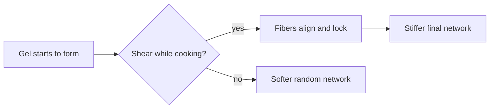

# Digest — 2026-09-28

*Curated America/New_York (ET). Prefer arXiv / open sources. Verified via arXiv Atom API and cond-mat.soft / active-matter keyword listings.*  
*Focus: roughly since the [2026-09-25](/latest/2026-09-25) digest (Fri→Mon weekend gap). Prior items are not re-listed as “new today.”*

<Callout type="warning">
Frame these as **frontier progress**, not finished technology. Applications remain mostly lab-scale.
</Callout>

## At a glance

*Diagram: original illustration of this digest's key idea (not from the papers).*

<PubImg
  src="/images/latest/2026-09-28-top-finds.svg"
  alt="Schematic of the top three finds in the 2026-09-28 digest: parts, driver, and result for each"
  caption="Today's top finds at a glance: what the parts are, what drives them, and what forms."
  credit="Illustrative schematic by Self-Assembly Lab, not data from the papers"
  width={900}
  height={330}
/>

## Highlights

### 1. Collective order reorganizes dissipation and powers an active engine
- **Authors:** Michael Riedl, Vincent Wattiez, Étienne Fodor, Jan Brugués, Francesco Romanò
- **Submitted:** 2026-09-25
- **Link:** https://arxiv.org/abs/2609.31059
- **Why newsworthy:** Minimal experiment with synthetic motile spheres yields a time-resolved power budget of collective motion. Ordering increases locomotion efficiency and reorganizes dissipation from internal friction toward external slip — enabling an active engine that extracts mechanical work from collective order.
- **Beginner hook:** When self-propelled beads get organized, how they burn energy changes — and that change can power a tiny engine.
- **Caveat:** Soft-matter experiment (lab-scale active matter).

### 2. Shear stress during self-assembly encodes stiffness of network-based materials
- **Authors:** Lens M. Dedroog, Olivier Deschaume, Carmen Bartic, Yovan de Coene, Erin Koos, Minne P. Lettinga, Mehdi Bouzid
- **Submitted:** 2026-09-24
- **Link:** https://arxiv.org/abs/2609.30520
- **Why newsworthy:** Shear during collagen gelation first aligns the network, then irreversibly boosts the elastic modulus if stress is held to maturation. Simulations point to orientation plus permanent-contact topology; rigidity percolation suggests a distinct universality class from quiescent gels. Late Thu submission missed by the Fri digest.
- **Beginner hook:** How hard you pull on a gel while it cooks can permanently decide how stiff it becomes.
- **Caveat:** Experiment + simulation — we propose only dry discussion/drawing follow-ons, not wet collagen chemistry.

### 3. Shape enantiomerism in semi-rigid polymer liquid crystals
- **Authors:** S. Biswas, W. S. Fall, H. H. Wensink
- **Submitted:** 2026-09-25
- **Link:** https://arxiv.org/abs/2609.31143
- **Why newsworthy:** Achiral semi-rigid polymers can adopt weakly helical conformations of either handedness. Theory + MD show crowding-induced stiffening and pronounced enantiomeric shapes without spontaneous global chiral symmetry breaking; weak vs strong enantiomerism crossover near persistence length ≈ 3× contour length.
- **Beginner hook:** Flexible rods can wiggle into temporary left/right twists even when the overall fluid stays racemic.
- **Caveat:** Theory + simulation.

### 4. Realignment of ferroelectric nematic by photoinduced electric field
- **Authors:** Sathyanarayana Paladugu, Oleksandr Kurochkin, Ruslan Kravchuk, Mykola Kravets, Volodymyr Sashuk, Bijaya Basnet, Vassili G. Nazarenko, Sergij V. Shiyanovskii, Oleg D. Lavrentovich
- **Submitted:** 2026-09-25
- **Link:** https://arxiv.org/abs/2609.30673
- **Why newsworthy:** Low-power light creates an intrinsic electric field that realigns a ferroelectric nematic (NF) between ITO electrodes — strong enough for NF, too weak for ordinary paraelectric nematics used in LCDs.
- **Beginner hook:** A special liquid crystal lets dim light steer molecules the way a display voltage usually does.
- **Caveat:** Soft-matter experiment (lab LC / optics).

### 5. Emergence of Nanoscale Modulation in Liquid Crystals as a Result of Short-Range Order Parameter Condensation
- **Authors:** E. I. Kats
- **Submitted:** 2026-09-25
- **Link:** https://arxiv.org/abs/2609.30916
- **Why newsworthy:** Landau note on twist-bend nematics: nanoscale heliconical order without molecular chirality arises from condensation of a short-range orientational order parameter at finite wave vector (not merely Frank softening). de Gennes analogy; fluctuations → weakly first order; extra Goldstone mode.
- **Beginner hook:** A “hidden” local order can wake up inside an already-ordered liquid crystal and lock into a tiny corkscrew.
- **Caveat:** Theory note.

### Stretch
- **Vertebraic soft robotic tail pressure predictive control** (2026-09-24): https://arxiv.org/abs/2609.30479
- **Paper-stack trampoline / acoustic restitution** (2026-09-25): https://arxiv.org/abs/2609.31213
- **Rubble-pile asteroid bonded-particle reaccumulation** (2026-09-25): https://arxiv.org/abs/2609.30903
- **Geometric difference families / DNA-origami GOCs** (2026-09-24): https://arxiv.org/abs/2609.29202

---

## Safe classroom / discussion follow-ons

1. **Paper-stack bounce demo:** Drop a small hard ball from a fixed height onto printer-paper stacks of different sheet counts (e.g. 1, 10, 50, ~60) and compare bounce height (inspired by arXiv:2609.31213). Dry materials only — discuss why “more cushion” is not always “less bounce.”
2. **Ordered vs disordered “engine” sketch:** Sketch random vs aligned self-propelled dots and annotate where energy might go (internal rubbing vs pushing the surroundings) (inspired by arXiv:2609.31059). Pencil/paper or whiteboard; no chemistry.

---

*Corpus mirror: `/workspace/self-assembly-corpus/digests/2026-09-28.md`.*
