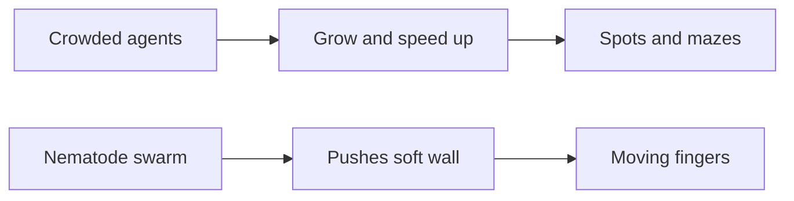

# Digest — 2026-09-29

*Curated America/New_York (ET). Prefer arXiv / open sources. Verified via arXiv Atom API and cond-mat.soft / active-matter keyword listings.*  
*Focus: roughly since the [2026-09-28](/latest/2026-09-28) digest (Mon→Tue). Prior items are not re-listed as “new today.”*

<Callout type="warning">
Frame these as **frontier progress**, not finished technology. Applications remain mostly lab-scale.
</Callout>

## At a glance

*Diagram: original illustration of this digest's key idea (not from the papers).*

<PubImg
  src="/images/latest/2026-09-29-top-finds.svg"
  alt="Schematic of the top three finds in the 2026-09-29 digest: parts, driver, and result for each"
  caption="Today's top finds at a glance: what the parts are, what drives them, and what forms."
  credit="Illustrative schematic by Self-Assembly Lab, not data from the papers"
  width={900}
  height={330}
/>

## Highlights

### 1. Active matter within flexible boundaries: T. aceti nematodes
- **Authors:** Christina M. Ceballos, Matthew S. Mizuhara, Mykhailo Potomkin, Anton Peshkov
- **Submitted:** 2026-09-26
- **Link:** https://arxiv.org/abs/2609.32945
- **Why newsworthy:** Synchronized vinegar-eel nematodes push a pliable liquid–liquid–gas border into periodic deformations and a new multi-protrusion state (oscillate, rotate, merge, split). Model + analytics for active matter at flexible interfaces.
- **Beginner hook:** Crowds of tiny wigglers can push a soft wall into moving “fingers.”
- **Caveat:** Soft-matter / biophysics experiment (not a classroom culture).

### 2. Quorum sensing with density-enhanced motility and size regulation
- **Authors:** Itay Azizi
- **Submitted:** 2026-09-28
- **Link:** https://arxiv.org/abs/2609.35085
- **Why newsworthy:** Agents that enlarge and speed up when local density exceeds global density form spots, holes, bands, and labyrinths; pattern length scale set mainly by the sensing radius.
- **Beginner hook:** Get bigger and faster when crowded, and the crowd can draw spots and mazes.
- **Caveat:** Simulation / theory.

### 3. Active 3D weaves for load-bearing and damage-resilient locomotion
- **Authors:** Guowei Wayne Tu, Evgueni T. Filipov
- **Submitted:** 2026-09-26
- **Link:** https://arxiv.org/abs/2609.32099
- **Why newsworthy:** Modular 3D woven shells combine axial load-bearing stiffness, bending compliance for actuation, and crush resilience. Five robots; carry ~70× self-weight and keep working after extreme compression.
- **Beginner hook:** Basket-weave logic can make a robot shell bendy for walking and stiff for hauling.
- **Caveat:** Soft-robotics / materials experiment (lab-scale).

### 4. Cell division sets a universal flow geometry in cell layers
- **Authors:** Tianxiang Ma, Lasse Bonn, Valeriia Grudtsyna, Nigar Abbasova, Martin Cramer Pedersen, Nuno A. M. Araujo, Amin Doostmohammadi
- **Submitted:** 2026-09-28
- **Link:** https://arxiv.org/abs/2609.34631
- **Why newsworthy:** Epithelial vortical-interface flow geometry (percolation / conformal hallmarks) is controlled by cell division via geometric and mechanical flexibility of the cell–cell network.
- **Beginner hook:** Who divides can decide whether a living sheet keeps its special swirl geometry.
- **Caveat:** Soft-matter / biophysics experiment.

### 5. Domain growth in lipid membranes and the budding instability
- **Authors:** Jean Wolff, Fabrice Thalmann, Carlos Marques, David Andelman, Haim Diamant, Shigeyuki Komura
- **Submitted:** 2026-09-26
- **Link:** https://arxiv.org/abs/2609.32951
- **Why newsworthy:** Conserved TDGL domain growth crosses \(D\sim t^{1/3}\) to \(D\sim t^{1/2}\) before finite-size saturation; time-dependent line tension and budding criteria analyzed.
- **Beginner hook:** A lipid patch grows with clock-like rules and may want to pinch into a bud.
- **Caveat:** Theory / numerics.

### 6. Odd stochastic density functional theory
- **Authors:** Yael Avni, Michel Fruchart, David Martin, Tali Khain, Vincenzo Vitelli
- **Submitted:** 2026-09-25
- **Link:** https://arxiv.org/abs/2609.32080
- **Why newsworthy:** Extends SDFT to a chiral overdamped limit relevant to magnetized electrolytes and chiral active matter (“odd SDFT”). Late Fri submission missed by the Mon digest.
- **Beginner hook:** A density-field language for active fluids with a built-in twist.
- **Caveat:** Theory.

### Stretch
- **Charge-regulated nanoparticle interactions** (2026-09-27): https://arxiv.org/abs/2609.33793
- **Mechanical cell clustering via ECM** (2026-09-25): https://arxiv.org/abs/2609.31860
- **Harmonic Theory of Behavior / Couzin** (2026-09-27): https://arxiv.org/abs/2609.33896
- **Fish-school positional choice (biohybrid)** (2026-09-28): https://arxiv.org/abs/2609.35554
- **LdG anchoring-induced tilt modes** (2026-09-28): https://arxiv.org/abs/2609.35127

---

## Safe classroom / discussion follow-ons

1. **Soft-wall crowd sketch:** Draw a flexible dashed boundary around self-propelled arrows and annotate where synchronized pushing might make the wall bulge into fingers that merge/split (inspired by arXiv:2609.32945). Pencil/paper only — no live animals.
2. **Paper-strip “woven corner” model:** Interlace stiff paper/cardstock strips into a small 3D corner and compare top-loading vs sideways bending (inspired by arXiv:2609.32099). Dry craft only — no motors or heat.

---

*Corpus mirror: `/workspace/self-assembly-corpus/digests/2026-09-29.md`.*
