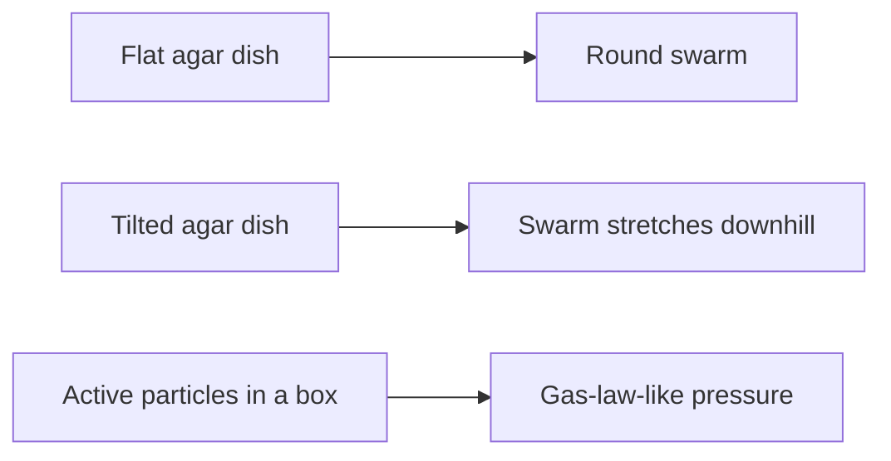

# Digest — 2026-10-02

*Curated America/New_York (ET). Prefer arXiv / open sources. Verified via arXiv Atom API and cond-mat.soft / active-matter / self-assembly keyword listings.*  
*Focus: roughly since the [2026-10-01](/latest/2026-10-01) digest (Thu→Fri). Prior items are not re-listed as “new today.”*

<Callout type="warning">
Frame these as **frontier progress**, not finished technology. Applications remain mostly lab-scale.
</Callout>

## At a glance

*Diagram: original illustration of this digest's key idea (not from the papers).*

<PubImg
  src="/images/latest/2026-10-02-top-finds.svg"
  alt="Schematic of the top three finds in the 2026-10-02 digest: parts, driver, and result for each"
  caption="Today's top finds at a glance: what the parts are, what drives them, and what forms."
  credit="Illustrative schematic by Self-Assembly Lab, not data from the papers"
  width={900}
  height={330}
/>

## Highlights

### 1. Inclined surfaces bias bacterial swarming expansion and edge organization
- **Authors:** Pengxi Gu, Zixiang Lin, Hui Ren, Jin Zhu, Anqi Li, Omar Said, Weijie Chen, Zijie Qu
- **Submitted:** 2026-10-01
- **Link:** https://arxiv.org/abs/2610.01281
- **Why newsworthy:** Gravity/inclination non-monotonically tunes *Enterobacter* swarm expansion and downhill-biased morphology; up-facing vs down-facing agar sides differ at the same tilt magnitude (thin-film model separates tangential redistribution from normal pressure effects).
- **Beginner hook:** Tipping the Petri dish changes how far — and in what shape — a living swarm frontier grows.
- **Caveat:** Agar-surface bacterial experiment + thin-film model (not a classroom wet demo).

### 2. Ideal gas of active particles in a box
- **Authors:** Siran Li, Ralf Eichhorn, Lennart Dabelow
- **Submitted:** 2026-10-01
- **Link:** https://arxiv.org/abs/2610.01287
- **Why newsworthy:** Ideal active gas law for noninteracting particles in a finite box — exact for 1D RTPs, analytic for AOUPs, numeric for ABPs/higher-D RTPs — enabling macroscopic thermo without tracking every propulsion kick.
- **Beginner hook:** Self-propelled “gases” get their own ideal-gas-style rule for pressure and volume.
- **Caveat:** Theory + numerics.

### 3. SupraTITO: generative MD for peptide self-assembly
- **Authors:** Weilong Chen, Nuno Costa, Julija Zavadlav
- **Submitted:** 2026-10-01
- **Link:** https://arxiv.org/abs/2610.01381
- **Why newsworthy:** Transferable GenMD with sequence/topology/geometry-conditioned transfer operators; generalizes across held-out dipeptides and concentrations while resolving assembly structures and dynamics.
- **Beginner hook:** A learned fast-forward explores how peptide sequences assemble without waiting for every atom wiggle.
- **Caveat:** Computational GenMD — not a wet lab protocol.

### 4. Microscopic origin of the chiral pressure in a two-dimensional fluid
- **Authors:** Francisco Vega Reyes
- **Submitted:** 2026-10-01
- **Link:** https://arxiv.org/abs/2610.02003
- **Why newsworthy:** Antisymmetric chiral pressure from a parity-breaking pseudo-scalar / rotational viscosity, present even in a homogeneous Quiescent Chiral State.
- **Beginner hook:** A quiet, uniform chiral soup can still carry a sideways twist pressure.
- **Caveat:** Kinetic theory / micropolar hydrodynamics (PRE Letter submission).

### 5. Scalar field theory for (chiral) active Brownian particles — bottom-up derivation
- **Authors:** Yuta Kuroda, Thomas Speck
- **Submitted:** 2026-10-01
- **Link:** https://arxiv.org/abs/2610.01672
- **Why newsworthy:** RG / pressure-expansion bridge from interacting ABPs to fourth-order scalar field theories; chiral ABPs add two odd continuum terms.
- **Beginner hook:** Particle-level chirality shows up as odd terms in the big-picture continuum equations.
- **Caveat:** Long-form continuum derivation.

### Stretch
- **Active-Matter Battery** (2026-09-30): https://arxiv.org/abs/2610.00428
- **Enhanced LW fluctuations in active crystals** (2026-09-30): https://arxiv.org/abs/2610.00634
- **Spherical crystal / quasicrystal nucleation** (2026-10-01): https://arxiv.org/abs/2610.00931
- **Bio-inspired rigid-soft finger Jacobian** (2026-10-01): https://arxiv.org/abs/2610.01668

---

## Safe classroom / discussion follow-ons

1. **Tilted-swarm storyboard:** Sketch a circular colony on flat agar, then the same swarm on a gentle downhill tilt with a stretched tip; annotate where edge motion might slow (inspired by arXiv:2610.01281). Pencil/paper only — no bacterial culture.
2. **Active ideal-gas cartoon:** Draw self-propelled arrows in a box vs Brownian dots; discuss why wall pressure may need a different rule than PV = nRT (inspired by arXiv:2610.01287). Paper/pencil only.

---

*Corpus mirror: `/workspace/self-assembly-corpus/digests/2026-10-02.md`.*
