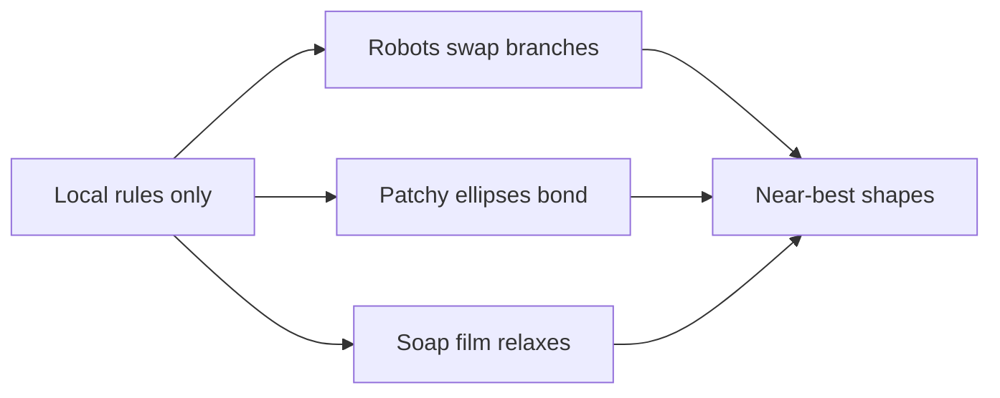

# Digest — 2026-10-07

*Curated America/New_York (ET). Prefer arXiv / open sources. Verified via arXiv "new" listings (cond-mat.soft, cs.RO, cs.MA, cond-mat.mtrl-sci, physics.bio-ph, physics.chem-ph), arXiv abstract pages, and Crossref.*  
*Focus: roughly since the [2026-10-06](/latest/2026-10-06) digest; arXiv submissions from 2026-10-03 to 2026-10-06 announced 2026-10-07.*

<Callout type="warning">
Frame these as **frontier progress**, not finished technology. Applications remain mostly lab-scale or simulation-scale.
</Callout>

## At a glance

*Diagram: original illustration of this digest's key idea (not from the papers).*

<PubImg
  src="/images/latest/2026-10-07-top-finds.svg"
  alt="Schematic of the top three finds in the 2026-10-07 digest: parts, driver, and result for each"
  caption="Today's top finds at a glance: what the parts are, what drives them, and what forms."
  credit="Illustrative schematic by Self-Assembly Lab, not data from the papers"
  width={900}
  height={330}
/>

## Highlights

### 1. Towards decentralized formation of minimum-length communication networks using robot swarms
- **Authors:** Genki Miyauchi, Mohamed S. Talamali, Julian Rau, Roderich Groß
- **Date / venue:** arXiv preprint, submitted 2026-10-05 (cs.RO)
- **Link:** https://arxiv.org/abs/2610.07320
- **Tidbits:**
  - Robots link up into a chain-and-branch network that relays messages between faraway spots, with no central planner and no GPS.
  - Each robot only talks to neighbors, swapping which branch it belongs to and shifting position to shorten the total network length.
  - The authors prove every local swap keeps the network connected and strictly shortens it.
  - In simulation and on physical robots, the networks came out close to the length of the ideal "Steiner tree" a central computer would calculate.
  - Robots that aren't needed as relays are freed up for other jobs, and the network adapts when targets move.
- **Why a beginner should care:** It is a clean example of self-organization: simple local rules produce a near-optimal global shape, the same idea that runs through molecular self-assembly.
- **Media:** Simulation and physical-robot experiment figures in the preprint.
- **Caveat:** Small-scale experiments; uses like cave or planetary exploration are motivation, not demonstrated deployments.

### 2. Networks of triblock ellipses: from kagome order to disordered porous networks
- **Authors:** Susanne Wagner, Gerhard Kahl, Carina Karner
- **Date / venue:** arXiv preprint, submitted 2026-10-06 (cond-mat.soft)
- **Link:** https://arxiv.org/abs/2610.08522
- **Tidbits:**
  - The particles are flat ellipses with a sticky patch at each end, simulated on a surface.
  - They can assemble into a kagome lattice, a pattern of triangles and hexagonal holes, or into messier porous networks.
  - How ordered the result is depends on how fast the system is cooled and how crowded it is.
  - Unlike sticky-patch spheres, which usually crystallize in two steps, the ellipses crystallize in one step, so shape changes the assembly pathway.
  - The team counts pores by turning the bond network into a graph and walking around its faces.
- **Why a beginner should care:** It shows the two main knobs of colloidal self-assembly, particle shape and where particles stick, working together to make porous materials.
- **Caveat:** Simulation only.

### 3. Design principles for programmable topological soft networks
- **Authors:** Andrea Bonato, Davide Marenduzzo, Enzo Orlandini
- **Date / venue:** arXiv preprint, submitted 2026-10-06 (cond-mat.soft)
- **Link:** https://arxiv.org/abs/2610.08298
- **Tidbits:**
  - Most gels are held together by fixed crosslinks; "topological gels" are held together by rings threaded through each other and polymers tangled like chain mail.
  - Letting the tangles slide lets the material relax stress while staying in one piece; pinning them makes it store stress and eventually yield.
  - Squeezing the system into thin slabs or tubes during assembly turns a 3D gel into a 2D net or a ring-like 1D structure.
  - If polymers can cut and reconnect, the network can be "rewritten" after it forms, ending up mostly as simple pairwise links.
- **Why a beginner should care:** It treats connectivity itself as something you can program, a big idea behind adaptive and self-healing materials, and it connects to real biological networks like kinetoplast DNA.
- **Caveat:** Molecular dynamics simulation.

### 4. Nonlinear curvature-free periodic folding in origami via symmetry classification of linear modes
- **Authors:** Nan Cheng, Leon M. Kamp, Yanxin Feng, Wenqian Sun, Katia Bertoldi, D. Zeb Rocklin
- **Date / venue:** arXiv preprint, submitted 2026-10-06 (cond-mat.soft)
- **Link:** https://arxiv.org/abs/2610.08635
- **Tidbits:**
  - The Miura-ori fold can collapse flat while keeping its repeating pattern, but most repeating crease patterns curl into tube-like shapes instead.
  - Using group theory, the authors show a sheet's symmetry type largely decides which ways it can fold.
  - They give a symmetry-plus-topology test for whether a sheet can keep folding smoothly well beyond tiny motions.
  - The classification becomes a recipe for quickly designing new foldable sheets with chosen properties.
- **Why a beginner should care:** Self-folding origami is one route to programmable matter, and this shows that symmetry, which students can see and count, predicts what a sheet can do.
- **Caveat:** Theory and design rules; uses in deployable structures are proposed, not built here.

### 5. Fluctuating chemically active droplets
- **Authors:** Guido L. A. Kusters, Noah Ziethen, Michael E. Cates, David Zwicker
- **Date / venue:** arXiv preprint, submitted 2026-10-06 (cond-mat.soft)
- **Link:** https://arxiv.org/abs/2610.08154
- **Tidbits:** Droplets that phase-separate and also run chemical reactions can hold a set size instead of merging forever. Adding realistic random noise, the authors match theory to field simulations and find that the same reactions that control size also make new droplets harder to nucleate.
- **Why a beginner should care:** Living cells use droplets like these (condensates) to organize themselves without membranes.
- **Caveat:** Theory and simulation.

### Stretch (theory / adjacent)
- **Efficient searches for low-energy structures in clusters with thousands of particles: the Thomson problem** (Paolo Amore, David J. Wales, 2026-10-06): https://arxiv.org/abs/2610.08122, finding the best way to arrange thousands of repelling charges on a sphere, relevant to virus shells and colloidal "spherical crystals."
- **When robots crash: optimal asynchronous gathering at Weber meeting nodes** (2026-10-03): https://arxiv.org/abs/2610.06939, how identical robots can still meet at the best spot when some of them fail.
- **Spontaneous motion generates reversible nonreciprocity in an achiral active elastic ring** (2026-10-05): https://arxiv.org/abs/2610.07050
- **Nine trials to recover: a benchmark for soft-robot damage adaptation** (2026-10-06): https://arxiv.org/abs/2610.07616, simulated voxel soft robots relearning to move after parts are removed.
- **Morphology-directed assembly and chiroptical properties of chiral gold nanorods** (ACS Applied Nano Materials, 2026-10-05): https://doi.org/10.1021/acsanm.6c03878
- **Passive gravity gradient capture during in-space assembly and manufacturing** (AIAA Journal, 2026-10-05): https://doi.org/10.2514/1.j066569

---

## Safe classroom / discussion follow-ons

1. **Soap-film shortest networks (inspired by item 1):** Push 3 to 5 pins or short dowels between two clear plastic sheets, dip the frame in dish-soap solution, and lift it out. The soap film shrinks to a near-shortest network joining the pins, meeting at 120° angles, the same Steiner-tree shape the robot swarm approximates. Compare with networks students draw by hand and measure with a ruler. Only dish soap, water, and plastic.
2. **Fold and count symmetry (inspired by item 4):** Fold a Miura-ori sheet from printer paper (many free crease-pattern templates exist) and a plain accordion fold. Does each collapse flat while staying flat-ish, or curl? List the mirror lines and rotations each pattern has, and discuss why symmetry might limit how it can move.

## Key idea of the day

Self-organization often finds near-best shapes using only local rules: robots shortening a relay network, patchy particles finding a kagome lattice, and soap films finding Steiner trees are all versions of that idea. The field is still early, and most results here are simulations or small lab demos.
