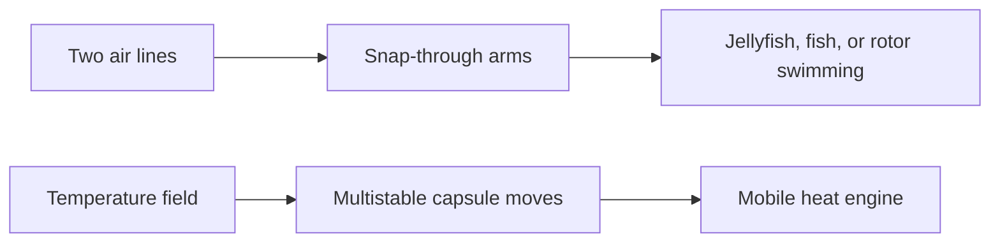

# Digest — 2026-10-09

*Curated America/New_York (ET). Prefer arXiv / open sources. Verified via arXiv API (cond-mat.soft, cs.RO, keyword searches), arXiv abstract pages, Crossref, and publisher pages (Science Advances, Scientific Reports).*  
*Focus: roughly since the [2026-10-08](/latest/2026-10-08) digest; arXiv submissions announced 2026-10-08 plus journal articles published 2026-10-08 to 2026-10-09.*

<Callout type="warning">
Frame these as **frontier progress**, not finished technology. Applications remain mostly lab-scale or simulation-scale.
</Callout>

## At a glance

*Diagram: original illustration of this digest's key idea (not from the papers).*

<PubImg
  src="/images/latest/2026-10-09-top-finds.svg"
  alt="Schematic of the top three finds in the 2026-10-09 digest: parts, driver, and result for each"
  caption="Today's top finds at a glance: what the parts are, what drives them, and what forms."
  credit="Illustrative schematic by Self-Assembly Lab, not data from the papers"
  width={900}
  height={330}
/>

## Highlights

### 1. Minimal-Actuation Feather Star–Inspired Soft Swimmers for Multimodal 3D Maneuverability
- **Authors:** Haitao Qing, Yuanhang Zhu, Jiacheng Guo, Caizhi Zhou, Haoze Sun, Haibo Dong, Daniel Quinn, Jie Yin
- **Date / venue:** Science Advances, published 2026-10-09
- **Link:** https://doi.org/10.1126/sciadv.aeg9211
- **Tidbits:**
  - Feather stars (crinoids) swim with many flexible arms; this soft robot copies that idea with four ribbon arms on a soft pneumatic body.
  - Only **two** air channels produce three switchable gaits: jellyfish-like pulsing (up/down/hover), fishlike steering, and rotor spinning for reorientation.
  - The trick is "mechanical intelligence": monostable snap-through in the arms and frame turns simple pressure pulses into large, fast flaps.
  - Peak vertical speed about 1.64 body lengths per second; rotor mode up to about 90° per second.
  - Lab demos include picking up metal screws with soft magnets, hooking plastic waste (including two robots cooperating), and carrying a tiny camera into a tube.
- **Why a beginner should care:** It shows how putting smarts into shape and snap-through can replace a pile of actuators — a core programmable-matter / soft-robot idea.
- **Media:** High-speed swimming footage, PIV vortex maps, and CFD in the paper/supplement.
- **Caveat:** Still tethered pneumatics and open-loop control in a tank; real ocean autonomy is future work.

### 2. Magnetorheological Elastomers for Soft Robotics
- **Authors:** Jakub Bernat, Weronika Hein, Piotr Gajewski, Agnieszka Marcinkowska, Wiktoria Ramocka, Tamara J. Bednarchuk, Karol Synoradzki
- **Date / venue:** Scientific Reports, published 2026-10-09 (CC BY-NC-ND 4.0)
- **Link:** https://doi.org/10.1038/s41598-026-74334-5
- **Tidbits:**
  - Soft robots that stiffen or move under magnetic fields need trustworthy material numbers, but comparable datasets have been scarce.
  - The team measured 48 silicone-based recipes (7 neat elastomers + 41 magnetic composites) under one protocol: mechanics, magnetism, density, hardness, and Ogden hyperelastic fits.
  - Fillers were carbonyl iron powder (CIP), Fe–Si–Al flakes, or magnetite at 10–70 wt%.
  - CIP gave the best stiffness–stretch compromise (elongation at break still >300% at 70 wt%); flake filler stiffened most but cut stretchability.
  - Saturation polarization rose with filler content, up to 1.42 T for 70 wt% CIP (relative permeability up to ~3.5).
- **Why a beginner should care:** Designing magnetic soft matter is half chemistry, half spreadsheet — this open dataset is a rare shared starting point.
- **Caveat:** Materials characterization and FEM checks, not a finished magnetic robot; formulations use lab silicones and iron powders (not a home experiment).

### 3. Autonomous Thermodynamic Cycles via Robotic Mobility and Sensing
- **Authors:** Sofia Kuperman, Ezra Ben-Abu, Yaron Veksler, Anna Zigelman, Sefi Givli, Amir D. Gat
- **Date / venue:** arXiv preprint, submitted 2026-10-08 (cond-mat.soft; also cs.RO)
- **Link:** https://arxiv.org/abs/2610.11667
- **Tidbits:**
  - Ordinary heat engines sit between two fixed hot and cold spots; this work asks what if the "engine" can *walk* to where the temperature gradient is.
  - Multistable gas-filled capsules circulate through a spatial thermal gradient, acting as a mobile heat engine that harvests and stores energy.
  - Models link capsule-scale internal-energy jumps to the robot's large-scale navigation path.
  - Experiments couple robotic mobility and sensing so the machine can run thermodynamic cycles by choosing where to go.
- **Why a beginner should care:** Self-assembly and soft robots often live in uneven environments — here locomotion itself becomes part of the energy cycle.
- **Caveat:** Lab proof-of-concept with engineered capsules and controlled gradients; not a free-ranging outdoor energy harvester.

### 4. Beyond Dry Flocking: Shape-Dependent Hydrodynamic Alignment
- **Authors:** Abhishek Thakur, Taniya Khatun, Soumyadeep Kundu, Nitin Kumar, P. Parmananda, Anirban Sain
- **Date / venue:** arXiv preprint, submitted 2026-10-07 (cond-mat.soft)
- **Link:** https://arxiv.org/abs/2610.10709
- **Tidbits:**
  - Classic "dry" flocking models ignore the fluid between agents except as a momentum sink.
  - Here, partially camphor-coated triangular paper boats self-propel on water (Marangoni swimmers); the fluid feedback depends on boat shape.
  - Up to thirty boats show a disorder-to-order transition, then an unusual re-entrant order-to-disorder as density rises.
  - A reaction–diffusion model of the camphor field coupled to boat motion reproduces both transitions.
- **Why a beginner should care:** It is tabletop active matter — shape + chemistry + fluid — and you can see collective order emerge by eye.
- **Caveat:** Confined dish experiments; "wet" hydrodynamic alignment is specific to this Marangoni setup.

### 5. A Reconfigurable Fabric-Based Pneumatic Actuator with Button-Fastened Constraint Modules
- **Authors:** Kentaro Kimura, Hiroki Ishizuka, Yusuke Sakaue, Sei Ikeda, Osamu Oshiro
- **Date / venue:** arXiv preprint, submitted 2026-10-08 (cs.RO / soft robotics)
- **Link:** https://arxiv.org/abs/2610.11054
- **Tidbits:**
  - Soft air muscles usually lock in one behavior (bend vs expand) when they are made.
  - This design uses a buttoned textile sleeve: snap on low-stretch fabric patches to switch among isotropic expansion, contraction, bending, and twisting — no redesign, no tools.
  - An attachable capacitive fabric tactile sensor can sit anywhere on the surface for task-dependent touch sensing.
  - Reported performance includes elongation ratio ~1.2, ~60° bend, and ~90° twist under the tested pressures.
- **Why a beginner should care:** Reconfigurable "constraints" are a soft-robot cousin of modular self-assembly — change the attachments, change the motion.
- **Caveat:** Bench actuator study; integration into a full robot is left open.

### Stretch (theory / adjacent)
- **Active nematics with integer defects in active colloids of ellipsoidal rollers** (Fan, Liu, Wu, Song, Tian, Chen, Zhang; Chinese Physics B, 2026-10-09): https://doi.org/10.1088/1674-1056/aeb247 — transversely driven Quincke rollers prefer +1 / −1 defects instead of the usual half-integer ones.
- **Controlling transitions between nonequilibrium states through active bath engineering** (Boriskovsky et al., 2026-10-08): https://arxiv.org/abs/2610.11831 — speed up switches between active steady states by tuning only the noise correlation time of an engineered bath.
- **Elastic polymer networks of exceptional strength by deconcentrating tension** (Zhou, Li, Chen, Bao, Suo, 2026-10-08): https://arxiv.org/abs/2610.11837 — entanglements and prestretched interpenetrating nets raise hydrogel strength from ~0.05 MPa toward ~10 MPa with low hysteresis.
- **Polarization of the Drosophila oocyte by active cortical exchange** (Firouznia et al., 2026-10-07): https://arxiv.org/abs/2610.10916 — living self-organization: position-dependent cortical binding/unbinding plus cytoplasmic diffusion builds the egg's front–back polarity.

---

## Safe classroom / discussion follow-ons

1. **Snap-arm paper flapper (inspired by item 1):** Cut a thin strip of cardstock, bow it slightly, and tape the ends to a base so it sits as a shallow arch. Press the middle until it snaps through, then release so elastic energy snaps it back. Discuss how a monostable "snap" amplifies a small push into a big flap — the same idea the feather-star robot uses, without any air pumps or chemicals.
2. **Camphor / soap boat flock (inspired by item 4):** Float several small cardboard triangles in a shallow dish of water. Touch a tiny bit of dish soap (or a camphor scrap, if available in a supervised setting) to the rear edge of each boat and watch them scoot. Vary boat shapes and crowding; talk about when they look ordered vs chaotic. Water + cardboard + soap only; rinse and dispose of soapy water down the drain.

## Key idea of the day

When the body can snap, stretch, or steer itself, a few simple controls (two air lines, a magnetic filler recipe, a path through a temperature field) unlock many behaviors. Today's soft swimmers, magnetic silicones, and wet flocks all push that mechanical-intelligence theme — still mostly lab tanks and benchtops, not everyday gadgets yet.
