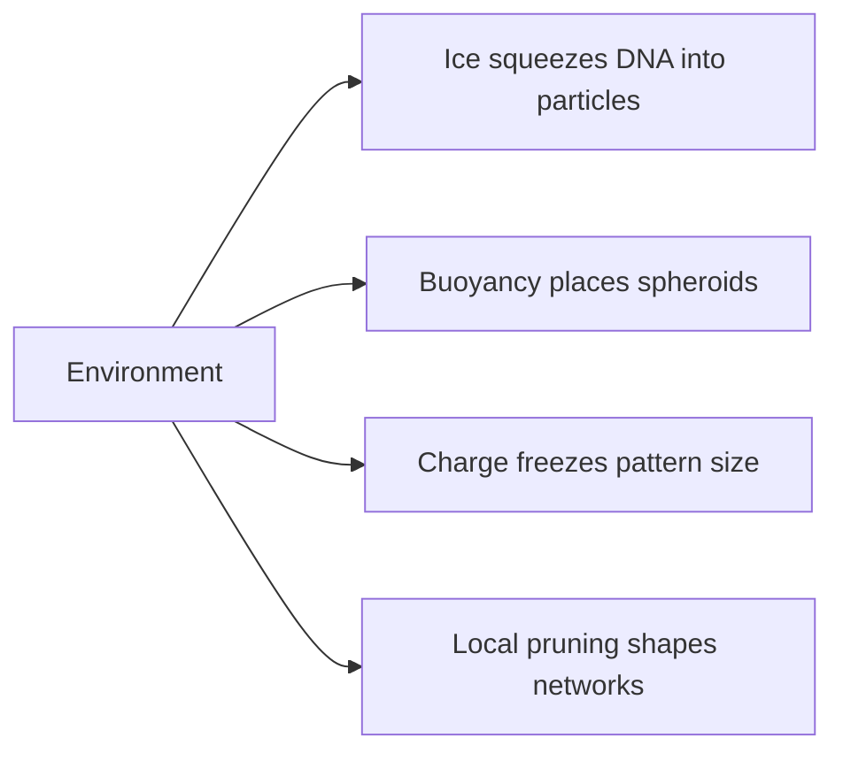

# Digest — 2026-10-12

*Curated America/New_York (ET). Prefer arXiv / open sources. Verified via arXiv API and the Monday 2026-10-12 `/new` listings (cond-mat.soft, cs.RO, keyword searches), arXiv abstract pages, Crossref, and publisher pages (Nature Communications, Science Advances, ACS Macro Letters, Small, ACM THRI).*  
*Focus: roughly since the [2026-10-09](/latest/2026-10-09) digest (weekend + Monday); arXiv submissions from 2026-10-08 to 2026-10-09 announced through Monday 2026-10-12, plus journal articles published 2026-10-09 to 2026-10-12.*

<Callout type="warning">
Frame these as **frontier progress**, not finished technology. Applications remain mostly lab-scale or simulation-scale.
</Callout>

## At a glance

*Diagram: original illustration of this digest's key idea (not from the papers).*

<PubImg
  src="/images/latest/2026-10-12-top-finds.svg"
  alt="Schematic of the top three finds in the 2026-10-12 digest: parts, driver, and result for each"
  caption="Today's top finds at a glance: what the parts are, what drives them, and what forms."
  credit="Illustrative schematic by Self-Assembly Lab, not data from the papers"
  width={900}
  height={330}
/>

## Highlights

### 1. Freezing-Induced Solid–Liquid Microphase Separation for Self-Assembly of Functional Nucleic Acid Nanoparticles
- **Authors:** Tao Zeng, Jiahui Fang, Jian Hao, Xiuping Cao, Shiqing Li, Shiyan Bai, Jiaying Chen, Chunsen Li, Huanghao Yang, Chunhua Lu
- **Date / venue:** Nature Communications, published 2026-10-09 (CC BY-NC-ND 4.0)
- **Link:** https://doi.org/10.1038/s41467-026-78488-8
- **Tidbits:**
  - Inspiration: in cell nuclei, DNA wrapped with histones compacts into dense, solid-like chromatin.
  - Here, simply **freezing** a nucleic-acid solution does the squeezing: growing ice crystals push solutes together (freeze-concentration) and exert pressure at the ice–liquid front.
  - Single-stranded DNA, molecular beacons, siRNA, and plasmid DNA were all compressed into high-density states that self-assemble into nanoparticles.
  - Molecular dynamics simulations suggest rising concentration first links DNA into supramolecular chains, then stress at the advancing ice front orders and packs those chains into particles.
  - In breast cancer cell experiments, different particles detected miRNA-21, knocked down Bcl-2, showed antitumor effects (siPLK1), or expressed GFP.
- **Why a beginner should care:** It swaps chemical synthesis for a physical constraint — a freezer becomes the "assembly tool." That's a great example of environment-driven self-assembly.
- **Caveat:** Cell-culture results only; nucleic-acid nanomedicine is far from routine clinical use, and this is not a home or classroom wet protocol.

### 2. Arrested Phase Separation and Amorphous Patterns in Charged Binary Fluids
- **Authors:** Logan H. Grant, Ana Bensabat, Eva Pospivsilova (as listed on arXiv), Joost de Graaf, Alexander Morozov, Giuseppe Negro, Ciprian G. Pruteanu, Tyler N. Shendruk, Davide Marenduzzo
- **Date / venue:** arXiv preprint, submitted 2026-10-09 (cond-mat.soft)
- **Link:** https://arxiv.org/abs/2610.13748
- **Tidbits:**
  - Oil-and-water-style mixtures usually keep coarsening until they fully separate into two big regions.
  - Add charge, and screened electrostatic repulsion fights that tendency — phase separation gets "arrested" at a finite pattern size.
  - In 2D the team finds droplet and labyrinth (maze-like) phases; in 3D, droplets, concentric shells, and tubes.
  - Surprisingly, some *disordered* (amorphous) patterns reappear reproducibly from different starting conditions.
  - Free-energy estimates suggest those amorphous patterns may be truly stabilized by frustration, not just stuck mid-way.
- **Why a beginner should care:** Competing forces (attract vs repel) are one of the simplest recipes for self-assembled patterns with a built-in size.
- **Caveat:** Analytics + simulations; experimental confirmation in real charged fluids is still to come.

### 3. Self-Buoyant Cell-Spheroid Culture Programming Multi-Spheroid Assembly
- **Authors:** Yuanhang Xiang, Binqi Wei, Yueyang Sun, Weifeng Liu, Hui Zhao, Xiaojie Qin, Changfeng Zhu, Xinchun Li, Fan Yang
- **Date / venue:** Science Advances, published 2026-10-09
- **Link:** https://doi.org/10.1126/sciadv.aee3306
- **Tidbits:**
  - Spheroids are little balls of cells; fusing several into "assembloids" helps model tissues, but placing them precisely is hard.
  - Microbubbles create a cell-adhesive buoyancy interface so each droplet grows one floating spheroid — no magnetic, acoustic, or electric fields needed.
  - A quick droplet "kiss" between a top and bottom droplet transfers a spheroid by buoyancy in about one second.
  - Repeating those flash transfers along a droplet array builds programmable horizontal/vertical stacks of same or different spheroids ("buoyantoid" patterns).
  - The same moves allow parallel media exchange and drug dosing.
- **Why a beginner should care:** Buoyancy — the same physics that floats a boat — is used as a free, self-powered assembly force.
- **Caveat:** A lab tissue-engineering tool; biomedical uses (drug screening, precision medicine) are still prospective.

### 4. Efficient Transport Networks through Edge Pruning by Relative Resistance
- **Authors:** Mathieu Le Verge-Serandour, Viktor Vasilev, Lara Szeimies, Karen Alim
- **Date / venue:** arXiv preprint, submitted 2026-10-09 (physics.bio-ph; cross-listed cond-mat.soft, nlin.AO)
- **Link:** https://arxiv.org/abs/2610.13582
- **Tidbits:**
  - Living networks (think slime-mold tubes or leaf veins) adapt using local rules, without a global plan.
  - Rule used here: remove a link if its resistance is higher than the resistance of routing that flow through the rest of the network.
  - This redundancy measure depends on topology alone — no global objective and no specific inflow/outflow boundary conditions.
  - Repeated pruning yields sparse, loop-rich networks with low dissipation (energy loss).
- **Why a beginner should care:** A clean example of self-organization: one local "is this link redundant?" test sculpts an efficient whole.
- **Caveat:** Network model study; mapping it to a specific organism or engineered system is future work.

### 5. FallGown: A Soft Pneumatic Wearable Device for Fall Prevention
- **Authors:** Megan C. Coram, Haoran Lei, Steven H. Collins, Steve B. Cousins, Michelle Baldonado, Cynthia Sung, Allison M. Okamura
- **Date / venue:** arXiv preprint, submitted 2026-10-08 (cs.RO)
- **Link:** https://arxiv.org/abs/2610.12706
- **Tidbits:**
  - Walkers tie up the arms; exoskeletons can be rigid, bulky, and stigmatized — FallGown is a soft "skirt" of pressurized air pouches inside a fabric shell.
  - It can support the user's full body weight; it weighs 6.9 kg and packs to 0.051 m³.
  - Drag while walking was 7.24–20.8 N depending on floor and an optional rolling base; donning took under 2.5 minutes on average.
  - Single-user fall tests showed a size vs tipping-stability tradeoff; a 12-pouch, 1.4 m skirt with base frame prevented all falls except one mechanical-failure case.
  - Built-in pressure sensors read weight distribution, hinting at monitored exercise and adaptive support.
- **Why a beginner should care:** Soft robotics isn't only grippers — inflatable structures can carry a person's weight while staying gentle.
- **Caveat:** One test user and a research prototype; clinical safety studies with older adults would be needed.

### 6. The Value of Information and the Emergence of Communication in Evolved e-puck Robots
- **Authors:** Fernando Montes-Gonzalez
- **Date / venue:** arXiv preprint, submitted 2026-10-09 (cs.RO)
- **Link:** https://arxiv.org/abs/2610.13118
- **Tidbits:**
  - Two simulated e-puck robots must find a hidden "feeding zone" they can only detect by driving over it; each can emit a one-bit signal whose direction the other senses.
  - Controllers (GRU recurrent networks) are evolved; fitness counts only time spent on the food — communication is never rewarded directly.
  - Give the robots a compass to the food and signaling vanishes entirely.
  - Without a compass, different runs found different strategies: a referential signal, a permanent beacon, or no signal; the referential signal generalized best to larger arenas.
  - Hand-designed "innate reflexes" tended to hurt performance, and evolution steadily weakened them.
- **Why a beginner should care:** It shows communication in a swarm emerging *only when the information is worth something* — a neat, testable idea for collective robotics.
- **Media / code:** Code and data at https://github.com/ferdiex/easagru (archived at https://doi.org/10.5281/zenodo.23051976).
- **Caveat:** Two robots in a PyBullet simulation (validated against Webots), not a large physical swarm.

### Stretch (theory / adjacent)
- **Distributed harmonic-covariance feedback for hole closure in planar robot swarms** (Jitian Liu, Subhrajit Bhattacharya; 2026-10-08): https://arxiv.org/abs/2610.12637 — algebraic-topology signals (Hodge Laplacian) let a swarm find and close coverage holes with local computations; in a 15 s numerical demo all holes close by 9.9 s.
- **A hinged honeycomb with zero bulk modulus retaining more than four-fifths of its constituent's shear modulus** (Chun-Teh Chen; 2026-10-08): https://arxiv.org/abs/2610.11280 — a "dilational" metamaterial that freely grows/shrinks but resists shape change; proven retained shear modulus > 0.8528 of the base solid.
- **How fluctuations control chiral symmetry breaking in reacting mixtures of chiral molecules** (Leonardo Silva-Dias, Christoph A. Weber; 2026-10-09): https://arxiv.org/abs/2610.13523 — small-population noise can pick, and even flip, which handedness wins in autocatalytic chemistry.
- **An all-transistor physical-learning transformer can be trained to perform in-context learning** (Michael C. Abbott, Benjamin B. Machta; 2026-10-08): https://arxiv.org/abs/2610.12571 — simulated MOSFET circuits that learn attention-style tasks locally, extending "physical learning" beyond perceptron-like networks.
- **Homochiral evolution from self-assembly of chiral block copolymers** (Sheng-Wei Shao, Rong-Ming Ho; ACS Macro Letters Viewpoint, 2026-10-12, CC BY 4.0): https://doi.org/10.1021/acsmacrolett.6c00449 — how molecular chirality grows into helical and alternating-gyroid self-assembled phases.
- **Supramolecular assembly of photoresponsive molecular amphiphile for functional soft matter** (Shuangshuang Meng, Franco King-Chi Leung; Small review, 2026-10-12): https://doi.org/10.1002/smll.76172 — light-switchable building blocks that assemble from molecules up to macroscopic soft scaffolds in water.
- **Leveraging passive compliance of soft robotics for physical human-robot collaborative manipulation** (Cordon, Moss, Killpack, Salmon; ACM THRI, 2026-10-11): https://doi.org/10.1145/3848623 — a large pneumatic continuum arm on a mobile base co-carries a long object with a person, comparing against human–human teams.

---

## Safe classroom / discussion follow-ons

1. **Freezer color squeeze (inspired by item 1):** Put water with a few drops of food coloring in a clear plastic cup and place it in the freezer. Check every 30–45 minutes: ice forms first at the walls and top and is paler, while color concentrates in the still-liquid center. Discuss how growing ice "pushes" dissolved stuff together — the same freeze-concentration effect the Nature Communications team used to pack DNA into nanoparticles. Water + food coloring only; let it melt and pour it down the drain.
2. **Prune-the-pipes network game (inspired by item 4):** On paper (or in a short Python/networkx notebook), draw a grid of "pipes" between a few sources and sinks. Repeatedly erase one link that has an easy detour around it, and stop when every remaining link matters. Compare your final network with a photo of leaf veins: where did loops survive, and why? Paper, pencil, or a computer only.

## Key idea of the day

The environment can do the building: ice crystals squeeze DNA into particles, buoyancy carries cell spheroids into place, charge frustration freezes patterns at a fixed size, and a local pruning rule sculpts efficient networks. Even robot "language" showed up only when the information paid off. All of this is still lab-, cell-culture-, or simulation-scale — a starting point, not finished technology.
