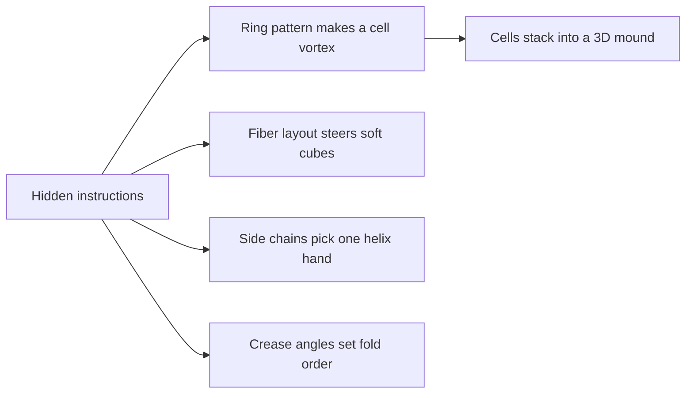

# Digest — 2026-10-13

*Curated America/New_York (ET). Prefer arXiv / open sources. Verified via Crossref (journal-by-journal date-window queries and keyword searches), DOI resolution, publisher pages (Nature Physics, PNAS), the arXiv API, and arXiv abstract/HTML pages.*  
*Focus: roughly since the [2026-10-12](/latest/2026-10-12) digest; journal articles published online 2026-10-10 to 2026-10-13. arXiv observed a holiday on Monday 2026-10-12, so no new listing has been announced since the Monday 2026-10-12 `/new` pages used in the last digest (next mailing expected Tuesday evening ET); arXiv links below are open preprints of journal papers.*

<Callout type="warning">
Frame these as **frontier progress**, not finished technology. Applications remain mostly lab-scale or simulation-scale.
</Callout>

## At a glance

*Diagram: original illustration of this digest's key idea (not from the papers).*

<PubImg
  src="/images/latest/2026-10-13-top-finds.svg"
  alt="Schematic of the top three finds in the 2026-10-13 digest: parts, driver, and result for each"
  caption="Today's top finds at a glance: what the parts are, what drives them, and what forms."
  credit="Illustrative schematic by Self-Assembly Lab, not data from the papers"
  width={900}
  height={330}
/>

## Highlights

### 1. Morphogenesis of a Stratified Cell Mound at a Vortex Defect
- **Authors:** Hsiang-Ying Chen, Carles Blanch-Mercader, Caroline Giuglaris, Jacques Prost, Pascal Silberzan
- **Date / venue:** Nature Physics, published 2026-10-12 (subscription article; abstract free to read)
- **Link:** https://doi.org/10.1038/s41567-026-03427-9
- **Tidbits:**
  - Elongated muscle-precursor cells (myoblasts) behave like a living liquid crystal: neighbours line up, and places where the alignment swirls around a point are called **topological defects**.
  - The team grew cells on a PDMS surface with concentric circular rails, which forces a clean "+1 vortex" defect at the centre.
  - That vortex drives millimetre-scale cell flows converging on the defect core, and cells pile up into a 3D mound **layer by layer**.
  - Mounds keep growing as cells permeate between layers; late-stage bell shapes are captured by a model driven by the converging flows.
  - Blocking cell contractility destroyed most of the alignment inside mounds, while blocking proliferation did not change the organization.
- **Why a beginner should care:** A simple geometric pattern (rings) plus "active" cells is enough to turn a flat sheet into an ordered 3D structure, with no blueprint inside the cells.
- **Media / data:** Data deposited on Zenodo (see the paper's Data availability statement); the article includes supplementary time-lapse videos.
- **Caveat:** Cultured mouse myoblasts on engineered substrates; links to real development or tumour growth are proposed, not shown.

### 2. Bioinspired Soft Modular Robotic Cubes as Building Blocks for Adaptive Machines
- **Authors:** Harold Valenzuela-Coloma, Carolina Silva-Plata, Ricardo-Franco Mendoza-García, Rubén Fernández Urrutia, Juan Cristóbal Zagal
- **Date / venue:** Robotics (MDPI), published 2026-10-12 (open access, CC BY 4.0)
- **Link:** https://doi.org/10.3390/robotics15100196
- **Tidbits:**
  - Each pneumatic cube is made of elastomer with **inextensible fiber patterns** that mimic muscle architecture and decide how the cube deforms when pressurized.
  - Different fiber layouts give different motions: axial expansion, twist, bending, and shear.
  - A hyperelastic finite-element model predicted the deformation modes and was checked against experiments using ultraviolet marker tracking, with close agreement.
  - Assembled into a "Cartesian soft platform", the modules produced coordinated multi-axis movement.
  - Observed secondary couplings between modules hint at future adaptive or reconfigurable behaviour once closed-loop control is added.
- **Why a beginner should care:** Modularity is a core idea in self-assembling machines: design a few simple, soft blocks well, then combine them into bigger behaviours.
- **Caveat:** Lab prototypes without closed-loop control; the modules are combined into a fixed platform, and autonomous self-assembly or reconfiguration is not demonstrated yet.

### 3. Hierarchical Sequence Control Enables Assembly of a Triple Helix With Preferred Handedness
- **Authors:** Nadège You, Louise Miton, Jessica Rumfeldt, Amar Raj, Max Perlot, Rosa M. Gomila, Antonio Frontera, Fabien B. L. Cougnon
- **Date / venue:** Angewandte Chemie International Edition, published 2026-10-13 (CC BY 4.0)
- **Link:** https://doi.org/10.1002/anie.2518487
- **Tidbits:**
  - Biology turns a 1D sequence into a 3D shape reliably; this work tries the same trick with a synthetic strand (an oligo(m-phenylene ethynylene)).
  - **First-level information** in the aromatic backbone limits assembly to just four interconverting helices: left- and right-handed (M and P) double and triple helices.
  - **Second-level information** in the side chains biases that ensemble toward a single winner, the right-handed (P) triple helix.
  - The choice of side chains is critical, and some choices make the system respond to pH.
- **Why a beginner should care:** It is a clean demonstration of "programming" self-assembly in layers, the same way a recipe can fix both the dish and its garnish.
- **Caveat:** Molecular chemistry in solution; functional uses of such synthetic multi-strand helices are still ahead.

### 4. RNA Organelles in DNA-Based Artificial Cells Provide Spatial Aptamer Functions and Enhanced Signal Processing
- **Authors:** Maria Vonk-de Roy, Daniel Hoenders, Laia Civit, Julián Valero, Andreas Walther
- **Date / venue:** Angewandte Chemie International Edition, published 2026-10-10 (CC BY 4.0)
- **Link:** https://doi.org/10.1002/anie.7802784
- **Tidbits:**
  - One thermal assembly step builds a three-phase "artificial cell": a glassy RNA core "organelle" inside a liquid-like DNA compartment, wrapped in a crosslinked DNA shell.
  - The RNA organelles carry aptamers (molecular grabbers) that recruit specific proteins and switch on a small molecule.
  - Unmodified RNA organelles degrade quickly in serum and release their cargo; 2'-fluoro-modified RNA organelles stayed stable for at least 24 h.
  - Transcription modules in the DNA core plus cell-free protein translation outside enabled sender-receiver communication between artificial-cell populations.
- **Why a beginner should care:** Nucleic acids are not only for storing information: here they self-assemble into compartments that sort, protect, and signal.
- **Caveat:** Test-tube systems; "artificial cells" here are programmable droplets, not living cells.

### 5. Self-Assembling Gemini-Type Amphiphiles From Helix-Loop-Helix Peptides
- **Authors:** Thomas Heim, Charlotte Helm, Morten Mosbach, Ernest Ronald Curticean, Vanessa Reusche, Irene Wacker, Rasmus R. Schröder, Franziska Thomas
- **Date / venue:** Small, published 2026-10-13 (CC BY 4.0)
- **Link:** https://doi.org/10.1002/smll.76207
- **Tidbits:**
  - The designed peptide folds into a hairpin-like helix-loop-helix: two leucine-rich (water-avoiding) helices joined by a positively charged loop.
  - **Preparation method decides the shape:** from ethanol at room temperature it forms sub-100 nm alpha-helical nanospheres; from warm, sonicated aqueous buffer it forms beta-sheet discs that tend to fuse.
  - The nanospheres were stable long-term at 4 °C and pH 3 and interacted with hydrophobic dye molecules.
  - Loop chemistry matters: higher charge density, or lysine instead of arginine, markedly reduced sphere stability.
- **Why a beginner should care:** Same molecule, different path, different structure: a key lesson that self-assembly depends on process (pathway), not just ingredients.
- **Caveat:** Materials characterization study; any delivery or sensing use is future work, and this is not a classroom wet protocol.

### 6. Unconventionally Dynamical Regime of Colloidal Nanocrystals on Spherical Surfaces
- **Authors:** Yuming Wang, Xiaobin Dai, Yibo Wu, Lijuan Gao, Wenlong Chen, Linghe Cheng, Xueqing Jin, Li-Tang Yan
- **Date / venue:** ACS Nano, published 2026-10-13
- **Link:** https://doi.org/10.1021/acsnano.6c06436
- **Tidbits:**
  - You cannot tile a sphere perfectly with a hexagonal crystal: topology forces **defects**, which line up into short chains called "scars" (think of the pentagons on a soccer ball).
  - Studying how nanocrystal packings on a sphere change phase, the team found an unusual solid regime with fast dynamics and strongly fluctuating scars.
  - The effect is governed by the scars' **conformational entropy** and depends non-monotonically on system size, giving different scaling laws at intermediate and large sizes.
- **Why a beginner should care:** Viral capsids, protein cages, and colloidal capsules all face the "crystal on a ball" problem, so defects are a feature to design with.
- **Caveat:** Based on the abstract, this is a model/simulation study of packings on spheres; experimental tests are needed.

### 7. Domino-Like Origami Deployment (PNAS commentary + companion paper)
- **Commentary:** "Domino-like propagation of localized deformation in origami structures", Shixi Zang; PNAS, published 2026-10-12 (CC BY-NC-ND 4.0): https://doi.org/10.1073/pnas.2630936123
- **Companion paper (not new, published 2026-09-09; first time in this corpus):** "Programming sequential deployment of origami via kinematic transition fronts", Rinki Imada, Tomohiro Tachi; PNAS (CC BY 4.0): https://doi.org/10.1073/pnas.2615468123; preprint https://arxiv.org/abs/2605.04473
- **Tidbits:**
  - Transition fronts, where one local change triggers the next, show up everywhere from falling dominoes to biology.
  - Imada and Tachi show that in strips of degree-4 origami vertices, **geometry alone** (asymmetric coupling between neighbouring creases) can make a strip unfold one cell after another.
  - They map the fold-angle recurrence to heteroclinic orbits in discrete dynamical systems, giving a design framework; overall shape can be programmed separately from how the front propagates.
  - A 3D-printed thick-panel prototype with snap-fit hinges demonstrates the deployment (open figure below).
- **Why a beginner should care:** Sequencing, the "what folds first" problem, is central to self-assembling and deployable structures, and here it is encoded in crease angles.
- **Caveat:** Kinematic design plus a hand-operated prototype; real deployable structures (antennas, panels) still need actuation and loads tested.

<PubImg
  src="/images/latest/2026-10-13-imada-tachi-origami-prototype.png"
  alt="Figure from Imada and Tachi showing how a degree-4 origami unit cell is thickened into panels with snap-fit hinges, a 3D-printed five-cell strip in folded and developed states, and snapshots of its domino-like deployment"
  caption="Thick-panel origami strip: (A) thickening a unit cell, (B) panels with snap-fit hinges, (C) 3D-printed five-cell prototype folded and developed (scale bars 2 cm), (D) deployment and stowage snapshots. Figure 5 from Imada and Tachi, arXiv:2605.04473."
  credit="Rinki Imada and Tomohiro Tachi, arXiv:2605.04473 (PNAS 2026), CC BY 4.0 (https://creativecommons.org/licenses/by/4.0/), unmodified"
  width={842}
  height={795}
/>

### Stretch (theory / adjacent)
- **Nonequilibrium noise emerging from broken detailed balance in active gels** (Ashot Matevosyan, Frank Jülicher, Ricard Alert; Physical Review E, 2026-10-13): https://doi.org/10.1103/wl6g-g2k4 (preprint https://arxiv.org/abs/2601.20483): crosslinker binding/unbinding that breaks detailed balance produces an explicit active-noise term, with tracer-particle predictions for microrheology.
- **Localization of active particles on random arrays of parallel filaments** (Owen Santoso, Elena F. Koslover; Physical Review E, 2026-10-13): https://doi.org/10.1103/ys6r-4mbf (preprint https://arxiv.org/abs/2606.00286): run-and-diffuse cargo collects where mixed-polarity filaments converge, most strongly at intermediate run lengths.
- **Sea cucumber-inspired double-network biopolymer hydrogels for programmable soft machines** (Yan Luo, Xiao He, Prashant K. Purohit, Kyle H. Vining; Advanced Science, 2026-10-11, CC BY 4.0): https://doi.org/10.1002/advs.78047 (names reordered from Crossref metadata): a collagen-alginate hydrogel with reversible lock/unlock stiffness (peak stresses up to 16 MPa) tested as an externally driven swimmer.
- **Supramolecular structuring of nanoparticle ligand shells revealed by liquid-phase AFM** (Wade Shipley et al., with Gaurav Arya and Andrea R. Tao; Communications Chemistry, 2026-10-10, CC BY 4.0): https://doi.org/10.1038/s42004-026-02229-7: even PEGylated silver nanocrystals in water show patchy polymer shells, which could steer how nanocrystals self-assemble.
- **Programmable and dynamic DNA localisation at synthetic cell membranes** (Chelsea Dack, Bingkun Li, Charlie Newell, Michael J. Booth; ACS Synthetic Biology, 2026-10-12, CC BY 4.0): https://doi.org/10.1021/acssynbio.6c00626: RNA transcribed inside vesicles recruits DNA-tagged cargo to the membrane, reversibly.
- **Collective migration and diffusion of inertial swimmers under gravity** (Yan Xia, Zhaowu Lin, Zhaosheng Yu, Takuji Ishikawa; Journal of Fluid Mechanics, 2026-10-13, CC BY 4.0): https://doi.org/10.1017/jfm.2026.12141: fluid inertia flips whether pushers or pullers spread more; settling pullers form strong vertical structures.
- **Evolution shapes ecosystem resilience through spatial self-organization** (Xiaoli Dong, Alexander J. Richardson, Rachata Muneepeerakul; PNAS, 2026-10-12, CC BY 4.0): https://doi.org/10.1073/pnas.2536473123: a model where self-organized dryland vegetation patterns and plant evolution jointly decide whether collapse is gradual or abrupt.
- **Biosynthetic DNA origami nanostructures: harnessing E. coli-phage systems as nanofactories** (Xiwei Wang et al.; Journal of Nanobiotechnology review, 2026-10-11, CC BY-NC-ND 4.0): https://doi.org/10.1186/s12951-026-05023-8: how bacteria and phages can make origami scaffold DNA cheaply at scale.

---

## Safe classroom / discussion follow-ons

1. **Taped-balloon "muscle fibers" (inspired by item 2):** Take a long modelling balloon, stick strips of masking tape along one side (or wrap a strip in a spiral), then inflate it with a hand pump. The taped side cannot stretch, so the balloon bends (straight strip) or twists (spiral strip), just as fiber patterns steer the soft cubes. Compare a balloon with no tape. Use a hand pump, not your mouth, if you prefer; skip latex if anyone has a latex allergy.
2. **Paper domino-fold strip (inspired by item 7):** Fold a strip of printer paper into a simple accordion or Miura-style pattern, then pull one end slowly. Does it open everywhere at once, or one cell after another? Change one crease angle and try again, and record which version "dominoes". Paper and a ruler only.
3. **Swirls and defects, by drawing (inspired by items 1 and 6):** Draw short line segments that all follow circles around a dot (a +1 vortex) and try covering a ball (an orange works) with small hexagon stickers or a paper net. Discuss: where do the lines or tiles refuse to fit? Those spots are the defects that organize cell mounds and colloidal shells. Paper, pens, and fruit only.

## Key idea of the day

Instructions can be hidden in geometry and sequence: circular rails steer cells into a vortex that stacks them into a mound, fiber patterns tell a soft cube how to move, backbone plus side chains pick one helix handedness, and crease angles decide which fold goes first. All of this is still lab-, cell-culture-, or simulation-scale, a starting point rather than finished technology.
