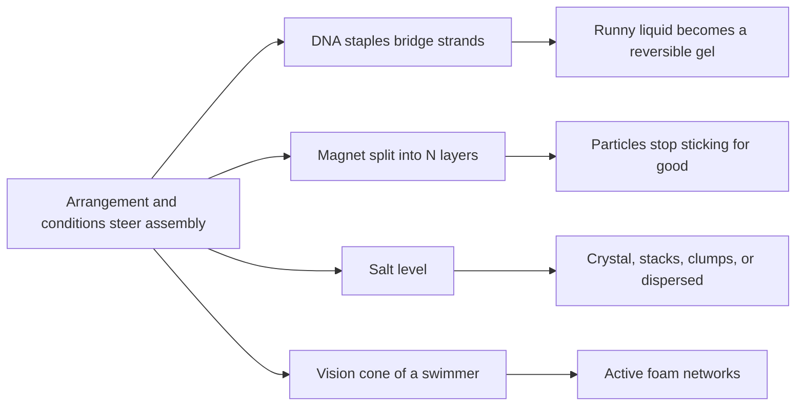

# Digest — 2026-10-14

*Curated America/New_York (ET). Prefer arXiv / open sources. Verified via the Wednesday 2026-10-14 arXiv `/new` listings (cond-mat.soft, cs.RO, cs.MA, physics.bio-ph, physics.chem-ph, cond-mat.stat-mech, nlin.AO, keyword filters), arXiv abstract/HTML pages, Crossref (journal-by-journal date-window queries and keyword searches), DOI resolution, and publisher pages (Soft Matter, Nanoscale, Nature Materials), plus one media story (SciTechDaily).*  
*Focus: roughly since the [2026-10-13](/latest/2026-10-13) digest; the first arXiv mailing after the Monday 2026-10-12 holiday (submissions 2026-10-09 to 2026-10-13, announced Wednesday 2026-10-14), plus journal articles published online 2026-10-13 to 2026-10-14. Two catch-up items (published earlier, first time in this corpus) are clearly marked.*

<Callout type="warning">
Frame these as **frontier progress**, not finished technology. Applications remain mostly lab-scale or simulation-scale.
</Callout>

## At a glance

*Diagram: original illustration of this digest's key idea (not from the papers).*

<PubImg
  src="/images/latest/2026-10-14-top-finds.svg"
  alt="Schematic of the top three finds in the 2026-10-14 digest: DNA tadpoles forming a network, magnets split into layers, and nanoplatelets in four salt-dependent states"
  caption="Today's top finds at a glance: what the parts are, what drives them, and what forms."
  credit="Illustrative schematic by Self-Assembly Lab, not data from the papers"
  width={900}
  height={330}
/>

## Highlights

### 1. Rheology and Programmable Gelation of DNA Tadpoles
- **Authors:** Jennifer Harnett, Saminathan Ramakrishnan, Elizabeth P. Holmes, Alice L. B. Pyne, Davide Michieletto
- **Date / venue:** Soft Matter, first published 2026-10-14 (open access; Crossref lists CC BY-NC 3.0)
- **Link:** https://doi.org/10.1039/d6sm00371k
- **Tidbits:**
  - DNA origami is usually used to fold tiny, tight objects. Here the same method (an 8064-base M13mp18 scaffold plus about 200 short "staple" strands) builds **polymers with chosen shapes**: linear, circular, and "tadpole" (a loop head with a linear tail; heads of 1/4, 1/2, and 3/4 of the length).
  - Surprise: in dense solutions all three shapes followed the same classic polymer scaling laws (viscosity roughly C^4.0 to C^4.7 above about 4 times the overlap concentration). The authors argue the chains are too short (only 3 to 4 entanglements each) for the loop shape to matter.
  - The useful twist: tadpole "looping" staples can also **bridge two different scaffolds**. Heating to 70 °C and cooling a dense tadpole solution rebuilt it into a crosslinked network, and viscosity rose about **16-fold**; linear designs did not change.
  - Adding an excess of competing linear staples undid the crosslinks by strand displacement, lowering viscosity about 3-fold over 2 hours at room temperature.
- **Why a beginner should care:** The "instructions" (which staples pair with which part of the scaffold) decide whether a liquid stays runny or turns into a gel, and a second set of strands can reverse it. That is programmable self-assembly at the scale of a material, not just a single nano-object.
- **Caveat:** Microlitre samples measured by tracking beads (microrheology); DNA origami material is still costly to make in bulk. Not a classroom wet protocol.

### 2. Partitioning the Magnetization Raises the Stability Limit of Ferromagnetic Colloids
- **Authors:** Paramita Modak, Priyadharshini M, Ankur Jaiswar, Ambarish Ghosh
- **Date / venue:** arXiv preprint, submitted 2026-10-09, announced 2026-10-14 (cond-mat.soft)
- **Link:** https://arxiv.org/abs/2610.14247
- **Tidbits:**
  - Strongly magnetic microparticles are great to steer, but they **clump irreversibly**: near contact, two permanent magnets attract with an energy that grows as the square of their moment (M^2).
  - Idea: keep the total moment M but split it into N thin magnetic layers inside each particle (Fe/SiO2 multilayers; for example about 7 nm of Fe per layer in the 3-layer helices). Far away, the particle still behaves like one magnet, so steering forces are unchanged; up close, each layer mostly feels only its facing partner, so the sticking energy drops by **1/N**.
  - Across **57 samples** and three shapes (helices, bent rods, straight rods; N from 1 to 36, plus co-evaporated films), stability collapsed onto a single M^2/N boundary, raising the usable magnetic energy scale **nearly 150-fold**.
  - In a rotating field, N = 3 helices stayed locked in rigid clusters, while N = 36 helices with the same moment broke apart and swam individually.
  - A liquid-phase analogue of magnetic force microscopy (tracking small superparamagnetic beads drifting toward a fixed particle) mapped the engineered force landscape directly.
- **Why a beginner should care:** Where you put the material can matter as much as how much you use: the same magnet, arranged differently, decides whether parts stick forever or come apart on command, a core design knob for reconfigurable micro-assemblies.
- **Caveat:** Preprint, not yet peer reviewed; particles are made by thin-film deposition in a lab, and microfluidics or drug-delivery uses are proposed, not shown.

<PubImg
  src="/images/latest/2026-10-14-magnet-partition-idea.svg"
  alt="Bar chart illustrating the idealized rule that near-contact magnetic sticking energy falls as 1 over N when the same total magnetic moment is split into N layers"
  caption="The 1/N idea in one picture: same total magnet, split into more internal layers, sticks less at contact while still being steerable from afar."
  credit="Illustration by Self-Assembly Lab of the scaling stated in arXiv:2610.14247; idealized, not measured data"
  width={900}
  height={360}
/>

### 3. Ionic Strength Controls Transition Across Distinct States of Nanoparticle Aggregation and Assembly
- **Authors:** Elias Nakouzi, Xiaoxu Li, Pravalika Butreddy, Lili Liu, Kavin Chakravarthy Thangaraj, Haoyuan Shi, Jonathan David Bazak, Xin Zhang, Benjamin A. Legg, Gregory Schenter, Jaehun Chun, James J. De Yoreo
- **Date / venue:** Nanoscale, first published 2026-10-13 (Crossref lists CC BY 3.0)
- **Link:** https://doi.org/10.1039/d6nr02498j
- **Tidbits:**
  - Building blocks: flat gibbsite (aluminium hydroxide) nanoplatelets. The only knob turned is how much salt is in the water (ionic strength).
  - **Pure water, months of ageing:** slow assembly of mesocrystals with long-range order.
  - **Some salt:** platelets favour face-to-face (001) stacking, giving stacks that are only locally ordered.
  - **More salt:** fast, random aggregation into fractal clusters (fractal dimension 2.4 to 2.6) that made the suspension about **18 times more viscous**.
  - **Above 1 m (beyond the Debye-Hückel regime):** aggregation slowed dramatically, clusters shrank, and at extreme ionic strength the particles were stable again as single particles (re-entrant stabilization). The team summarizes all four behaviours in one "state diagram".
- **Why a beginner should care:** One dial, salt, walks the same particles from crystal-like order to messy clumps and back to dispersed. Learning to read a state diagram is learning how to steer self-assembly.
- **Caveat:** One mineral system; the authors frame applications around environmental management and nuclear-waste processing, which are far from demonstrated here.

### 4. Emergence of Active Foams in a Minimal Cognitive Flocking Model
- **Authors:** Aryan Dwivedi, Diganta Bhaskar, Anil Kumar Dasanna
- **Date / venue:** arXiv preprint submitted 2026-10-11 (CC BY 4.0); accepted manuscript in Soft Matter, first published 2026-10-13
- **Links:** https://arxiv.org/abs/2610.15835 ; https://doi.org/10.1039/d6sm00751a
- **Tidbits:**
  - Each simulated self-propelled particle turns toward neighbours it can "see" inside a **vision cone**; there is no copying of neighbours' headings and no physical size (particles can overlap).
  - Because "I see you" does not mean "you see me", the interactions are **non-reciprocal**.
  - Varying vision range and cone angle (10^4 particles) gives gas, worms, nematic bands, and a new state: **active foams**, system-spanning fractal-like networks of particle streams around voids.
  - Foam networks are made mostly of three-way junctions, then four-way ones; wider vision cones instead give condensates, rings, and multi-twist filaments.
- **Why a beginner should care:** Simple perception rules, the kind you could program on a robot swarm, are enough to grow large network patterns with no leader.
- **Media:** The Soft Matter page lists supplementary movies.
- **Caveat:** 2D simulation of an idealized model; matching it to real animals or robots is future work.

<PubImg
  src="/images/latest/2026-10-14-active-foams-states.png"
  alt="Figure from Dwivedi, Bhaskar and Dasanna: a sketch of the vision-cone interaction, examples of aggregate states, and simulation snapshots of worms, nematic bands, active foams and a gas phase"
  caption="Vision-cone interactions (a) and the collective states they produce: aggregates (b) and long-range phases (c) including worms, nematic bands, active foams, and gas. Figure 1 from Dwivedi, Bhaskar and Dasanna, arXiv:2610.15835."
  credit="Aryan Dwivedi, Diganta Bhaskar, Anil Kumar Dasanna, arXiv:2610.15835 (Soft Matter 2026), CC BY 4.0 (https://creativecommons.org/licenses/by/4.0/), unmodified"
  width={552}
  height={374}
/>

### 5. Contact-Mediated Asymmetric Delay and Rate Memory in Snapping Beam Pairs
- **Authors:** Gavin Linton, Shima Mahmoudirad, Nidhi Pashine, Anupam Pandey
- **Date / venue:** arXiv preprint, submitted 2026-10-10 (cond-mat.soft; CC BY 4.0)
- **Link:** https://arxiv.org/abs/2610.15119
- **Tidbits:**
  - Two touching elastic beams of unequal thickness are squeezed and released over and over. Depending on the speeds, the pair snaps while loading, snaps while unloading, or stays packed.
  - In contact, one beam **rolls along the other without slipping**; faster driving lets it roll further before it slides and snaps.
  - The unloading snap "remembers" how fast the loading was, and above a threshold the pair snaps even after the motion is stopped (with the waiting time diverging at that threshold).
  - Using arrays of pairs with graded gaps, the team **programs the order** of snap events, and energy dissipated per cycle rose fourfold when fast loading was followed by a slow return.
- **Why a beginner should care:** Contact plus timing turns a simple structure into a mechanical memory and sequencer, a building block for "smart" metamaterials that compute with their shape.
- **Caveat:** Tabletop experiments on beam pairs; robotics or energy-absorber applications are not yet built.

<PubImg
  src="/images/latest/2026-10-14-snapping-beam-pairs.png"
  alt="Figure from Linton, Mahmoudirad, Pashine and Pandey showing snapshots of a pair of contacting elastic beams that snap on loading at a slower rate and on unloading at a faster rate, plus the imposed displacement protocol"
  caption="Rate-dependent snapping of contacting beams: at the slower rate the pair snaps while loading, at the faster rate it snaps while unloading. Figure 1 from Linton et al., arXiv:2610.15119."
  credit="Gavin Linton, Shima Mahmoudirad, Nidhi Pashine, Anupam Pandey, arXiv:2610.15119, CC BY 4.0 (https://creativecommons.org/licenses/by/4.0/), unmodified"
  width={2040}
  height={1357}
/>

### 6. Optoelectronically Enabled Simultaneous and Decoupled Navigation and Selective Pairing of Electrically Driven Janus Particles for Multi-Agent Microrobotics
- **Authors:** Srikanta Debata, Ido Rachbuch, Gilad Yossifon
- **Date / venue:** arXiv preprint, submitted 2026-10-10 (cond-mat.soft)
- **Link:** https://arxiv.org/abs/2610.14560
- **Tidbits:**
  - Problem: when one global field powers many microswimmers, they all respond at once.
  - Fix: project one fixed light pattern (from a digital micromirror device) onto a photoconductive surface to make "virtual electrodes" that steer each metallo-dielectric Janus particle along its own path, with no live feedback.
  - Demonstrated controlled **pairing** of Janus particles with passive polystyrene beads and with biological cells; an image-based planner picks agent-target pairs, avoids crossing paths, and outputs a single composite pattern.
  - Also showed independent control of several magnetically rolling Janus particles under one global magnetic field.
- **Why a beginner should care:** Assembly at the microscale needs a way to tell many identical parts where to go; a pre-drawn "map" of light is one answer.
- **Caveat:** Microfluidic lab demonstration; in vitro uses are proposed.

### 7. Catch-up (published earlier, first time in this corpus)
- **Gene-driven self-morphing microtubule-based active matter** (Rochelle Silverman, Erez Zerbib, David Garenne, Hillel Aharoni, Vincent Noireaux, Alexandra M. Tayar; Nature Materials, published 2026-10-08, CC BY-NC-ND 4.0): https://doi.org/10.1038/s41563-026-02767-4
  - Cell-free gene expression inside a dense microtubule sheet makes the kinesin motors during the experiment. The sheet is quiet for about 2 h, then buckles into blisters (spacing about 150 to 200 µm) and ends in active turbulence.
  - More kinesin DNA (0.1 to 13 nM) moved the onset of motion from about 4 h to about 1 h; adding a crosslinker gene (PRC1) gave arrest or a single pulse; a delayed negative-feedback circuit gave flow oscillations with about a 30 min period.
  - Caveat: tiny wells of purified proteins; "self-morphing materials" are a direction, not a product.
- **Media (2026-10-13):** "Scientists Build a World-First DNA Computer That Runs Without Continuous Power", SciTechDaily (Maynooth University release): https://scitechdaily.com/scientists-build-a-world-first-dna-computer-that-runs-without-continuous-power/ , about "A thermodynamically favoured molecular computer" (Tristan Stérin, Abeer Eshra, Constantine Glen Evans, Janet Adio, Damien Woods; Nature, 2026-09-16): https://doi.org/10.1038/s41586-026-10996-5
  - DNA strands and a scaffold, heated a little and cooled, assemble a structure that *is* the answer: 10 + 3 in 30 s, ten programs including 100-bit computations, large additions taking up to 14 h, and up to 25 calculations in a row.
  - Caveat: far slower than silicon, as the team itself notes; uses like data storage or in-cell sensing are long-term.

### Stretch (theory / adjacent)
- **Ionic gradients shape the spatial organization and dynamics of supramolecular polymers** (Claudio Perego, Annalisa Cardellini, Andrea Tagliabue, Giovanni M. Pavan; arXiv 2026-10-13, CC BY 4.0): https://arxiv.org/abs/2610.18357: coarse-grained simulations show salt gradients create zones of locally enhanced assembly and disassembly that a uniform solution cannot.
- **Dynamical-state switching controls active microrod navigation in porous media** (Ana Cazorla, Maria L. Jimenez, Raul A. Rica-Alarcon, Carla Fernandez-Rico, Laura Alvarez; arXiv 2026-10-12, CC BY 4.0): https://arxiv.org/abs/2610.16331: pre-aligning electric-field-driven Janus rods switches them from circling (good local search, easy trapping) to persistent motion that escapes obstacles.
- **Colloid-colloid interactions impact network morphology of confined colloidal drying patterns** (Andreas Andersen Hennig, Natalia Kizilova, Ilaria Beechey-Newman, Erika Eiser; arXiv 2026-10-12, CC BY-NC-SA 4.0): https://arxiv.org/abs/2610.16695: drying colloid films form maze-like fingers whose junctions follow Murray's law, with bifurcation angles peaking around 53 (degrees); added salt makes more loops.
- **Machine-learned topological transport of magnetic colloids** (Sebastian Wohlrab et al., with Thomas M. Fischer and Daniel de las Heras; arXiv 2026-10-12): https://arxiv.org/abs/2610.17344: a reinforcement-learning agent discovers field "control loops" that carry beads across unseen periodic, quasicrystalline, and disordered magnetic patterns; protocols transferred to experiment.
- **Active remodeling rescues a microswimmer from geometric trapping** (Ayushi Bhatt, Nico Schramma, Jasper van der Gucht, Uddalok Sen; arXiv 2026-10-10): https://arxiv.org/abs/2610.14805: *Chlamydomonas* algae in soft microgel packings push grains aside; obstacle mobility alone shifts the onset of permanent trapping.
- **Evaporation-driven nanowire self-assembly in an elongated droplet** (Johannes Schöttner, Qingguang Xie, Jens Harting; Soft Matter, 2026-10-13, CC BY 3.0 per Crossref): https://doi.org/10.1039/d6sm00647g: lattice Boltzmann simulations of printed-electronics droplets; longer nanowires improve both connectivity and uniformity.
- **Cluster-resolved associating-fluid theory for patch-geometry-dependent phase behavior in patchy particle mixtures** (Hamza Çoban, Alfredo Alexander-Katz; J. Chem. Phys., 2026-10-13, CC BY 4.0): https://doi.org/10.1063/5.0352520: a theory that keeps track of *where* binding patches sit, not just how many, and predicts different demixing for geometric isomers.
- **Molecular conformation as a determinant of self-assembly in sequence-isomeric tripeptides** (Zhuojun Li, Rein V. Ulijn, Hamish W. A. Swanson; J. Phys. Chem. B, 2026-10-13, CC BY 4.0): https://doi.org/10.1021/acs.jpcb.6c03754: single-molecule simulations of D/Y/F tripeptide isomers correlate conformational flexibility with which ones self-assemble.
- **Dual cascade of two-dimensional turbulence arising from collective swimming** (Xingyuan Mao, Jian Deng; Proc. R. Soc. A, 2026-10-14, CC BY 4.0): https://doi.org/10.1098/rspa.2026.0192: simulated fish schools (with shallow-tank experiments) stir up 2D turbulence; swarming boosts vortex merging, milling limits it.
- **Recurrent neural chemical reaction networks trained to switch dynamical behaviours through learned bifurcations** (Alexander Dack, Tomislav Plesa, Thomas E. Ouldridge; J. R. Soc. Interface, 2026-10-14, CC BY 4.0): https://doi.org/10.1098/rsif.2026.0169: chemical networks trained to change behaviour (even to draw a heart-shaped oscillation) as conditions shift, a design route for molecular controllers.
- **Programmable spatiotemporal magnetic fields for selective multimodal actuation and deterministic decoupling of heterogeneous magnetic robots** (Armando Ramos-Sebastian, Ja Sung Lee, Sung Hoon Kim; Research, 2026-10-14): https://doi.org/10.34133/research.1458: a moving field-free region drives one milli/microrobot at a time and flips strongly coupled robots from attraction to repulsion so they can separate.
- **Top-down or bottom-up? What has become of these approaches for assembly on the micro/nano scale?** (Ulrich Gengenbach, Liane Koker; at - Automatisierungstechnik, 2026-10-13): https://doi.org/10.1515/auto-2026-0043: a retrospective on electric-field and capillary assembly of small parts and why industrial uptake is still limited.
- **Developing the statistical mechanics of evolving assembly spaces** (Anisha K. Yeddanapudi, Abhishek Sharma, Ian Seet, Leroy Cronin; arXiv 2026-10-11, CC BY-NC-ND 4.0): https://arxiv.org/abs/2610.15695: couples assembly theory with stochastic thermodynamics to estimate the work needed to build novel, complex objects.

---

## Safe classroom / discussion follow-ons

1. **Salt and muddy water (inspired by item 3):** Fill two clear jars with tap water and stir in one spoonful of garden soil or clay powder each. Add a teaspoon of table salt to one jar only, stir both the same way, then photograph them every 15 minutes. Salt screens the charges that keep fine clay particles apart, so they clump (flocculate) and settle faster. Discuss how "how much salt" changes the kind of clumps, as in the nanoplatelet state diagram. Water, soil, and table salt only; pour it out in the garden afterwards.
2. **Same magnets, different arrangement (inspired by item 2):** Use flexible fridge-magnet sheet or ceramic fridge magnets (not small neodymium magnets). Make two "particles" on craft sticks: on one stick tape 4 magnet pieces stacked tightly at one end; on the other, tape the same 4 pieces spread out with gaps. Lay pairs of sticks on a table and compare how easily they slide apart after touching, then test whether each still gets pulled by a larger magnet held 10 cm away. Keep magnets away from young children, phones, and bank cards.
3. **Snap-order challenge (inspired by item 5):** Cut two strips from a plastic file folder, one thicker (double layer taped) and one thinner, and hold their ends between two stacks of books so they bow out side by side and touch. Push the books together slowly, then quickly, and note when (and whether) the strips snap; then pull back slowly versus quickly. Keep faces away from the strips; plastic and books only.
4. **Vision-cone walking game (inspired by item 4):** In a gym or playground, each student walks slowly and may only steer toward classmates inside a narrow "vision cone" (hands held like blinkers). Try a wide cone and a narrow cone. Do you get clumps, lines, or loose networks? Alternatively, code the rule in a short Python or Scratch simulation.

## Key idea of the day

Self-assembly can be steered by **arrangement and conditions**, not just by ingredients: which DNA staples bridge which strands, how a magnet is sliced inside a particle, how much salt is in the water, how wide a swimmer's "vision" is, and how fast a pair of beams is pressed. All of this is still lab-, microlitre-, or simulation-scale, a starting point rather than finished technology.
