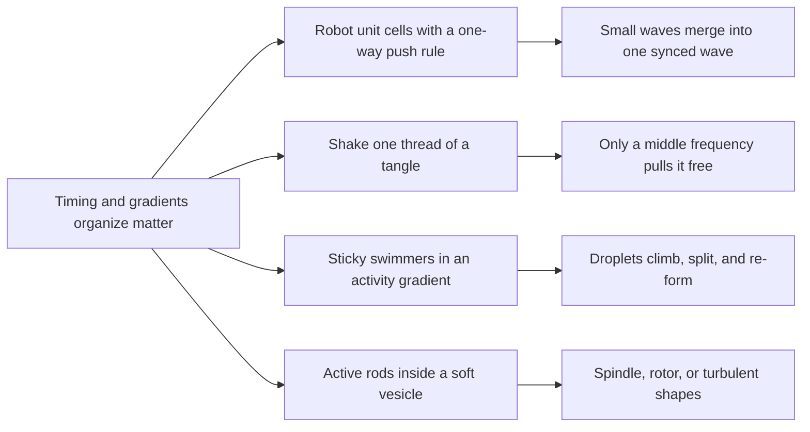

# Digest — 2026-10-15

*Curated America/New_York (ET). Prefer arXiv / open sources. Verified via the Thursday 2026-10-15 arXiv `/new` listings (cond-mat.soft, cs.RO, cs.MA, physics.bio-ph, physics.chem-ph, cond-mat.stat-mech, nlin.AO, q-bio.BM, plus keyword scans of cond-mat.mtrl-sci, physics.flu-dyn, physics.app-ph, physics.optics, q-bio, eess.SY and math.OC), arXiv abstract/HTML pages, Crossref (journal-by-journal date-window queries for about 60 journals), DOI resolution, and publisher pages (Nature, Communications Physics, Science Advances, Nature Communications, Physical Review Research).*  
*Focus: roughly since the 2026-10-14 digest; the Thursday 2026-10-15 arXiv mailing (mostly submissions from 2026-10-13 to 2026-10-14) plus journal articles first published online 2026-10-14 to 2026-10-15. A lighter arXiv day than usual, so two strong journal papers lead.*

<Callout type="warning">
Frame these as **frontier progress**, not finished technology. Applications remain mostly lab-scale, tabletop, or simulation-scale.
</Callout>

## At a glance

*Diagram: original illustration of this digest's key idea (not from the papers).*

<PubImg
  src="/images/latest/2026-10-15-top-finds.svg"
  alt="Schematic of the top three finds in the 2026-10-15 digest: short waves merging into one long wave in a robotic metamaterial, a peaked extraction curve for shaking a tangle, and a cluster of particles moving up an activity gradient"
  caption="Today's top finds at a glance: what the parts are, what drives them, and what forms."
  credit="Illustrative schematic by Self-Assembly Lab, not data from the papers"
  width={900}
  height={330}
/>

## Highlights

### 1. Wave Coarsening Drives Time Crystallization in Mechatronic Metamaterials
- **Authors:** Jonas Veenstra, Jack Binysh, Vito Seinen, Roger Solé Borràs, Rutger Naber, Damien Robledo-Poisson, Andres Hunt, Wim van Saarloos, Anton Souslov, Corentin Coulais
- **Date / venue:** Nature, published 2026-10-14 (subscription; data and code openly on Zenodo: https://doi.org/10.5281/zenodo.17398589)
- **Link:** https://doi.org/10.1038/s41586-026-11163-6
- **Tidbits:**
  - Everyday "coarsening": magnetic domains, oil droplets in an emulsion, or galaxy clusters start fine-grained and slowly grow bigger as things relax toward equilibrium.
  - This team found a **vibrational** version. In "active elastic" materials, small vibrations appear on their own and then grow in wavelength, period, and amplitude until the whole thing moves in one globally synchronized rhythm, a state called a **time crystal**.
  - The hardware is a robotic (mechatronic) metamaterial. In the 2D version, **37 unit cells** each hold a voice-coil actuator and a Hall-effect sensor; small microcontrollers measure strain and apply a **non-reciprocal** force rule (A pushes B differently than B pushes A). A 1D version is a ring of **24** such cells.
  - The team captured the "dynamical scaling" of this wave coarsening, and simulations extend the power-law growth to 3D.
  - Adding friction (breaking momentum conservation) **arrests** the coarsening and leaves counter-rotating waves that run along the edges, a far-from-equilibrium cousin of the edge modes studied in topological physics.
- **Why a beginner should care:** Self-organization is not only about where parts sit; it can be about **when** they move. Simple local rules in many identical robotic cells can make the whole material choose one shared rhythm, an idea relevant to soft robots that need to move without a central clock.
- **Media:** The Nature page lists four supplementary videos (2D wave coarsening, 1D ring, simulations, and frictional arrest).
- **Caveat:** Tabletop lattices of tens of cells wired to microcontrollers; the authors suggest links to acoustics, optomechanics, living matter, and soft robotics, but those uses are not demonstrated here.

### 2. Why Shaking Faster Does Not Untangle: Frequency-Selective Extraction of Filaments from Tangled Matter
- **Authors:** Ishant Tiwari, Sutikshan Bansal, Rosalind Huang, Chenyi Fei, Jörn Dunkel, Vishal Patil, Saad Bhamla
- **Date / venue:** arXiv preprint, submitted 2026-10-14, announced 2026-10-15 (cond-mat.soft; CC BY 4.0)
- **Link:** https://arxiv.org/abs/2610.19480
- **Tidbits:**
  - Tangles are everywhere, from living worm blobs to the cables in a desk drawer. The team made **cotton-thread tangles** in a rotating box (a "tangler"), adding 0, 2, or 10 tumbling weights to make them more or less tightly entangled, and also stitched ordered meshes from a single thread.
  - They hung each tangle from one embedded thread (the tether) and shook it up and down at a fixed amplitude (0.75 cm).
  - Surprise: pulling the thread free worked best at an **intermediate frequency, about 15 Hz**, and got worse at higher frequencies even though the peak acceleration keeps growing with the square of the frequency.
  - The explanation is **timing, not resonance**. Below the window, the tether never goes slack, so it never "snaps taut" to deliver a jerk. Above it, the jerk cannot travel across the tangle within a quarter of a shaking cycle, so the tangle stops responding as a whole and the energy is lost inside it.
  - The lower bound depends only on the drive and gravity; the upper bound depends only on the tangle's size and how fast a disturbance crosses it, which makes the rule easy to transfer to other tangles.
- **Why a beginner should care:** Disassembly is the mirror image of assembly. Knowing how to take a jumbled structure apart on purpose (for recycling, untangling fibres, or reconfiguring a robot swarm) is as important as knowing how to build one.
- **Caveat:** Preprint, not yet peer reviewed; cotton tangles and a lab shaker, with a deliberately minimal spring-mass model. Industrial or biological uses are suggested, not shown.

<PubImg
  src="/images/latest/2026-10-15-tangle-extraction-setup.jpg"
  alt="Figure from Tiwari et al.: micro-CT reconstruction of a cotton thread tangle, photos of tangles made with 0, 2 and 10 tumbling weights, a sketch of the rotating tangler box, contact networks, and box plots of tangle size, contacts and tensile force"
  caption="Making tangles with tunable entanglement: a micro-CT reconstruction (A), tangles made with 0, 2, and 10 tumbling weights (B), the rotating tangler box (C, D), and measurements showing that more tumbling weights give smaller, more connected, stronger tangles (E to J). Figure 1 from Tiwari et al., arXiv:2610.19480."
  credit="Ishant Tiwari, Sutikshan Bansal, Rosalind Huang, Chenyi Fei, Jörn Dunkel, Vishal Patil, Saad Bhamla, arXiv:2610.19480, CC BY 4.0 (https://creativecommons.org/licenses/by/4.0/), resized"
  width={1400}
  height={885}
/>

### 3. Self-Organization and Collective Migration of Active Condensates
- **Authors:** Hossein Vahid, Jens-Uwe Sommer, Abhinav Sharma
- **Date / venue:** Communications Physics, published 2026-10-14 (open access, CC BY 4.0)
- **Link:** https://doi.org/10.1038/s42005-026-02903-1
- **Tidbits:**
  - Simulated "active Brownian particles" swim in random directions and also attract each other (like sticky swimmers). With enough attraction they separate into a dense liquid droplet and a dilute gas, like water vapour condensing.
  - Now make activity (swimming strength) **vary across space**. Counter-intuitively, the droplets **migrate toward higher activity**, the opposite of what a passive droplet does in a temperature gradient (it drifts to the cold side), and the opposite of clusters formed only by crowding (MIPS), which drift toward low activity.
  - Why: particles at the droplet edge tend to point outward, and on the high-activity side they push harder, so the droplet is pushed up the gradient. The authors check this with a full pressure and force balance.
  - In simulations of 5000 particles, weak attraction lets the droplet evaporate; medium attraction makes it **split into two daughter droplets** that settle where activity and cohesion balance while constantly swapping particles; strong attraction keeps one droplet that travels to the activity peak.
  - With finite clusters, a cycle appears: clusters are **born** in low-activity regions, **climb** toward higher activity, then **evaporate or merge**, and the freed particles start new clusters.
- **Why a beginner should care:** It shows how a simple "map" of activity, with no chemical signalling or central control, can position, move, and recycle self-assembled clusters. The authors suggest testing it with enzyme-powered nanomotors, light-activated Janus particles, or robot swarms.
- **Caveat:** Brownian dynamics simulations of an idealized model; real active condensates (in cells or synthetic systems) have not yet been tested against these predictions.

<PubImg
  src="/images/latest/2026-10-15-active-condensate-gradient.png"
  alt="Figure panels from Vahid, Sommer and Sharma: a simulation box with a dense droplet of active particles on the left, a triangular activity profile peaking in the middle, density profiles for different attraction strengths, and the average swimming direction at droplet edges"
  caption="A dense droplet of sticky active particles starts at low activity (a); activity peaks in the middle of the box (b); steady-state density profiles show droplets moving inward or splitting depending on attraction strength (c); particles at droplet edges point outward (d). Figure 3a to d from Vahid, Sommer and Sharma, Communications Physics (2026)."
  credit="Hossein Vahid, Jens-Uwe Sommer, Abhinav Sharma, Commun. Phys. (2026), https://doi.org/10.1038/s42005-026-02903-1, CC BY 4.0 (https://creativecommons.org/licenses/by/4.0/), cropped to panels a to d"
  width={1000}
  height={925}
/>

### 4. Ultrasound-Driven Electronically Programmable Microbubbles
- **Authors:** Zhiyuan Zhang, Jinsong Zhang, Alyosha C. Molnar, Itai Cohen
- **Date / venue:** Science Advances, published 2026-10-14 (vol. 12, eaeg5408)
- **Link:** https://doi.org/10.1126/sciadv.aeg5408
- **Tidbits:**
  - Ultrasound makes tiny gas bubbles vibrate and stir the liquid around them, a handy "engine" for microrobots. Usually bubbles are trapped passively, so you cannot choose their size or switch individual ones on and off.
  - Here each bubble is **written electronically**: a 6 µm platinum electrode in salty buffer (PBS) makes a hydrogen bubble by electrolysis at -3.3 V; bubble volume grows linearly with time (Faraday's law), and bigger bubbles resonate at lower frequencies.
  - A higher voltage (-5 V) makes continuous bubbling that **erases** a bubble; a 6 x 6 array of individually wired electrodes lets the team draw bubble patterns on demand.
  - Bubble pairs act like coupled oscillators: depending on their size ratio, the flow points left, splits into four symmetric vortices, or flips right. L-shaped bubble patterns produce turning flows.
  - With bubbling plus ultrasound, bubbles are "shot" sideways (up to about 6,208 µm/s), and changing only the ultrasound **frequency** changes the shooting direction.
- **Why a beginner should care:** It turns bubbles from fixed parts into **reconfigurable agents**: write, use, erase, and rewrite them, a useful idea for programmable microfluidics and micro-robotic actuators.
- **Caveat:** Benchtop electronics and a cleanroom-made chip in a small acoustic chamber; uses such as cell routing or drug release are early demonstrations. Electrolysis chips and ultrasound transducers are **not** a classroom activity.

### 5. Active Sculpting: Morphodynamics of Internally Stirred Active Vesicles
- **Authors:** Devadevan M M, Brato Chakrabarti
- **Date / venue:** arXiv preprint, submitted 2026-10-14, announced 2026-10-15 (cond-mat.soft, cross-listed to physics.flu-dyn; CC BY 4.0)
- **Link:** https://arxiv.org/abs/2610.19631
- **Tidbits:**
  - Picture a soft, elastic bag (a vesicle) filled with swimming rod-like particles that push fluid outward along their length ("extensile" swimmers, like many bacteria).
  - One alignment rule couples rods and membrane both ways. At rest, the rods form a **+1 vortex**, swirling around the centre.
  - As activity rises, a sequence of thresholds destabilizes successive shape modes. Each crossing gives a new state: a **static spindle** (the +1 defect splits into two +1/2 defects pinned at the tips), a **rotor** that spins while its membrane "tank-treads" the other way, a **fluctuating spinner**, and finally a **turbulent** state in which the vesicle becomes a self-stirring compartment.
  - Very floppy vesicles can even become unstable with no activity at all, from the anchoring alone.
- **Why a beginner should care:** Cells constantly reshape themselves from the inside. This shows how far a single coupling rule plus activity can go in sculpting a soft container, a design idea for artificial cells and soft micro-machines.
- **Caveat:** Preprint; 2D theory and simulation. The authors propose using membrane wobbles as a probe of the activity inside, which still needs experiments.

<PubImg
  src="/images/latest/2026-10-15-active-vesicle-spindle.png"
  alt="Figure from Devadevan and Chakrabarti showing a vesicle filled with active rods over time: the central vortex splits into two defects and the vesicle stretches into a spindle, with flow streamlines below"
  caption="From vortex to spindle: as the vesicle elongates, the central +1 vortex of the active rods unbinds into two +1/2 defects (green markers) and the surrounding flow (bottom row) stretches the shape. Figure 4 from Devadevan and Chakrabarti, arXiv:2610.19631."
  credit="Devadevan M M, Brato Chakrabarti, arXiv:2610.19631, CC BY 4.0 (https://creativecommons.org/licenses/by/4.0/), resized"
  width={1400}
  height={766}
/>

### 6. Complex Pattern in Periodically Driven Binary Quincke Colloids
- **Authors:** Chuan Yu Zhang, Mu Yue Zhao, Xiao Yi Zhou, Wen-De Tian, Kang Chen, Tian Hui Zhang
- **Date / venue:** arXiv preprint, submitted 2026-10-14, announced 2026-10-15 (cond-mat.soft)
- **Link:** https://arxiv.org/abs/2610.19593
- **Tidbits:**
  - Quincke particles are colloids that start rolling when a strong enough DC electric field is applied. Here, a **mix of large and small** Quincke particles is driven with a square-wave (on-off-reversing) field.
  - A **dynamic square lattice** emerges on its own: small particles collect in the centres of lattice cells, surrounded by large particles.
  - Particle tracking shows the sorting comes from the **difference in mobility** between big and small particles.
  - Driving faster shortens how far each particle travels per cycle and **shrinks the lattice spacing**, so the pattern size is tunable with a single knob.
- **Why a beginner should care:** Mixing two kinds of active parts and pulsing the power can build ordered patterns without any templates, a simple route to tunable self-organized structures.
- **Caveat:** Preprint (11 pages, 9 figures); a microscope-slide colloid experiment with strong electric fields, not a classroom setup.

### Stretch (theory / adjacent)
- **Dynamic morphing of non-Euclidean active shells enabled by flutter under a steady stimulus** (Roberto Marchello, Pietro Maria Santucci, Giovanni Noselli; arXiv 2026-10-14): https://arxiv.org/abs/2610.20330: thin polyelectrolyte hydrogel plates and shells in a constant electric field "flutter" and swim, changing shape continuously without any oscillating input; millimetre hydrogel plate experiments support the theory (six supplementary videos).
- **Multicomponent nanocrystal superlattice structure prediction from first-principles validated against two decades of experiments** (Santiago F. Bonoli, Leandro L. Missoni, Yamila A. Perez Sirkin, Mario Tagliazucchi, Alex Travesset; JACS, 2026-10-14): https://doi.org/10.1021/jacs.6c15291: a density functional theory (MOLT-CF) checked against nearly 300 experiments predicts which binary nanocrystal superlattices form; only Li3Bi and Cu3Au-type lattices disagree, with proposed explanations.
- **Compartmentalized dynamic supramolecular hydrogels through chemically fueled self-assembly in aqueous two-phase systems** (Guanyao Gu et al., with Jan H. van Esch and Yiming Wang; Small, 2026-10-14): https://doi.org/10.1002/smll.76277: fuel-driven peptide gels form inside polymer-in-polymer emulsions, fall apart as fuel runs out, and can drag one polymer phase along with them.
- **Small viruses reveal bidirectional evolution between HK97-fold viruses and encapsulins via procapsids** (Abelardo Aguilar et al., with Antoni Luque; Nature Communications, 2026-10-14, CC BY 4.0): https://doi.org/10.1038/s41467-026-78136-1: 523 small viral genomes with HK97-fold shell proteins suggest viral capsids and bacterial protein "nanocompartments" evolved into each other more than once, with the immature procapsid as the bridge.
- **Wave-driven contraction-deformation coupling enables the motility and revolving waves of active gel droplets** (Ryota Sakamoto, Arash Abedijaberi; Physical Review Research, accepted paper, 2026-10-14): https://doi.org/10.1103/cnn8-lrdx: a phase-field model where contraction waves inside an active-gel droplet make it crawl or carry revolving waves; time-varying confinement can lock the waves into rhythm.
- **Geometry-encoded hidden orientational memory** (Vladimir A. Baulin; arXiv 2026-10-13, CC BY-SA 4.0): https://arxiv.org/abs/2610.19090: simulated caged ellipsoids at a fluid interface store a field-written orientation pattern through capillary forces, hundreds of times longer than a single particle takes to turn, and even remember which of two fields came last.
- **Mechanisms leading to axial segregation of bidisperse particles in rotating tumblers** (Umberto d'Ortona, Richard Lueptow, Nathalie Thomas; arXiv, announced 2026-10-15): https://arxiv.org/abs/2610.18885: simulations explain the classic striped bands in a spinning drum of big and small grains as a granular Rayleigh-Taylor-like instability.
- **Enhanced acoustic adhesion enabling agile and small wall-climbing robot design with anisotropic origami structure** (Xinxian Chen et al.; Advanced Science, 2026-10-14, CC BY 4.0): https://doi.org/10.1002/advs.78084: a 28 g, 50 mm robot climbs walls (8 cm/s) and ceilings (20 cm/s) with a vibrating-disk "acoustic adhesion" pad held flat by an origami spring.
- **Machine learning for programmable nanosystems: from liposome formulation to DNA origami and hybrid vesicles** (Daniel Q. Zhang, Matthew A. B. Baker; Small mini review, 2026-10-14, CC BY 4.0): https://doi.org/10.1002/smll.76157: how ML is starting to help design and characterize DNA origami and lipid carriers, and why standard datasets are still missing.

---

## Safe classroom / discussion follow-ons

1. **Shake-out challenge (inspired by item 2):** Loosely tangle a handful of cotton yarn or string pieces (about 30 cm each) in a shoebox by shaking it with a few clothes pegs inside. Tie a long "tether" string to one piece and hang the tangle from it. Shake the tether up and down by hand at a slow, medium, and fast pace (use a free metronome app at about 60, 300, and 600 beats per minute as a guide) for 30 seconds each, and record whether the tethered string pulls out. Repeat several times. Is the fastest shaking really the best? Yarn and cardboard only.
2. **Metronome sync (inspired by item 1):** Place two or three cheap mechanical metronomes (or wind-up toys that tick) on a light board resting on two empty soda cans lying on their sides. Start them out of step and watch whether they fall into one shared rhythm. Then put the board on the table (adding friction) and compare. Discuss how many small "players" can choose one shared beat without a leader.
3. **Gradient tag game (inspired by item 3):** In a gym, mark a "slow zone" at one end and a "fast zone" at the other. Students hold hands loosely in small groups ("sticky swimmers") and each takes small steps in random directions, stepping faster in the fast zone. Do groups drift, split, or stay together? Then code the rule as a short Python or Scratch simulation and vary how "sticky" the particles are.
4. **Rice and lentil drum (inspired by the tumbler stretch item):** Fill a clear plastic bottle about one third with a mix of dry rice and dry lentils (or two sizes of dried beans), cap it tightly, lay it on its side, and roll it slowly back and forth on a table for a few minutes. Look for stripes where the grains sort themselves. Dry kitchen grains only; keep lids on.

## Key idea of the day

Self-organization can be steered by **timing and gradients**, not just by ingredients: a one-way push rule that lets robotic cells pick one shared rhythm, a shaking frequency that only works in a middle window, an activity map that moves and recycles droplets, a soft wall that reshapes the swimmers inside it, and pulsed fields that sort big and small particles into a lattice. All of this is still tabletop-, chip-, or simulation-scale, a starting point rather than finished technology.
