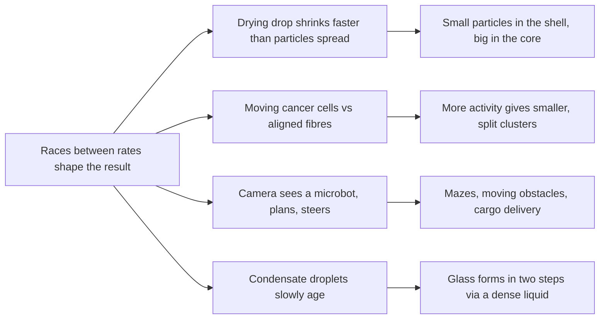

# Digest — 2026-10-16

*Curated America/New_York (ET). Prefer arXiv / open sources. Verified via the Friday 2026-10-16 arXiv `/new` listings (cond-mat.soft, cs.RO, cs.MA, physics.bio-ph, physics.chem-ph, cond-mat.stat-mech, nlin.AO, q-bio.BM), arXiv abstract/HTML pages and source files, Crossref date-window keyword queries, DOI resolution, and publisher pages (Physical Review X, Microsystems & Nanoengineering).*  
*Focus: roughly since the 2026-10-15 digest; the Friday 2026-10-16 arXiv mailing (submissions mostly 2026-10-14 to 2026-10-15) plus journal articles first published online 2026-10-14 to 2026-10-16 that earlier digests had not covered. Another light arXiv day, so one journal paper is near the top.*

<Callout type="warning">
Frame these as **frontier progress**, not finished technology. Applications remain mostly lab-scale, tabletop, or simulation-scale.
</Callout>

## At a glance

*Diagram: original illustration of this digest's key idea (not from the papers).*

<PubImg
  src="/images/latest/2026-10-16-top-finds.svg"
  alt="Schematic of the top three finds in the 2026-10-16 digest: a shrinking drop that ends with small particles in a shell and big ones in the core, purple cell clusters splitting among wavy aligned fibres, and a small cube-shaped microbot following yellow waypoints around an obstacle"
  caption="Today's top finds at a glance: what the parts are, what drives them, and what forms."
  credit="Illustrative schematic by Self-Assembly Lab, not data from the papers"
  width={900}
  height={330}
/>

## Highlights

### 1. Drying-Induced Size Segregation and Stratification in Colloidal Droplets across Binary, Ternary, and Polydisperse Systems
- **Authors:** Zhaoxuan Liu, Marjolein Dijkstra
- **Date / venue:** arXiv preprint, submitted 2026-10-15, announced 2026-10-16 (cond-mat.soft; CC BY 4.0)
- **Link:** https://arxiv.org/abs/2610.21816
- **Tidbits:**
  - Picture a tiny drop of liquid filled with a mix of small and large particles. As the liquid evaporates, the drop's surface moves inward and sweeps the particles together.
  - In Brownian dynamics computer simulations, the mix does **not** stay mixed: **smaller particles collect near the surface** and **larger particles end up in the core**, giving a layered "supraparticle".
  - The key control knob is the **Péclet number**: how fast the surface shrinks compared with how fast particles can wander (diffuse) on their own. Sorting gets stronger when drying is fast, when the size difference is bigger, and when the drop starts more dilute.
  - With three sizes, the drop can form **three layers** if drying is fast enough and the middle size is chosen well. With a continuous spread of sizes, average particle size falls smoothly from centre to surface.
  - A second simulation method that includes the liquid's flow (multi-particle collision dynamics) still shows layering, but weaker than the simpler model, a useful honesty check.
- **Why a beginner should care:** It is a recipe that needs no glue, no templates, and no robots: just **mix, then dry at the right speed** to build a structured particle with a size gradient inside it.
- **Caveat:** Preprint, not yet peer reviewed, and simulation only. Real drops have extra effects (particle charges, surface skins, flow inside the drop) that can change the outcome.

<PubImg
  src="/images/latest/2026-10-16-drying-droplet-stratification.jpg"
  alt="Three simulation snapshots of a drying droplet: at first red large and blue small particles are mixed throughout; later the drop has shrunk with blue small particles forming an outer shell; finally red large particles fill an inner core surrounded by a blue outer shell"
  caption="A drying drop sorts itself: cross-sections from a simulation with large particles three times the diameter of small ones and fast drying (Péclet number 100). Small particles (blue) form the outer shell and large ones (red) the inner core. Figure 2 from Liu and Dijkstra, arXiv:2610.21816."
  credit="Zhaoxuan Liu, Marjolein Dijkstra, arXiv:2610.21816, CC BY 4.0 (https://creativecommons.org/licenses/by/4.0/), rendered from the source PDF and resized"
  width={1400}
  height={479}
/>

### 2. Self-Organization of Invasive Breast Cancer Driven by the Interplay of Active and Passive Nematic Dynamics
- **Authors:** Pablo Gottheil, Saraswat Bhattacharyya, Philip Friedrich, Kilian Roth, Mario Merkel, Kolya Lettl, Kudor Harb, Salvador Rivera-Moreno, Assal Daneshgar, Jonas Wieland, Bahriye Aktas, Jens-Uwe Blohmer, Hans Kubitschke, Anne-Sophie Wegscheider, Christine Sers, Igor M. Sauer, Armin Jarosch, Axel Niendorf, Julia M. Yeomans, Josef A. Käs
- **Date / venue:** Physical Review X, accepted paper posted 2026-10-15; earlier preprint arXiv:2412.01285 (CC BY 4.0, https://arxiv.org/abs/2412.01285)
- **Link:** https://doi.org/10.1103/z8gf-q6rh
- **Tidbits:**
  - In invasive breast cancer, clumps of cancer cells of many sizes and shapes sit inside a fibrous scaffold (the extracellular matrix, or ECM). A common view is that this pattern simply reflects growing disorder.
  - The team argues the opposite: the pattern comes from **active self-organization**. Moving, lined-up cancer cells behave like an **active nematic** (a liquid crystal whose parts push themselves), travelling through strongly aligned ECM fibres that act as a **passive nematic** cage.
  - Cell motion makes clusters **split and merge**, much like droplets. In simulations, more activity gives smaller clusters.
  - Comparing simulations with tissue slides from **more than 2,000 patients** (2,012 in the preprint's figure), the cluster sizes and shapes follow characteristic scaling rules, and ECM **topological defects** (places where the fibre alignment breaks, such as comet and trefoil shapes) sit close to cluster boundaries.
  - Higher estimated activity correlated with tumour progression and a poorer prognosis in the preprint's patient analysis.
- **Why a beginner should care:** The same physics used for liquid crystals and bacterial swarms (alignment, defects, droplets splitting and merging) can read structure in real human tissue. Self-assembly ideas are not just for nano-gadgets.
- **Caveat:** This is a physics model compared with fixed tissue slides; it describes a correlation, not a new test or treatment. The figure below is from the 2024 preprint and the accepted PRX version may differ.

<PubImg
  src="/images/latest/2026-10-16-tumour-cluster-activity.jpg"
  alt="Panel a: a time series of simulation snapshots with purple clusters in a pink background moving, splitting, and merging, marked with black and red arrows. Panel b: simulations at intermediate and high activity beside stained tissue sections with similar cluster shapes; higher activity shows many thin small clusters. Panel c: a scatter plot of cluster area against activity, with area falling as activity rises"
  caption="Activity sets cluster size: (a) simulated cell clusters move, split (black arrows), and merge (red arrows) over time; (b) intermediate and high activity in simulations beside tissue sections with similar shapes; (c) cluster area falls as activity rises in simulations (Spearman correlation -0.37). Figure 2 from Gottheil et al., arXiv:2412.01285v1."
  credit="Pablo Gottheil, Saraswat Bhattacharyya, Kolya Lettl, Philip Friedrich, Kilian Roth, Salvador Rivera-Moreno, Mario Merkel, Bahriye Aktas, Igor Sauer, Assal Daneshgar, Jonas Wieland, Hans Kubitschke, Anne-Sophie Wegscheider, Julia M. Yeomans, Josef A. Käs, arXiv:2412.01285, CC BY 4.0 (https://creativecommons.org/licenses/by/4.0/), resized"
  width={1400}
  height={1683}
/>

### 3. Vision-Guided Closed-Loop Autonomous Navigation of Light-Driven Janus Microbots
- **Authors:** Kanhu Charan Andia, Harsh Prashant Katole, Parth Nitinkumar Bhosale, Hemant Kumar, Dhruv Pratap Singh
- **Date / venue:** arXiv preprint, submitted 2026-10-15, announced 2026-10-16 (cond-mat.soft; CC BY-NC-ND 4.0, so no figure is reproduced here)
- **Link:** https://arxiv.org/abs/2610.21222
- **Tidbits:**
  - The microbots are **cubes about 3 µm across**, half hematite and half titanium dioxide (a "Janus" particle with two different faces). Light powers them; a magnetic field steers them.
  - A camera watches the microscope view, a custom-trained **YOLOv11** object detector finds the bot in each frame, and the software sends magnetic steering commands to reach the next **waypoint** along a path.
  - More than **90%** of measured deviations stayed **below 6 µm** across the tested path shapes, and users can draw free-hand paths or send the bot through a small maze.
  - With **A\* path planning**, the bot replans in real time to dodge several independently swimming 5 µm Janus micromotors, and it can pick up multiple cargo particles and deliver them to a chosen spot.
- **Why a beginner should care:** Self-propelled particles wander randomly on their own. Adding a **see-plan-steer feedback loop** is how you turn a random swimmer into a useful little worker, the same loop used by a robot vacuum, just much smaller.
- **Caveat:** Preprint; one bot at a time under a lab microscope, with an external camera, computer, and magnets doing the "thinking". Uses in the body or in factories are a long way off.

*Diagram: original illustration of the closed feedback loop described in the abstract (not from the paper).*

### 4. Phase Coexistence and Nucleation of Aging Condensates
- **Authors:** Yicheng Qiang, Chengjie Luo, David Zwicker
- **Date / venue:** arXiv preprint, submitted 2026-10-15, announced 2026-10-16 (cond-mat.soft; arXiv standard licence, so no figure is reproduced here)
- **Link:** https://arxiv.org/abs/2610.21917
- **Tidbits:**
  - Cells make droplet-like "condensates" by phase separation, the same way oil separates from vinegar. Over time many of these droplets **age**, turning from liquid-like to solid-like.
  - The authors join two textbook models: the Flory-Huggins model of phase separation and the "trap model" of slow, glassy aging.
  - The combined model predicts a rich phase diagram, including a regime where two liquids coexist in a metastable way.
  - That dense metastable liquid acts as a **stepping stone**: the solid-like glass forms in **two steps**, first a dense liquid, then a glass inside it.
- **Why a beginner should care:** Self-assembled structures are not frozen in place. They can keep changing after they form, and the path they take (one step or two) changes what you end up with.
- **Caveat:** Short theory preprint (5 pages plus appendix); it gives a general framework, not measurements on a specific protein.

*Diagram: original simplified sketch of the two-step pathway described in the abstract (not from the paper).*

### 5. Active Matter Model Implementation in LAMMPS: A Coherent `fix active` Framework of Ten Active Self-Propulsion Mechanisms
- **Authors:** Ram Chand, Saqia Bukhari
- **Date / venue:** Modelling and Simulation in Materials Science and Engineering, published 2026-10-16
- **Link:** https://doi.org/10.1088/1361-651X/aeaa0a
- **Tidbits:**
  - LAMMPS is a widely used, free molecular dynamics simulator. This paper adds one command, `fix active`, that switches between **ten active-matter models** with a single keyword: active Brownian particles, active Ornstein-Uhlenbeck particles, chiral swimmers, run-and-tumble, Vicsek-style flocking, active rods, spinners, inertial swimmers, MIPS clustering, and active nematics.
  - The authors report that it needs **no changes to the LAMMPS source code**, and that single-particle tests match theory to within a few per cent (spinners within 0.1%), while flocking, MIPS clustering, and active-nematic turbulence look qualitatively right.
  - In this release the active force acts in a 2D plane; a full 3D update is planned.
- **Why a beginner should care:** Many digest papers rely on exactly these models. A single, tested tool makes it easier for students and teachers to reproduce "swarm" and "active droplet" results on an ordinary computer.
- **Caveat:** Journal access may be restricted; check the article page for code availability before planning a class around it.

### 6. Reconfigurable Acoustic Tweezers Based on a Programmable Droplet Array
- **Authors:** Zhen Wang, Menglei Zhao, Kangfu Chen, Yao Lu, Haopu Wang, Zongliang Guo, Zonghao Li, Meiyi Zhou, Huiliang Cao, Kaiqiang Cao, Xiaoyi Wang, Rongxin Fu, Hang Li, Zhichao Ma, Jiafang Li, Huikai Xie, Shuailong Zhang
- **Date / venue:** Microsystems & Nanoengineering, published 2026-10-14 (vol. 12, article 344; open access, CC BY-NC-ND 4.0)
- **Link:** https://doi.org/10.1038/s41378-026-01458-z
- **Tidbits:**
  - Sound waves can push tiny particles into neat patterns, but usually the pattern is fixed by the device.
  - Here a digital microfluidic chip moves droplets around electrically (electrowetting), and the droplets change where sound energy passes through, because sound crosses liquid-solid and gas-solid interfaces very differently.
  - Rearranging the droplets reshapes the sound field in real time, so the team can capture and move particles on demand.
- **Why a beginner should care:** It is a "programmable mould" for assembly: change the droplet pattern, and the place where particles gather changes too.
- **Caveat:** Cleanroom chips and ultrasound hardware; the authors point to micro-assembly uses, but this is an early demonstration and not a classroom build.

## Also noted (shorter)

- **Denser-than-crystalline disordered polydisperse ellipse packings** (Kinsley G. Trlak, Dewni S. de Silva, Salvatore Torquato, Robert S. Hoy; arXiv 2026-10-14, announced 2026-10-16): https://arxiv.org/abs/2610.20953: computer-grown jammed packings of mixed-size ellipses can pack more densely than the perfect single-size ellipse crystal (about 90.7%) while showing no obvious long-range order, the first such result reported for non-round particles.
- **Spatiotemporally correlated activity regulation of random-organizing hyperuniform states** (Yuhan Peng, Yusheng Lei, Ran Ni; arXiv 2026-10-15): https://arxiv.org/abs/2610.21769: simulations show that conserving the centre of mass is not enough on its own to make an active mixture "hyperuniform" (unusually even at large scales); how activity is correlated in space and time matters too.
- **Anomalous dewetting dynamics in active entangled polymer films: semiflexible chains** (Mithun Chowdhury; Physical Review E, 2026-10-15): https://doi.org/10.1103/8f5t-nwwd: a study of how thin films of active, entangled polymers pull back from a surface.
- **DNA nanotechnology-based robotic devices for frontier applications in healthcare** (Mainak Sarkar et al., with Dhiraj Bhatia; Small review, 2026-10-16): https://doi.org/10.1002/smll.76227: a review of DNA origami, DNA walkers, and molecular logic devices, and of what still blocks clinical use (stability in the body, manufacturing cost, safety, and regulation).

---

## Safe classroom / discussion follow-ons

1. **Rope-loop drying game (inspired by item 1):** Lay a long rope in a big loop on a gym floor. Half the students are "small particles" who may take quick steps; the others hold a beach ball or pillow as "large particles" and may only take slow steps. Everyone wanders inside the loop while two students pull the rope in, first slowly, then quickly. Photograph who ends up near the rope and who ends up in the middle each time. Does fast "drying" sort the class more? Rope and soft balls only; walk, don't run.
2. **Coffee-drop rings (inspired by item 1):** Put single drops of weak instant coffee or diluted washable watercolour on a plastic lid or glossy card and let them dry. Compare drops dried in a warm sunny spot and in a cool shady spot, and look at the edges with a magnifier. Discuss why real drops on a surface make rings, while the paper's free-floating simulated drops make layered balls. Kitchen materials only.
3. **Fingerprint defect hunt (inspired by item 2):** Make fingerprints with a washable marker or ink pad on white paper. Ridges are an everyday "nematic" pattern. Find the loops (where ridges turn back on themselves, like a comet-shaped +1/2 defect) and the deltas, or triradii (three-way meeting points, like a trefoil-shaped -1/2 defect). Count them for each finger and compare with classmates.
4. **See-plan-steer relay (inspired by item 3):** One blindfolded student is the "microbot" and walks slowly across a classroom path marked with tape waypoints and chair "obstacles" that classmates slowly move. In round one, the steering team writes all commands in advance; in round two, a "camera" student watches and calls out one turn at a time. Compare how often the microbot reaches the goal. Clear the floor and keep a spotter beside the walker.

## Key idea of the day

Structure often comes from a **race between rates**: a drop shrinking faster than its particles can spread, cancer cells moving faster than the fibre cage can hold them, an aging droplet slowly trapping its own molecules, or a camera loop correcting a microbot faster than it can drift off course. Change which rate wins, and the same ingredients build something different. All of this is still simulation-, microscope-, or chip-scale, a starting point rather than finished technology.
