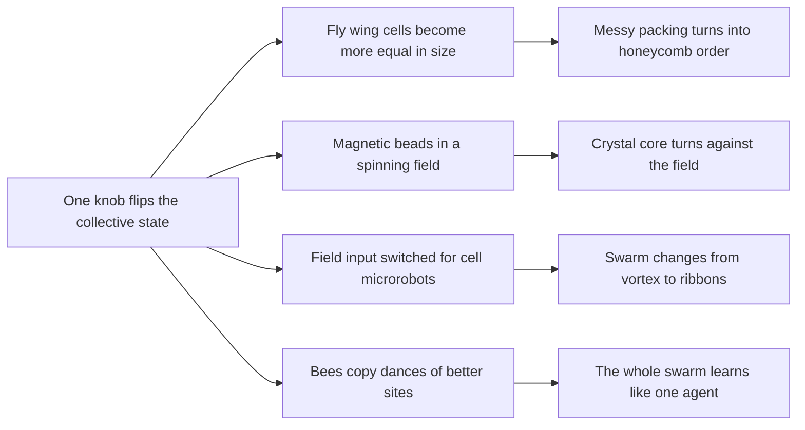
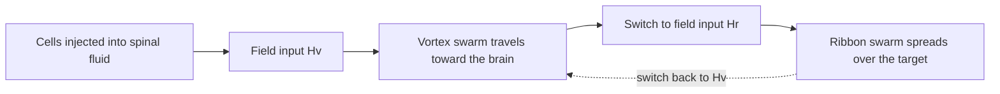

# Digest — 2026-10-19

*Curated America/New_York (ET). Prefer arXiv / open sources. Verified via the Monday 2026-10-19 arXiv `/new` listings (cond-mat.soft, cs.RO, cs.MA, physics.bio-ph, physics.chem-ph, cond-mat.stat-mech, nlin.AO, q-bio.BM; plus a scan of cond-mat.mtrl-sci, physics.app-ph, physics.flu-dyn), arXiv abstract pages and source files, Crossref date-window keyword and journal queries, DOI resolution, and publisher pages (PRX Life, Nature Physics, Nature Chemistry, Nature Communications, Science Advances, Swarm Intelligence).*  
*Focus: roughly since the 2026-10-16 digest; the Monday 2026-10-19 arXiv mailing (submissions mostly 2026-10-15 to 2026-10-16) plus journal articles first published online 2026-10-16 to 2026-10-19 that earlier digests had not covered. A small Monday arXiv listing, so journal papers lead today.*

<Callout type="warning">
Frame these as **frontier progress**, not finished technology. Applications remain mostly lab-scale, tabletop, or simulation-scale.
</Callout>

## At a glance

*Diagram: original illustration of this digest's key idea (not from the papers).*

<PubImg
  src="/images/latest/2026-10-19-top-finds.svg"
  alt="Schematic of the top three finds in the 2026-10-19 digest: mixed-size orange circles turning into a yellow honeycomb of equal cells, a cluster of green magnetic beads whose core arrow turns opposite to a yellow field arrow while red rim beads follow the field, and purple dots switching between a spiral vortex and parallel ribbons"
  caption="Today's top finds at a glance: one control knob flips how the whole group behaves."
  credit="Illustrative schematic by Self-Assembly Lab, not data from the papers"
  width={900}
  height={330}
/>

## Highlights

### 1. Cell Size Heterogeneity Controls Crystallization of the Developing Fruit Fly Wing
- **Authors:** Kartik Chhajed, Franz S. Gruber, Raphaël Etournay, Natalie A. Dye, Frank Jülicher, Marko Popović
- **Date / venue:** PRX Life, accepted paper posted 2026-10-19; preprint arXiv:2505.05437 (latest version 2026-05-23, CC BY 4.0, https://arxiv.org/abs/2505.05437)
- **Link:** https://doi.org/10.1103/fftq-nnxf
- **Tidbits:**
  - The fruit fly wing starts as a flat sheet of cells (an epithelium). Early in development the cells are packed in a messy, disordered way; later they line up into an ordered, honeycomb-like "crystalline" packing.
  - Earlier work credited this ordering to the tissue being stretched and sheared. Here the team finds that local ordering of cells still happens when shear flow is reduced (by laser-cutting the wing's attachment near its tip) and when cell division is blocked (a *cdc2* mutant).
  - Their explanation is **cell size heterogeneity**: how different the cells are in size (polydispersity, the standard deviation of size divided by the mean). In a computer "vertex model" of tissue, there is a critical spread: above it the packing stays disordered, below it the cells crystallize.
  - In real wings the size spread **drops** during development. In the preprint's data, local order rises sharply once the measured spread falls below about 0.2. In wings cut near the body (proximal ablation), the spread stays high and the packing stays disordered.
  - Shear is not the switch, but it **speeds up** tissue-wide order by helping small ordered patches line up with each other.
- **Why a beginner should care:** It is the same rule that holds for marbles, bubbles, and colloids: equal-size pieces pack into neat hexagons, mixed sizes jam into a mess. Living tissue seems to use that physics too.
- **Caveat:** Fruit fly tissue plus simulations; the figure below is from the arXiv preprint and the final PRX Life version may differ. The study explains a pattern; it does not show how to engineer tissues yet.

<PubImg
  src="/images/latest/2026-10-19-fly-wing-crystallization.jpg"
  alt="Panel A: outline of a fly wing with the blade region shaded. Panels B to D: definitions of a hexatic order measure for each cell. Panels E and E prime: maps of the wing blade colored by cell order at 17 and 32 hours after puparium formation, mostly dark and mixed early and mostly pale yellow, meaning ordered, later. Panels F and F prime: maps colored by the orientation of that order, with larger same-colored patches later. Panel G: a ring-shaped structure factor at 17 hours that develops six-fold spots at 32 hours. Panels H and I: line plots of average cell order and tissue-wide order rising between about 18 and 32 hours for three wild-type wings"
  caption="Cell packing in the developing fly wing becomes ordered: maps of local six-fold (hexatic) order at 17 and 32 hours after puparium formation (hAPF), the orientation of that order, the structure factor of cell positions, and average order rising over time in three wild-type wings. Figure 1 from Chhajed et al., arXiv:2505.05437v4."
  credit="Kartik Chhajed, Franz S. Gruber, Raphaël Etournay, Natalie A. Dye, Frank Jülicher, Marko Popović, arXiv:2505.05437, CC BY 4.0 (https://creativecommons.org/licenses/by/4.0/), rendered from the source PDF and resized"
  width={1400}
  height={1404}
/>

### 2. Anti-Synchronized Collective Rotation in Magnetic Colloidal Particles under Rotating Magnetic Fields
- **Authors:** Adithya Bharath, A. V. Anil Kumar
- **Date / venue:** arXiv preprint, submitted 2026-10-16, announced 2026-10-19 (cond-mat.soft; CC BY 4.0)
- **Link:** https://arxiv.org/abs/2610.23784
- **Tidbits:**
  - Tiny magnetic beads (colloids) in a flat layer usually spin **along with** a rotating magnetic field, like dancers following a beat.
  - In these computer simulations of a 2D cluster (448 particles), the authors find a surprising state: the ordered crystal **core turns, on average, the opposite way** to the field, while the messy, defect-rich outer rim keeps turning with the field. They call it **anti-synchronized** rotation.
  - The phase diagram has four regimes depending on field strength and drive frequency: disordered, anti-synchronized, synchronized, and slipping. Anti-synchronization appears in a band of intermediate frequencies.
  - Torque analysis shows why: in the normal state, contact (steric) torques between beads cancel the opposing magnetic (dipolar) torque from neighbours in the outer core; in the anti-synchronized state that cancellation falls short, the net torque there turns negative, and the core decouples from the rim.
  - Raising the frequency switches back to coherent rotation abruptly and with **hysteresis** (the answer depends on whether you sweep up or down), like a first-order transition.
- **Why a beginner should care:** In a self-assembled cluster, the inside and the outside can do opposite things. How forces travel through contacts can matter as much as the drive itself.
- **Caveat:** Preprint, simulation only, in simulation units and at zero temperature for the main results; nobody has yet shown this state in a real experiment.

<PubImg
  src="/images/latest/2026-10-19-magnetic-colloid-anti-sync.jpg"
  alt="Left: simulation snapshot of a round cluster of beads on a dark background; inner beads are green and yellow-green in a regular triangular lattice and outer rim beads are red, marking disorder, with a colour bar for hexatic angle. Right: phase diagram of drive frequency against field strength with four colored regions: purple slipping at low field, blue disordered at low frequency, orange anti-synchronized in a middle frequency band, and green synchronized at higher frequency"
  caption="Left: an anti-synchronized cluster in simulation, with an ordered core (green) and a defect-rich rim (red, local order below 0.9). Right: the simulated phase diagram in field strength B and drive frequency, showing disordered, anti-synchronized, synchronized, and slipping regimes (simulation units). Figures 2b and 1 from Bharath and Anil Kumar, arXiv:2610.23784v1, combined side by side."
  credit="Adithya Bharath, A. V. Anil Kumar, arXiv:2610.23784, CC BY 4.0 (https://creativecommons.org/licenses/by/4.0/), rendered from source files, combined, and resized"
  width={1526}
  height={700}
/>

### 3. Therapeutic-Scale CAR-NK Microrobots with Programmable Swarm Navigation for Targeted Solid Tumor Therapy
- **Authors:** Zhiguang Wu, Yalin Wang, Hongyue Zhang, Xinjian Fan, Mingtong Li, Zesheng Li, Gongzi Zhang, Jialin Wang, Yumeng Lu, Hongda Wang, Yuxin Jia, Hongri Gu, He Tan, Jiawei Tian, Ximing Sun, Hui Xie, Lihai Zhang, Metin Sitti, Jie Zhao
- **Date / venue:** Science Advances, vol. 12, issue 42, article eaef9412, issue dated 2026-10-16 (license not confirmed, so no figure is reproduced here)
- **Link:** https://doi.org/10.1126/sciadv.aef9412
- **Tidbits:**
  - The team loads immune cells (CAR-NK cells, engineered to recognise HER2-positive cancer cells) with iron oxide nanoparticles by electroporation, roughly a **fivefold** stronger magnetization than coating the cell surface.
  - Different magnetic field inputs make the cell swarm take two shapes: a compact **vortex** for travelling and spread-out **ribbons** for covering a surface. Switching from vortex to ribbon took about **0.5 s** in lab tests.
  - A robot arm moves a rotating magnetic field source to steer about a million cells (the paper's "therapeutic scale") along a model spinal canal and, in animal tests, through spinal fluid toward tumours in the brain.
  - In mice, about **25%** of guided cells reached the brain after 40 minutes, versus about 4% without guidance; in two monkeys, X-ray imaging showed the swarm spreading out in the brain after the field was switched to ribbon mode.
- **Why a beginner should care:** It shows a key swarm idea at a new scale: the **same parts** can form different group shapes, and you choose the shape by changing one outside signal.
- **Caveat:** Early animal studies (5 mice per group, 2 monkeys) with large external magnet hardware; long-term safety is unknown and this is not a human treatment. Medical microrobots are still a research topic.

*Diagram: original simplified sketch of the swarm mode switching described in the paper (not from the paper).*

### 4. A Liquid-Crystal Analogue of the Skyrmion Hall Effect
- **Authors:** Rodrigo C. V. Coelho, Hanqing Zhao, Guilherme N. C. Amaral, Ivan I. Smalyukh, Margarida M. Telo da Gama, Mykola Tasinkevych
- **Date / venue:** Nature Physics, published 2026-10-19 (subscription; no figure reproduced)
- **Link:** https://doi.org/10.1038/s41567-026-03379-0
- **Tidbits:**
  - Twisted (chiral) liquid crystals, the kind of material in many displays, can hold self-contained knotted patterns called **topological solitons**, such as "torons" and "skyrmion tubes". They behave a bit like particles.
  - When the liquid is sheared between two plates (one plate slides), the solitons do not just go with the flow: they **drift sideways**, like magnetic skyrmions do in the "skyrmion Hall effect".
  - Theory predicts only a weak sideways flow of the liquid itself, growing with the **cube** of the shear rate. Experiments with tracer particles and simulations show the solitons move sideways much more strongly than the liquid; in simulations, they even move opposite to the net sideways liquid flow.
  - A simple liquid-crystal version of the Thiele equation (from magnetism) explains the effect, with flow **vorticity** (local spinning of the flow) as the key ingredient.
- **Why a beginner should care:** Patterns that form by themselves inside a liquid can be moved around like tiny particles. The authors suggest using them as building blocks in microfluidic devices.
- **Caveat:** Thin lab cells under a microscope plus theory; device uses are an idea for the future.

### 5. The Hive Mind Is a Single Reinforcement Learning Agent
- **Authors:** Karthik Soma, Yann Bouteiller, Heiko Hamann, Giovanni Beltrame
- **Date / venue:** Swarm Intelligence (vol. 20), published 2026-10-17 (open access, CC BY 4.0); preprint arXiv:2410.17517 (CC BY 4.0)
- **Link:** https://doi.org/10.1007/s11721-026-00264-7
- **Tidbits:**
  - When honey bees hunt for a new nest, scouts come back and "waggle dance"; better sites get longer dances. Other bees simply copy the first dance they see.
  - The authors prove that this simple copying rule (the "weighted voter" model) makes the whole swarm behave mathematically like **one reinforcement-learning agent** trying options and learning from rewards. They name the rule **Maynard-Cross Learning**.
  - Each bee acts like one parallel "trial" of the swarm's choice, so the group learns fast without any single bee comparing options.
  - In their simple simulations with 10 options, about 500 scouts were enough to reliably pick the best site, and even neighbourhoods of 5 bees followed the theory well. The authors stress these numbers are qualitative.
- **Why a beginner should care:** It links two big ideas used in robot swarms: copying your neighbours and learning by trial and error. Simple local rules can add up to smart group behaviour.
- **Caveat:** Theory plus toy simulations. The bee model leaves out real behaviours such as stop signals and quorum sensing, and the paper has not been tested on robots here.

*Diagram: original simplified sketch of the loop described in the paper (not from the paper).*

### 6. Solvent Heterogeneity Regulates Assembly Pathways in Supramolecular Polymerization
- **Authors:** Goutam Ghosh, Jim Bachmann, Marvin Nyenhuis, Timo Krüger, Zulema Fernández, João Paulo Coelho, Antonia Albers, Max Köyer, Nikos Doltsinis, Gustavo Fernández
- **Date / venue:** Nature Communications, published 2026-10-18 (open access, CC BY 4.0)
- **Link:** https://doi.org/10.1038/s41467-026-78525-6
- **Tidbits:**
  - Supramolecular polymers are long chains held together by weak, reversible bonds rather than strong chemical ones. Chemists often make them in **mixtures of two solvents**.
  - Using a soap-like (amphiphilic) palladium complex in water mixed with 1,4-dioxane, the team sees small, discrete nanostructures first (the quick, "kinetic" product), which turn into long one-dimensional fibres (the stable, "thermodynamic" product) faster when heated.
  - Experiments and simulations point to the cause: the two solvents do not mix perfectly at the microscopic scale. Tiny **dioxane-rich pockets** form and concentrate the building blocks, and heating helps these pockets grow and merge.
  - Comparing related molecules shows the metal centre and hydrogen-bonding groups decide how strongly this happens.
- **Why a beginner should care:** The "background" liquid is not neutral: patchy mixing can steer which structure self-assembles.
- **Caveat:** Specialist chemistry with solvents that are not for classroom use; the result is about one model family of molecules.

## Also noted (shorter)

- **MOSS: Multimodal Origami Swamp Robot System** (T. Lan, A. Babgei, L. Romanello, M. Kovac, S. F. Armanini; arXiv 2026-10-16, announced 2026-10-19): https://arxiv.org/abs/2610.23813: a small amphibious robot with 3D-printed origami wheels that expand or contract in 1.95 ± 0.11 s; expanded wheels cut cost of transport by up to 29% on wet mud, sand, and water.
- **SenseSwarm: swarm exploration via neural structure estimation** (Haohua Que et al.; arXiv 2026-10-16): https://arxiv.org/abs/2610.22905: a 709K-parameter map predictor folded into a shared stigmergic guidance field helps simulated swarms of 32 to 512 robots "know" a building's layout faster; non-predictive baselines took 1.3 to 1.9 times longer to reach an 80% known map.
- **Spatial and temporal control of avalanches in dense active-passive mixtures** (Caterina Landi, Giulia Janzen, Chantal Valeriani, Ezequiel Ferrero, Daniel A. Matoz-Fernandez; arXiv 2026-10-16, CC BY 4.0): https://arxiv.org/abs/2610.23696: in simulations, a few self-propelled "dopants" in a jammed solid set the size of the largest stress-release avalanches, while their persistence sets the timing.
- **When cooling meets flow: phase separation around a moving cooling source** (Lakshmipriya K, Sutapa Roy; arXiv 2026-10-16, CC BY 4.0): https://arxiv.org/abs/2610.23285: a moving cold spot plus flow writes oriented, spiral, or elongated domains into a separating mixture, a "thermal history" route to pattern control.
- **Self-Building Labs** (Jiaru Bai et al., with Alán Aspuru-Guzik; arXiv 2026-10-16, CC BY 4.0): https://arxiv.org/abs/2610.23826: an AI system that designs and configures its own robotic lab setup from a high-level goal, tested with a real quantum-dot synthesis.
- **Stereochemical preorganization directs triple-helical assembly of Au4 nanoclusters** (Baojia Yang et al., with Shuang-Quan Zang; Nature Chemistry, 2026-10-16): https://doi.org/10.1038/s41557-026-02271-x: a collagen-inspired ligand "switch" makes tiny gold clusters braid into left- or right-handed triple helices.
- **Death and chemotaxis: bacterial chemotaxis enables collective escape from phage predation** (Victoria G. Muir, Alejandro Martínez-Calvo, Ned S. Wingreen, Sujit S. Datta; Science Advances, issue dated 2026-10-16): https://doi.org/10.1126/sciadv.aeg2358: migrating fronts of *E. coli* in transparent granular hydrogels can outrun spreading virus infection when migration is fast enough.
- **Habitat-specific design strategies for untethered soft robots** (Siyang Li, Zhikun Miao, Tuck-Whye Wong, Tiefeng Li; Advanced Science review, 2026-10-18, CC BY 4.0): https://doi.org/10.1002/advs.78287: compares soft robots for land, water, air, and inside the body; no single actuation method wins everywhere.
- **Stepwise unknotting of complex polymer knots under nanochannel confinement** (Runfang Mao, Kevin D. Dorfman; Journal of Chemical Physics, 2026-10-16): https://doi.org/10.1063/5.0352170: simulated knotted DNA in nanochannels often unties in several steps, simplifying into easier knots on the way.

---

## Safe classroom / discussion follow-ons

1. **Coin-tray crystals (inspired by item 1):** Fill a shallow tray or box lid about two-thirds with identical flat discs (coins, bottle caps, or cardboard circles) and shake it gently side to side. Count how many neighbours each disc touches (look for six) and photograph the honeycomb patches. Repeat with a mix of three sizes. At what mix does the pattern fall apart? Dry, everyday objects only.
2. **Paper-gear counter-rotation (inspired by item 2):** Cut two cardboard gears, pin them loosely to a board so their teeth mesh, and turn the outer one. The other turns the opposite way. Discuss: this is only an analogy, but it shows how a push passed through contacts can make one part turn against the drive. Use paper fasteners and safety scissors.
3. **Vortex-and-ribbon walk (inspired by item 3):** In a clear gym or playground, students are "microrobots". On the call "vortex", everyone walks slowly in a tight circle around a cone; on "ribbon", everyone lines up in rows and walks forward side by side. Use chalk or tape to mark the area covered in each mode, and time how fast the group switches. Walk, don't run.
4. **Waggle-dance vote (inspired by item 5):** Hide 4 to 6 "nest site" cards around the room with secret quality scores from 1 to 5. Scouts visit one, return, and clap as many times as the score. Every other student joins the first clapper they hear, then visits that site next round. Track how many rounds it takes the class to agree, and whether it picks the best site. Try it again with only 3 scouts.

## Key idea of the day

**One knob can flip the whole group.** Let the cells of a fly wing become more equal in size and their packing turns from messy to honeycomb; spin a magnetic field at the right speed and a bead crystal's core turns against it; switch a magnetic input and a swarm of cell robots changes from a travelling vortex to spreading ribbons; let bees copy longer dances and the swarm learns as if it were one mind. Finding the control knob, and the point where it tips, is a big part of designing self-assembly. All of this is still simulation-, microscope-, or animal-lab-scale, a starting point rather than finished technology.
