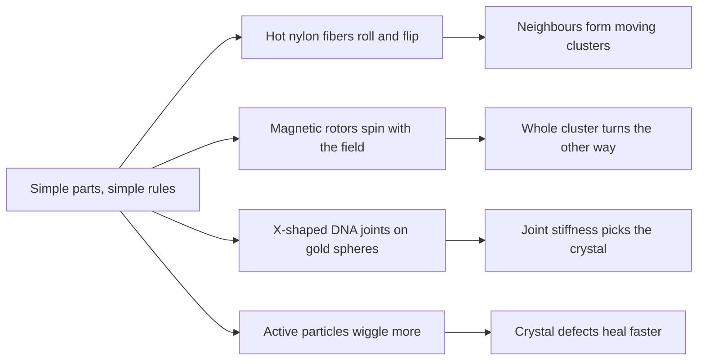

# Digest — 2026-10-20

*Curated America/New_York (ET). Prefer arXiv / open sources. Verified via the Tuesday 2026-10-20 arXiv `/new` listings (cond-mat.soft, cs.RO, cs.MA, physics.bio-ph, physics.chem-ph, cond-mat.stat-mech, nlin.AO, q-bio.BM), arXiv abstract pages, HTML versions and source files, Crossref date-window keyword and journal queries, DOI resolution, and publisher pages (JACS, Journal of Robotics and Mechatronics, Advanced Materials Technologies, Nature Materials).*  
*Focus: roughly since the 2026-10-19 digest; the Tuesday 2026-10-20 arXiv mailing (submissions mostly 2026-10-16 to 2026-10-19) plus journal articles first published online 2026-10-19 to 2026-10-20 that earlier digests had not covered.*

<Callout type="warning">
Frame these as **frontier progress**, not finished technology. Applications remain mostly lab-scale, tabletop, or simulation-scale.
</Callout>

## At a glance

*Diagram: original illustration of this digest's key idea (not from the papers).*

<PubImg
  src="/images/latest/2026-10-20-top-finds.svg"
  alt="Schematic of the top three finds in the 2026-10-20 digest: red and blue rods in an oval dish grouped into two clusters of three with direction arrows; a cluster of green rotor discs, each with a small clockwise arrow, inside a large yellow counterclockwise arrow; and yellow gold spheres connected by purple X-shaped DNA junctions in a regular grid"
  caption="Today's top finds at a glance: simple parts following simple rules give surprising group behavior."
  credit="Illustrative schematic by Self-Assembly Lab, not data from the papers"
  width={900}
  height={330}
/>

## Highlights

### 1. Twitching Fiberboids in the Collective: A Table-Top, One-Dimensional, Active Particle Gas
- **Authors:** Alex Arnhold, Falko Ziebert, Igor M. Kulić
- **Date / venue:** arXiv preprint, submitted 2026-10-19, announced 2026-10-20 (cond-mat.soft; CC BY 4.0)
- **Link:** https://arxiv.org/abs/2610.26087
- **Tidbits:**
  - "Fiberboids" are fibers that roll on their own along a surface when heat (or humidity) flows through that surface. The heat makes the fiber try to bend, the floor keeps it flat, and that frustration turns into a rolling torque.
  - The team used ordinary nylon fishing line (0.6 mm thick, cut into 7.5 cm pieces, pre-annealed) in a glass Petri dish (9.5 cm across) on a hot plate at 150 or 175 °C, filmed from above with a phone camera.
  - On a flat glass floor a fiber rolls steadily and bounces off the walls. On a **slightly curved** floor it "twitches": it rolls briefly, then reverses at random, so over long times it wanders like a diffusing particle.
  - Because the fibers are nearly as long as the dish is wide, they can only roll back and forth along one line. With 1 to 16 fibers this makes a **one-dimensional active gas** you can watch on a tabletop.
  - The fibers bump into each other and form moving clusters. Small clusters are most common, and the chance of finding a cluster drops roughly exponentially with its size. A simple lattice model only matches the experiment well when neighbouring fibers tend to align their rolling direction (a Vicsek-like rule).
  - Bonus observations: a small aluminium-foil ball can trap a fiber into steady rolling, and a wooden chip resting on top of several fibers ("crowd surfing") makes the cluster motion more collective.
- **Why a beginner should care:** It shows active matter (things that move on their own energy) with cheap, visible parts. Clusters form without glue, just from blocking and lining up.
- **Caveat:** Preprint; the setup uses a hot plate at 150 to 175 °C, so it is **not a classroom experiment**. Only up to 16 fibers were studied, and the alignment mechanism is still a hypothesis (possibly fiber curvature or air currents).

<PubImg
  src="/images/latest/2026-10-20-fiberboid-setup.jpg"
  alt="Left: cross-section sketch of a heating plate, a metal plate, and a blue curved-bottom Petri dish with two round nylon rods and double-headed arrows showing back-and-forth rolling. Right: photo of the glass Petri dish on a metal plate with a straight fiber inside, an orange microscope slide for scale, and the hot plate display reading 175"
  caption="The table-top setup: nylon rods in a curved-bottom Petri dish on a metal plate over a hot plate. Figure 1 from Arnhold, Ziebert and Kulić, arXiv:2610.26087v1."
  credit="Alex Arnhold, Falko Ziebert, Igor M. Kulić, arXiv:2610.26087, CC BY 4.0 (https://creativecommons.org/licenses/by/4.0/), rendered from source files and resized"
  width={1017}
  height={517}
/>

<PubImg
  src="/images/latest/2026-10-20-fiberboid-kymographs.jpg"
  alt="Four space-time plots, time 0 to 30 seconds on the horizontal axis and position in centimetres on the vertical axis. a: one bright zigzag line bouncing between the walls. b: one jagged line wandering near the bottom. c: many parallel zigzag lines moving together between the walls. d: many tangled, jagged bright tracks forming moving bundles"
  caption="Kymographs (position against time) of rolling fibers at 175 °C. a) one fiber on a flat floor rolls steadily and bounces off the walls; b) one fiber on a slightly curved floor twitches back and forth; c) 16 fibers on a flat floor; d) 16 fibers on the curved floor form moving clusters. Figure 2 from Arnhold, Ziebert and Kulić, arXiv:2610.26087v1."
  credit="Alex Arnhold, Falko Ziebert, Igor M. Kulić, arXiv:2610.26087, CC BY 4.0 (https://creativecommons.org/licenses/by/4.0/), rendered from source files and resized"
  width={1400}
  height={678}
/>

### 2. Emergent Chirality Reversal in Magnetically Driven Rotor Clusters
- **Authors:** Xinzhi Li, Ke Zhong, Mohammad F. Islam, Shiladitya Banerjee
- **Date / venue:** arXiv preprint, submitted 2026-10-18, announced 2026-10-20 (cond-mat.soft; arXiv non-exclusive license, so no figure is reproduced here)
- **Link:** https://arxiv.org/abs/2610.25537
- **Tidbits:**
  - Tiny magnetic rotors in a rotating magnetic field each spin in the field's direction. Magnetic (dipolar) attraction pulls them together into compact, ordered clusters with no trap needed.
  - The surprise: the **whole cluster can rotate the opposite way** to every rotor inside it, without flipping the field.
  - Two effects compete. Spinning near a surface makes each rotor roll around the field centre (rotation-translation coupling), which favours one direction. Dipolar interactions acting through the cluster's shape favour the other.
  - The rolling effect grows faster with cluster size than the dipolar one, and the dipolar effect weakens at higher drive frequency. So the cluster's handedness can be tuned just by **how many rotors** it has and **how fast** the field turns. Fluid (hydrodynamic) interactions shift the switch point but are not needed for the reversal.
- **Why a beginner should care:** It pairs nicely with yesterday's anti-synchronized colloids: the whole is not just a scaled-up part. A group can turn against the very spin its members follow.
- **Caveat:** Preprint; a 2D simulation model with a simplified rolling term and no wall corrections to the flow. The authors list predictions for experiments, but none are shown yet.

### 3. Programming Symmetry in Colloidal Crystal Engineering with DNA Using Four-Way Junction-Dendrons
- **Authors:** Ana Clara Zampirolli Leal, Domagoj Fijan, Kaitlin M. Landy, Kyle J. Gibson, Byeongdu Lee, Sajib Barua, Xiaobing Zuo, Sharon C. Glotzer, Chad A. Mirkin
- **Date / venue:** Journal of the American Chemical Society, published online 2026-10-19 (license not confirmed, so no figure is reproduced here)
- **Link:** https://doi.org/10.1021/jacs.6c15674
- **Tidbits:**
  - Gold nanoparticles coated with DNA strands act like "programmable atoms" that click together into 3D crystals (superlattices). Round particles usually give high-symmetry crystals; getting lower-symmetry ones normally needs oddly shaped particles.
  - Here the direction comes from the DNA instead: small branched DNA pieces built around a **four-way junction** (an X-shaped DNA crossroads, like the Holliday junction) co-assemble with plain round gold particles.
  - Rigid junctions stack into a "stacked Holliday" shape, which makes bonding directional. Depending on the size ratio of junction piece to nanoparticle, the result is a **simple hexagonal** crystal or a **distorted hexagonal close-packed** one, confirmed by X-ray scattering (SAXS) and molecular dynamics simulations.
  - With **flexible** junctions, the crystal symmetry switches between those two lattices even at the same size ratio.
- **Why a beginner should care:** It separates "what the particle looks like" from "which way it bonds". The connector, not the brick, decides the pattern.
- **Caveat:** Specialist DNA nanotechnology done in research labs with synchrotron X-rays; there is no classroom version, and uses are still far off.

### 4. Tunable Annealing of Defects in Self-Aligning Active Crystals
- **Authors:** Kanka Ghosh, Andreas M. Menzel
- **Date / venue:** arXiv preprint, submitted 2026-10-19, announced 2026-10-20 (cond-mat.soft; CC BY 4.0)
- **Link:** https://arxiv.org/abs/2610.26459
- **Tidbits:**
  - A crystal made of many small grains pointing different ways (a polycrystal) has defects at the grain boundaries. Making one clean single crystal is hard.
  - In simulations of self-propelled particles that line up their heading with their motion (self-aligning active Brownian particles), the authors find that **more orientational wiggle** around the shared direction helps defects heal.
  - Their picture: first a "heating" phase, where long, persistent runs shake the crystal and let it cross energy barriers, then a "cooling" phase, as headings align and the motion settles. Tuning the persistence and alignment timescales gives either defect-rich or defect-free crystals.
  - A similar defect healing appears in crystals of point-like active particles when flocking is delayed.
- **Why a beginner should care:** Like shaking a box of marbles to make them pack better, but here the particles do the shaking themselves.
- **Caveat:** Preprint, 2D simulation only, in reduced units; no experimental test yet.

<PubImg
  src="/images/latest/2026-10-20-active-crystal-annealing.jpg"
  alt="Two stacked plots against time on a log axis from 0.001 to 100. Top: velocity fluctuations relative to a passive crystal rise on a red heating background to a peak near time 1, then drop to about 1 on a blue cooling background. Labels show persistence length for heating and the product of persistence and alignment times for cooling. Bottom: polar order P rises from 0 to 1 around time 1, with sketches of particles whose arrows point in random directions early and all the same way late"
  caption="Schematic of activity-driven defect annealing: an early 'heating' stage of large velocity fluctuations (set by persistence length) is followed by 'cooling' as the particles align (set by persistence and alignment times). Figure 9 from Ghosh and Menzel, arXiv:2610.26459v1."
  credit="Kanka Ghosh, Andreas M. Menzel, arXiv:2610.26459, CC BY 4.0 (https://creativecommons.org/licenses/by/4.0/), rendered from source files and resized"
  width={1200}
  height={900}
/>

### 5. Phase Diagram of the Two-Dimensional Vicsek Model (and companion: Coexistence Phase of the Two-Dimensional Vicsek Model)
- **Authors:** Yu Duan, Hugues Chaté, Benoît Mahault, Xia-qing Shi
- **Date / venue:** two arXiv preprints, submitted 2026-10-19, announced 2026-10-20 (cond-mat.stat-mech)
- **Links:** https://arxiv.org/abs/2610.26569 and https://arxiv.org/abs/2610.26561
- **Tidbits:**
  - The Vicsek model is the classic "flocking" rule: each particle moves at constant speed and copies the average heading of its neighbours, plus some noise.
  - Using simulations at sizes and times never explored before, the authors update its 2D phase diagram: there is more than one way the flock separates into dense bands and sparse gas, and the coexistence region splits in two.
  - The companion paper reports many kinds of band patterns, but argues most vanish for very large systems. Even the neat, ordered band states can be destroyed by a local poke, so at very large scales that phase is a chaotic mix of travelling bands.
- **Why a beginner should care:** Even the simplest swarm rule still holds surprises after about 30 years. This is the rule many robot-swarm demos start from.
- **Caveat:** Pure simulation and theory; about idealized point particles, not real robots or animals.

### 6. Electropermanent Magnet Modular Boa (EMB): Reconfigurable Snake Robot with Magnetic Wall Interaction
- **Authors:** Yuya Shimizu, Yosuke Kita, So Shimooka, Tetsushi Kamegawa
- **Date / venue:** Journal of Robotics and Mechatronics, vol. 38, no. 5, p. 1459, published 2026-10-20
- **Link:** https://doi.org/10.20965/jrm.2026.p1459
- **Tidbits:**
  - A modular snake robot whose segments can join or detach, so it can change how many joints it has or drop a failed module.
  - Each connector combines an **electropermanent magnet** (a magnet you switch on or off with a short current pulse, then it holds without power) for pulling force with passive pins that take sideways (shear) loads and line up the electrical contacts.
  - That makes the joint both strong and simple, fixing the weak point of earlier magnet-only connectors, which shook loose during motion.
- **Why a beginner should care:** Modular, self-reconfiguring robots are the robot side of self-assembly, and the connector is usually the hardest part.
- **Caveat:** A lab prototype; we read the abstract only, so performance numbers are not reported here.

### Stretch (theory / adjacent)
- **Self-organizing reinforcement learning: a swarm approaches the explore-exploit optimum** (Galen J. Wilkerson; arXiv, 2026-10-18): https://arxiv.org/abs/2610.25113 — a reward-free foraging swarm (random long jumps, recruit neighbours, spread out when crowded) gets close to the ideal sharing of resources; in one embodied test it reaches about 65% of an oracle ceiling with no training, until trained learners overtake it at about 74 to 75%.
- **A general mechanism for collective foraging: percolating recruitment cascades** (Galen J. Wilkerson; arXiv, 2026-10-17): https://arxiv.org/abs/2610.24865 — recruitment spreads like a rumour on the swarm's contact network; up to 7.6 times the harvest of solo search when food is sparse and clustered.
- **Chirality destroys oriented active solids** (S. J. Kole, Gareth P. Alexander, Ananyo Maitra, Sriram Ramaswamy; arXiv, 2026-10-19): https://arxiv.org/abs/2610.25953 — hydrodynamic theory showing active chiral forces generically destabilize 3D uniaxial solids, except higher-symmetry polar elastomers.
- **Dynamic clustering of active chemotactic Janus particles** (Joël Mabillard, Frédéric van Wijland, Jean-Baptiste Fournier; arXiv, 2026-10-19): https://arxiv.org/abs/2610.26657 — revisits a classic experiment; clusters arise from a mix of chemical attraction collapse and motility-induced phase separation.
- **CROPS: Cosserat-rod-based co-design of soft slender programmable material systems** (Chandrasekhar, Lee, Kwon, Li, Chen; arXiv, 2026-10-16, CC BY 4.0): https://arxiv.org/abs/2610.24209 — differentiable design of swelling stents and magnetic catheters as programmable slender materials (simulation case studies).
- **Autonomous reconfigurable modular conductive hydrogels** (Burgess, Wolny, Liu, Cysewska, Nair; Advanced Materials Technologies, 2026-10-19, CC BY 4.0): https://doi.org/10.1002/admt.71406 — freeze-dried hydrogel pieces are injected through a syringe and re-join into a conductive network, recovering 90% of conductivity; tested on human skin explants.
- **Genes take control of active matter** (Fan Yang, Matt Thomson; Nature Materials News & Views, 2026-10-20): https://doi.org/10.1038/s41563-026-02773-6 — commentary on cell-free gene expression controlling cytoskeletal networks, a route toward genetically programmed biomaterials.
- **Edible mobile robot using confectionery and baked materials** (Igeta, Furukawa, Ogawa; Journal of Robotics and Mechatronics, 2026-10-20): https://doi.org/10.20965/jrm.2026.p1439 — a fun outlier: robots built partly from food, which could be eaten after delivering supplies.

---

## Safe classroom / discussion follow-ons

1. **Human 1D active gas (inspired by item 1):** In a hallway, mark a straight line with tape between two "walls". Students stand on the line facing left or right and step once per clap. Before each clap, anyone with nobody in front of them flips a coin; tails means turn around. If the spot ahead is taken, wait. Try a second round where you turn to match a touching neighbour. Count how many clusters form and how long they last in each round. No equipment beyond tape and coins, and no hot plates.
2. **Spin the group, not the part (inspired by item 2):** Place 7 to 19 identical coins or bottle caps flat on a turntable or lazy Susan in a tight hexagon. Spin the turntable slowly and watch whether the group stays together, and how individual caps move inside it. Then discuss: in the preprint each rotor spins one way while the cluster turns the other. Why might a group's motion differ from its members'? Household items only.
3. **Simulate it (items 1, 4, 5):** In a spreadsheet or a short Python notebook, put "particles" on a 1D row of cells that hop left or right and randomly flip direction, with the rule that they cannot share a cell. Add a rule that touching particles copy each other's direction, and compare the cluster sizes. Computer only.

## Key idea of the day

Simple parts following simple rules can surprise you: fishing-line fibers cluster without glue, a cluster of spinners turns against its own members, the stiffness of a DNA connector picks the crystal, and self-propelled particles heal their own crystal defects. All of this is still tabletop, lab, or simulation scale, so treat it as a starting point, not finished technology.
