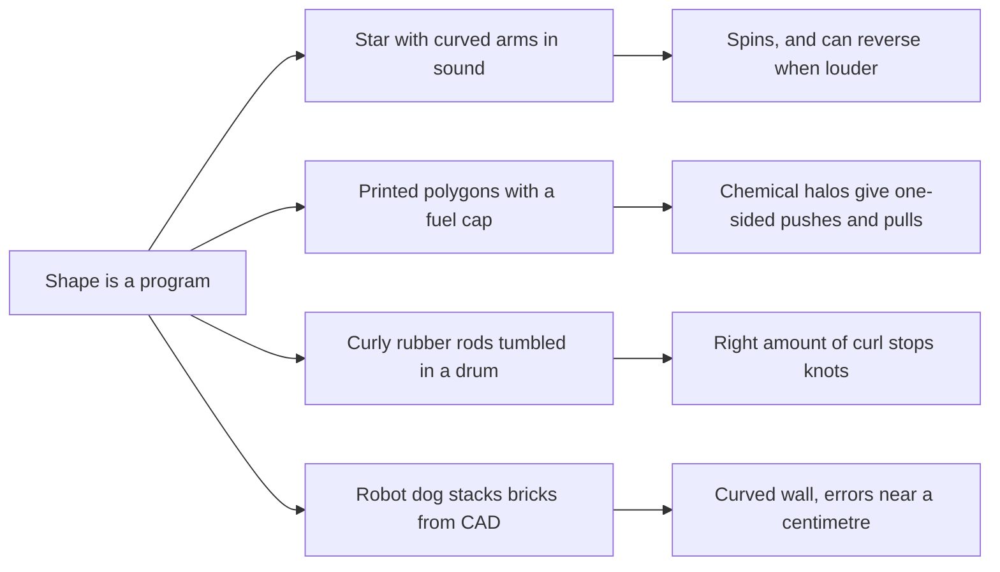

# Digest — 2026-10-21

*Curated America/New_York (ET). Prefer arXiv / open sources. Verified via the Wednesday 2026-10-21 arXiv `/new` listings (cond-mat.soft, cs.RO, cs.MA, physics.bio-ph, physics.chem-ph, cond-mat.stat-mech, nlin.AO, q-bio.BM), arXiv abstract pages, HTML versions and source files, Crossref date-window keyword and journal queries, DOI resolution, and publisher pages (Physical Review Letters and Physical Review E accepted-paper pages, Communications Physics, Nature Nanotechnology, PNAS; Langmuir via Crossref metadata).*  
*Focus: roughly since the 2026-10-20 digest; the Wednesday 2026-10-21 arXiv mailing (submissions mostly 2026-10-19 to 2026-10-20) plus journal articles first published online 2026-10-20 to 2026-10-21 that earlier digests had not covered. It was a light day for self-assembly on arXiv, so a few robotics-assembly items fill out the list.*

<Callout type="warning">
Frame these as **frontier progress**, not finished technology. Applications remain mostly lab-scale, tabletop, or simulation-scale.
</Callout>

## At a glance

*Diagram: original illustration of this digest's key idea (not from the papers).*

<PubImg
  src="/images/latest/2026-10-21-top-finds.svg"
  alt="Schematic of the top three finds in the 2026-10-21 digest: a grey mirror-symmetric star with straight arms that does not spin next to a green star with curved arms and a yellow rotation arrow under wavy sound lines; four white polygons with red direction arrows, each inside a faint blue chemical halo; and two round drums, one holding a tangled red loop labelled straight: knots and one holding a green wavy helix labelled very curly: fewer"
  caption="Today's top finds at a glance: the shape of a part changes how it spins, interacts, and tangles."
  credit="Illustrative schematic by Self-Assembly Lab, not data from the papers"
  width={900}
  height={330}
/>

## Highlights

### 1. Programmable Nonlinear Rotation of Acoustically Levitated Chiral Stars
- **Authors:** Sue Shi, Maximilian C. Hübl, Aarnav Panda, Thorfinn Barton, Carl P. Goodrich, Scott R. Waitukaitis
- **Date / venue:** arXiv preprint, submitted 2026-10-20, announced 2026-10-21 (cond-mat.soft; arXiv non-exclusive license, so no figure is reproduced here)
- **Link:** https://arxiv.org/abs/2610.27927
- **Tidbits:**
  - Sound can hold small objects in mid-air: a standing ultrasonic wave (51 kHz here, between a transducer and a sapphire reflector) traps a particle near a pressure node. Levitated things often start spinning on their own, and nobody had a general rule for when or which way.
  - The team 3D-printed flat "chiral stars" (200 µm thick, fitting inside a 1 mm circle) with curved arms, plus mirror-symmetric shapes (triangles, squares, pentagons, a straight-armed star) for comparison.
  - In a carefully aligned sound field, the **mirror-symmetric shapes never spin**. The chiral stars start spinning within a few hundred milliseconds, and the **handedness of the arms sets the direction**. Flipping a star over reverses its spin.
  - Surprise: louder sound does not always mean faster spin. 3- and 5-armed stars speed up over the whole range tested, 7-armed stars peak and slow down, and 10- and 12-armed stars slow, stop and then **spin the other way**.
  - A simple torque-versus-drag model, checked against separately measured drag, fits all the shapes. The team then designed a **"hybrid star"** (half of a 4-armed star joined to half of a 10-armed star of opposite handedness) that turns one way when quiet and the other way when loud, and it reversed close to the predicted voltage.
- **Why a beginner should care:** It is a clean example of "shape as a program": you choose the outline of a part, and that choice decides how it will move in a field, with no motors or electronics on the part.
- **Caveat:** Preprint; one lab, one single-axis levitator, millimetre-scale printed parts. The authors note that misaligned sound fields can make any shape spin, so the result depends on very careful alignment.

### 2. Emergent Non-Reciprocal Pair Interactions in Catalytically Propelled Active Polyhedra
- **Authors:** Silvana A. Caipa Cure, Sander C. Kammeraat, Jérôme Hem, Silke Henkes, Daniela J. Kraft
- **Date / venue:** arXiv preprint, submitted 2026-10-20, announced 2026-10-21 (cond-mat.soft; CC BY 4.0)
- **Link:** https://arxiv.org/abs/2610.27821
- **Tidbits:**
  - Most experiments on self-propelled colloids use spheres. Here the team **3D micro-printed flat polygons** (triangles, squares, pentagons, hexagons, plus discs; about 8 to 10 µm across) and gave each one a catalytic iridium cap, so they swim in a very dilute fuel (hydrazine at 0.0005% by volume).
  - Alone, all the shapes move in similar ways. To see how pairs interact, they used **Stochastic Force Inference**, a way of working out the hidden forces from many recorded trajectories.
  - The inferred pair forces are mostly along the line between particles and **non-reciprocal**: A does not push or pull B the same way B pushes or pulls A. Every shape shows attractive and repulsive zones at centre-to-centre distances of about two particle diameters, and chemical fields reach up to about five diameters.
  - A minimal simulation of disc-shaped "phoretic" active particles (ones that make and respond to their own chemical gradients) reproduces the pattern. Slowing down where the fuel is used up sets the main angular pattern; the corners only **modulate** the strength and angle of the interaction, more so for stronger anisotropy.
- **Why a beginner should care:** Self-assembly is often described as "shape plus glue". This paper shows that for active particles, the chemical clouds they make can matter more than their corners.
- **Caveat:** Preprint; specialist microfabrication, and hydrazine is a toxic chemical, so there is **no classroom version**. Results are for pairs at modest density, not big clusters.

<PubImg
  src="/images/latest/2026-10-21-active-polygons.jpg"
  alt="Multi-panel scientific figure. A: sketch of a pentagon about 8 to 10 micrometres across, coated with silica and iridium, then moving in hydrazine with red force arrows. B: five electron-microscope images of a disc, triangle, square, pentagon and hexagon with 10 micrometre scale bars. C: five star-shaped bundles of trajectories coloured by time up to 120 seconds. D: histograms of speeds of a few micrometres per second for each shape. E: decaying velocity autocorrelation curves for the five shapes"
  caption="How the active polygons are made and how they move alone: (A) print, coat with silica and iridium, then add dilute hydrazine fuel; (B) electron-microscope images of the five shapes; (C) trajectories from the origin; (D) speed and diffusion distributions; (E) how quickly each shape forgets its direction. Figure 1 from Caipa Cure et al., arXiv:2610.27821v1."
  credit="Silvana A. Caipa Cure, Sander C. Kammeraat, Jérôme Hem, Silke Henkes, Daniela J. Kraft, arXiv:2610.27821, CC BY 4.0 (https://creativecommons.org/licenses/by/4.0/), rendered from source files"
  width={1347}
  height={1277}
/>

### 3. Intrinsic Curvature Controls Spontaneous Entanglement of Elastic Rods
- **Authors:** Fani Derveni, Javier Sabater, Pedro M. Reis
- **Date / venue:** arXiv preprint, submitted 2026-10-19, announced 2026-10-21 (cond-mat.soft; arXiv non-exclusive license, so no figure is reproduced here)
- **Link:** https://arxiv.org/abs/2610.27342
- **Tidbits:**
  - Everyone knows earphone cables tangle in a pocket. The team cast soft silicone rods, either **straight** or **naturally curly (helical)**, coated them in talc, and tumbled them in a cylinder on a two-axis rotating machine for 20 minutes. Each condition was repeated 15 times.
  - They measured two different kinds of tangle: **knotting** (a tangle that survives pulling both free ends apart) and **locking** (one end cannot be pulled out past a stopper).
  - For straight rods, the chance of knotting rises with length, as earlier string-tumbling experiments found. Highly curved rods knot **up to 73% less often** across lengths.
  - Curvature has a non-monotonic effect: a little curl first raises knotting, then above a critical curvature knotting is **fully suppressed** in their experiments. The authors say the physical reason is still open.
  - Locking barely cares about curvature and depends mainly on rod length, which suggests the two kinds of tangle come from different mechanisms.
- **Why a beginner should care:** Tangling is the dark side of self-assembly: parts that clump the wrong way. The built-in shape of a filament is a dial you can turn to make tangles more or less likely, which may also matter for DNA and other long molecules.
- **Caveat:** Preprint; results are specific to one rod thickness, one container and one tumbling speed, and the authors say generality still needs testing.

### 4. Density Accelerated Relaxation in Active Passive Colloidal Networks with Competing Interactions
- **Authors:** Pronay Dutta, Hima Nagamanasa Kandula
- **Date / venue:** arXiv preprint, submitted 2026-10-19, announced 2026-10-21 (cond-mat.soft; CC BY 4.0)
- **Link:** https://arxiv.org/abs/2610.27207
- **Tidbits:**
  - A nearly flat mixture of active (self-propelled) and passive colloids, where an electric field makes **unlike particles attract and like particles repel**.
  - By mapping total crowding and the share of active particles, they find an active fluid, clusters, and a regime where the particles form a connected **network** that spans the sample.
  - Inside that network regime, the structure **relaxes faster as it gets denser**, the opposite of what you expect for dense gels, which usually get stuck. Particle-level tracking links this to activity-driven rearrangements made possible by the lopsided interactions.
- **Why a beginner should care:** Normally crowding freezes things. Here a few active "movers" in a network keep reshuffling it, a possible route to self-healing, adaptable materials.
- **Caveat:** Preprint; short letter-style report, read at abstract level, so no numbers are given here.

### 5. Spontaneous Oscillations and Geometric Cutoff in Confined Bacterial Swarms
- **Authors:** Bing Miao, Lei-Han Tang
- **Date / venue:** Physical Review Letters, accepted 2026-10-20 (accepted paper; final version not yet published)
- **Link:** https://doi.org/10.1103/t72b-4s6m
- **Tidbits:**
  - Dense bacteria in thin liquid films can circulate in large, self-organized **elliptical motions**, and why has been unclear.
  - In a minimal theory, the fluid carries long-range feedback between run-and-tumble bacteria. Swimming across the film plus the way rod-like cells rotate in shear flow gives a response that runs slightly ahead of the flow.
  - Oscillations appear only **above a critical cell density** and **below a cutoff film thickness**. Using independently measured cell and fluid parameters, the theory accounts for both the onset density and the oscillation frequency seen in experiments.
- **Why a beginner should care:** The container is part of the recipe: just making the film thinner or thicker can switch a whole swarm's rhythm on or off.
- **Caveat:** Theory paper matched to earlier experiments; we read the accepted abstract only.

### 6. Towards Autonomous Bricklaying Using Boston Dynamics Spot
- **Authors:** Karl-Johan Sorensen, Nico vom Hofe, Frank H. P. Fitzek
- **Date / venue:** arXiv preprint, submitted 2026-10-20, announced 2026-10-21 (cs.RO; CC BY 4.0)
- **Link:** https://arxiv.org/abs/2610.27472
- **Tidbits:**
  - A four-legged Spot robot with an arm walks between a supply area and a building area, using printed AprilTag markers to know where it is, and stacks bricks whose target positions come straight from CAD software.
  - In ten repeated builds of a curved four-layer wall of 14 wooden bricks, mean position errors were below 10 mm and mean turning (yaw) errors below 1.5 degrees; the overall RMSE was 27.72 mm and 2.06 degrees.
  - It was also tested outdoors with **stairs** between the pick-up and build areas.
- **Why a beginner should care:** It is the robot side of assembly: a "blueprint in, structure out" pipeline. Today one robot follows a plan; self-assembly research asks how many simple builders could do this with only local rules.
- **Caveat:** A proof-of-concept with light wooden bricks and one robot; no mortar, no large walls, not a construction product.

<PubImg
  src="/images/latest/2026-10-21-spot-bricklaying.jpg"
  alt="Three superimposed video frames of a pink and white Spot quadruped robot with an arm in a grey-floored room: at position 1 it picks a wooden brick near a fiducial marker, at position 2 it walks holding the brick, and at position 3 it places the brick on a curved wall of wooden bricks on a black mat"
  caption="Superimposed video frames of Spot at the pick position (1), autowalking (2), and at the place position (3) next to the curved wooden-brick wall. Figure from Sorensen, vom Hofe and Fitzek, arXiv:2610.27472v1."
  credit="Karl-Johan Sorensen, Nico vom Hofe, Frank H. P. Fitzek, arXiv:2610.27472, CC BY 4.0 (https://creativecommons.org/licenses/by/4.0/), from source files, resized"
  width={1100}
  height={648}
/>

### 7. Safe Multi-Robot Collaboration With Uniform Exclusion Using Trust
- **Authors:** Thomas Kaminsky, Áron Vékássy, Hammad Izhar, Angelia Nedić, Stephanie Gil
- **Date / venue:** arXiv preprint, submitted 2026-10-20, announced 2026-10-21 (cs.RO, cross-listed to cs.MA)
- **Link:** https://arxiv.org/abs/2610.28251
- **Tidbits:**
  - Robot swarms share data over local links, and some links might be hacked to send bad data. This "safe wrapper" decides which incoming links to trust, using a stream of trust scores from an anomaly detector that only needs to be **better than chance**.
  - It comes with two statistical guarantees: with a user-chosen high probability it **excludes every compromised link for all time**, yet it still learns quickly to trust honest links.
  - Tested in hardware on 3 LoCoBots (mapping) and 8 GoPiGo robots (agreeing on a heading), with simulations suggesting it scales to swarms of hundreds.
- **Why a beginner should care:** Swarms that self-organize from local messages are only as good as those messages. Trust is a quiet but key ingredient.
- **Caveat:** Preprint; small hardware teams, with larger swarms only in simulation.

### Stretch (theory / adjacent)
- **Emergent active-blob length scale governs the collapse transition of tangentially driven polymers** (Baptiste Parage, Sara Jabbari-Farouji; arXiv, 2026-10-20): https://arxiv.org/abs/2610.27787 — simulations of chains pushed along their own backbone; activity smears out the coil-to-globule collapse and introduces an "active blob" folding length, giving a universal master curve.
- **Dynamics of self-organization in dense persistent active matter** (Atharva Shukla, Chandan Dasgupta; Physical Review E, accepted 2026-10-20): https://doi.org/10.1103/p7hh-6tn5 — in 2D simulations of a dense active mixture, long-range velocity correlations grow from a random start much like ordering after a quench, ending in two streams flowing in opposite directions.
- **Quantitative relationship between coupled structural dynamics and collective order in the original Vicsek model** (Ruizhi Jin, Kejun Dong; Communications Physics, 2026-10-20, open access CC BY 4.0): https://doi.org/10.1038/s42005-026-02933-9 — in the classic flocking model, how ordered the flock is tracks the average number of neighbours each particle interacts with.
- **Screw dislocation-mediated galaxy-mimicking superspiral assembly with amplified bio-piezoelectricity** (Jiahao Zhang et al.; PNAS, 2026-10-20): https://doi.org/10.1073/pnas.2611417123 — a single simple amino-acid building block self-assembles into spiral architectures whose handedness is tuned by enantiomeric excess; the spirals give a 17-fold larger piezoelectric response than random aggregates.
- **Supramolecular chemical ligation of helical polymers** (Minyi Ma, ..., Ben L. Feringa, Qi Zhang; Nature Nanotechnology, 2026-10-20): https://doi.org/10.1038/s41565-026-02310-1 — hydrogen bonds fold polymer chains into stiff helices with "sticky ends" that line up, so the chains can then be covalently joined end to end without heating.
- **Bio-inspired superhydrophilic urchin-like supramolecular structures formed by co-assembly of simple metabolites** (Ruth Aizen, ..., Ehud Gazit; Langmuir, 2026-10-20, CC BY 4.0 per Crossref): https://doi.org/10.1021/acs.langmuir.6c03644 — riboflavin (vitamin B2) and 2,6-diaminopurine co-assemble into urchin-like structures that make glass superhydrophilic, which neither molecule does alone.
- **JARVIS: From Visual Manuals to Autonomous Robotic Assembly** (Fan Ding et al.; arXiv, 2026-10-20): https://arxiv.org/abs/2610.27618 — a benchmark of 236,679 LEGO assembly tasks across 8,987 scenes; AI agents that read picture manuals do worse as the build gets longer, and errors are hard to fix.
- **Structure and dynamics of defects in two-dimensional nematic liquid crystals** (Cody D. Schimming, Daniel A. Beller; arXiv, 2026-10-19, CC BY 4.0): https://arxiv.org/abs/2610.27278 — a review of the analytical theory of defects in 2D liquid crystals, the same defects that organize active nematics and developing tissues.
- **Does a flux-defined Markov blanket screen self-replicating Gray-Scott spots?** (John E. Pearson; arXiv, 2026-10-19): https://arxiv.org/abs/2610.27235 — tests a free-energy-principle idea on self-replicating reaction-diffusion spots and finds the proposed boundary does not screen inside from outside.

---

## Safe classroom / discussion follow-ons

1. **Paper pinwheel chirality test (inspired by item 1):** Cut two paper stars about 8 cm across from card. Leave one with straight arms and bend the tip of every arm of the other the same way (all clockwise), like a little turbine. Hold each by a pin through the centre in front of a desk fan on low, or blow gently from straight in front. Which one spins, and which way? Flip the bent star over and repeat. Then try stars with 3, 5 and 8 bent arms and see whether more arms always means faster. Paper, a pin and a fan only (keep fingers away from the fan).
2. **Tangle lottery (inspired by item 3):** Put a 50 cm piece of string in a shoebox, close the lid, and shake or roll it for 10 seconds. Open it and pull both ends: did a knot survive? Repeat 15 times and count. Then do the same with a curly piece of the same length (for example a coiled phone-charger cable, or a pipe cleaner wound tightly around a pencil and slid off). Compare how often each knots and graph the results.
3. **Who pushes whom? (inspired by item 2):** On a playground, pairs of students play "follow, but not equally": student A walks toward B, while B walks away from A. Watch how the pair moves together across the yard. Discuss how one-sided pushes and pulls can make a pair travel, which equal pushes and pulls cannot. No equipment.
4. **Blueprint to build (inspired by items 6 and the JARVIS benchmark):** One student draws a curved wall of 14 building blocks on squared paper. A partner builds it from the drawing without talking, then measures how far each block is from where it should be with a ruler. Repeat 3 times and see whether errors grow toward the top layers.

## Key idea of the day

Shape works like a program: curved arms decide whether a levitated star spins and even when it reverses, a filament's built-in curl decides how often it knots, and for active particles the chemical cloud they make can matter more than their corners. All of this is tabletop, lab, or simulation scale, so treat it as a starting point, not finished technology.
