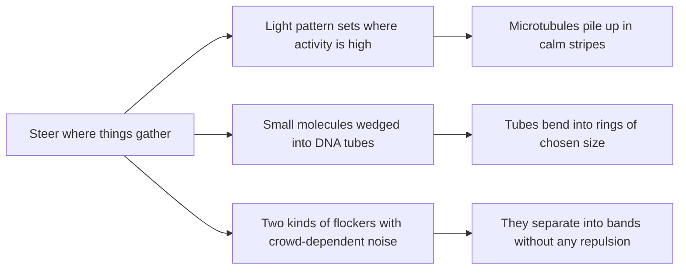

# Digest — 2026-10-22

*Curated America/New_York (ET). Prefer arXiv / open sources. Verified via the Thursday 2026-10-22 arXiv `/new` listings (cond-mat.soft, cs.RO, cs.MA, physics.bio-ph, physics.chem-ph, cond-mat.stat-mech, nlin.AO, q-bio.BM), arXiv abstract and HTML pages, the arXiv API, Crossref date-window keyword queries, and DOI resolution (Langmuir, The Journal of Chemical Physics, NPG Asia Materials, Materials and Interfaces).*  
*Focus: roughly since the 2026-10-21 digest; the Thursday 2026-10-22 arXiv mailing (submissions 2026-10-21) plus journal articles first published online 2026-10-21 to 2026-10-22. It was a light day: no new robotics self-assembly or swarm-construction papers, so this digest leans on soft and active matter and DNA nanotech.*

<Callout type="warning">
Frame these as **frontier progress**, not finished technology. Applications remain mostly lab-scale, tabletop, or simulation-scale.
</Callout>

## At a glance

*Diagram: original illustration of this digest's key idea (not from the papers).*

<PubImg
  src="/images/latest/2026-10-22-top-finds.svg"
  alt="Schematic of the top three finds in the 2026-10-22 digest: alternating orange and blue vertical stripes with many short green filaments crowded in the blue stripes; a straight blue DNA tube with an arrow to a blue ring studded with yellow wedges; and a mix of pink and green arrows that turns into horizontal bands of a single colour"
  caption="Today's top finds at a glance: patterned activity, wedged DNA, and crowd-dependent noise each decide where parts end up."
  credit="Illustrative schematic by Self-Assembly Lab, not data from the papers"
  width={900}
  height={330}
/>

## Highlights

### 1. Spatial Control of Compressible Active Fluids
- **Authors:** Yu-Chuan Cheng, Dimitris Krommydas, Seungwoo Shin, Paarth Gulati, Michael F. Hagan, Aparna Baskaran, Cristina M. Marchetti, Zvonimir Dogic
- **Date / venue:** arXiv preprint, submitted 2026-10-21, announced 2026-10-22 (cond-mat.soft; arXiv non-exclusive license, so no figure is reproduced here)
- **Link:** https://arxiv.org/abs/2610.30092
- **Tidbits:**
  - "Active fluids" made of microtubule filaments and motor proteins churn on their own, in chaotic swirls. The team made the activity strength vary in **sine-wave stripes** across the sample and watched where the filaments went.
  - Microtubules **gathered in the low-activity stripes** and emptied out of the high-activity ones. How strong that difference got depended on the stripe spacing.
  - With narrow stripes, swirls spanning a calm and a busy stripe mixed everything back together, so little density pattern appeared. With wide stripes, swirls stayed inside one stripe and the density contrast could build up.
  - A minimal continuum model matched the experiments, but only once it included both the usual active stresses and an extra **"active pressure"** that pushes equally in all directions.
- **Why a beginner should care:** It is a recipe for patterning a self-organizing material from outside: you do not place the filaments, you shape where the "busy" zones are and they sort themselves.
- **Caveat:** Preprint; specialist biochemistry (purified microtubules and motors), and we read the abstract only, so no numbers are given here.

### 2. Self-Assembly of DNA Nanodonuts via Selective Insertions of Azobenzene Molecules
- **Authors:** Bo Kou, Daniel Fu, Mengyao Sun, Lei Yu, Luyao Shen, Shoujun Xiao, Yonggang Ke
- **Date / venue:** Langmuir, published online 2026-10-21 (ACS standard license, so no figure is reproduced here)
- **Link:** https://doi.org/10.1021/acs.langmuir.6c04685
- **Tidbits:**
  - DNA nanotubes are normally stiff and straight. The team inserted **azobenzene**, a small light-sensitive molecule, at chosen spots inside the DNA double helix.
  - Three azobenzene units inside an 8-letter stretch of DNA make that part of the helix **fatter**. Put these wedges on one side and the tube bends.
  - By choosing how many wedges and where, they bent nanotubes into closed **"donuts" from about 40 to 200 nm across**, with the ring size set by design.
- **Why a beginner should care:** It is the same trick as bending a bimetal strip or a paper strip with tape on one side: make one side longer than the other and the whole thing curves. Here it works on single molecules.
- **Caveat:** Lab-scale DNA nanotechnology; we read the abstract only. It shows control of shape, not an application yet.

### 3. Clutter Noise Induced Phase Segregation in Binary Active Polar Flocks
- **Authors:** Pradeep Kumar Yadav, Ignacio Pagonabarraga
- **Date / venue:** arXiv preprint, submitted 2026-10-21, announced 2026-10-22 (cond-mat.soft; arXiv non-exclusive license)
- **Link:** https://arxiv.org/abs/2610.30008
- **Tidbits:**
  - Two kinds of "flockers" (in a Vicsek model, where each agent copies its neighbours' heading with some randomness) are mixed together.
  - The twist: each agent's randomness depends on **who is around it**, which the authors call **clutter noise**. There is no repulsion and no rule telling unlike agents to turn away from each other.
  - That alone breaks up the mixture into multiple stripes, bands moving together, bands moving in opposite directions, and finally a stable **separated** flowing state.
  - A continuum theory shows the clutter noise lowers local order and transport, consistent with the separation seen in the simulations.
- **Why a beginner should care:** Sorting does not need "dislike". If one group simply gets more confused in mixed company, the crowd sorts itself.
- **Caveat:** Simulation and theory only; we read the abstract.

### 4. Closing of Density Wake in Concentrated Colloidal Suspensions
- **Authors:** Guillaume Duprez, Gianmarco Spera, Benjamin Buhl, François Graner, Vincent Démery, Cécile Cottin-Bizonne, Hélène Delanoë-Ayari, Mathieu Leocmach
- **Date / venue:** arXiv preprint, submitted 2026-10-21, announced 2026-10-22 (cond-mat.soft; CC BY 4.0)
- **Link:** https://arxiv.org/abs/2610.29801
- **Tidbits:**
  - A small obstacle is dragged through a dense single layer of colloids, either ordinary (thermal) ones or self-propelled Janus particles, and leaves a **low-density wake** behind it, like a boat.
  - For ordinary colloids the wake length first **shrinks and then grows** as the layer gets more crowded. Simple arguments based on how compressible the suspension is explain both regimes.
  - With self-propulsion, the obstacle behaves as if it were **effectively larger**, with the swimming speed and how long particles keep their direction playing different roles.
- **Why a beginner should care:** Before particles can assemble, they have to flow around things. This shows crowding and activity change how a "hole" in a crowd heals.
- **Caveat:** Preprint; a 2D monolayer under a microscope, with experiments plus simulations.

<PubImg
  src="/images/latest/2026-10-22-density-wake-setup.png"
  alt="Two-panel figure. Top: sketch of a tilted cell where half-coated Janus colloids sit in a single layer, a micromanipulator dips a round obstacle into the layer and drags it to the right, with a 50 micrometre scale bar. Bottom: dark-field microscope image of the dense colloid layer with a dark circular obstacle and a darker low-density trail behind it, and an orange arrow showing motion to the right"
  caption="The experiment: (a) Janus colloids settle into one layer on a slightly tilted plate while a micromanipulator drags a round obstacle through it; (b) dark-field image showing the low-density wake behind the obstacle. Figure 1 from Duprez et al., arXiv:2610.29801v1."
  credit="Guillaume Duprez, Gianmarco Spera, Benjamin Buhl, François Graner, Vincent Démery, Cécile Cottin-Bizonne, Hélène Delanoë-Ayari, Mathieu Leocmach, arXiv:2610.29801, CC BY 4.0 (https://creativecommons.org/licenses/by/4.0/)"
  width={404}
  height={461}
/>

### 5. Self-Assembly and Dynamics of Active Filaments in Weak Confinement
- **Authors:** Hao-chen Yang, Xiao-xia Huang, Jia-xin Shen, Hui-shu Li, Wen-de Tian, Tian-hui Zhang, Kang Chen
- **Date / venue:** The Journal of Chemical Physics, published online 2026-10-22
- **Link:** https://doi.org/10.1063/5.0356148
- **Tidbits:**
  - Simulations of self-propelled polymer chains in containers **bigger** than the chains (weak confinement), comparing circles and polygons.
  - A single chain curls into **spirals** more often when confined, mostly starting near the wall and especially at sharp corners. With many chains, spirals are suppressed and the group instead forms an aggregate or one of two kinds of **vortex**.
- **Why a beginner should care:** The shape of the container is part of the recipe, even when it does not squeeze the chains.
- **Caveat:** Simulation only; read at abstract level.

### 6. Entropy-Enthalpy Competition Controls Self-Assembly of Functionalized Star Polymers Under Cylindrical Confinement
- **Authors:** Yuting Zhang, Yihang Sun, Guolong Zhu
- **Date / venue:** The Journal of Chemical Physics, published online 2026-10-22
- **Link:** https://doi.org/10.1063/5.0355487
- **Tidbits:**
  - Star-shaped polymers with sticky ends are packed inside a tube of fixed width. Changing only the **temperature** moves them from a disordered liquid to a zigzag chain and then to a **double helix**.
  - The switch comes from a balance between the fuzzy arms pushing apart (entropy) and the sticky ends pulling together (enthalpy). Going from zigzag to helix needs to get over a small energy barrier, tied to forming one complete helical turn.
- **Why a beginner should care:** Instead of changing the tube to change the structure, you can change the "stickiness" of the parts.
- **Caveat:** Theory and simulation; read at abstract level.

### Stretch (reviews / adjacent)
- **From deterministic to adaptive magnetic micro-robots** (Eunhwa Jo, Seungyeon Kim, Koohee Han; NPG Asia Materials, 2026-10-21, open access CC BY 4.0): https://doi.org/10.1038/s41427-026-00682-3 — a review that sorts magnetic micro-robots into four groups (rigid, reconfigurable, shape-changing, and swarm) plus hybrids, and lists open challenges.
- **A DNA Origami Syringe for Programmable Membrane Translocation** (Yifeng Shi; Materials and Interfaces, 2026-10-22, CC BY 4.0): https://doi.org/10.53941/mi.2026.100023 — a short highlight of a Nature Nanotechnology report on a DNA origami "nanosyringe" whose needle is pushed in and pulled back through a membrane by DNA strand-displacement reactions.
- **Morphological instability and negative geometric friction from contact with active and driven particles** (Forouh Maleki, Christian Maes; arXiv, 2026-10-21): https://arxiv.org/abs/2610.29902 — theory showing that active particles on a soft surface can make its effective friction negative, favouring bulges and dents; at equilibrium this cannot happen.

---

## Safe classroom / discussion follow-ons

1. **Busy and calm stripes (inspired by item 1):** Mark a playground or hall floor into four wide stripes with chalk or tape. In "busy" stripes students must keep walking briskly in random directions; in "calm" stripes they walk slowly. After two minutes, freeze and count how many people are in each stripe. Repeat with narrow stripes (one step wide). Where do people collect, and does stripe width change the answer?
2. **Bend a strip with wedges (inspired by item 2):** Take a long strip of card. Glue short pieces of drinking straw or folded paper (the "wedges") along one edge only, all the same distance apart. Watch the strip curve. Add more wedges, or space them closer, and measure how small a ring you can close. Graph ring diameter against the number of wedges. Card, glue and scissors only.
3. **Noisy neighbours sorting game (inspired by item 3):** Give half the class red cards and half blue. Everyone walks around trying to match the direction of the people next to them. Rule: if you are next to someone with the other colour, roll a die each step, and on a 1 or 2 turn a random way. After a few minutes, look for same-colour groups. Repeat without the die rule and compare.
4. **Wake in a crowd of beads (inspired by item 4):** Fill a tray with one layer of dried lentils or plastic beads. Drag a coin slowly across it with a pencil and look at the empty trail behind it. Repeat with the tray less and more full, and measure how long the trail stays open with a ruler. No liquids needed.

## Key idea of the day

You can steer where parts gather without placing them one by one: pattern where the activity is, wedge in a small molecule to make one side longer, or let crowd-dependent noise sort two kinds of movers. All of this is lab, simulation, or theory scale, so treat it as a starting point, not finished technology.
