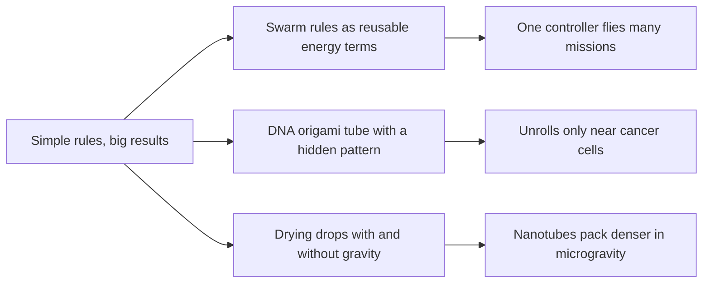

# Digest — 2026-10-23

*Curated America/New_York (ET). Prefer arXiv / open sources. Verified via the Friday 2026-10-23 arXiv `/new` listings (cond-mat.soft, cs.RO, cs.MA, physics.bio-ph, nlin.AO), arXiv abstract and HTML pages, Crossref date-window keyword queries, and DOI resolution (npj Microgravity, Journal of the American Chemical Society, Advanced Science).*  
*Focus: roughly since the 2026-10-22 digest; the Friday 2026-10-23 arXiv mailing (submissions 2026-10-22) plus journal articles first published online 2026-10-22 to 2026-10-23. Items already covered on 2026-10-22 are not repeated.*

<Callout type="warning">
Frame these as **frontier progress**, not finished technology. Applications remain mostly lab-scale, tabletop, animal-model, or simulation-scale.
</Callout>

## At a glance

*Diagram: original illustration of this digest's key idea (not from the papers).*

<PubImg
  src="/images/latest/2026-10-23-top-finds.svg"
  alt="Three-panel schematic: three coloured rule boxes (stay close, avoid hits, go to goal) feeding one controller that drives a group of dots; a closed DNA tube that opens into a flat sheet showing five orange binding sites; two drying droplets on a surface, one at normal gravity with a stirring arrow and loosely packed dots, one in microgravity with tightly packed dots"
  caption="Today's top finds at a glance: reusable swarm rules, a DNA origami device that changes shape, and gravity changing how a coating packs."
  credit="Illustrative schematic by Self-Assembly Lab, not data from the papers"
  width={900}
  height={330}
/>

## Highlights

### 1. Probabilistic Energy Modeling Unifies Versatile Swarm Control
- **Authors:** Xiang Zhou, Xiangyu Zhu, Xintong Wang, Qingyuan Yang, Rui Huang, Feng Xue, Lin Li, Qingrui Zhang
- **Date / venue:** arXiv preprint, announced 2026-10-23 (cs.RO / cs.MA; arXiv non-exclusive license, so no figure is reproduced here)
- **Link:** https://arxiv.org/abs/2610.31371
- **Tidbits:**
  - Swarm controllers usually have to be redesigned or retrained whenever the mission changes. Here each basic swarm behaviour is written as a reusable **"energy" term**, and missions are built by combining terms.
  - Separately trained decentralized policies are joined into **one controller** with lightweight gating, without retraining.
  - On aerial swarms the single policy handled **six mission classes** and **10 to 100 agents** zero-shot, across two hardware platforms, indoors and in GPS-denied woodland. The authors report 0.96 to 1.00 task success in large-scale simulation.
- **Why a beginner should care:** It is the "LEGO for behaviours" idea: write a few local rules once, then snap them together for new jobs.
- **Caveat:** Preprint; we read the abstract only. Drone swarms, not self-assembling structures.

### 2. A DNA Origami Nanodevice Programs CD20 Spatial Organization for Selective Apoptosis of Malignant B Cells in Lymphoma Therapy
- **Authors:** Lin Zhao, Ping Xie, Xumin Pan, Siyuan Liu, Jia Zhao, Mengmeng Wu, Ruixi Peng, Jianhui Jiang, Xia Chu
- **Date / venue:** Journal of the American Chemical Society, published online 2026-10-23 (ACS license, so no figure is reproduced here)
- **Link:** https://doi.org/10.1021/jacs.6c16691
- **Tidbits:**
  - A folded DNA sheet carries antibodies placed with nanometre precision. Five antibodies about **10 nm apart** worked best at pulling a cell-surface receptor (CD20) into clusters, which tells the cell to self-destruct.
  - The trick is a **shape switch**: the sheet stays rolled up as a tube with the antibodies hidden inside, so it leaves normal B cells alone. When it meets a protein found on the lymphoma cells (c-Met), it unrolls and exposes the pattern.
  - In a mouse tumour model, injected devices unrolled at the tumour and slowed tumour growth by more than 70%, with no significant toxicity reported.
- **Why a beginner should care:** Self-assembly here does two jobs at once: it fixes the exact spacing of parts and it builds a lock that only opens for the right key.
- **Caveat:** Mouse study, not a human treatment; we read the abstract only.

### 3. Buoyancy-Controlled Self-Assembly and Wettability of Carbon Nanocoatings Evidenced by Sounding Rocket Microgravity Experiments
- **Authors:** Hatim Machrafi, Claire Perfetti, Rami Elkaffas, Yarjan Abdul Samad, Carlo Saverio Iorio
- **Date / venue:** npj Microgravity, published online 2026-10-23 (open access, CC BY 4.0)
- **Link:** https://doi.org/10.1038/s41526-026-00641-w
- **Tidbits:**
  - Droplets carrying carbon nanotubes, graphene flakes, or a 50/50 mix were dried on silicon aboard the ESA-supported **MASER 14 sounding rocket**, and the same experiment was repeated at normal gravity.
  - Without gravity-driven stirring inside the drop, **nanotube coatings packed denser** with smaller pores and repelled water more. Graphene coatings went the other way: rougher, and less water-repellent.
  - Mixed coatings organized differently depending on gravity, so the same ingredients gave a different surface.
- **Why a beginner should care:** The "environment" part of self-assembly includes gravity. Change how the liquid flows while it dries, and the parts settle into a different structure.
- **Caveat:** A few minutes of rocket microgravity and a small number of samples; read at abstract level.

### 4. Active Phase Separation from Concentration-Dependent Diffusion in Chemical Networks
- **Authors:** Giulia Pisegna, Ramin Golestanian
- **Date / venue:** arXiv preprint, announced 2026-10-23 (cond-mat.soft; CC BY 4.0)
- **Link:** https://arxiv.org/abs/2610.30958
- **Tidbits:**
  - Living cells form droplets and clusters that do not behave like oil in water. Physicists describe them with "active" field theories, but where the extra terms come from has been unclear.
  - Starting from just **two reacting chemicals**, the authors derive one such theory (Active Model B+) and show the minimal ingredients: chemicals that **diffuse at different speeds depending on how crowded they are**, plus a one-sided attraction between the two species.
  - Those ingredients give **arrested coarsening**: clusters stop growing at a finite size instead of merging into one big blob. Simulations of the chemistry and of the field theory agree.

<PubImg
  src="/images/latest/2026-10-23-active-phase-separation-sims.png"
  alt="Simulation snapshots from Pisegna and Golestanian: top rows compare the evolving concentration pattern from the reaction-diffusion model and the Active Model B+ field theory started from the same initial condition; bottom panel plots the coarsening length scale against time, with an inset of structure factors"
  caption="Figure 2 from the paper: snapshots of the chemical model and the field theory side by side, and how the typical cluster size grows over time."
  credit="Giulia Pisegna and Ramin Golestanian, arXiv:2610.30958, Fig. 2, CC BY 4.0 (https://creativecommons.org/licenses/by/4.0/)"
  width={640}
  height={746}
/>

- **Why a beginner should care:** It links a recipe of reactions to the patterns they make, which is the core question of designing self-organizing chemistry.
- **Caveat:** Theory and simulation only.

### 5. Shear-Induced Mechanical Yielding Controls Cluster Morphology and Dynamics in Aggregating Non-Brownian Suspensions
- **Authors:** Jae Hwan Jeong, Donald L. Koch, Sarah Hormozi
- **Date / venue:** arXiv preprint, announced 2026-10-23 (cond-mat.soft; CC BY 4.0)
- **Link:** https://arxiv.org/abs/2610.30330
- **Tidbits:**
  - Sticky particles in a stirred liquid form clusters, and the flow both builds and breaks them. Clusters grow until the flow's pull matches the strongest bond between particles.
  - Simulated clusters fall on one master curve with three regimes: small compact clusters act as rigid balls, mid-sized ones stretch into longer shapes that align with the flow, and the biggest are limited by bond strength.
- **Why a beginner should care:** Stirring is not neutral: how hard you mix sets how big and how elongated assembled clusters get.
- **Caveat:** Simulation only; read at abstract level.

### Stretch (adjacent)
- **Entropy-production cost limits hierarchical decision-making in homing pigeon flocks** (Bibaswan Ghosh, Vipul Rai, Harsh Soni, Nitin Kumar; arXiv, 2026-10-23): https://arxiv.org/abs/2610.31126 — small pigeon flocks have clear leaders, larger flocks become more egalitarian, which the authors explain with an information "cost" per bird.
- **Strain Waves Generate Compression and Trigger Buckling in Active Polymers** (Wen-de Tian, Kang Chen, Tianhui Zhang; arXiv, 2026-10-23, CC BY 4.0): https://arxiv.org/abs/2610.30749 — chemical reactions along a chain can send travelling strain waves that compress it enough to make it buckle.
- **Dispersive Tree Agreements for Multi-Robot Coordination** (Shashank A. Deshpande, Blake T. Edwards, Jonathan P. How; arXiv, 2026-10-23): https://arxiv.org/abs/2610.31540 — robots negotiate "rent" on shared space to plan near-optimal joint paths in real time, tested on six real robots.
- **An AI-Driven Framework for Directed Self-Assembly Toward Design-Technology Co-Optimization** (Caiwei Shang et al.; Advanced Science, 2026-10-22, CC BY 4.0): https://doi.org/10.1002/advs.78401 — machine learning tunes a polymer self-assembly simulation to match chip-patterning experiments, with simulation-experiment error below 1.5 nm.

---

## Safe classroom / discussion follow-ons

1. **Snap-together swarm rules (inspired by item 1):** Write three rule cards: "stay within two steps of a friend", "never touch anyone", "drift toward the door". Have the class walk with one card active, then two, then all three, and note what shape the group makes each time. Which combination gets everyone to the door fastest without bumps?
2. **Hidden-pattern tube (inspired by item 2):** Stick five coloured dots in a pattern on one side of a sheet of paper, then roll it up with the dots inside and hold it with a paper clip (the "lock"). Only a student holding the "key card" may remove the clip. Discuss why hiding the pattern until the right moment is useful. Paper and clips only.
3. **Coffee-ring drying test (inspired by item 3):** Put drops of water with a pinch of ground pepper or food colouring on a plate and let them dry. Compare a drop left still with one on a plate you gently tilt or stir with a toothpick at the start. Photograph the dried rings and compare where the specks ended up. No heat, no solvents.
4. **Stir strength and clumps (inspired by item 5):** Sprinkle a spoonful of cornflakes crumbs or small paper punch-outs on water in a bowl, add a drop of dish soap at one edge, then try slow and fast stirring. Sketch the clump sizes after each. Which stirring makes bigger clumps?

## Key idea of the day

The same parts can end up in very different arrangements depending on simple outside conditions: which local rules you combine, whether a pattern is hidden or exposed, how strongly the liquid moves while things settle. All of today's work is simulation, lab, rocket-experiment, or animal-model scale, so treat it as a starting point, not finished technology.
