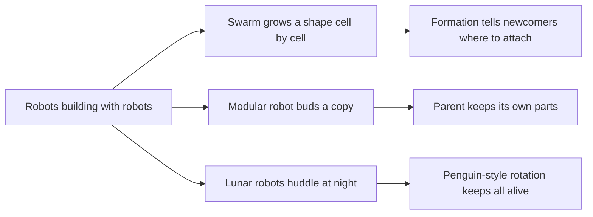

# Digest — 2026-10-26

*Curated America/New_York (ET). Prefer arXiv / open sources. Verified via the Monday 2026-10-26 arXiv `/new` listings (cond-mat.soft, cs.RO, cs.MA, physics.bio-ph, nlin.AO), arXiv abstract and HTML pages, a Crossref date-window keyword query, and DOI resolution (Journal of Chemical Education).*  
*Focus: roughly since the 2026-10-23 digest; the Monday 2026-10-26 arXiv mailing (submissions 2026-10-22 to 2026-10-23) plus journal articles first published online 2026-10-24 to 2026-10-26. Items covered on 2026-10-23 are not repeated.*

<Callout type="warning">
Frame these as **frontier progress**, not finished technology. Applications remain mostly simulation, tabletop hardware, or teaching-lab scale.
</Callout>

## At a glance

*Diagram: original illustration of this digest's key idea (not from the papers).*

<PubImg
  src="/images/latest/2026-10-26-top-finds.svg"
  alt="Three-panel schematic: a cluster of dark dots forming a letter-like shape with two dashed orange rings marking open attachment spots and a newcomer dot heading to one; a three-block parent robot next to loose spare blocks, then the parent beside an identical new three-block copy; a ring of robot dots around a warm core with arrows showing robots swapping between rim and core"
  caption="Today's top finds at a glance: a swarm that grows a shape from local rules, a modular robot that builds a copy of itself, and robots huddling to survive the lunar night."
  credit="Illustrative schematic by Self-Assembly Lab, not data from the papers"
  width={900}
  height={330}
/>

## Highlights

### 1. Distributed Swarm Morphogenesis with Neural Cellular Automata
- **Authors:** Ray Verma, Eliseo Ferrante, Anthony Tzes
- **Date / venue:** arXiv preprint, announced 2026-10-26 (cs.RO / cs.MA; CC BY 4.0)
- **Link:** https://arxiv.org/abs/2610.31900
- **Tidbits:**
  - "Morphogenesis" here means a swarm building a target shape by itself. Each robot runs a small learned rule (a **neural cellular automaton**, like a grid game where every cell updates from its neighbours).
  - Robots already in the formation share their local states to work out **where the next robot should attach**, so nobody needs a master list of positions.
  - Extra training that mimics robots arriving one at a time, plus a penalty for "false" open spots, made the shapes much more accurate. Simulations reached several hundred robots; eight small Crazyflie drones tested the full pipeline.

<PubImg
  src="/images/latest/2026-10-26-swarm-nca-formation.png"
  alt="Figure from Verma, Ferrante and Tzes: left, step-by-step assembly sequences for four target shapes built from 250 simulated robots; right, plots of how formation accuracy and time scale with the number of robots"
  caption="Figure 2 from the paper: assembly sequences for four target shapes and how the method scales with swarm size."
  credit="Ray Verma, Eliseo Ferrante, Anthony Tzes, arXiv:2610.31900, Fig. 2, CC BY 4.0 (https://creativecommons.org/licenses/by/4.0/)"
  width={1400}
  height={678}
/>

- **Why a beginner should care:** It is the textbook self-assembly idea, applied to robots: the shape is not placed from above, it grows from local "is there a spot next to me?" decisions.
- **Caveat:** Preprint; mostly simulation, and the drone test used external motion tracking. Read at abstract and figure-caption level.

### 2. Robotic Budding: From Homogeneous Cells to Diverse Morphologies in Physical Self-Reproduction
- **Authors:** Siyuan Zhang, Junyan Liu, Wanglin He, Hod Lipson
- **Date / venue:** arXiv preprint, announced 2026-10-26 (cs.RO; arXiv non-exclusive license, so no figure is reproduced here)
- **Link:** https://arxiv.org/abs/2610.31929
- **Tidbits:**
  - One standard module (magnetic docking face plus two motorized joints) folds from flat to 3D, the way identical cells can make different tissues.
  - The same module builds a three-module "trilobite" and a five-module "seal". The parent robot docks spare modules one by one, assembles an **identical copy**, and the copy separates off, like **budding** in yeast.
- **Why a beginner should care:** Self-reproduction is one of the oldest dreams in self-assembly, and this shows how hard each physical step (grab, align, dock, let go) still is.
- **Caveat:** Preliminary hardware demos, and a human teleoperated the steps. The authors say autonomy and repeated trials are future work.

### 3. Emergent Cooperative Thermoregulation in Lunar Swarm Robotics
- **Authors:** Anais Jeger, Harry Holt, Lennart Puck
- **Date / venue:** arXiv preprint, announced 2026-10-26 (cs.RO / cs.MA; arXiv non-exclusive license, so no figure is reproduced here)
- **Link:** https://arxiv.org/abs/2610.31868
- **Tidbits:**
  - The lunar night lasts about 354 hours and gets down to roughly 95 K. Small rovers cannot each carry a radioactive heater, so could they **shield each other** instead?
  - Twenty simulated robots shared one learned policy and got one reward at dawn: how warm the five coldest robots were. With nothing about position in the reward, they learned to **huddle and rotate between core and rim**, the strategy emperor penguins use.
  - The authors report the swarm survived on 37% less stored heat than a motionless huddle, and the behaviour carried over from 20 to 40 robots without retraining.
- **Why a beginner should care:** A simple shared goal produced a self-organized group structure nobody programmed directly.
- **Caveat:** Simulation only; read at abstract level.

### 4. From Design Rules to Crystal Structures: A Research-Style DNA-Programmed Colloidal Crystal Laboratory for Upper-Division Chemistry Students
- **Authors:** Ana Clara Zampirolli Leal, Kevin Hunter, Andrew Minorik, Samuel Richardson, Rachel R. Chan, Omar K. Farha, Chad A. Mirkin
- **Date / venue:** Journal of Chemical Education, published online 2026-10-24 (ACS license, so no figure is reproduced here)
- **Link:** https://doi.org/10.1021/acs.jchemed.6c01273
- **Tidbits:**
  - Undergraduates coated gold nanoparticles with DNA ("programmable atom equivalents") and assembled them into **six different crystal structures**, choosing the structure through the DNA design.
  - The class pooled results so each student could see how the bonding rules mapped to the crystal that formed, then checked it with X-ray scattering and electron microscopy.
- **Why a beginner should care:** DNA-programmed crystals are moving from research papers into teaching labs, which is a good sign for the field's maturity.
- **Caveat:** University lab with specialist equipment, not a home or school activity. Read at abstract level.

### Stretch (adjacent)
- **Field Directed Assembly of Anisotropic Composite Pacman Colloids into Reconfigurable Architectures** (Indira Barros, Isha Songara, Indrani Chakraborty; arXiv, 2026-10-26): https://arxiv.org/abs/2610.32872 — "Pacman" particles with a magnetic patch switch between assembly modes when magnetic and AC electric fields are combined and tuned.
- **Multi-scale patterns arising from competing chemotactic interactions** (Agniva Datta, Robert Großmann, Carsten Beta; arXiv, 2026-10-26): https://arxiv.org/abs/2610.32591 — swimmers chasing two competing chemicals form clumps, waves, and mixed patterns, depending on which signal wins.
- **Facultative Swarming: A Capability, Not a Category, for Multi-Robot Systems** (Ning Zhou, Edmund R. Hunt; arXiv, 2026-10-26): https://arxiv.org/abs/2610.32526 — a perspective arguing robot teams should be centrally planned when things are calm and fall back to swarm-style self-organization under stress.

---

## Safe classroom / discussion follow-ons

1. **Grow-a-letter game (inspired by item 1):** Pick a target letter on a floor grid made of tape. Students join one at a time, but each newcomer may only ask the people already standing "is there an open spot next to you that belongs to the letter?" Count how long it takes and whether any wrong spots got filled.
2. **Budding with blocks (inspired by item 2):** Build a three-block "parent" from LEGO or paper cubes. Using only one hand and one block at a time, build an identical copy next to it without taking the parent apart. Discuss which step was hardest: picking up, lining up, attaching, or letting go.
3. **Penguin huddle with cups (inspired by item 3):** Fill several identical paper cups with warm tap water (not hot), packed tightly in one group, and set a few others apart. After 20 minutes compare how warm they feel or use a kitchen thermometer. Then swap edge and middle cups and discuss why rotating helps everyone. Warm tap water only.
4. **Design-rule pairing cards (inspired by item 4):** Give students cards marked with sticky "ends" (A only bonds to A-prime). Predict what pattern forms before laying them out, then check. Paper only.

## Key idea of the day

Structure can come from the bottom up: robots asking neighbours where the next spot is, a robot assembling a copy from loose parts, or a cold swarm learning to huddle. None of this is ready for real-world use yet. It's simulation, early hardware demos, and teaching labs, so treat it as a starting point, not finished technology.
