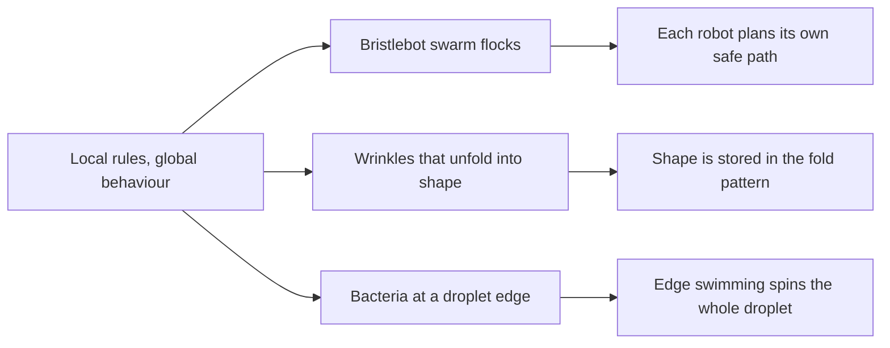

# Digest — 2026-10-27

*Curated America/New_York (ET). Prefer arXiv / open sources. Verified via the Tuesday 2026-10-27 arXiv `/new` listings (cond-mat.soft, cs.RO, cs.MA, physics.bio-ph, nlin.AO), arXiv abstract and HTML pages, a Crossref date-window keyword query, and DOI resolution.*  
*Focus: roughly since the 2026-10-26 digest; the Tuesday 2026-10-27 arXiv mailing (submissions 2026-10-23 to 2026-10-26) plus journal articles first published online 2026-10-26 to 2026-10-27. Items covered on 2026-10-26 and earlier are not repeated. A quieter day: fewer self-assembly items than usual.*

<Callout type="warning">
Frame these as **frontier progress**, not finished technology. Applications remain mostly simulation, tabletop hardware, or lab-scale experiments.
</Callout>

## At a glance

*Diagram: original illustration of this digest's key idea (not from the papers).*

<PubImg
  src="/images/latest/2026-10-27-top-finds.svg"
  alt="Three-panel schematic: small elliptical robots with dashed safety rings moving together toward a yellow light; a zigzag wrinkled strip with denser folds in the middle unfolding into a dome; a round droplet with small swimmers along its edge and curved arrows showing rotation, next to a sketched curve where spin rate falls as droplet size grows"
  caption="Today's top finds at a glance: a vibrating-robot swarm that flocks without collisions, wrinkle patterns that unfold into curved surfaces, and bacteria that spin the droplets they sit on."
  credit="Illustrative schematic by Self-Assembly Lab, not data from the papers"
  width={900}
  height={330}
/>

## Highlights

### 1. Distributed Predictive Flocking for a Swarm of Miniature Vibration-Driven Robots in a Confined Arena
- **Authors:** Prajol Shrestha, Siddhant Mohapatra, Filip Novkoski, Julian Oelhaf, Nicolas Vandewalle, Ana-Sunčana Smith, Andreas Maier
- **Date / venue:** arXiv preprint, announced 2026-10-27 (cs.RO; CC BY 4.0; submitted to Robotics and Autonomous Systems)
- **Link:** https://arxiv.org/abs/2610.35582
- **Tidbits:**
  - The robots are **bristlebots**: tiny open-source robots that move by vibrating on bristle legs, the same trick as a toothbrush-head toy.
  - There is no leader and no map. Each robot plans a few steps ahead on its own and only swaps its **planned path** with nearby robots, while trying to stay close, point the same way, and keep a safety distance.
  - The team compared six ways of writing the "do not crash" rule. A look-ahead version worked best. Swarms ran from ten robots up to the most that can physically fit in a 0.8 m by 0.8 m arena, following a light, circling it, or just sticking together.
  - Collisions stayed low in small swarms and rose steeply near the packing limit, but order and togetherness faded gently instead of collapsing.

<PubImg
  src="/images/latest/2026-10-27-bristlebot.png"
  alt="Photo of a small bristlebot robot on an orange background: a circuit board on a white 3D-printed oval frame with a ring bumper and thin bristle legs, with a 1 cm scale bar"
  caption="Figure 1 (right panel) from the paper: the open-source GRASPion bristlebot hardware the simulated swarm is modelled on."
  credit="Prajol Shrestha et al., arXiv:2610.35582, Fig. 1 (right panel, resized), CC BY 4.0 (https://creativecommons.org/licenses/by/4.0/)"
  width={1000}
  height={638}
/>

- **Why a beginner should care:** Flocking is a classic example of order from local rules, and this shows the hard practical part: keeping a crowded group orderly without bumping.
- **Caveat:** Results come from a digital twin (simulation) of the robot, not a full physical swarm run. Read at abstract and figure-caption level.

### 2. Inverse origami inspired by insect morphogenesis: geometric design of wrinkle structures for curved surface formation
- **Authors:** Kentaro Morikawa, Yuuki Shimizu, Nen Saito, Yasuhiro Inoue
- **Date / venue:** arXiv preprint, announced 2026-10-27 (cond-mat.soft / physics.bio-ph; arXiv non-exclusive license, so no figure is reproduced here)
- **Link:** https://arxiv.org/abs/2610.34903
- **Tidbits:**
  - When an insect larva turns into a pupa, its new 3D shape appears suddenly because **pre-made wrinkles** inside the body unfold under internal pressure.
  - Normal origami folds a flat sheet into 3D. This "inverse origami" goes the other way: design wrinkles so that **unfolding** them produces a chosen curved surface.
  - The trick is to treat the wrinkles as a map of how much each spot will stretch. The method was tested with numerical designs, unfolding simulations, and 3D-printed prototypes.
- **Why a beginner should care:** The final shape is "programmed" into the folded pattern ahead of time, which is the same idea as programmable matter.
- **Caveat:** Geometry and prototypes only; no device yet. Read at abstract level.

### 3. Interfacial bacteria-driven rotation of free-floating active droplets
- **Authors:** Dixi Yang, Anheng Wang, Chunming Wang, Hajime Tanaka, Jiaxing Yuan
- **Date / venue:** arXiv preprint, announced 2026-10-27 (cond-mat.soft; CC BY 4.0)
- **Link:** https://arxiv.org/abs/2610.35242
- **Tidbits:**
  - Two water-based liquids (dextran and PEG solutions) separate into droplets, like oil and vinegar. Swimming bacteria gather **at the boundary** of the droplets and swim along it.
  - That edge swimming makes free-floating droplets **spin on their own**, with no walls, magnets, or external fields needed.
  - Bigger droplets spin more slowly: the spin rate falls roughly as one over the radius. Simulations and a simple model explain why.

<PubImg
  src="/images/latest/2026-10-27-bacteria-droplets.png"
  alt="Six-panel figure: green fluorescent bacteria outlining many round droplets at two magnifications; a 3D simulation box of red droplets with black and white dots at their surfaces; a tracked droplet edge path; and two bar charts of angular velocity versus droplet radius, from simulation and experiment, each with a line marking a one-over-radius trend"
  caption="Figure 1 from the paper: bacteria collect at droplet interfaces (a, b), a simulation of the same setup (c), a tracked rotating droplet (d), and spin rate versus droplet size in simulation (e) and experiment (f)."
  credit="Dixi Yang, Anheng Wang, Chunming Wang, Hajime Tanaka, Jiaxing Yuan, arXiv:2610.35242, Fig. 1, CC BY 4.0 (https://creativecommons.org/licenses/by/4.0/)"
  width={1468}
  height={801}
/>

- **Why a beginner should care:** Many tiny swimmers organizing themselves at a surface turn random wiggling into one big, steady motion.
- **Caveat:** Specialist microbiology lab work; the bacterium used (*Pseudomonas aeruginosa*) is a pathogen and must never be grown outside a proper lab. Read at abstract and figure-caption level.

### Stretch (adjacent)
- **Lightweight Change Detection for Adaptive Collective Perception in Dynamic Environments** (Thiemen Siemensma, Tiago Travassos, Jiacheng Zhang, Bahar Haghighat; arXiv, 2026-10-27): https://arxiv.org/abs/2610.34059 — swarm robots vote on which floor colour is in the majority, and a tiny-memory detector lets them reset their beliefs when the floor pattern changes (Webots simulation).
- **Diffusion of chiral active Brownian particles in oscillatory Poiseuille flow** (Anshika Sharma, Vikas Sharma, Narender Khatri, Suneet Kumar Awasthi; arXiv, 2026-10-27): https://arxiv.org/abs/2610.33466 — spinning self-propelled particles in a back-and-forth channel flow spread out much faster when the flow rhythm matches their own (simulation).
- **Mapping bimodal colloidal depletion systems onto the monodisperse gelation phase diagram** (Robert A. Campbell, Ziye Zhuang, Ali Mohraz, Safa Jamali; arXiv, 2026-10-27): https://arxiv.org/abs/2610.33394 — a single number lets mixtures of two particle sizes reuse the known "will it gel?" map for one-size particles (simulation).
- **Matter that learns what matters** (Natalia G. Berloff; arXiv, 2026-10-27): https://arxiv.org/abs/2610.34428 — a model optical network whose links keep a record of past success, so the material learns which inputs to pay attention to (theory and simulation).
- **Field-Driven Assembly of Orientation-Controlled Anisotropic Colloidal Frameworks for Broadband Perfect Optical Absorption** (Chenhui Wei, Yuanhao Liu, Xiaoyu Liu, Ming Fu, Dawei He, Yongsheng Wang; Advanced Optical Materials, published online 2026-10-27): https://doi.org/10.1002/adom.71994 — magnetic or electric fields line up rod- and ellipsoid-shaped particles into loose frameworks that absorb almost all light across a wide range of colours.

---

## Safe classroom / discussion follow-ons

1. **Bristlebot flock (inspired by item 1):** Build toothbrush-head bristlebots from a kit and release 3 to 10 in a cardboard-walled tray. Count bumps per minute as you add robots, and try adding cardboard obstacles. Adult supervision: keep coin cell batteries away from young children (swallowing hazard).
2. **Unfold a shape (inspired by item 2):** Accordion-fold strips of paper with folds packed tighter in the middle than at the ends, tape the strips side by side at one edge, then gently pull open. Predict which spacing pattern gives a bowl or a ridge before trying. Paper and tape only.
3. **Hula-hoop spin rule (inspired by item 3):** A group of students holds a large hoop and side-steps at the same walking speed, then repeats with a small hoop. Time one full turn each. The small hoop turns faster, matching the "spin ~ 1/size" idea. No bacteria or lab cultures.
4. **Majority vote on a tile floor (stretch, collective perception):** Students walk a black-and-white tile or paper-square floor, each sampling a few squares, then share counts only with neighbours to guess the majority colour. Change some squares mid-game and see how long it takes the group to notice.

## Key idea of the day

Big, organized behaviour can come from small local rules: robots that each plan their own safe path end up flocking, a pre-made wrinkle pattern stores a 3D shape until it unfolds, and bacteria swimming along a droplet's edge spin the whole droplet. None of this is ready for real-world use yet. It is simulation, prototypes, and lab experiments, so treat it as a starting point, not finished technology.
