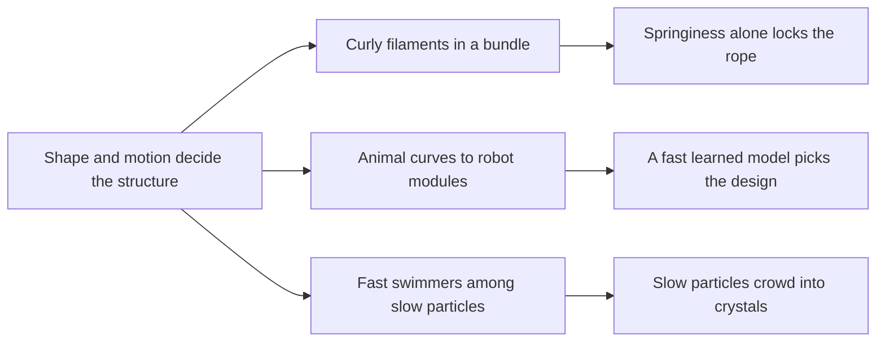

# Digest — 2026-10-28

*Curated America/New_York (ET). Prefer arXiv / open sources. Verified via the Wednesday 2026-10-28 arXiv `/new` listings (cond-mat.soft, cs.RO, cs.MA, physics.bio-ph, nlin.AO), arXiv abstract and HTML pages, a Crossref date-window keyword query, and DOI resolution.*  
*Focus: roughly since the 2026-10-27 digest; the Wednesday 2026-10-28 arXiv mailing plus journal articles first published online 2026-10-27 to 2026-10-28. Items covered on 2026-10-27 and earlier are not repeated.*

<Callout type="warning">
Frame these as **frontier progress**, not finished technology. Applications remain mostly simulation, tabletop hardware, or lab-scale experiments.
</Callout>

## At a glance

*Diagram: original illustration of this digest's key idea (not from the papers).*

## Highlights

### 1. No friction required: Self-locking in entangled assemblies of curved filaments
- **Authors:** Benjamin R. Greenvall, Jay van den Berg, Ross E. Meinhart, Patrick A. Staudenmayer, Alfred J. Crosby, Gregory M. Grason
- **Date / venue:** arXiv preprint, announced 2026-10-28 (cond-mat.soft; CC BY 4.0)
- **Link:** https://arxiv.org/abs/2610.36330
- **Tidbits:**
  - The textbook story is that rope holds together because of **friction** between its strands plus outside pulling. Cut a rope and it frays.
  - This paper shows that strands that are **naturally curly** (like phone-cord springs) can lock together with **no friction at all**. Each strand wants to keep its own coil shape, the strands cannot pass through each other, and that tug-of-war holds the bundle.
  - Depending on how many strands there are and how curly they are, a cut bundle either stays locked or unravels, with the unravelling moving along the bundle like a wave.
  - Some bundle shapes can never self-lock, no matter how much friction you add. The team checked this with simulations and experiments with real filaments.

<PubImg
  src="/images/latest/2026-10-28-self-locking-filaments.png"
  alt="Three-panel photo figure: (A) a frayed marine rope detangling from a cut end next to taped cladding; (B) straight coloured wires twisted together, cut, and springing apart; (C) coiled coloured plastic springs twisted together and cut, staying locked as one bundle"
  caption="Figure 1 from the paper: a cut rope frays (A), a bundle of straight filaments springs apart when cut (B), and a bundle of curly filaments stays locked after cutting (C)."
  credit="Benjamin R. Greenvall et al., arXiv:2610.36330, Fig. 1 (resized), CC BY 4.0 (https://creativecommons.org/licenses/by/4.0/)"
  width={1600}
  height={452}
/>

- **Why a beginner should care:** A structure can hold itself together through shape alone, with no glue, bonds, or friction. That is a clean example of design rules for self-assembly and disassembly.
- **Caveat:** Mostly a theory and simulation model with tabletop tests; the "materials that assemble and disassemble on command" idea is a future direction, not a product. Read at abstract and figure-caption level.

### 2. From Biological Curves to Soft Modular Robots: Learning-Based Inverse Design with Uncertainty-Guided Refinement
- **Authors:** Dixiang Wang, Minghao Zha, Arifur Rahman, Yinhong Qin, Yitao Jiang, Shiyang Lu, Zebing Mao, Muhao Chen, Luyang Zhao
- **Date / venue:** arXiv preprint, announced 2026-10-28 (cs.RO; arXiv non-exclusive license, so no figure is reproduced here)
- **Link:** https://arxiv.org/abs/2610.36681
- **Tidbits:**
  - The goal: take a curve traced from an animal, like a swimming eel or an arching inchworm, and work out how to build a **soft modular robot** that bends into that shape.
  - The robots are chains of soft modules pulled by cables. Which way the cable is threaded through each module decides the final bend, and there are a huge number of possible threadings.
  - A machine-learning stand-in for the slow physics simulation predicts the bend almost instantly, and the method suggests designs in about 4 milliseconds instead of about half an hour.
  - On 5,000 unseen test cases it matched the target shape 93% of the time (judged by the learned model), and four physical robots were built as demos.
- **Why a beginner should care:** Choosing how simple modules connect so the whole thing takes a chosen shape is the core puzzle of modular and self-reconfiguring robots.
- **Caveat:** The 93% figure is scored by the learned model, not by building all 5,000 robots. Read at abstract level.

### 3. Phase Separation in a Mixture System of Active and Passive Particles
- **Authors:** Reo Arakaki, Tetsuya Hiraiwa, Ryo Akiyama
- **Date / venue:** arXiv preprint, announced 2026-10-28 (cond-mat.soft; CC BY 4.0)
- **Link:** https://arxiv.org/abs/2610.37193
- **Tidbits:**
  - A computer simulation mixes **self-propelled particles** (tiny swimmers) with ordinary passive particles that only jiggle from heat.
  - When the swimmers go fast enough, the mixture splits in two: one region of passive particles packed into an **ordered crystal**, and one loose mixed region.
  - Neither kind of particle does this on its own. Fast swimmers shove neighbours away, so they act bigger than they are, and that crowding pushes the passive particles together, much like the "depletion" effect seen in colloids.

<PubImg
  src="/images/latest/2026-10-28-active-passive.png"
  alt="Grid of simulation snapshots: square boxes filled with blue and red dots; at low swimmer speed the dots are evenly mixed, at higher speed a circled patch shows a close-packed hexagonal crystal, and a time series at the highest speed shows the dots separating into a dense ordered band and a looser mixed band"
  caption="Figure 2 from the paper: snapshots at different swimmer speeds (a, b, d), a zoom on an ordered patch (c), and a time series at high speed where the system splits into an ordered region and a mixed region (e)."
  credit="Reo Arakaki, Tetsuya Hiraiwa, Ryo Akiyama, arXiv:2610.37193, Fig. 2 (resized), CC BY 4.0 (https://creativecommons.org/licenses/by/4.0/)"
  width={1600}
  height={868}
/>

- **Why a beginner should care:** A few busy movers can organize a crowd of passive neighbours into order, a simple picture of how activity can drive assembly.
- **Caveat:** Simulation only. Read at abstract and figure-caption level.

### Stretch (adjacent)
- **Ratchet Effects for Swarmalators on Asymmetric Substrates** (B. Albert, A. Libal, C. J. O. Reichhardt, C. Reichhardt; arXiv, 2026-10-28): https://arxiv.org/abs/2610.36318 — "swarmalators" are moving particles that also keep an internal rhythm; on a sawtooth-shaped floor they drift one way, and labyrinth-like patterns ratchet best (simulation).
- **Mixed symmetries in active non-reciprocal systems** (Yuv Agarwal, Ylann Rouzaire, Daniel J. G. Pearce; arXiv, 2026-10-28): https://arxiv.org/abs/2610.36817 — a lattice model of active units that break action-equals-reaction and carry two kinds of symmetry at once, like some cell tissues (theory).
- **Chemical Reaction-Powered Self-Assembly and Dehydration of Supramolecular Hydrogels for Phase-Transitional Robots** (Guanyao Gu, Lai Wei, Yuliang Gao, Chunyu Zhang, Xinyu Chen, Xuhong Guo, Yiming Wang, Fu-Zhen Xuan; Angewandte Chemie International Edition, published online 2026-10-27): https://doi.org/10.1002/anie.8697238 — a chemical fuel makes a peptide solution self-assemble into a gel, which then dries out, giving soft robots that change phase (specialist chemistry lab).
- **In situ assembly of peptides in living cells** (Peng Zhang, Xin Liu, Hao Wang, Ninglin Chen, Linqi Shi, Zhilin Yu; Nature Protocols, published online 2026-10-27): https://doi.org/10.1038/s41596-026-01433-y — a lab protocol for getting peptides to self-assemble inside living cells (specialist biology lab only).

---

## Safe classroom / discussion follow-ons

1. **Curly vs. straight bundles (inspired by item 1):** Twist together three straight pipe cleaners, and separately three plastic spiral cable wraps or springs from old pens. Tape the ends, snip the tape off one end (adults handle cutters), and compare which bundle falls apart. No chemicals, just craft supplies.
2. **Threading decides the bend (inspired by item 2):** Thread a string through a row of drinking-straw segments or paper-cup modules, with holes on different sides. Pull the string and sketch the shape. Try to match a printed picture of an inchworm arch by changing only which side each hole is on.
3. **Busy movers sort the crowd (inspired by item 3):** Put many marbles or beads in a shallow tray and add a few battery-powered "hexbug"-style toys. Watch whether the still beads get pushed into tight, ordered patches. Adult supervision for button batteries (swallowing hazard).
4. **Sawtooth ratchet (stretch, swarmalators):** Shake a tray with a corrugated cardboard floor and a handful of rice or beads; check whether the grains drift toward one side when the bumps are lopsided.

## Key idea of the day

Structure can come from shape and motion instead of glue: curly strands lock a rope through springiness alone, the threading pattern in each module sets a soft robot's final pose, and a few fast swimmers can push slow particles into crystals. None of this is ready for real-world use yet. It is simulation, tabletop prototypes, and lab work, so treat it as a starting point, not finished technology.
