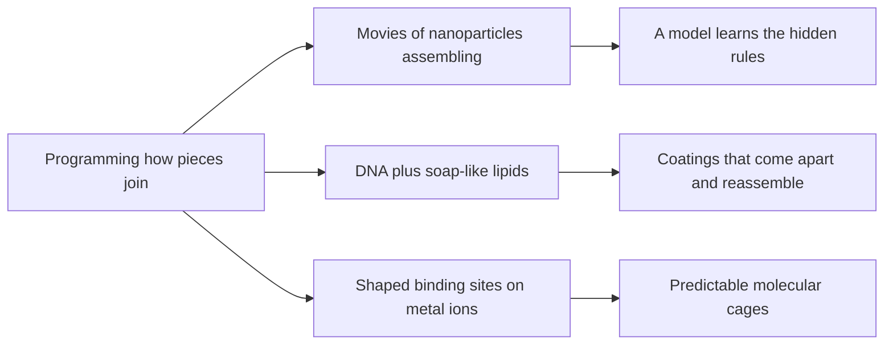

# Digest — 2026-10-29

*Curated America/New_York (ET). Prefer arXiv / open sources. Verified via the arXiv API and abstract/HTML pages, a Crossref date-window keyword query (journal articles published online 2026-10-28 to 2026-10-29), and DOI resolution.*  
*Focus: items since the 2026-10-28 digest. At curation time (about 8:50 AM ET) arXiv's `/new` pages still showed the Wednesday 2026-10-28 mailing, so this digest picks up self-assembly preprints from cross-lists outside the categories checked yesterday plus new journal articles. Items covered on 2026-10-28 and earlier are not repeated.*

<Callout type="warning">
Frame these as **frontier progress**, not finished technology. Applications remain mostly simulation, tabletop hardware, or lab-scale experiments.
</Callout>

## At a glance

*Diagram: original illustration of this digest's key idea (not from the papers).*

## Highlights

### 1. Learning Multiscale Dynamics of Nanoparticle Self-Assembly
- **Authors:** Shuaifeng Li, Puquan Pan, Jonas Hallstrom, Nicholas Kotov, Paul Bogdan, Qian Chen, Xiaoming Mao
- **Date / venue:** arXiv preprint, submitted 2026-10-27 (cond-mat.mtrl-sci, cross-listed cond-mat.mes-hall; CC BY 4.0)
- **Link:** https://arxiv.org/abs/2610.36498
- **Tidbits:**
  - Scientists can now film nanoparticles assembling in liquid using a special electron microscope (liquid-phase TEM), but the motion is so jittery that the underlying "rules" are hard to see.
  - This team turns each video frame into smooth maps of **how crowded** each region is and **which way particles point**, then fits a simple model where each patch only talks to its nearest neighbours.
  - Watching how much the fitted model changes over time reveals when the system switches from scattered particles to growing clusters (a peak at roughly 110 seconds in their example).
  - The method also pulls out the actual equations that describe the motion, so the result is interpretable rather than a black box.

<PubImg
  src="/images/latest/2026-10-29-nanoparticle-dynamics.png"
  alt="Figure with a row of five square snapshots of tiny particles over 224 seconds, scattered at first and clumping into clusters later; below them, matching colour maps of density and orientation; a sketch of a plus-shaped nearest-neighbour stencil leading to a banded matrix; and a line plot of reconstruction error rising slowly over time"
  caption="Figure 1 from the paper: particle snapshots from a liquid-phase electron microscopy video and the smoothed density and orientation maps made from them (a), the nearest-neighbour model structure (b), and how well the model reproduces the data over time (c)."
  credit="Shuaifeng Li et al., arXiv:2610.36498, Fig. 1 (resized), CC BY 4.0 (https://creativecommons.org/licenses/by/4.0/)"
  width={1600}
  height={1320}
/>

- **Why a beginner should care:** Self-assembly is usually explained with neat rules; this shows how scientists recover those rules from messy real data.
- **Caveat:** Demonstrated on microscopy videos of particular nanoparticle systems; "predictive design" of nanostructures is the authors' stated future direction. Read at abstract and figure-caption level.

### 2. Circular, Reconfigurable DNA-Surfactant Materials for Coatings with Tunable Oil and Water Barrier Properties
- **Authors:** Liat H. Kugelmass, Bryan D. James
- **Date / venue:** ACS Sustainable Chemistry & Engineering, published online 2026-10-28 (CC BY 4.0)
- **Link:** https://doi.org/10.1021/acssuschemeng.6c08713
- **Tidbits:**
  - Paper coatings that keep out grease and water often use plastics that cannot be recycled or broken down.
  - Here the coating is a complex of **DNA** and **positively charged lipids** (soap-like molecules) held together by reversible, non-covalent attraction rather than permanent bonds.
  - Because the pieces only stick by self-assembly, the coating can be washed off or split apart with salt, and the paper, the coating, and even the DNA and lipids can be recovered and reused.
  - Swapping in a different lipid when the material reassembles changes whether the coating repels or attracts water and oil, so one base material can be "re-tuned" for a new job.
- **Why a beginner should care:** Self-assembly is not only about building; reversible joins also let you take things apart cleanly, which matters for recycling.
- **Caveat:** Lab-scale coatings on paper; read at abstract level.

### 3. Node-Encoded Control of Lanthanide Self-Assembly Enables Predictable and Water-Stable Polyhedra for Bioimaging
- **Authors:** Xin-Ran Gan, Guanning Huang, Shao-Jun Hu, Ze-Hong Chen, Fan Yin, Li-Peng Zhou, Xi Meng, Xiao-Qing Guo, Tianfeng Chen, Qing-Fu Sun
- **Date / venue:** Aggregate, published online 2026-10-28 (CC BY 4.0)
- **Link:** https://doi.org/10.1002/agt2.70469
- **Tidbits:**
  - Lanthanide metal ions (like gadolinium and europium) grab many partners at once and switch partners easily, so molecular cages built from them often come out messy or fall apart in water.
  - The team designs a binding unit that **pre-shapes** each metal's surroundings, so the "corners" of the cage are fixed before assembly starts. Changing how the binding units link up gives triangles, rings, tetrahedra, and prisms on purpose.
  - A gadolinium cage gave MRI contrast about seven times stronger per gadolinium than a standard clinical agent measured the same way; europium versions glow red and were used to image cells with low toxicity.
- **Why a beginner should care:** It is a clear case of the core self-assembly trick: get the shape of each joint right and the overall structure follows.
- **Caveat:** Chemistry lab work with cell imaging only, no patients; read at abstract level.

### Stretch (adjacent)
- **High-Efficiency Graphene Oxide Moire Lenses Enabled by Cyclic Self-Assembly and Laser Nanoprinting** (Guiyuan Cao, Xinyuan Du, Han Lin, Baohua Jia, Shibiao Wei; arXiv, submitted 2026-10-26): https://arxiv.org/abs/2610.36373 — thin layers of graphene oxide and a polymer are stacked by layer-by-layer self-assembly, then carved with a laser into flat lenses whose focus can be tuned by rotating two of them.

<PubImg
  src="/images/latest/2026-10-29-go-lens-efficiency.svg"
  alt="Bar chart with two bars: 22.4 percent focusing efficiency for 2 phase levels and 54.8 percent for 6 phase levels"
  caption="Chart drawn for this digest from the two efficiency numbers stated in the abstract: lenses carved with more thickness steps focus more of the light."
  credit="Original chart by Self-Assembly Lab; data from Cao et al., arXiv:2610.36373 abstract"
  width={560}
  height={320}
/>

---

## Safe classroom / discussion follow-ons

1. **Find the rules from a video (inspired by item 1):** Film a tray of floating cereal loops or paper punch-outs on water as they clump. Draw a grid over a few frames and count pieces per square. Does crowding spread to neighbouring squares first?
2. **Stick, unstick, restick (inspired by item 2):** Join paper shapes with removable sticky tack or magnets instead of glue, then take the model apart and rebuild it differently. Discuss why reversible joins make recycling easier. No chemicals needed.
3. **Shaped corners make the shape (inspired by item 3):** Use construction-kit connectors or bent pipe cleaners with fixed angles (60 degrees, 90 degrees) as "corners" and straws as edges. Which corner angle forces a triangle, a tetrahedron, or a cube?
4. **More steps, better lens (stretch):** Compare a smooth magnifying glass with a flat plastic Fresnel magnifier sheet and look at the rings that replace the curved surface. Never point either at the sun.

## Key idea of the day

Good self-assembly comes from controlling the joins: fixed-angle corners give predictable cages, reversible attractions let a coating come apart and be re-tuned, and careful modelling of real microscopy movies can recover the local rules behind nanoparticle clustering. All of this is still lab-scale or early-stage, so treat it as a starting point, not finished technology.
