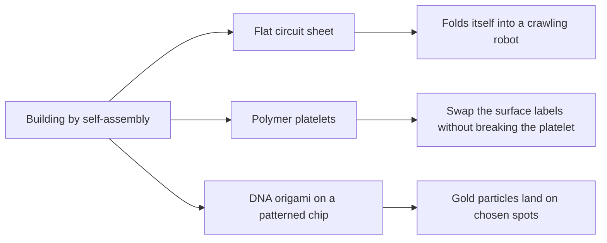

# Digest — 2026-10-30

*Curated America/New_York (ET). Prefer arXiv / open sources. Verified via the arXiv API, a Crossref date-window keyword query (journal articles published online 2026-10-29 to 2026-10-30), Crossref metadata and abstracts, and DOI resolution.*  
*Focus: items since the 2026-10-29 digest. Items covered on 2026-10-29 and earlier are not repeated. Journal publisher pages blocked automated access today, so the highlights below are read at abstract level.*

<Callout type="warning">
Frame these as **frontier progress**, not finished technology. Applications remain mostly simulation, tabletop hardware, or lab-scale experiments.
</Callout>

## At a glance

*Diagram: original illustration of this digest's key idea (not from the papers).*

## Highlights

### 1. Co-Design Insights for Mechanically Active Flexible Printed Circuit Boards Through the CurveQuad Origami Robot
- **Authors:** Xuelin Wu, Daniel Feshbach, Satviki Vasireddy, Louis Beardell, Bao To, Yuliy Baryshnikov, Cynthia Sung
- **Date / venue:** Advanced Science, published online 2026-10-29 (CC BY 4.0)
- **Link:** https://doi.org/10.1002/advs.78428
- **Tidbits:**
  - The robot body is a single flexible printed circuit board, the bendy kind found inside phones, with the fold lines, copper wiring, and sensors all built into the same sheet.
  - One small motor pulls tendons under the sheet so it **folds itself** from flat into a curved-crease four-legged shape, then twists to crawl and steer.
  - The folded robot is about 6 cm across, weighs 10.9 g, and crawls at a reported 16.8 mm per second (about a quarter of its body length each second).
  - The hard part is that wiring changes how stiff the sheet is, so the electronics and the folding have to be designed together.
- **Why a beginner should care:** It shows "flat sheet in, 3D machine out", a robotics cousin of self-assembly where the shape is programmed into the crease pattern.
- **Caveat:** One centimetre-scale lab prototype; read at abstract level.

### 2. Dynamically and Reversibly Functionalized Self-Assembled Platelets via Noncovalent Interactions
- **Authors:** Tianlai Xia, Peng Sun, Laihui Xiao, Andrew P. Dove, Rachel K. O'Reilly
- **Date / venue:** Journal of the American Chemical Society, published online 2026-10-29 (CC BY 4.0)
- **Link:** https://doi.org/10.1021/jacs.6c17888
- **Tidbits:**
  - The team grows flat polymer platelets by **crystallization-driven self-assembly**, where one part of each polymer chain crystallizes and stacks into a thin sheet.
  - Instead of bolting new molecules on with permanent chemical bonds, they give the platelets molecular "sockets" (cyclodextrin rings or hydrogen-bonding groups) that fluorescent dye "plugs" snap into.
  - Under the microscope the dyes sit right on the platelets, and adding a competing molecule pushes the dye out so the platelet can be relabelled, all without breaking the platelet.
- **Why a beginner should care:** It separates building the scaffold from decorating it, so one structure can be given new jobs over and over.
- **Caveat:** A lab chemistry demonstration with dyes; uses like sensors or delivery are future possibilities, not shown here. Read at abstract level.

### 3. Molecularly Addressable Nanoparticle-on-Mirror Cavity Arrays via DNA Origami-Mediated Template Assembly
- **Authors:** Soyeon Kim, Jaewon Lee, Soyoung Lee, Dooheon Kim, Jangwon Kim, Hoyoung Lee, Minsang Kim, Kyeongsoo Kim, Seungwoo Lee
- **Date / venue:** Nano Letters, published online 2026-10-29
- **Link:** https://doi.org/10.1021/acs.nanolett.6c02892
- **Tidbits:**
  - A gold nanoparticle sitting a few molecules above a flat gold mirror traps light in the tiny gap, but simply dropping particles on a surface puts them in random places.
  - The team first patterns landing spots with an electron beam, then places folded DNA (DNA origami) on each spot, and finally lets DNA strands pull gold nanospheres onto exactly those spots.
  - Across 2538 sites in six patches, an estimated 84.7% held a single particle on average, and a dye placed in the gap changed how the cavities scatter light.
- **Why a beginner should care:** It mixes top-down patterning with bottom-up DNA self-assembly to put each piece at a chosen address.
- **Caveat:** Lab-scale optics demonstration; read at abstract level.

<PubImg
  src="/images/latest/2026-10-30-npom-occupancy.svg"
  alt="Horizontal bar showing about 84.7 percent of 2538 patterned sites filled with a single gold particle and the rest empty"
  caption="Chart drawn for this digest from the two numbers stated in the abstract: 2538 sites and an estimated 84.7% mean single-particle occupation."
  credit="Original chart by Self-Assembly Lab; data from Kim et al., Nano Letters, doi:10.1021/acs.nanolett.6c02892 (abstract)"
  width={560}
  height={300}
/>

### Stretch (adjacent)
- **Precise modular engineering of neutral organometallic rectangles from binuclear palladacycles via hierarchical assembly strategy** (Yanzhe Ma, Lixin Duan, Tianheng Hou, Jiaxin Zhang, Haonan Sun, Ran Ma, Tao Tu; Nature Communications, published online 2026-10-30, CC BY 4.0): https://doi.org/10.1038/s41467-026-79020-8 — molecular rectangles are built in stages: first the corner pieces get their geometry, then a final step locks the shape with strong bonds, so the structure can be both precise and tough.
- **Emergent higher-order optical nonlinearity in self-assembled polar supertextures** (Daniel A. Bustamante Lopez et al.; arXiv, submitted 2026-10-28): https://arxiv.org/abs/2610.38138 — swirling patterns of electric polarization that form on their own in layered oxide crystals turn out to convert infrared light very strongly.

*Diagram: original sketch of the staged strategy described in the Nature Communications abstract.*

---

## Safe classroom / discussion follow-ons

1. **Flat to folded (inspired by item 1):** Score a sheet of card along a crease pattern (a simple waterbomb or a curved crease drawn around a plate), then pull a thread taped underneath. Which crease patterns fold the most with one pull? Add a strip of tape across a crease and see how stiffness changes the fold.
2. **Sockets and plugs (inspired by item 2):** Make "platelets" from felt or cardboard with Velcro dots, and give students coloured Velcro "labels". Swap labels without changing the platelet, then discuss why non-permanent joins are useful.
3. **Landing spots (inspired by item 3):** Draw a grid of target circles on paper, put a small magnet under each, and roll steel ball bearings or drop paper clips across it. Count what fraction of targets hold exactly one piece and compare with the 84.7% in the paper.
4. **Build, then lock (stretch):** Assemble a rectangle from LEGO or straws held with sticky tack, adjust it until it is square, then lock it with tape. Why is it easier to fix mistakes before locking?

## Key idea of the day

Self-assembly works best when you decide what is programmed up front and what stays flexible: crease patterns program how a circuit sheet folds into a robot, reversible "socket and plug" joins let a polymer platelet be relabelled, and DNA origami turns a patterned chip into addresses for nanoparticles. All of this is still lab-scale or early-stage, so treat it as a starting point, not finished technology.
