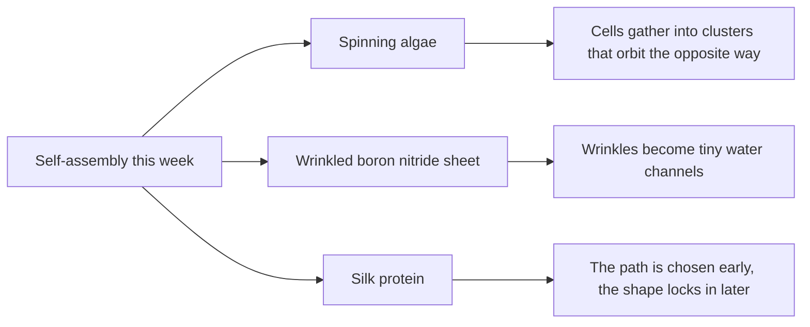
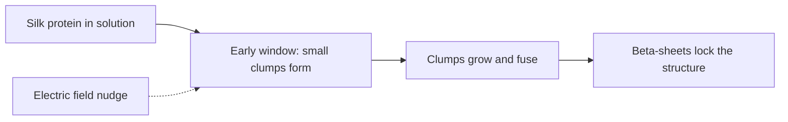

# Digest — 2026-11-02

*Curated America/New_York (ET). Prefer arXiv / open sources. Verified via the arXiv API, a Crossref date-window keyword query (journal articles published online 2026-10-31 to 2026-11-02), Crossref metadata and abstracts, and DOI resolution.*  
*Focus: items since the 2026-10-30 digest. Items covered on 2026-10-30 and earlier are not repeated. Journal items are read at abstract level.*

<Callout type="warning">
Frame these as **frontier progress**, not finished technology. Applications remain mostly simulation, tabletop hardware, or lab-scale experiments.
</Callout>

## At a glance

*Diagram: original illustration of this digest's key idea (not from the papers).*

## Highlights

### 1. Chirality inversion and odd transport in a suspension of living rotors
- **Authors:** Isabelle Eisenmann, Pedro Cosme, Hannah van Sterkenburg, Hugo Franca, Titouan Seguy, Maria Tatulea-Codrean, Maziyar Jalaal
- **Date / venue:** arXiv preprint, submitted 2026-10-29 (cond-mat.soft)
- **Link:** https://arxiv.org/abs/2610.41016
- **Tidbits:**
  - The team built a new experiment with microalgae that spin in place, like tiny living tops.
  - As the cells get more crowded, the swirling water they stir up pulls them into small rotating clusters, which then merge into one connected spinning fluid.
  - The surprise: every cell spins clockwise, yet the clusters orbit **counterclockwise**. Experiments, theory, and simulations trace this flip to the fact that the cells power themselves rather than being spun by an outside magnet or field.
  - Once the clusters connect into a network, the way things spread through the fluid changes too.
- **Why a beginner should care:** It is a clean example of self-assembly in living, self-powered matter, where the group can behave opposite to its members.
- **Caveat:** A preprint (not yet peer reviewed) about a lab experiment; no application is claimed.

<PubImg
  src="/images/latest/2026-11-02-spin-vs-orbit.svg"
  alt="Sketch of five green cells each with a small clockwise arrow, surrounded by a large red counterclockwise arrow for the cluster"
  caption="Illustration drawn for this digest to show the idea in the abstract (cells spin clockwise, clusters orbit counterclockwise). It is not data or a figure from the paper."
  credit="Original illustration by Self-Assembly Lab; concept from Eisenmann et al., arXiv:2610.41016"
  width={560}
  height={320}
/>

### 2. Self-Assembled hBN Wrinkles as Planar Optofluidic Channels
- **Authors:** Xiliang Yang, Tetsuo Martynowicz, Allard J. Katan, Kenji Watanabe, Takashi Taniguchi, Sabina Caneva
- **Date / venue:** Small, published online 2026-10-31 (CC BY 4.0)
- **Link:** https://doi.org/10.1002/smll.76515
- **Tidbits:**
  - Hexagonal boron nitride (hBN) is an atom-thin, flat crystal. When a flake on a surface is heated and cooled, it wrinkles, and the wrinkles join up into a network of tunnels, with no stencils or lithography needed.
  - Channel heights ranged from under 2 nm to over 100 nm depending on how thick the flake was and what it sat on.
  - Water seeped into the wrinkles after a droplet touched them and stayed there for more than 10 hours, and fluorescent DNA could be seen lined up along the channels.
- **Why a beginner should care:** Instead of carving nanochannels one by one, the material makes them itself as it buckles.
- **Caveat:** A proof-of-concept lab platform; read at abstract level.

<PubImg
  src="/images/latest/2026-11-02-hbn-wrinkle-heights.svg"
  alt="Log-scale bar from about 2 nanometres to about 100 nanometres showing the reported range of wrinkle channel heights"
  caption="Chart drawn for this digest from the range stated in the abstract (under 2 nm to over 100 nm). The bar shows the stated range only, not a measured distribution."
  credit="Original chart by Self-Assembly Lab; data from Yang et al., Small, doi:10.1002/smll.76515 (abstract)"
  width={560}
  height={260}
/>

### 3. Early Pathway Selection Precedes Conformational Locking in Protein Self-Assembly
- **Authors:** Ruoxuan Peng, Lele Zhou, Runnan Bai, Yunhao Yang, Yi Zhou, Hao Zhang, Xinyan Wang, Jing Ren, Jian Li, Yifan Liu, Shengjie Ling
- **Date / venue:** ACS Nano, published online 2026-11-02
- **Link:** https://doi.org/10.1021/acsnano.6c13997
- **Tidbits:**
  - Using silk protein, the team caught a short early window when small clumps (intermediates) first form, before the protein folds into its final locked structure.
  - Applying an electric field during that window nudged how the clumps formed and competed, and the effect was not simply "more field, more effect".
  - Later growth mostly happened by existing clumps lengthening and fusing; the stiff beta-sheet structure appeared only at the end and locked in the path chosen early.
- **Why a beginner should care:** It suggests the best time to steer self-assembly is at the very start, not after the structure has set.
- **Caveat:** Lab study on one model protein; read at abstract level.

*Diagram: original sketch of the sequence described in the abstract.*

### Stretch (adjacent)
- **Swimming versus Screening: How Activity Reshapes the Ionic Cloud of a Charged Particle** (Tanmoy Chakraborty, Tomer Markovich, Ram M. Adar; arXiv, submitted 2026-10-28): https://arxiv.org/abs/2610.38594 — theory showing that a fast-swimming charged particle changes the cloud of ions around it, so its electric influence reaches farther than for a still particle.
- **Advances on triply periodic hyperbolic surface structures: from biological inspiration to artificial self-assembly** (Shuai Ye, Lu Han; Micro Nano Science, published online 2026-11-02): https://doi.org/10.20517/mns.2026.09 — a review of saddle-shaped, endlessly repeating 3D surfaces found in butterfly wing scales and beetle shells, and how chemists self-assemble similar structures.

---

## Safe classroom / discussion follow-ons

1. **Spinners in a crowd (inspired by item 1):** Put several fidget spinners or spinning tops on a tray, or watch a video of them, and ask: if every spinner turns one way, which way would you guess a group drifts? Then sketch the flow around two neighbouring spinners to see why the answer can flip.
2. **Wrinkle channels (inspired by item 2):** Stretch a balloon or a sheet of plastic wrap over a bowl, let it relax, or push a sheet of cling film across a table to make wrinkles. Drip a drop of coloured water at one edge and watch it run along the wrinkles.
3. **Steer early (inspired by item 3):** Make two batches of gelatin or jelly (food-safe), and stir one only during the first few minutes of cooling and the other only once it starts to set. Compare textures and discuss why timing matters.
4. **Saddle shapes (stretch):** Fold a sheet of paper into a hyperbolic paraboloid (a saddle-shaped pleated square) and look at butterfly-wing photos; spot where curved surfaces repeat.

## Key idea of the day

Self-assembly often surprises us at the group level and depends on timing: self-powered algae gather into clusters that turn the opposite way to each cell, a crumpling crystal sheet builds its own nanoscale water channels, and silk protein picks its path early before locking it in. All of this is still lab-scale research, so treat it as a starting point, not finished technology.
