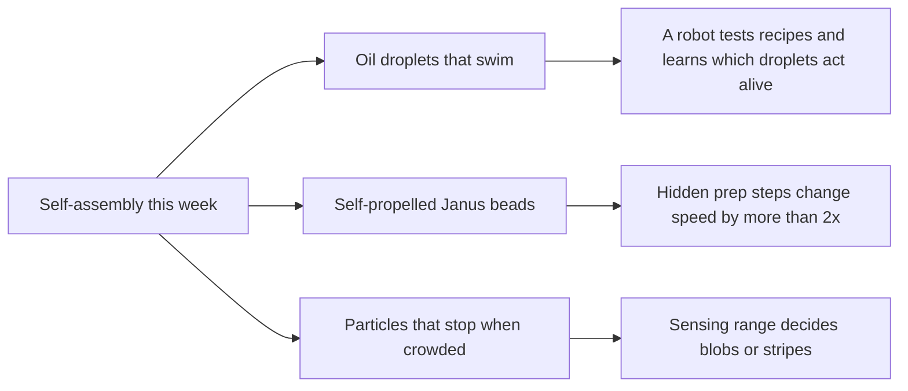
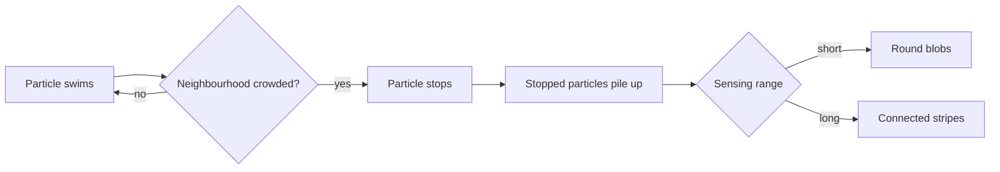

# Digest — 2026-11-03

*Curated America/New_York (ET). Verified via the arXiv API (submissions 2026-10-30 to 2026-11-02), arXiv abstract pages, and a Crossref date-window check of journal articles published online 2026-11-02 to 2026-11-03.*  
*Focus: items since the 2026-11-02 digest. Items covered earlier are not repeated. All three highlights are arXiv preprints read at abstract level.*

<Callout type="warning">
Frame these as **frontier progress**, not finished technology. Applications remain mostly simulation, tabletop hardware, or lab-scale experiments.
</Callout>

## At a glance

*Diagram: original illustration of this digest's key ideas (not from the papers).*

## Highlights

### 1. Programmable Droplets as Active Matter in a Reconfigurable Environment
- **Authors:** Ivan Shmarov, Abhishek Sharma, Michael Jirasek, Kristine Laws, Leroy Cronin
- **Date / venue:** arXiv preprint, submitted 2026-10-31 (cs.RO)
- **Link:** https://arxiv.org/abs/2611.01277
- **Tidbits:**
  - Oil droplets in water can swim on their own, which makes them a simple model of "life-like" behaviour.
  - The team built a closed-loop robotic platform that mixes droplet recipes, films how they move in real time, and picks the next recipe to try, with and without pH changes in the surrounding water.
  - They scored each droplet on two things: **persistence** (does it keep moving in a steady way?) and **diversity** (does it change its motion and adapt when disturbed?).
  - The key finding is a trade-off: droplets that were very persistent were less diverse, and very diverse droplets were less persistently active.
- **Why a beginner should care:** It shows how a robot that runs its own experiments can map out the "rules" of a messy active system faster than trying recipes by hand.
- **Caveat:** A preprint (not yet peer reviewed) on a lab platform; no application is claimed. The paper is CC BY-NC-ND, so the sketch below is our own drawing, not a figure from it.

<PubImg
  src="/images/latest/2026-11-03-persistence-diversity.svg"
  alt="Sketch of a curve falling from high diversity and low persistence to low diversity and high persistence, with a yellow dot for an adaptable droplet and a teal dot for a steady droplet"
  caption="Sketch drawn for this digest to show the trade-off stated in the abstract. The curve shape is illustrative only; it is not data from the paper."
  credit="Original illustration by Self-Assembly Lab; concept from Shmarov et al., arXiv:2611.01277"
  width={560}
  height={320}
/>

### 2. Impact of Surface Preparation on the Propulsion of Catalytic Janus Colloids and Implications for Reproducibility
- **Authors:** Muhammad Haroon, Mitchell Lau, Christopher L. Wirth
- **Date / venue:** arXiv preprint, submitted 2026-10-30 (cond-mat.soft)
- **Link:** https://arxiv.org/abs/2611.00274
- **Tidbits:**
  - Janus particles are tiny plastic beads with a platinum cap on one side. In hydrogen peroxide fuel they push themselves along, and they are one of the most common model systems in active matter.
  - Published speeds for similar particles differ by more than ten times, so the team tested two routine steps that papers rarely report.
  - Pre-exposing the platinum cap to the fuel before the experiment made the beads 2.4 times faster on average (strongly for an aged batch, only 16% for a fresh batch). Plasma-cleaning the glass slide made them 2.7 times slower.
  - The slowdown traced back to ions released from the cleaned glass into the water, and a simple model based on the water's conductivity matched the measured speeds. Of 17 published studies they compared, only 4 reported the pre-exposure step and only 6 reported how the glass was cleaned, so they propose a minimum reporting standard.
- **Why a beginner should care:** Good science depends on writing down "boring" steps; small, unreported choices can change a result more than the thing you meant to study.
- **Caveat:** A preprint about one widely used lab system; read at abstract level.

<PubImg
  src="/images/latest/2026-11-03-janus-speed-factors.svg"
  alt="Horizontal bar chart: pre-exposing the platinum cap gives 2.4 times faster, plasma-cleaning the glass gives 2.7 times slower, relative to a 1x baseline"
  caption="Chart drawn for this digest from the two factors stated in the abstract (2.4x faster, 2.7x slower). It shows only those stated averages, not the full measurements."
  credit="Original chart by Self-Assembly Lab; data from Haroon, Lau, Wirth, arXiv:2611.00274 (abstract)"
  width={560}
  height={280}
/>

### 3. Kinetics of Self-Organization in One Component Active Matter Systems
- **Authors:** Avinash Chauhan, Prasenjit Das
- **Date / venue:** arXiv preprint, submitted 2026-10-31 (cond-mat.soft); comments say accepted in Langmuir
- **Link:** https://arxiv.org/abs/2611.00618
- **Tidbits:**
  - In this computer simulation, self-propelled particles "sense" how crowded their neighbourhood is, a bit like bacteria using quorum sensing. When it gets crowded enough, a particle simply stops.
  - Stopped particles pile up into particle-rich domains. With a short sensing range they form round droplet-like blobs; with a longer range the blobs join into winding stripes (a bicontinuous pattern).
  - Whatever the range, the typical domain size grows with time as t to the power 1/3, the same slow coarsening law seen in many ordinary mixtures separating.
- **Why a beginner should care:** One simple rule ("stop when crowded") is enough for particles to self-organize, and a single knob (how far they sense) changes the pattern they make.
- **Caveat:** A 2D simulation, not an experiment.

<PubImg
  src="/images/latest/2026-11-03-quorum-morphology.png"
  alt="Three square simulation snapshots of blue particles: round blobs at sensing range 3, larger blobs at 4, and connected winding stripes at 5"
  caption="Snapshots at the same time for sensing range lambda = 3, 4 and 5: round droplet-like clusters turn into connected stripes as the sensing range grows (Figure 3 of the preprint)."
  credit="Avinash Chauhan and Prasenjit Das, arXiv:2611.00618, licensed CC BY 4.0 (resized)"
  width={700}
  height={258}
/>

*Diagram: original sketch of the rule described in the abstract.*

### Stretch (adjacent)
- **Swarm Choreography Made Simple: Superposed Guiding Vector Fields for Rigid Formation Path Following** (Joao Machado, Matthieu Verdoucq, Christophe Jouffrais, Murat Bronz; arXiv, submitted 2026-11-02): https://arxiv.org/abs/2611.03016 — five quadrotor drones keep a rigid V-shape while flying a helix, each sharing only a single number with its neighbours.
- **Mediating Human-Swarm Interactions Through a Robot Helper: A Shepherding-Inspired Approach** (Arihant Yadav, Sophie Jorg, Eakta Jain; arXiv, submitted 2026-11-02, accepted at IROS 2026): https://arxiv.org/abs/2611.03548 — in a virtual-reality shepherding task, steering a swarm by its overall shape worked better and felt easier than driving a helper robot by hand.

---

## Safe classroom / discussion follow-ons

1. **Design a robot scientist (inspired by item 1):** Using paper boats or toy cars, pick two things to change (for example sail size and weight), run quick trials, and after each round decide as a group what to try next. Discuss: did the "steadiest" design also turn the most?
2. **Write down the boring steps (inspired by item 2):** Two teams each race the same toy car or roll the same marble down a ramp, but each team secretly changes one "small" step (a dusted ramp, a different start push). Compare results, then write a shared recipe that everyone could follow.
3. **Stop when crowded (inspired by item 3):** In a gym or playground, students walk randomly and must freeze when they can touch two or more people (short range) or see three people within a few steps (long range). Photograph from above and compare the shapes of the frozen groups.
4. **Shepherd a swarm (stretch):** One student guides a group of walkers toward a goal by moving only around the edge of the group, never touching anyone, then compare with calling out instructions to each walker.

## Key idea of the day

Self-organization often comes from very simple rules, and from details we forget to notice: a robot can learn which droplet recipes act most life-like, a hidden cleaning step can halve or double how fast tiny swimmers move, and particles that just "stop when crowded" build blobs or stripes depending on how far they sense. All of this is still lab-scale research or simulation, so treat it as a starting point, not finished technology.
