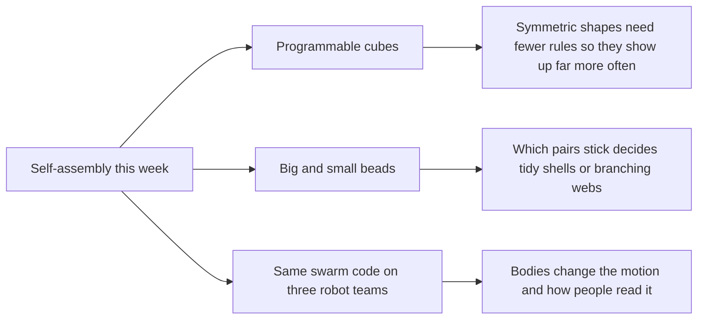

# Digest — 2026-11-04

*Curated America/New_York (ET). Verified via the arXiv API (submissions 2026-11-02 to 2026-11-03) and arXiv abstract and HTML pages.*  
*Focus: items since the 2026-11-03 digest. Items covered earlier are not repeated. All three highlights are arXiv preprints read at abstract and figure-caption level.*

<Callout type="warning">
Frame these as **frontier progress**, not finished technology. Applications remain mostly simulation, tabletop hardware, or lab-scale experiments.
</Callout>

## At a glance

*Diagram: original illustration of this digest's key ideas (not from the papers).*

## Highlights

### 1. How symmetry and complexity shape three-dimensional programmable self-assembly
- **Authors:** Prarthana Agrawal, Joakim Bohlin, Ard A. Louis
- **Date / venue:** arXiv preprint, submitted 2026-11-03 (cond-mat.soft)
- **Link:** https://arxiv.org/abs/2611.05301
- **Tidbits:**
  - The model uses "polycubes": cube-shaped tiles whose six faces carry colour codes, and only matching colours stick. A set of tiles plus its sticking rules is an assembly kit.
  - The team asked a simple question: if you pick a kit at random, how likely is it to build a given shape? They call this the shape's assembly rule probability.
  - That probability drops exponentially with "assembly complexity", the minimum information needed to write down rules that build the shape. Simple shapes win because many different kits, not just the minimal one, happen to build them.
  - Symmetry helps because the same tile and the same contact can be reused around the shape, so the most likely structures are a tiny group of highly symmetric ones. But symmetry is not the whole story: shapes with the same symmetry can need very different amounts of rule information.
- **Why a beginner should care:** It explains why nature (and engineers) keep landing on symmetric structures like viral shells: they are cheaper to "program".
- **Caveat:** A computer model of idealized tiles, not an experiment.

<PubImg
  src="/images/latest/2026-11-04-polycube-model.png"
  alt="Diagram: two coloured cube tile species and an interaction matrix form the input, a cross-shaped polycube is the output; below, a seed tile grows by attaching compatible tiles at open faces until it terminates"
  caption="The polycube model: tile species plus a matrix of which face colours stick (input) deterministically build a finite shape (output). Growth starts from a seed tile and adds compatible tiles at open faces until none remain (Figure 1 of the preprint)."
  credit="Prarthana Agrawal, Joakim Bohlin, Ard A. Louis, arXiv:2611.05301, licensed CC BY 4.0 (resized)"
  width={1000}
  height={659}
/>

### 2. Effect of Small Particle Interactions on Assembly of Binary Colloidal Clusters
- **Authors:** Dillip Kumar Mohapatra, Teun W. J. Verouden, Bos Everhardus Sprik, Wouter G. Ellenbroek, Janne-Mieke Meijer
- **Date / venue:** arXiv preprint, submitted 2026-11-02 (cond-mat.soft)
- **Link:** https://arxiv.org/abs/2611.03909
- **Tidbits:**
  - The experiment mixes large and small silica beads in a special liquid where small temperature changes switch on a gentle, reversible stickiness between beads (critical Casimir forces).
  - By tuning temperature, the team controlled which pairs stick: large-large, large-small, and small-small.
  - When only large-large and large-small pairs stick, the result is tidy core-shell clusters, with large beads wrapped by a full shell of small ones. When small-small pairs also stick, the shells fail and the beads form extended, branched networks.
  - Tracking each bead under a confocal microscope showed why: small beads that keep moving can rearrange into the tidy structure, while small beads that freeze in place get stuck (kinetic trapping).
- **Why a beginner should care:** Making something self-assemble neatly is a race between "finding the best arrangement" and "getting stuck too early", and stickiness that is too strong often loses that race.
- **Caveat:** A preprint on a quasi-2D lab system with a specialist solvent; read at abstract level. The arXiv HTML figures did not load, so the sketch below is our own drawing.

<PubImg
  src="/images/latest/2026-11-04-binary-cluster-sketch.svg"
  alt="Sketch: on the left, large green beads each fully ringed by small red beads; on the right, large green beads linked by branching chains of small red beads"
  caption="Sketch drawn for this digest of the two outcomes stated in the abstract. Bead counts and positions are illustrative only; this is not microscopy data from the paper."
  credit="Original illustration by Self-Assembly Lab; concept from Mohapatra et al., arXiv:2611.03909"
  width={640}
  height={300}
/>

### 3. Reality and Perceptual Gaps in Expressive Swarm Robotics
- **Authors:** Ali Imran, Abdalwhab Bakheet Mohammed Abdalwhab, Rafael Gomes Braga, Hélène Duval, Audrey Rochette, Vivek Shankar Varadhajan, Yann Bouteiller, Jean Mazerolle, Giovanni Beltrame, David St-Onge
- **Date / venue:** arXiv preprint, submitted 2026-11-03 (cs.RO)
- **Link:** https://arxiv.org/abs/2611.05244
- **Tidbits:**
  - The same decentralised swarm code ran on three very different robot teams during live art performances: small tabletop robots, flying drones, and human-scale mobile robots.
  - The software worked on all three, but the robots' bodies changed what the motion looked like, stretching how fast behaviours played out by more than three times and reshaping the paths.
  - Audience surveys found that what people thought the swarm was "trying" to do, and whether it felt comforting or threatening, depended strongly on the robots' physical form. Those two reactions did not move together.
- **Why a beginner should care:** Getting swarm code to run on real robots (closing the "reality gap") is only half the job; people also have to understand what a swarm is doing.
- **Caveat:** A preprint based on artistic performances and audience surveys, not a controlled engineering benchmark.

<PubImg
  src="/images/latest/2026-11-04-swarm-trajectories.png"
  alt="Grid of robot paths: rows for Fireworks, Cyclic pursuit and Lennard-Jones behaviours, columns for the Doody, CrazyCogni and Sushi platforms, lines coloured from dark blue at start to yellow at end"
  caption="The same three behaviours (Fireworks, cyclic pursuit, Lennard-Jones) run from the same script on human-scale (Doody), flying (CrazyCogni) and tabletop (Sushi) robots. Lines show individual robots coloured by time (Figure 3 of the preprint)."
  credit="Imran et al., arXiv:2611.05244, licensed CC BY 4.0 (resized)"
  width={1000}
  height={944}
/>

### Stretch (adjacent)
- **Trail systems self-organize through individual route optimization** (Brendan Wallace, Andrew Berdahl; arXiv, submitted 2026-11-03): https://arxiv.org/abs/2611.04346 — in simulation, walkers who each plan the cheapest route, and flatten the ground as they go, build whole trail networks that connect space efficiently.
- **Assignment-Free Swarm Navigation via Adaptive Target-Field Planning and Mean-Shift Exploration** (Jiaxuan Li, Junhui Zhang, Bo Zhu; arXiv, submitted 2026-11-03): https://arxiv.org/abs/2611.04824 — a robot swarm fills a target shape and changes that shape to squeeze through cluttered spaces, without any robot being given its own spot, tested in simulation and on hardware.

---

## Safe classroom / discussion follow-ons

1. **Fewest rules wins (inspired by item 1):** With sugar cubes or snap cubes and coloured stickers, give each group a rule like "red touches blue only". Count how many different rule cards build a cross versus a lopsided shape. Which shapes are easiest to "program"?
2. **Sticky too soon (inspired by item 2):** Shake large and small pom-poms or Velcro dots in a closed box. First let only big-to-small pieces stick, then add strips so small pieces stick to each other too. Compare tidy shells with tangled webs.
3. **Same code, different bodies (inspired by item 3):** Give the same three movement rules (spread out, follow the person ahead in a circle, keep a comfortable distance) to a group walking, a group on tiptoe in a small square, and a group of toy cars pushed by hand. Ask observers what each group "looks like it wants".
4. **Desire paths (stretch):** Look at a school field or park map for worn shortcuts across the grass, and discuss why people's individual shortcuts add up to a shared trail network.

## Key idea of the day

Self-assembly rewards simple, reusable rules and patience: symmetric shapes need the fewest rules, beads that can still move find tidy arrangements while over-sticky ones get trapped, and even the same swarm code looks different, and feels different to people, depending on the bodies running it. All of this is still lab-scale research or simulation, so treat it as a starting point, not finished technology.
