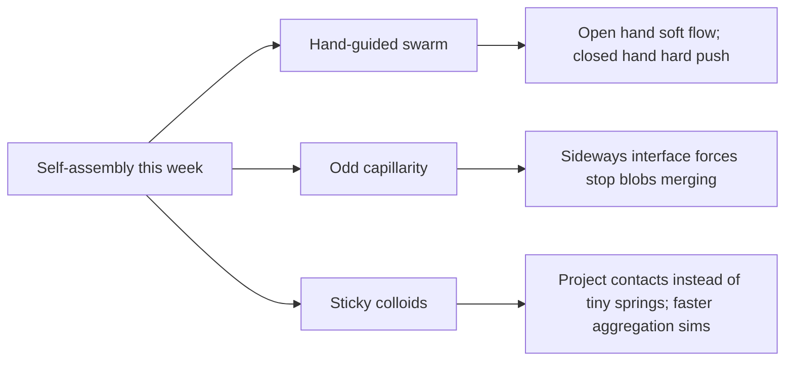

# Digest — 2026-11-05

*Curated America/New_York (ET). Verified via the arXiv API (submissions 2026-11-03 to 2026-11-04), arXiv abstract and HTML pages, and Crossref (published window 2026-11-03 to 2026-11-05).*  
*Focus: items since the 2026-11-04 digest. Items covered earlier (including arXiv 2611.05301, 2611.03909, 2611.05244) are not repeated. All three highlights are arXiv preprints read at abstract and figure-caption level.*

<Callout type="warning">
Frame these as **frontier progress**, not finished technology. Applications remain mostly simulation, tabletop hardware, or lab-scale experiments.
</Callout>

## At a glance

*Diagram: original illustration of this digest's key ideas (not from the papers).*

## Highlights

### 1. Fluidic Body: Swarm Robots as a Fluid Extension of the Hand
- **Authors:** Michikuni Eguchi, Shigeo Yoshida, Mai Nishimura, Takefumi Hiraki
- **Date / venue:** arXiv preprint, submitted 2026-11-04 (cs.HC, cs.RO); accepted to ACM ISS 2026
- **Link:** https://arxiv.org/abs/2611.06068
- **Tidbits:**
  - Most swarm interfaces ask a person to point where the robots should go. Fluidic Body instead treats the swarm as a fluid "body" attached to the hand.
  - A virtual fluid sits between the hand and the robots. Opening the hand makes the swarm soft so it can deform and flow around obstacles; closing the hand makes it a hard, cohesive body that can push objects.
  - The team tested the idea in simulation (obstacle avoidance and object transport) and in a demonstration with physical robots, and compared operability with an existing same-behavior controller.
- **Why a beginner should care:** It turns a swarm from "a flock you steer" into "a tool you reshape with a gesture", which is closer to how people already use their hands.
- **Caveat:** A preprint on a research HCI/robotics system; physical results are a demonstration, not a consumer product. arXiv license is nonexclusive-distrib only, so the sketch below is our own drawing.

<PubImg
  src="/images/latest/2026-11-05-fluidic-body-sketch.svg"
  alt="Sketch: left, open hand and soft blue robots flowing around a gray obstacle; right, closed fist and tight orange robot cluster pushing a box"
  caption="Sketch drawn for this digest of the open-hand soft / closed-hand hard idea stated in the abstract. Robot counts and poses are illustrative only; this is not data from the paper."
  credit="Original illustration by Self-Assembly Lab; concept from Eguchi et al., arXiv:2611.06068"
  width={720}
  height={320}
/>

### 2. Odd Capillarity
- **Authors:** Nadia Bihari Padhan, Axel Voigt
- **Date / venue:** arXiv preprint, submitted 2026-11-04 (physics.flu-dyn, cond-mat.soft)
- **Link:** https://arxiv.org/abs/2611.06882
- **Tidbits:**
  - Ordinary capillarity pulls along an interface in a familiar way (think surface tension rounding a droplet). "Odd capillarity" adds a parity-breaking interfacial stress that pushes sideways along the interface instead.
  - In continuum simulations of a binary fluid, that sideways stress slows and then arrests domain coarsening: blobs stop growing even while the fluid keeps moving turbulently.
  - In asymmetric mixtures, odd-capillary deformation and breakup interrupt droplet growth and can leave dynamically arrested, more evenly spaced patterns (hyperuniformity in the reported simulations).
- **Why a beginner should care:** Self-assembly often fails when domains keep merging forever; a new interfacial force that freezes pattern size while keeping motion is a rare design knob.
- **Caveat:** Direct numerical simulations of continuum equations, not a lab experiment. Read at abstract and figure-caption level.

<PubImg
  src="/images/latest/2026-11-05-odd-capillarity-coarsening.png"
  alt="Plot panels: characteristic coarsening length L(t) for increasing chirality parameter chi; higher chi slows then arrests growth compared with ordinary linear coarsening"
  caption="Odd capillarity slows and arrests domain coarsening. As the chirality parameter chi increases, the characteristic length L(t) grows more slowly than ordinary hydrodynamic coarsening and can plateau (Figure 1 of the preprint)."
  credit="Nadia Bihari Padhan, Axel Voigt, arXiv:2611.06882, licensed CC BY 4.0 (resized)"
  width={1000}
  height={444}
/>

### 3. Long-time Brownian dynamics of hard and sticky colloids by geometric projection
- **Authors:** Rémi Martin, Sandrine Duluard, Céline Merlet
- **Date / venue:** arXiv preprint, submitted 2026-11-03 (cond-mat.soft, cond-mat.mtrl-sci)
- **Link:** https://arxiv.org/abs/2611.05018
- **Tidbits:**
  - Simulating sticky colloids is usually limited by the tiniest timescales inside the attractive wells that hold bonded pairs together.
  - The authors replace those stiff near-contact forces with a geometric projection step: after each free Brownian move, particle positions are projected so hard-sphere exclusion, sticky bonds, and hard walls are satisfied.
  - The method matches hard-sphere structure and diffusion and recovers sticky-sphere aggregation kinetics, while reaching one to two orders of magnitude more physical time at the same computational cost in the tests reported.
  - That speed-up lets them simulate low-Péclet electrophoretic deposition, where densification can happen before a bonded network forms.
- **Why a beginner should care:** Better long-time aggregation simulations mean researchers can watch self-assembly pathways that used to be too slow to reach on a computer.
- **Caveat:** A methods preprint validated against other simulations; not a new experimental material.

<PubImg
  src="/images/latest/2026-11-05-sticky-aggreg-kinetics.png"
  alt="Two-panel figure: pair potentials of decreasing attractive range versus an idealized sticky square well; cluster-number decay over time for those models versus the projected sticky-contact method"
  caption="Validation of aggregation kinetics: shorter-range attractions (black, green, blue) versus the projected sticky-contact model (red), and the matching decay of normalized cluster number Nc/N at volume fraction 0.25 (Figure 2 of the preprint)."
  credit="Rémi Martin, Sandrine Duluard, Céline Merlet, arXiv:2611.05018, licensed CC BY 4.0 (resized)"
  width={1000}
  height={482}
/>

### Stretch (adjacent)
- **Synchronization transitions in ensembles of active particles with distance-dependent higher-order interactions** (Dhrubajyoti Biswas, P. S. Burada, Pintu Patra; arXiv, submitted 2026-11-04): https://arxiv.org/abs/2611.06088 — a Vicsek–Kuramoto model with trio-and-higher interactions shows continuous and explosive sync transitions; short-range interactions and tight initial clusters can break the analytic picture.
- **Toward Ternary Computing Enabled by Origami-Inspired Modular Architectures** (Xiaolei Wang, Zihe Wang, Haibo Qu, Peiyi Wang, Sheng Guo, Jinkyu Yang; Nature Communications, 2026-11-05, CC BY 4.0): https://doi.org/10.1038/s41467-026-79187-0 — Kresling origami modules encode binary and ternary mechanical logic gates and adders via multi-stable kinematics.
- **Global coarse-grained simulation of hierarchical self-assembly in ABn dendron-like giant molecules** (Huilong Liu, Zongwu Huang, Rui Zhang; J. Chem. Phys., 2026-11-05): https://doi.org/10.1063/5.0357597 — unbiased DPD of dendron-like amphiphiles recovers lamellar, gyroid, cylinder, and micelle phases; rigidity alone shifts phase boundaries.

---

## Safe classroom / discussion follow-ons

1. **Soft hand, hard hand (inspired by item 1):** Give a group of students the same "swarm" of tennis balls or beanbags. First ask them to stay loose and flow around a chair (open-hand mode). Then ask them to lock elbows and shoulders and push a cardboard box together (closed-hand mode). Discuss which mode fits which task.
2. **Sideways force at a boundary (inspired by item 2):** On a tabletop, use two colours of water beads or oil-and-water food-colour blobs in a shallow dish. Gently stir. Talk about what usually makes blobs merge (ordinary surface tension). Then imagine a rule that always pushes along the rim sideways: would merging slow down?
3. **Sticky too expensive to simulate (inspired by item 3):** With Velcro dots on coins, show that once two coins stick, tiny jiggles inside the bond are boring but costly to "simulate" by hand. Instead, after each random slide, snap bonded coins to a fixed contact distance (the projection idea). Compare how far the cluster story gets in the same time.
4. **Origami logic (stretch):** Fold a simple bistable paper hinge (two stable snaps) and assign "0" and "1" to the two snaps. Ask what a third stable pose would buy you for counting.

## Key idea of the day

Self-assembly advances when we change how collectives are controlled, how interfaces push, and how we simulate stickiness: a hand gesture that softens or hardens a robot swarm, an odd interfacial stress that freezes pattern size while motion continues, and a geometric shortcut that lets sticky-colloid simulations reach much longer times. All of this is still lab-scale research or simulation, so treat it as a starting point, not finished technology.
