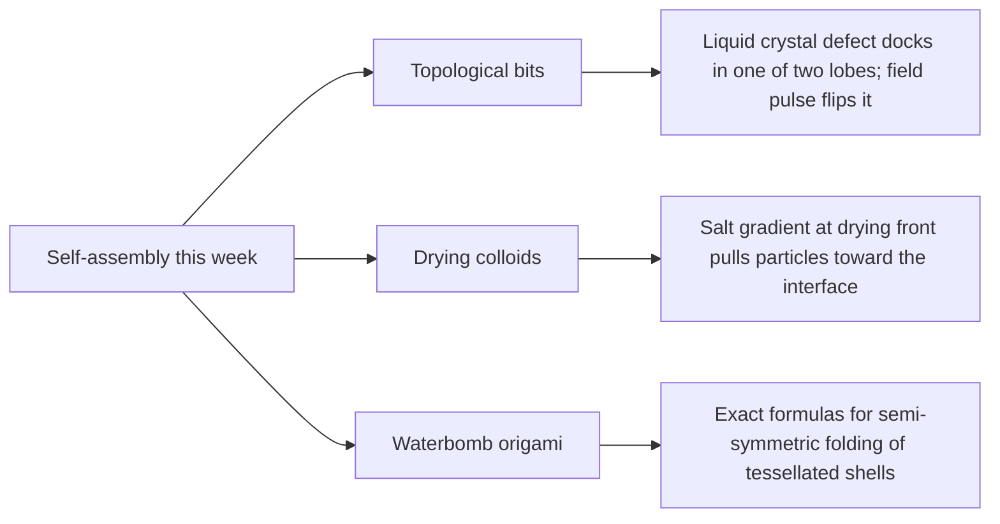

# Digest — 2026-11-09

*Curated America/New_York (ET). Verified via the arXiv API (submissions 2026-11-04 to 2026-11-06), arXiv abstract and HTML pages, and Crossref (published window 2026-11-06 to 2026-11-09).*  
*Focus: items since the 2026-11-05 digest (no digest was published on 2026-11-06). Items covered earlier are not repeated. All three highlights are arXiv preprints read at abstract and figure-caption level.*

<Callout type="warning">
Frame these as **frontier progress**, not finished technology. Applications remain mostly simulation, tabletop hardware, or lab-scale experiments.
</Callout>

## At a glance

*Diagram: original illustration of this digest's key ideas (not from the papers).*

## Highlights

### 1. Flexoelectric Switching of Lock-and-Key Topological Bits
- **Authors:** Zhijian Zhou, Claire Doré, Yusheng Cai, Jed-Joan S. Edziah, Brian Edwards, Nader Engheta, Amish J. Patel, Kathleen J. Stebe
- **Date / venue:** arXiv preprint, submitted 2026-11-04 (cond-mat.soft)
- **Link:** https://arxiv.org/abs/2611.07119
- **Tidbits:**
  - A point defect in a nematic liquid crystal can be stabilized inside a pillbox-shaped pore, where it docks into one lobe or the other, much like lock-and-key docking of colloids. That gives two stable states.
  - An in-plane electric field drives the defect from one lobe to the other, and it stays there after the field is removed. Its speed grows linearly with field strength and reverses with polarity, consistent with flexoelectric coupling.
  - Peanut-shaped pores with opposing curvature repel the defect, so pore geometry can set different switching thresholds. Arrays of pores can store and rewrite binary information in defect positions.
- **Why a beginner should care:** It shows that a "flaw" in an ordered soft material can be a useful, addressable memory element, with shape (not chemistry) doing the programming.
- **Caveat:** A lab-scale preprint; this is a route toward reconfigurable soft materials, not a working memory chip. arXiv license is nonexclusive-distrib only, so the sketch below is our own drawing.

<PubImg
  src="/images/latest/2026-11-09-topological-bit-sketch.svg"
  alt="Sketch: two pillbox-shaped pores, left with a red defect dot in its left lobe labelled 0, right with the dot in its right lobe labelled 1, and a green arrow labelled field pulse between them"
  caption="Sketch drawn for this digest of the two-lobe memory idea described in the abstract. Shapes and sizes are illustrative only; this is not data from the paper."
  credit="Original illustration by Self-Assembly Lab; concept from Zhou et al., arXiv:2611.07119"
  width={720}
  height={300}
/>

### 2. Evaporation-induced colloidal diffusiophoresis in electrolyte solutions
- **Authors:** Dang Q. Duong, Jung Hyun Kim, Hanna Cho, Sangwoo Shin
- **Date / venue:** arXiv preprint, submitted 2026-11-06 (cond-mat.soft, physics.flu-dyn)
- **Link:** https://arxiv.org/abs/2611.08965
- **Tidbits:**
  - As a liquid dries, dissolved salt that cannot evaporate piles up near the receding drying front, creating a concentration gradient.
  - In experiments with polystyrene particles drying inside a capillary tube, those ion gradients pushed particles toward the liquid-air interface (diffusiophoresis) and increased accumulation there.
  - Slower drying at higher humidity weakened the gradient and the migration. A heat-balance-integral model of the salt field, coupled to particle transport, captured the observed trajectories and accumulation trends.
- **Why a beginner should care:** How particles arrange while drying sets the structure of coatings and battery electrodes, and here salt and drying speed turn out to be coupled control knobs.
- **Caveat:** Experiments in a simple capillary geometry plus a model; scaling to real manufacturing is the authors' stated motivation, not a demonstrated result. The paper is CC BY 4.0, but arXiv HTML figures were unavailable, so the sketch below is our own drawing.

<PubImg
  src="/images/latest/2026-11-09-drying-front-sketch.svg"
  alt="Sketch: horizontal capillary tube with liquid on the left shading darker toward a curved drying front on the right, orange particles crowding near the front, arrow showing particle drift toward the front"
  caption="Sketch drawn for this digest of the drying-front mechanism stated in the abstract. Particle positions are illustrative only; this is not data from the paper."
  credit="Original illustration by Self-Assembly Lab; concept from Duong et al., arXiv:2611.08965"
  width={720}
  height={300}
/>

### 3. Closed-form solution for semi-symmetric folding of waterbomb tessellations
- **Authors:** Sascha Stüttgen, Homam Spartali, Alice C. Niemeyer, Rostislav Chudoba, Daniel Robertz
- **Date / venue:** arXiv preprint, submitted 2026-11-05 (cond-mat.soft, math.MG)
- **Link:** https://arxiv.org/abs/2611.08050
- **Tidbits:**
  - The waterbomb is a classic origami cell. Tiling many of them makes a foldable shell whose curvature depends on the cell's design.
  - An earlier exact (algebraic) solution covered symmetric folding. This paper extends it to semi-symmetric folding, where each cell has 180-degree rotation symmetry, and solves the whole folding process.
  - The formulas link single-cell design parameters directly to shell curvature and effective cross-section height, so designers can explore achievable shapes without heavy numerical simulation. The stated target is thin, lightweight shells in textile-reinforced concrete.
- **Why a beginner should care:** When a fold pattern has an exact formula, you can predict the final 3D shape from a flat sheet, which is the core promise of self-folding structures.
- **Caveat:** A geometry and kinematics paper (rigid origami, ideal hinges); it does not test material strength or self-folding actuation.

<PubImg
  src="/images/latest/2026-11-09-waterbomb-cells.png"
  alt="Two-panel diagram: a) three flat waterbomb cells O, P, Q joined along edges with red and dashed blue crease lines; b) the same three cells folded into a 3D shape"
  caption="Attaching neighbouring semi-symmetric waterbomb cells: a) flat configuration; b) folded configuration, where rotations about shared edges are still needed to match vertices (Figure 7 of the preprint)."
  credit="Sascha Stüttgen, Homam Spartali, Alice C. Niemeyer, Rostislav Chudoba, Daniel Robertz, arXiv:2611.08050, licensed CC BY 4.0 (resized)"
  width={1000}
  height={564}
/>

### Stretch (adjacent)
- **Massively parallel self-assembly of suspendable microcompartments for functional cell screening** (Michael Mellody, Yuta Nakagawa, and colleagues; Science Advances, 2026-11-06): https://doi.org/10.1126/sciadv.aei7819 — spherical capping particles dock into bowl-shaped hydrogel "nanovials" to make closed compartments; the authors report capping above 80% of nanovials and above 90% sorting yield by flow cytometry.
- **Slit-Confined Self-Assembly of Cellulose Nanocrystals for Long-Range Ordered Cholesteric Architecture** (Yi Zhou, Cheng Zeng, Chunhong Ye, Canhui Lu, Rui Xiong; ACS Nano, 2026-11-09): https://doi.org/10.1021/acsnano.6c15835 — a simple glass slit, gravity, and interfacial hydrogen bonding give centimetre-scale single-domain cholesteric cellulose films for photonics.
- **A Quantum Mechanical Description of Active Matter** (Ghansham Chandel, Siddhartha Das; arXiv, submitted 2026-11-06): https://arxiv.org/abs/2611.09861 — a theoretical proposal that treats energy expenditure and momentum generation rates as the basic variables for swimmers, arriving at Dirac- and Schrödinger-like equations. Speculative theory; read critically.

---

## Safe classroom / discussion follow-ons

1. **Two-pocket memory (inspired by item 1):** Cut a peanut-shaped hole in cardboard and put a marble in it on a tray. Tilt briefly to move the marble from one lobe to the other, then level the tray. The marble stays: that is one stored bit. Make a row of four and write a binary number.
2. **Coffee-ring and salt (inspired by item 2):** Dry small drops of water with a pinch of ground pepper or chalk dust on a plate, some with a little table salt and some without, one set near a fan and one covered. Compare where the dust ends up. No heating or chemicals needed.
3. **Fold a waterbomb (inspired by item 3):** Fold paper waterbomb bases, tape several together, and watch the sheet curve. Change the crease angles slightly and measure how the curvature changes with a ruler.

## Key idea of the day

Shape and gradients can program self-assembly: a pore's outline gives a liquid-crystal defect two stable homes that a field pulse can switch, a salt gradient at a drying front steers where particles settle, and exact origami formulas predict how a flat crease pattern curls into a shell. All of this is lab-scale or theoretical work, so treat it as a starting point, not finished technology.
