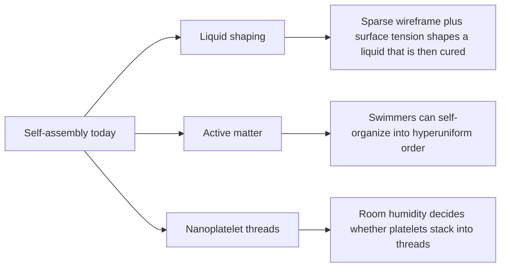

# Digest — 2026-11-10

*Curated America/New_York (ET). Verified via the arXiv "new" listings for Tuesday 10 November 2026 (cond-mat.soft, cs.RO, cs.MA, physics.bio-ph), arXiv abstract and HTML pages, and Crossref (published window 2026-11-09 to 2026-11-10).*  
*Focus: items since the 2026-11-09 digest. Items covered earlier are not repeated. All three highlights are arXiv preprints read at abstract and figure-caption level.*

<Callout type="warning">
Frame these as **frontier progress**, not finished technology. Applications remain mostly simulation, tabletop hardware, or lab-scale experiments.
</Callout>

## At a glance

*Diagram: original illustration of this digest's key ideas (not from the papers).*

## Highlights

### 1. Manufacturing Complex Structures Through Interfacial Self-Organization
- **Authors:** Jacob Garrett, Abhinit Sati, Edward Chien, Emily Whiting, Valeri Frumkin
- **Date / venue:** arXiv preprint, announced 2026-11-10 (cond-mat.soft)
- **Link:** https://arxiv.org/abs/2611.09950
- **Tidbits:**
  - Instead of carving or depositing material point by point, the target shape is encoded in a sparse wireframe, for example a 3D-printed frame.
  - A computer splits the target into patches of constant mean curvature (the shapes soap films and liquid surfaces naturally take) and builds the frame from the patch boundaries.
  - With the frame in a density-matched liquid (so gravity is effectively cancelled), an injected curable liquid pulls itself into the prescribed shape by surface tension and is then cured. The authors show a Stanford bunny, an anatomical hand, and topology-optimized parts with cavities and mixed materials.
- **Why a beginner should care:** It turns surface tension, the same force that shapes soap bubbles, into a manufacturing tool, so the liquid does the hard geometric work.
- **Caveat:** A lab demonstration with selected polymers and objects; speed, accuracy, and scale-up are not yet established. CC BY 4.0.

<PubImg
  src="/images/latest/2026-11-10-wireframe-self-organization.png"
  alt="Multi-panel figure: target shapes (Stanford bunny, human hand, cow) split into curved surface patches, the wireframes built from patch boundaries, liquid injected into submerged wireframes, and the final cured smooth objects"
  caption="Fabrication via interfacial self-organization: target geometry approximated by constant-mean-curvature patches, a wireframe built from their boundaries, liquid polymer injected into the submerged frame, then cured (Figure 1 of the preprint)."
  credit="Jacob Garrett, Abhinit Sati, Edward Chien, Emily Whiting, Valeri Frumkin, arXiv:2611.09950, licensed CC BY 4.0 (resized)"
  width={1000}
  height={664}
/>

### 2. Hyperuniformity in active matter
- **Authors:** Hartmut Löwen, Erdal C. Oğuz
- **Date / venue:** arXiv preprint (perspective), announced 2026-11-10 (cond-mat.soft)
- **Link:** https://arxiv.org/abs/2611.10605
- **Tidbits:**
  - A disordered hyperuniform material looks random up close but has unusually small density fluctuations over large distances, so it behaves almost as if it were incompressible.
  - Active matter is made of self-propelled agents that turn energy into motion. A 2019 study by Lei and coworkers showed that interacting circle swimmers self-organize into disordered hyperuniform structures, linking the two fields.
  - This short perspective surveys the examples found since then and suggests further links between hyperuniformity and active matter.
- **Why a beginner should care:** It shows that moving, energy-burning particles can arrange themselves into a hidden large-scale order that is neither crystal nor random.
- **Caveat:** A perspective article, not new experiments. CC BY 4.0, but arXiv HTML figures were unavailable, so the sketch below is our own drawing.

<PubImg
  src="/images/latest/2026-11-10-hyperuniform-sketch.svg"
  alt="Sketch: two boxes of blue dots, left placed at random with visible clumps and empty gaps, right disordered up close but evenly spread at large scale"
  caption="Sketch drawn for this digest contrasting random placement with a hyperuniform-like pattern (a jittered grid). Generated with a random-number script for illustration only; this is not data from the paper."
  credit="Original illustration by Self-Assembly Lab; concept from Löwen and Oğuz, arXiv:2611.10605"
  width={720}
  height={320}
/>

### 3. This Is Water: Relative Humidity as a Hidden Parameter in the Self-Assembly of CdSe Nanoplatelets into Threads
- **Authors:** Benoit Wagnon, Seungho Lee, Lilian Guillemeney, Frédéric Chaput, Rodolphe Valleix, Laurent Coolen, Benjamin Abécassis
- **Date / venue:** arXiv preprint, announced 2026-11-10 (cond-mat.soft)
- **Link:** https://arxiv.org/abs/2611.10625
- **Tidbits:**
  - Semiconductor nanoplatelets stacked face to face into threads can pass energy along them very efficiently (FRET over hundreds of nanometres), but making the threads reproducibly has been hard.
  - Using a humidity-controlled chamber, the authors found that micrometre-long stacks form only when evaporation happens above 50% relative humidity and when free oleic acid is present, not in dry air.
  - Because ordinary labs sit around those humidity levels, this hidden variable can explain why results differ from day to day. They discuss how stray water may change solvent polarity and depletion, capillary, or solvation forces.
- **Why a beginner should care:** The weather in the room can decide whether nanoparticles assemble, which is a strong lesson in recording every condition of an experiment.
- **Caveat:** Lab-scale study of one nanoplatelet system; the exact mechanism is still discussed, not settled. The license is CC BY-NC-ND, so the sketch below is our own drawing.

<PubImg
  src="/images/latest/2026-11-10-humidity-threads-sketch.svg"
  alt="Sketch: left box labelled dry air with orange platelets scattered at random angles; right box labelled humid air with platelets stacked side by side into three long threads"
  caption="Sketch drawn for this digest of the humidity finding stated in the abstract. Shapes, counts, and sizes are illustrative only; this is not data from the paper."
  credit="Original illustration by Self-Assembly Lab; concept from Wagnon et al., arXiv:2611.10625"
  width={720}
  height={320}
/>

### Stretch (adjacent)
- **Self-Assembly of Two-Dimensional Open Structures with Adjustable Square Voids** (Denis Dertli, Na Liu, Thomas Speck; ACS Nano, 2026-11-10): https://doi.org/10.1021/acsnano.6c13668 — Monte Carlo simulations and free-volume theory map the phases of 2D patchy hard rectangles as attraction strength changes.
- **Plasmon-Defined Chemical Templates for the Nanoscale Assembly of Colloidal Nanoparticles** (Pascal Cheng, Macilia Braïk, and colleagues; Chemistry of Materials, 2026-11-09): https://doi.org/10.1021/acs.chemmater.6c02048 — uses light-concentrating plasmon fields to pattern surface chemistry that then guides where nanoparticles attach.
- **Applications of Directed Self-Assembly Lithography in Advanced Semiconductor Devices** (Jiale Tang and colleagues; Materials, 2026-11-09, review): https://doi.org/10.3390/ma19214749 — reviews how block copolymer directed self-assembly could complement conventional chip lithography.

---

## Safe classroom / discussion follow-ons

1. **Soap-film shapes (inspired by item 1):** Bend pipe cleaners or wire into a cube or a twisted loop and dip it in bubble solution. The film always finds a smooth minimal surface set by the frame. Sketch the shape before dipping and compare.
2. **Random vs evenly spread (inspired by item 2):** Drop 50 dried beans onto a gridded sheet, then place 50 more by hand "randomly but not too close". Count beans in big squares of each grid and compare how much the counts vary.
3. **Record the room (inspired by item 3):** Dry identical drops of coffee or food colouring on plates on a humid day and a dry day (or inside a covered box with a damp paper towel versus an open plate). Note humidity from a cheap hygrometer or a weather app and compare the dried patterns.

## Key idea of the day

Self-assembly is often decided by forces and conditions we barely notice: surface tension can shape a liquid into a complex part, moving particles can find hidden large-scale order, and ordinary room humidity can make or break nanoplatelet threads. All of this is lab-scale or review work, so treat it as a starting point, not finished technology.
