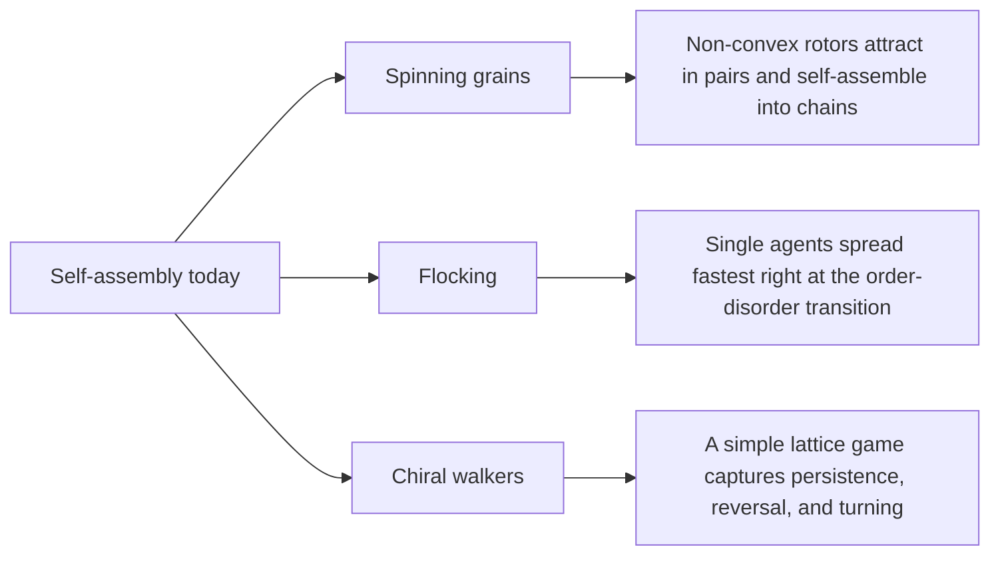

# Digest — 2026-11-11

*Curated America/New_York (ET). Verified via the arXiv API (recent submissions on self-assembly, swarms, active matter, programmable matter, and colloids), arXiv abstract and HTML pages, and Crossref (published window 2026-11-10 to 2026-11-11).*  
*Focus: items since the 2026-11-10 digest. Items covered earlier are not repeated. All three highlights are arXiv preprints read at abstract and figure-caption level.*

<Callout type="warning">
Frame these as **frontier progress**, not finished technology. Applications remain mostly simulation, tabletop hardware, or lab-scale experiments.
</Callout>

## At a glance

*Diagram: original illustration of this digest's key ideas (not from the papers).*

## Highlights

### 1. Mechanical pairing and self-assembled chains of non-convex granular rotors
- **Authors:** Thomas Barois, Melanie Labiausse, Jean-Francois Boudet, Juho S. Lintuvuori, Hamid Kellay
- **Date / venue:** arXiv preprint, submitted 2026-11-10 (cond-mat.soft)
- **Link:** https://arxiv.org/abs/2611.14120
- **Tidbits:**
  - The building blocks are rigid, non-convex grains (shapes with notches or arms) that are driven to spin, a kind of "active" granular matter.
  - Experiments and simulations show that two such rotors attract each other. How strongly depends on how much they spin compared with the random noise, and on their shape.
  - Pairs that stick together lead to robust chains, which can be either set up at the start or formed spontaneously by self-assembly.
- **Why a beginner should care:** Here, shape and motion alone create "stickiness" between grains with no glue, magnets, or chemistry.
- **Caveat:** A tabletop and simulation study of one rotor system; the abstract gives no applications. The license is CC BY-NC-ND, so the sketch below is our own drawing.

<PubImg
  src="/images/latest/2026-11-11-rotor-chain-sketch.svg"
  alt="Sketch: left box with star-shaped orange rotors scattered apart; right box with the same rotors lined up touching in two chains, each with a small spin arrow"
  caption="Sketch drawn for this digest of the idea in the abstract: when spin dominates noise, rotors pair up and form chains. Shapes and counts are illustrative only; this is not data from the paper."
  credit="Original illustration by Self-Assembly Lab; concept from Barois et al., arXiv:2611.14120"
  width={720}
  height={320}
/>

### 2. Giant Diffusion at Flocking Transitions
- **Authors:** Sohini Chatterjee, Wasim Akram, Subir K. Das
- **Date / venue:** arXiv preprint, submitted 2026-11-09 (cond-mat.stat-mech)
- **Link:** https://arxiv.org/abs/2611.12465
- **Tidbits:**
  - The authors simulate two 2D flocking models, where agents try to align their direction of motion with neighbours and switch between ordered (flocking) and disordered states as noise changes.
  - How far a single agent wanders (its diffusivity) peaks sharply right at the transition, and the peak grows with system size. In ordinary equilibrium systems diffusion at a critical point either drops or does not change.
  - They argue this enhanced wandering acts like a long-range interaction, which helps explain how 2D flocks can order at all despite the Mermin-Wagner theorem (a rule that forbids this kind of order in comparable equilibrium systems).
- **Why a beginner should care:** Flocks behave in ways that ordinary physics of crystals and magnets does not predict, which is a big reason active matter is studied.
- **Caveat:** Simulation-only study of model flocks; the authors expect experimental relevance but none is shown. CC BY 4.0.

<PubImg
  src="/images/latest/2026-11-11-flocking-giant-diffusion.png"
  alt="Four-panel figure: top, single-particle trajectories in two flocking models, with the trajectory at intermediate noise wandering much farther; bottom, diffusivity versus noise for system sizes 20 to 100, each curve peaking near the transition and peaks growing with size"
  caption="Top: single-agent paths at low, critical, and high noise in two models (M1, M2). Bottom: diffusivity versus noise for different system sizes L, peaking near the flocking transition (Figure 4 of the preprint)."
  credit="Sohini Chatterjee, Wasim Akram, Subir K. Das, arXiv:2611.12465, licensed CC BY 4.0 (resized)"
  width={900}
  height={799}
/>

### 3. The active chiral random walk
- **Authors:** Nir Sherf, Joshua Uhlig, Jan Wójcik, Ralf Metzler, Yael Roichman, Erik Kalz
- **Date / venue:** arXiv preprint, submitted 2026-11-10 (cond-mat.stat-mech, cond-mat.soft)
- **Link:** https://arxiv.org/abs/2611.14446
- **Tidbits:**
  - A minimal lattice model of an active particle that keeps going straight (persistence), sometimes reverses, and tends to turn one way (chirality), controlled by a few step probabilities.
  - The authors derive exact formulas for its spreading, including an "odd diffusion" coefficient that captures sideways drift caused by the turning bias.
  - When turns are rare it matches well-known continuum models of active particles; outside that limit it shows step-by-step effects such as anti-persistent (back-and-forth) motion that smooth models miss.
- **Why a beginner should care:** It is a random walk you can simulate on graph paper or in a few lines of code, yet it captures real features of swimming microbes and spinning microrobots.
- **Caveat:** A theoretical model checked against simulations, not experiments. CC BY 4.0.

<PubImg
  src="/images/latest/2026-11-11-chiral-walk-diffusion-map.png"
  alt="Colour map in a diamond: horizontal axis persistence q_p from -1 to 1, vertical axis chirality q_c; purple regions show reduced long-time diffusion, orange near high persistence shows enhanced diffusion, separated by a dashed circle"
  caption="Long-time diffusion relative to a plain random walk, as a function of persistence (q_p) and chirality (q_c). Inside the dashed circle the walker spreads faster than a plain random walk; outside it spreads slower (Figure 4 of the preprint)."
  credit="Nir Sherf, Joshua Uhlig, Jan Wójcik, Ralf Metzler, Yael Roichman, Erik Kalz, arXiv:2611.14446, licensed CC BY 4.0"
  width={869}
  height={693}
/>

### Stretch (adjacent)
- **Nanostructuring Semiconductor Surfaces Using Self-Assembled Metal Nanoparticles for Optoelectronic Applications** (S. Catalán-Gomez and colleagues; arXiv preprint, 2026-11-10): https://arxiv.org/abs/2611.14292 — self-assembled gallium nanoparticles act as a mask that is used up during plasma etching, leaving anti-reflective nanocones without lithography.
- **Compression-Driven Self-Assembly of Fusion Peptides Into Fibrous Networks Revealed by In Situ Grazing-Incidence X-Ray Diffraction** (Nisha Pawar and colleagues; Small, 2026-11-10): https://doi.org/10.1002/smll.76637
- **Emulsion-Mediated Self-Assembly of Au Nanoparticles at Liquid-Liquid Interface: A Kinetics Perspective** (Tiezheng Lv and colleagues; Colloids and Interfaces, 2026-11-10): https://doi.org/10.3390/colloids10060086 — curved droplet interfaces lower the barrier for gold nanoparticles to stick to oil-water boundaries.

---

## Safe classroom / discussion follow-ons

1. **Spinning-top chains (inspired by item 1):** Spin several small plastic tops or fidget spinners on a tray and watch how they bump, pair, and drift. Compare smooth round tops with ones that have arms or notches. Keep spins gentle and wear no loose items near them.
2. **Flock game (inspired by item 2):** In a gym or playground, students walk and try to match the direction of their nearest neighbours. Add "noise" by having a caller tell random students to turn. Watch how order appears or disappears and how far individuals travel.
3. **Graph-paper chiral walk (inspired by item 3):** Roll a die for each step: 1 to 3 go straight, 4 turn left, 5 turn right, 6 reverse. Then bias it (4 and 5 both turn left) and compare 50-step paths. A short Python or Scratch script can run hundreds of walks.

## Key idea of the day

Motion itself can organize matter: spinning grains pull together into chains, flocking agents wander farthest right at the edge of order, and a simple turning rule controls how fast a walker spreads. These are tabletop, simulation, and theory results, so treat them as a starting point, not finished technology.
