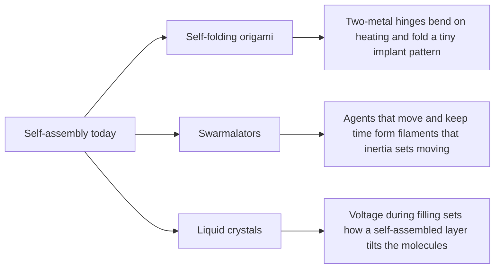

# Digest — 2026-11-12

*Curated America/New_York (ET). Verified via the arXiv API and arXiv category listings (recent submissions on self-assembly, swarms, active matter, programmable matter, and colloids), arXiv abstract and HTML pages, and Crossref (published window 2026-11-11 to 2026-11-12).*  
*Focus: items since the 2026-11-11 digest. Items covered earlier are not repeated. Items 1 and 2 are arXiv preprints and item 3 is an accepted journal manuscript, all read at abstract level.*

<Callout type="warning">
Frame these as **frontier progress**, not finished technology. Applications remain mostly simulation, tabletop hardware, or lab-scale experiments.
</Callout>

## At a glance

*Diagram: original illustration of this digest's key ideas (not from the papers).*

## Highlights

### 1. Design of Self-Folding Origami Architectures for Biomedical Implants: A Finite Element Simulation Framework
- **Authors:** Suhas Chandrashekar, Thomas Stieglitz, Prasanth Velvaluri
- **Date / venue:** arXiv preprint, submitted 2026-11-10 (cond-mat.mtrl-sci)
- **Link:** https://arxiv.org/abs/2611.13964
- **Tidbits:**
  - Tiny origami structures could let brain implants travel folded through narrow blood vessels and open up later, but folding very small pieces by hand or machine is hard.
  - The idea is a thin two-layer metal film: the shape memory alloy Nitinol (NiTi) paired with molybdenum or stainless steel. The layers expand by different amounts when heated, so each hinge bends on its own into a mountain or valley fold.
  - Computer (finite element) simulations tune hinge length, thickness, width, and shape, reaching a hinge design that cuts the unit-cell size by about 50% compared with earlier designs, and a full waterbomb origami cell folds in a coordinated way.
- **Why a beginner should care:** It is the same physics as a bimetal strip in an old thermostat, used to make a pattern fold itself.
- **Caveat:** Simulation-only design study; no fabricated implant or animal or clinical test is reported. arXiv nonexclusive license, so the sketch below is our own drawing.

<PubImg
  src="/images/latest/2026-11-12-self-folding-hinge-sketch.svg"
  alt="Sketch: left, a flat blue strip with a short gold layer under its middle; right, the same strip bent upward at the gold hinge with a fold-angle arc"
  caption="Sketch drawn for this digest of the idea in the abstract: a second metal layer under the hinge expands differently when heated, so the hinge bends itself into a fold. Not geometry or data from the paper."
  credit="Original illustration by Self-Assembly Lab; concept from Chandrashekar et al., arXiv:2611.13964"
  width={720}
  height={320}
/>

### 2. Inertial swarmalators with finite-range coupling in two dimensions
- **Authors:** Anirban Ray, Subhajit Mandal, Asesh RoyChowdhury
- **Date / venue:** arXiv preprint, submitted 2026-11-10 (nlin.AO, nlin.PS)
- **Link:** https://arxiv.org/abs/2611.13888
- **Tidbits:**
  - Swarmalators are model agents that both move in space and carry an internal clock (a phase), and each affects the other, like fireflies that flash and fly.
  - This paper adds inertia (mass) and lets agents interact only within a finite range. With attractive phase coupling the motion always stops; with repulsive coupling every steady state obeys an exact "sum rule".
  - In 2D, smooth phase waves break up into filaments. Inertia can set otherwise still filaments moving (through a Hopf bifurcation), and simulations show a moving filament network carrying many phase defects.
- **Why a beginner should care:** Adding a single realistic ingredient, mass, changes which patterns a swarm settles into, which matters for robot swarms that cannot stop instantly.
- **Caveat:** Theory and simulation of a model system, no experiments. CC BY-NC-ND 4.0, so the sketch below is our own drawing.

<PubImg
  src="/images/latest/2026-11-12-swarmalator-filaments-sketch.svg"
  alt="Sketch: left box with coloured dots scattered so colour shifts smoothly left to right; right box with dots lined up in four wavy rows with arrows showing motion"
  caption="Sketch drawn for this digest of the idea in the abstract: a uniform phase wave breaks into filaments, and inertia can make filaments move. Dot positions are illustrative only; this is not simulation output from the paper."
  credit="Original illustration by Self-Assembly Lab; concept from Ray, Mandal, and RoyChowdhury, arXiv:2611.13888"
  width={720}
  height={320}
/>

### 3. Electric-field-assisted interfacial rubrene self-assembly for continuous tuning of liquid crystal pretilt angles
- **Authors:** Chi Yen Huang, Rab Nawaz, Asad Hussain, Che Ju Hsu
- **Date / venue:** Journal of Physics: Photonics, accepted manuscript published 2026-11-11
- **Link:** https://doi.org/10.1088/2515-7647/aec0eb
- **Tidbits:**
  - Liquid crystal displays need the rod-like molecules to start at a set tilt (the "pretilt"), usually made by rubbing a polymer coating and baking it.
  - Here a small amount of the molecule rubrene is mixed into the liquid crystal, and an AC voltage (0 to 5 V) is applied while the cell fills. Rubrene self-assembles at the glass-electrode surface, and the voltage changes how that surface interacts with the liquid crystal.
  - The pretilt can be set anywhere from about 3 degrees (nearly flat) to 90 degrees (standing up), with stable alignment over repeated cycles, and without rubbing or high-temperature processing.
- **Why a beginner should care:** A voltage applied during assembly acts as a "dial" that programs how a self-assembled layer orders the material on top of it.
- **Caveat:** A lab-scale cell study; the abstract suggests flexible and wearable photonic devices, but those are not demonstrated. The article is CC BY 4.0, but the accepted manuscript page shows no usable figure, so the sketch below is our own drawing.

<PubImg
  src="/images/latest/2026-11-12-rubrene-pretilt-sketch.svg"
  alt="Sketch: three liquid crystal cells side by side with a gold surface layer; blue rod shapes lie flat on the left, tilt in the middle, and stand upright on the right"
  caption="Sketch drawn for this digest of the idea in the abstract: higher filling voltage shifts the rubrene-modified surface so molecules tilt from near flat (about 3 degrees) to upright (90 degrees). Not data from the paper."
  credit="Original illustration by Self-Assembly Lab; concept from Huang et al., J. Phys. Photonics, doi:10.1088/2515-7647/aec0eb"
  width={720}
  height={320}
/>

### Stretch (adjacent)
- **Kagome Flat Bands from Self-Assembled Water on Non-van der Waals 2D Materials** (Tom Barnowsky and colleagues; arXiv preprint, 2026-11-09): https://arxiv.org/abs/2611.12371 — computer (first-principles) calculations suggest intact water molecules order on reactive 2D surfaces, sometimes in a kagome pattern that creates flat electronic bands.
- **Unified Ott--Antonsen Framework for Stability and Bifurcations in Ring Swarmalators** (Can Xu and colleagues; arXiv preprint, 2026-11-10): https://arxiv.org/abs/2611.13474 — one reduced theory predicts when ring swarmalators desynchronize, form phase waves, synchronize, or mix.
- **Repurposing Grain Boundaries for Graphene Origami Auxetic Metamaterials with Enhanced Fatigue Resistance** (Apisit Chairuhttiwate and colleagues; ACS Applied Materials & Interfaces, 2026-11-12): https://doi.org/10.1021/acsami.6c18433 — molecular dynamics simulations use natural defect lines in graphene as fold creases.
- **Dynamic Self-Assembly of Lipid Nanoparticles in Biological Environments** (Haitao Yu, Brendan Dyett; Accounts of Materials Research, 2026-11-11): https://doi.org/10.1021/accountsmr.6c00320

---

## Safe classroom / discussion follow-ons

1. **Self-folding paper hinge (inspired by item 1):** Glue a strip of paper to a strip of plastic wrap or tape on one side only and breathe on it or hold it near (not on) a warm mug. The two layers respond differently to moisture or warmth and the strip curls. Discuss how placing the second layer only at "hinges" could fold a whole pattern. No flames or hot plates.
2. **Firefly swarm game (inspired by item 2):** Each student walks slowly and claps on their own beat, then tries to match the beat of close neighbours only. Next, have students "carry momentum" by taking two steps before any change of direction. Compare the patterns that form.
3. **Polarizer tilt demo (inspired by item 3):** Look at a phone or laptop screen through polarized sunglasses and slowly rotate them to see the screen darken and brighten. Discuss how liquid crystal molecules inside are tilted by surface layers and voltage. Never open or break a screen.

## Key idea of the day

Small built-in differences can steer order: mismatched metal layers fold a hinge, mass changes the patterns a moving swarm settles into, and a voltage applied during assembly sets how a surface layer tilts the molecules above it. These are simulation, theory, and lab-scale results, so treat them as a starting point, not finished technology.
