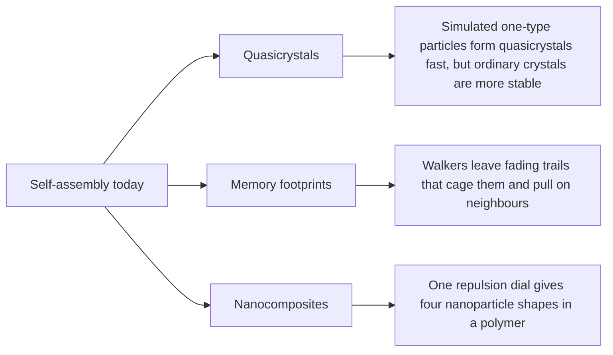

# Digest — 2026-11-13

*Curated America/New_York (ET). Verified via the arXiv API (recent submissions on self-assembly, swarms, active matter, programmable matter, modular robots, colloids, and DNA origami), arXiv abstract and HTML pages, and Crossref (published window 2026-11-12 to 2026-11-13).*  
*Focus: items since the 2026-11-12 digest. Items covered earlier are not repeated. All three highlights are arXiv preprints, read at abstract level.*

<Callout type="warning">
Frame these as **frontier progress**, not finished technology. Applications remain mostly simulation, tabletop hardware, or lab-scale experiments.
</Callout>

## At a glance

*Diagram: original illustration of this digest's key ideas (not from the papers).*

## Highlights

### 1. The metastability of icosahedral quasicrystals assembled from one-component systems with isotropic interactions
- **Authors:** Cosmin A. Dicu-Gohoreanu, Jonathan P. K. Doye, Eva G. Noya
- **Date / venue:** arXiv preprint, submitted 2026-11-11 (cond-mat.soft)
- **Link:** https://arxiv.org/abs/2611.14921
- **Tidbits:**
  - Quasicrystals are ordered but never repeat exactly, like a Penrose tiling. Icosahedral ones have only been seen in mixtures of several metals.
  - Earlier simulations showed that a single kind of particle with a wavy (oscillatory) pair attraction can self-assemble into icosahedral quasicrystals. This paper asks whether those quasicrystals are truly the most stable state.
  - Using simulations that put the solid and the liquid side by side to find melting lines, the authors find the quasicrystal is never the stable phase in the range they explored; ordinary periodic crystals always win, mainly because the quasicrystal has higher internal energy.
- **Why a beginner should care:** What forms first is not always what is most stable. Here the quasicrystal is a fast "kinetic" product, not the thermodynamic winner.
- **Caveat:** Simulation of model particles only, within one family of potentials. CC BY 4.0, figure below used with credit.

<PubImg
  src="/images/latest/2026-11-13-iqc-interface.png"
  alt="Simulation snapshot of a fluid and quasicrystal slab in contact, red particles that started in the fluid mixed into blue particles that started in the quasicrystal"
  caption="Figure 1 from the paper: fluid and quasicrystal interface simulated with the I2 model at T* = 0.3. Red particles started in the fluid and blue ones in the quasicrystal; after 200 million simulation steps many particles have swapped between the two phases."
  credit="Dicu-Gohoreanu, Doye, and Noya, arXiv:2611.14921, CC BY 4.0"
  width={1000}
  height={500}
/>

### 2. Interactions from memory footprints: Cage-hopping, mnemotaxis & nonreciprocity
- **Authors:** Jyoti Prasad Banerjee, Sambodh Sinha, Shashi Thutupalli, Rituparno Mandal, Deb Sankar Banerjee
- **Date / venue:** arXiv preprint, submitted 2026-11-12 (cond-mat.soft, cond-mat.stat-mech, physics.bio-ph)
- **Link:** https://arxiv.org/abs/2611.17257
- **Tidbits:**
  - Many cells leave long-lasting chemical or physical trails ("memory footprints") and then respond to them, which steers where they go next. Responding to shared marks like this is called stigmergy.
  - Agent-based simulations of a random walker that lays down and slowly loses footprints show "cage-hopping": a lone walker is held in place by its own trail, then hops away. Walkers also follow imposed footprint gradients (mnemotaxis).
  - When walkers share the footprint field, it acts like an effective pairwise interaction, sometimes equal both ways and sometimes not (nonreciprocal), which shapes how a population clusters.
- **Why a beginner should care:** Robots can coordinate without talking to each other by leaving and reading marks, as ants do with pheromones; the authors point to swarm robots as a target.
- **Caveat:** Simulation of a model; no new experiments reported. arXiv nonexclusive license, so the sketch below is our own drawing.

<PubImg
  src="/images/latest/2026-11-13-memory-footprints-sketch.svg"
  alt="Sketch: left box shows a faded orange cloud of trail marks and a darker new cloud with an arrow hopping between them; right box shows a blue and a red walker with trail clouds and unequal arrows between them"
  caption="Sketch drawn for this digest of the ideas in the abstract: a walker's own trail cages it until it hops, and shared trails act like an attraction that need not be equal both ways. Not simulation output from the paper."
  credit="Original illustration by Self-Assembly Lab; concept from Banerjee et al., arXiv:2611.17257"
  width={720}
  height={320}
/>

### 3. Inter-Nanoparticle Repulsion Effect on Self-Organization in Polymer Nanocomposites: A Langevin Dynamics Simulation Study
- **Authors:** Paawan Chandrakanth, Nikos Ch. Karayiannis, Subhalaxmi Das, Supriya Roy
- **Date / venue:** arXiv preprint, submitted 2026-11-12 (cond-mat.soft, physics.chem-ph, physics.comp-ph)
- **Link:** https://arxiv.org/abs/2611.17254
- **Tidbits:**
  - Polymer nanocomposites are plastics with tiny particles mixed in. Whether the particles clump or spread out changes the material's properties.
  - In simulations, a droplet of nanoparticles sits in a tightly confined matrix of stiff, rod-like polymer chains. Only the strength of nanoparticle-nanoparticle repulsion is changed.
  - Four regimes appear: droplet, slab, crystalline droplet, and dispersed. The slab barely crystallizes yet lines the polymer chains up the most, the crystalline droplet packs into triangular crystals but disturbs the chain alignment, and the dispersed state breaks into fragments that mix well.
- **Why a beginner should care:** Turning a single "dial" (how much particles push each other away) is enough to switch between quite different structures.
- **Caveat:** Simulation under extreme confinement; no lab material is made. arXiv nonexclusive license, so the sketch below is our own drawing.

<PubImg
  src="/images/latest/2026-11-13-np-repulsion-regimes-sketch.svg"
  alt="Sketch: four boxes with grey horizontal polymer lines and orange dots arranged as a round droplet, a flat slab, a hexagon-packed cluster, and scattered dots"
  caption="Sketch drawn for this digest of the four regimes named in the abstract. Dot positions are illustrative only; this is not simulation output from the paper."
  credit="Original illustration by Self-Assembly Lab; concept from Chandrakanth et al., arXiv:2611.17254"
  width={720}
  height={320}
/>

### Stretch (adjacent)
- **Chimera states in a network of firefly oscillators** (Deeptarag Das and colleagues; arXiv preprint, 2026-11-12): https://arxiv.org/abs/2611.16214 — simulated fireflies with communication delays form a shared chorus while some "characters" keep flashing before or after it.
- **Optimal Proximity Black Hole Search with Programmable Matter** (Giuseppe Antonio Di Luna, Alfredo Navarra, Francesco Piselli; arXiv preprint, 2026-11-09): https://arxiv.org/abs/2611.12170 — an algorithms paper on how simple programmable-matter particles can find a dangerous spot in their grid.
- **Quantitative biophysical analysis of human septin hexamer and octamer self-assembly on model membranes** (SaFyre Reese and colleagues; Molecular Biology of the Cell, 2026-11-12): https://doi.org/10.1091/mbc.e26-05-0210
- **Fabrication of Bicontinuous Emulsions Stabilized by Amphiphilic Poly(hexyl Methacrylate-co-Methacrylic Acid) Self-Assembly Aggregates** (Tongtong Cao and colleagues; Polymers, 2026-11-12): https://doi.org/10.3390/polym18222824

---

## Safe classroom / discussion follow-ons

1. **Fast versus stable tiles (inspired by item 1):** Give groups a minute to cover a tray with paper tiles any way they can, then ten minutes to find the tightest packing. Compare: the quick pattern is not the best one, just as the quasicrystal forms first but is not the most stable.
2. **Chalk-trail walkers (inspired by item 2):** On a playground, students take random steps and drop a bean or chalk dot at each step, with a rule to prefer stepping toward fresh dots and to sweep away the oldest dots every few turns. Watch whether walkers get "caged" and whether pairs drift together.
3. **Magnet repulsion dial (inspired by item 3):** Float small ring magnets (same pole up) on foam pieces in a water tray, or use repelling magnets on a smooth table, and change spacing or magnet strength. Note when they cluster, line up, or spread out. Keep small magnets away from young children who might swallow them.

## Key idea of the day

Order depends on both time and settings: a quasicrystal can form first yet lose to a regular crystal, fading trails turn lone walkers into interacting groups, and a single repulsion setting reshapes nanoparticles in a polymer. All three are simulation results, so treat them as a starting point, not finished technology.
