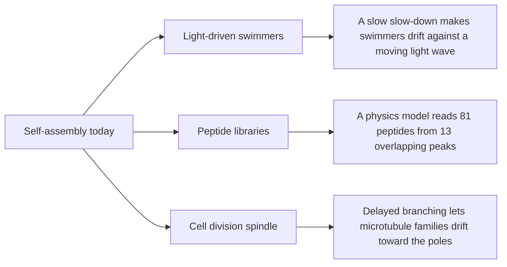

# Digest — 2026-11-16

*Curated America/New_York (ET). Verified via the arXiv API (recent submissions on self-assembly, self-organization, swarms, active matter, active particles, self-propelled, programmable matter, origami, colloids, and DNA origami), arXiv abstract and HTML pages, and Crossref (published window 2026-11-13 to 2026-11-16).*  
*Focus: items since the 2026-11-13 digest. Items covered earlier are not repeated. All three highlights are arXiv preprints, read at abstract level.*

<Callout type="warning">
Frame these as **frontier progress**, not finished technology. Applications remain mostly simulation, tabletop hardware, or lab-scale experiments.
</Callout>

## At a glance

*Diagram: original illustration of this digest's key ideas (not from the papers).*

## Highlights

### 1. Delay-induced current reversal in traveling activity waves
- **Authors:** Ueli Töpfer, Adrià Garcés, Miguel Chamorro-Burgos, Demian Levis, Alvaro Domínguez, Ignacio Pagonabarraga, Lucio Isa
- **Date / venue:** arXiv preprint, submitted 2026-11-13 (cond-mat.soft)
- **Link:** https://arxiv.org/abs/2611.18341
- **Tidbits:**
  - The swimmers are tiny silica-titania Janus particles (two-faced beads) that move faster under UV light. They speed up almost instantly when the light comes on, but slow down only gradually after it goes off.
  - The researchers sweep a moving stripe of UV light across the particles, like a wave. With experiments, simulations, and theory they show that this lagging slow-down can make the particles drift backward against the wave, and past a critical delay the net current reverses.
  - The key is the asymmetry (fast rise, slow fall). Theory shows that flipping the asymmetry flips the effect, so a delay alone is not enough.
- **Why a beginner should care:** How quickly a particle "reacts" to its surroundings can be used like a steering dial, which matters for guiding microrobots with light.
- **Caveat:** Lab-scale microscope experiments plus models; no device is built. CC BY 4.0, figure below used with credit.

<PubImg
  src="/images/latest/2026-11-16-delay-current-reversal.png"
  alt="Two plots of net drift velocity against wave speed: top panel compares experiment and simulation for several particle speeds, bottom panel shows simulations for several delay times, with curves dipping below zero at low wave speed"
  caption="Figure 3 from the paper: net drift velocity versus light-wave speed c. (a) Experiments (markers) and theory (lines) for different particle speeds; (b) simulations for different delay times. Negative values mean the particles drift against the wave."
  credit="Töpfer et al., arXiv:2611.18341, CC BY 4.0"
  width={412}
  height={420}
/>

### 2. Library of peptides: Analysis of a complex reactive mixture with the use of statistical physics and inference
- **Authors:** Laura Messio, Taleen Peker, Roba Moumné, Hélène Berthoumieux
- **Date / venue:** arXiv preprint, submitted 2026-11-12 (physics.chem-ph, physics.data-an)
- **Link:** https://arxiv.org/abs/2611.17130
- **Tidbits:**
  - In a dynamic combinatorial library, small building blocks keep linking and unlinking with reversible bonds until the mixture settles, producing hundreds of different molecules at once.
  - Lab instruments such as chromatography give overlapping peaks, so you cannot simply read off how much of each molecule is there.
  - Borrowing from Potts models used for protein folding, the authors give each molecule an energy built from a few block energies and neighbour couplings, then fit to the data. For a library of 81 peptides they recover the full composition from just 13 overlapping peaks, and find that side-by-side (lateral) couplings dominate.
- **Why a beginner should care:** A good physical model can fill in information an instrument cannot measure directly, a common trick in science.
- **Caveat:** One model chemical system; the method is new and still being tested. CC BY 4.0, figure below used with credit.

<PubImg
  src="/images/latest/2026-11-16-peptide-library.png"
  alt="Cartoon of a flask containing coloured building blocks joined by reversible bonds, a magnifying glass asking Composition?, and a chromatogram where one black curve is made of several overlapping coloured peaks"
  caption="Figure 1 from the paper: (a) a self-assembled mixture under thermodynamic control, (b) building blocks and reactive sites, (c) a measured spectrum (black) made of several overlapping peaks (dashed colours)."
  credit="Messio, Peker, Moumné, and Berthoumieux, arXiv:2611.17130, CC BY 4.0"
  width={1000}
  height={498}
/>

### 3. Proliferating against the current: how multistep branching nucleation can sort microtubule polarity in the spindle
- **Authors:** Ido Lavi, Sebastian Fürthauer, Daniel J. Needleman, Michael J. Shelley
- **Date / venue:** arXiv preprint, submitted 2026-11-12 (physics.bio-ph, cond-mat.soft)
- **Link:** https://arxiv.org/abs/2611.16200
- **Tidbits:**
  - The spindle that pulls chromosomes apart during cell division is a classic example of self-organization: an ordered structure lasting hours built from microtubule filaments that turn over within tens of seconds.
  - Puzzle: in large egg-cell spindles, filaments are born near the chromosomes and grow forward faster than motors slide them back, yet their minus ends end up at the poles.
  - The kinetic model's answer: if new branches need several slow steps to assemble, they tend to sprout from old parts of the parent filament near its minus end. Each generation is born a bit farther back, so the whole family drifts toward the poles. With measured Xenopus extract speeds this needs at least four rate-limiting steps.
- **Why a beginner should care:** A population can move one way even when every member moves the other way, because of where new members are born.
- **Caveat:** Theory and modelling, compared with published measurements; not a new experiment. arXiv nonexclusive license, so the sketch below is our own drawing.

<PubImg
  src="/images/latest/2026-11-16-spindle-branching-sketch.svg"
  alt="Sketch: four coloured horizontal filaments stacked diagonally, each with an arrowhead to the right, dashed lines linking a branch point near the left end of each to the next filament, and a bottom arrow pointing left labelled family drifts toward the pole"
  caption="Sketch drawn for this digest of the idea in the abstract: each filament grows toward the chromosomes, but each new generation branches from old lattice near the minus end, so the family shifts toward the pole. Positions are illustrative, not model output."
  credit="Original illustration by Self-Assembly Lab; concept from Lavi et al., arXiv:2611.16200"
  width={720}
  height={320}
/>

### Stretch (adjacent)
- **Active turbulent flows of dense persistent particles driven at constant velocity** (Yonglun Jiang, Juliane Klamser, Ludovic Berthier; arXiv preprint, 2026-11-13): https://arxiv.org/abs/2611.17777 — simulated crowded self-propelled particles pushed at a fixed speed behave like a glass near yielding and show active turbulence.
- **Physically Interpretable Basin Selection in Discrete-Variable Origami Design** (Lucy Liu, Leon M. Kamp, Katia Bertoldi, L. Mahadevan; arXiv preprint, 2026-11-12): https://arxiv.org/abs/2611.17196 — choosing among four hinge types per fold; biasing the start toward stiff flat hinges raises the final success rate from 49% to 69%.
- **The Rise of Zirconium Metal-Organic Polyhedra** (Joohan Nam and colleagues; arXiv review, 2026-11-13): https://arxiv.org/abs/2611.18217 — how cluster nodes and linkers choose which molecular cage (tetrahedron, cube, cocoon) assembles.
- **Machine learning techniques for understanding pattern formation and self-assembly in active colloidal systems** (Josue D. de la Cruz and colleagues; Journal of Physics: Condensed Matter review, 2026-11-13, CC BY 4.0): https://doi.org/10.1088/1361-648X/aec211
- **Self-Assembly of Sub-10 nm Lamellar Domains with Controlled Orientation Using Fluorinated Junctions** (Mingqiu Hu and colleagues; Macromolecules, 2026-11-16): https://doi.org/10.1021/acs.macromol.6c02743 — block copolymer stripes 9.4 nm apart; metadata verified via Crossref (publisher page blocks automated fetches).

---

## Safe classroom / discussion follow-ons

1. **Flashlight wave walkers (inspired by item 1):** Students stand in a line and may step only while a flashlight beam is on them. One group stops instantly when the beam leaves; another must take two extra "slowing" steps. Sweep the beam along the line at different speeds and record which way each group ends up drifting.
2. **Guess the mixture (inspired by item 2):** Mix a few colours of beads in hidden cups and only report total counts of some combined categories (for example "red or blue"). Teams use simple rules about how beads pair up to infer each cup's full recipe, then reveal and check.
3. **Born behind (inspired by item 3):** Lay a paper strip "conveyor" on a table. Each "filament" (a pencil) moves one step right per turn, but every new pencil is placed starting from the left end of an older one. After several turns, mark where the group's average position is and discuss why it moves left.

## Key idea of the day

Timing shapes collective outcomes: a lagging slow-down can reverse which way light-driven swimmers drift, an energy model built from a few couplings can decode a self-assembled mixture, and delayed branching can send a whole filament family backward. These are lab-scale experiments and models, so treat them as a starting point, not finished technology.
