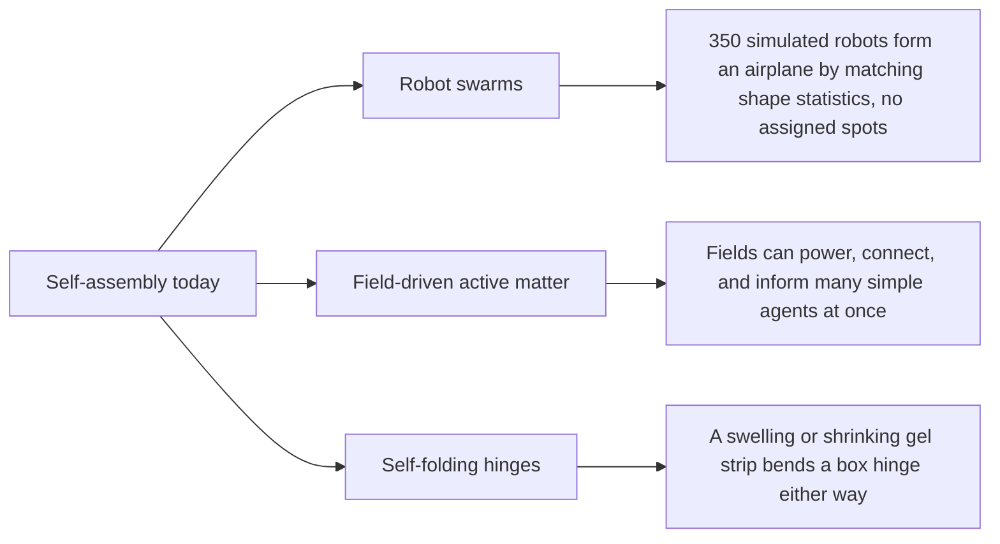

# Digest — 2026-11-17

*Curated America/New_York (ET). Verified via the arXiv API (recent submissions on self-assembly, self-organization, swarms, active matter, colloids, origami, DNA nanostructures, peptide assembly, and programmable matter), arXiv abstract and HTML pages, and Crossref (published window 2026-11-16 to 2026-11-17).*  
*Focus: items since the 2026-11-16 digest. Items covered earlier are not repeated. All three highlights are arXiv preprints, read at abstract level (plus figure captions and conclusions).*

<Callout type="warning">
Frame these as **frontier progress**, not finished technology. Applications remain mostly simulation, tabletop hardware, or lab-scale experiments.
</Callout>

## At a glance

*Diagram: original illustration of this digest's key ideas (not from the papers).*

## Highlights

### 1. Distributed Shaping of Robot Swarms Through Spatial Moments of Arbitrary Order
- **Authors:** Jin Chen, Hector Garcia de Marina
- **Date / venue:** arXiv preprint, submitted 2026-11-14 (eess.SY, cs.RO)
- **Link:** https://arxiv.org/abs/2611.19272
- **Tidbits:**
  - Instead of telling each robot "go to spot 17", the controller describes the target shape with spatial moments: the centre (average position), the spread (covariance), and higher-order statistics that capture finer details of the outline.
  - No robot is assigned a particular place. Each robot uses only relative positions of neighbours and messages from them, so the method can run without a central computer.
  - A mathematical trick (orthogonalization) means adding finer-detail corrections never undoes the coarser ones already reached, so detail can be layered on step by step. In a distributed simulation, 350 agents on a sparse network form an airplane outline using moments up to order ten.
- **Why a beginner should care:** It shows a swarm can build a shape by matching "statistics of the crowd" rather than following a blueprint of individual places, a very self-assembly way of thinking.
- **Caveat:** Theory plus simulation; no physical robots are tested here. CC BY 4.0, figure below used with credit.

<PubImg
  src="/images/latest/2026-11-17-swarm-airplane-moments.png"
  alt="Two panels of scattered orange starting dots and blue final dots filling an airplane outline, for hierarchical and joint control, plus a log-scale plot of shrinking moment and dispersion errors over time"
  caption="Figure 2 from the paper: 350 simulated agents form an airplane. (a) Hierarchical and (b) joint control, with initial agents (orange) and final agents (blue); (c) errors in the moments and spread shrinking over time (solid lines hierarchical, dashed lines joint)."
  credit="Chen and Garcia de Marina, arXiv:2611.19272, CC BY 4.0"
  width={862}
  height={260}
/>

### 2. Field-Driven Active Matter Physics and Material Applications
- **Authors:** Jing Wang, Shengkai Li, Trung V. Phan, Gao Wang, Huaicheng Chen, Xiaorui Chen, Robert H. Austin, Liyu Liu
- **Date / venue:** arXiv review, submitted 2026-11-15 (cond-mat.soft, physics.class-ph)
- **Link:** https://arxiv.org/abs/2611.19806
- **Tidbits:**
  - Active matter is made of units that use energy to move, from bacteria to small robots. Robot swarms are easy to program but hard to scale, because every robot needs its own battery, radio, and controller.
  - The review argues that outside fields (magnetic, electric, acoustic, light, or fluid flow) can take over part of that burden: one field can power, guide, and couple many agents at once.
  - It sorts the roles of fields into three kinds: energy injection (the field drives motion), interaction mediator (the field carries forces between distant agents), and information carrier (the field stores and passes signals, like ant pheromone trails or programmable light patterns).
- **Why a beginner should care:** It is a readable map of how "dumb" agents plus a smart environment can produce organized group behaviour, which is a useful frame for many future digests.
- **Caveat:** A review and perspective, not new results; the "intelligent materials" it describes are a long-term goal. CC BY 4.0; the figure below is one of the authors' own schematics (other figures in the review reproduce third-party images under different licenses and are not reused here).

<PubImg
  src="/images/latest/2026-11-17-field-roles.png"
  alt="Three-panel schematic: left shows field lines and a lightning bolt powering a small robot, middle shows green field lines linking three robots, right shows a purple network of nodes exchanging information with robots, with example icons below each panel"
  caption="Figure 3 from the review: three roles of physical fields in active matter. (i) Energy injection, (ii) interaction mediator, (iii) information encoding, with examples such as magnetic and light fields, hydrodynamic and capillary interactions, pheromone trails and quorum sensing. Resized for the web."
  credit="Wang et al., arXiv:2611.19806, CC BY 4.0"
  width={1000}
  height={610}
/>

### 3. Will it bend? Modelling hydrogel box hinges with a gel Lattice Spring Method
- **Authors:** Ellen M Jolley, Katie A Phillips, Guy Harrop, Gerard Cummins, Tom D Montenegro-Johnson
- **Date / venue:** arXiv preprint, submitted 2026-11-16 (physics.flu-dyn, cond-mat.soft)
- **Link:** https://arxiv.org/abs/2611.20857
- **Tidbits:**
  - Hydrogels are soft polymer networks that soak up water and swell, or lose water and shrink. Put a strip of gel on a hinge between stiff panels and that change in size can make the hinge fold, the basis for origami-style devices that fold and unfold on their own.
  - The authors built a "gel lattice spring" simulation, a grid of connected springs that can mix hydrogel with rubbery elastomer, and used it to compute the final bending angle of a bilayer box hinge.
  - Their results: the bending angle grows roughly in proportion to the length of gel in the hinge (doubling the gel length roughly doubles the angle, at smaller lengths), and depends nonlinearly on gel stiffness. Both swelling and shrinking can produce bending, in opposite directions. The simulation code is open source.
- **Why a beginner should care:** It gives a simple design rule of thumb for self-folding hinges, the kind of part needed for deployable medical devices that go in compact and open up inside the body.
- **Caveat:** Simulation of equilibrium shapes only, checked qualitatively against experiments; no device is built. arXiv nonexclusive license, so the sketch below is our own drawing.

<PubImg
  src="/images/latest/2026-11-17-hydrogel-hinge-sketch.svg"
  alt="Sketch in three panels: a flat strip of two grey panels on a yellow elastomer layer with a blue gel block between them; the gel swells into a wedge and the panels bend downward; the gel shrinks to a small triangle and the panels fold upward"
  caption="Sketch drawn for this digest of the idea in the abstract and conclusions: a hydrogel strip in a box hinge bends the hinge one way when it swells and the other way when it shrinks. Shapes and angles are illustrative, not model output."
  credit="Original illustration by Self-Assembly Lab; concept from Jolley et al., arXiv:2611.20857"
  width={720}
  height={320}
/>

### Stretch (adjacent)
- **Tunable topological droplets on supercoiled DNA under tension** (Enrico Skoruppa, Prithwidip Saha, Jan Brugués, Jan Lipfert, Davide Marenduzzo, Helmut Schiessel; arXiv preprint, 2026-11-14): https://arxiv.org/abs/2611.19342 — twisted DNA loops (plectonemes) act as force-shielded pockets where protein droplets can still form even when the DNA is pulled hard; magnetic tweezers experiments with spermine agree.
- **EgoSwarm: Learning Decentralized Robot Swarm Intelligence from Human Swarm Demonstrations** (Ziqiang Liu, Xitong Chen, Min Li, Yiqun Li, Zhuoping Yin; arXiv preprint, 2026-11-15): https://arxiv.org/abs/2611.20100 — more than 50 hours of first-person video from groups of people teach decentralized robot teams; 72.2% mean success across three kinds of collaborative tasks.
- **Delay-induced anomalous density-polarization relation in chiral active matter** (Dongrun Jian, Jie Su, Jun Wang, Jin Wang; arXiv preprint, 2026-11-16): https://arxiv.org/abs/2611.20931 — with delayed alignment, crowding first raises then lowers order inside droplets of spinning active particles.
- **Self-assembly of dipolar nanoclusters on an attractive substrate: A coarse-grained simulation approach** (Denis Gessert and colleagues; arXiv preprint, 2026-11-15): https://arxiv.org/abs/2611.20002 — simulated magnetic-dipole particles form chains on a surface, behaving like self-avoiding walks at low density and rods at high density.
- **Polymorphism and crystal suppression in symmetric mixtures with entropic interactions** (Santi Prestipino, Giuseppe Pellicane, Enrique Lomba, Franz Saija; arXiv preprint, 2026-11-16): https://arxiv.org/abs/2611.20944 — hard-sphere mixtures that prefer unlike neighbours can get stuck as a glass when two crystal types compete.
- **End-Group Functionalization Reshapes the Self-Assembly and Phase Behavior of Pluronic F68 in Water** (Nicola Antonio Di Spirito and colleagues; ACS Omega, 2026-11-17, CC BY 4.0): https://doi.org/10.1021/acsomega.6c10406 — metadata verified via Crossref.
- **Continuous Game of Life: Cell Emergence and Self-Organization at the Edge of Growth** (Alexandre Guillet, Frank Jülicher; Artificial Life, 2026-11-16): https://doi.org/10.1162/artl.a.501 — a continuous version of Conway's Game of Life that grows cell-like, self-replicating, gliding patterns; metadata verified via Crossref.

---

## Safe classroom / discussion follow-ons

1. **Crowd statistics shaping (inspired by item 1):** Mark a shape outline on the floor with tape. Without assigning spots, students only follow two rules called out by a "controller": "move so the group's centre is on the X" and "spread out until the group fills the tape width". Then add a third rule for finer detail (for example "more people on the left wing"). Discuss which rules had to come first.
2. **Field-guided paper clips (inspired by item 2):** Rest paper clips on small foam pieces floating in a shallow tray of water and steer many at once with a single magnet held under the tray. Compare with nudging each one by hand. Discuss energy, interaction, and information roles of the magnet (adult supervision for magnets around young children).
3. **Sponge hinge (inspired by item 3):** Glue a strip of compressed kitchen sponge (or a dry paper strip) across the fold line of a card "box" panel. Drip water on the strip and measure the fold angle with a protractor as it swells. Try strips of two different lengths and check whether doubling the length roughly doubles the angle.

## Key idea of the day

Shape can be programmed through the collective, not the individual: robots that match crowd statistics instead of assigned spots, fields that power and coordinate many simple agents at once, and gel strips whose swelling sets how far a hinge folds. These are simulations, a review, and design models, so treat them as a starting point, not finished technology.
