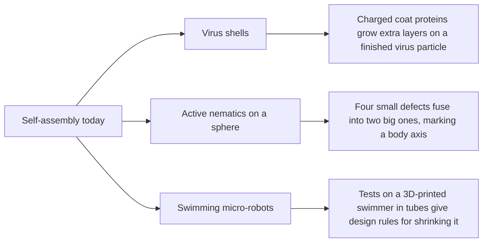

# Digest — 2026-11-19

*Curated America/New_York (ET). Verified via the arXiv API and new listings (cond-mat.soft, physics.bio-ph, cs.RO, nlin.AO, cs.MA; searches on self-assembly, self-organization, swarms, active matter, colloids, origami, DNA nanostructures, peptide assembly, and programmable matter), arXiv abstract and HTML pages, and Crossref (published window 2026-11-17 to 2026-11-19).*  
*Focus: items since the 2026-11-17 digest (there was no 2026-11-18 digest, so this one covers both days). Items covered earlier are not repeated. All three highlights are arXiv preprints, read at abstract level (plus figure captions and selected sections).*

<Callout type="warning">
Frame these as **frontier progress**, not finished technology. Applications remain mostly simulation, tabletop hardware, or lab-scale experiments.
</Callout>

## At a glance

*Diagram: original illustration of this digest's key ideas (not from the papers).*

## Highlights

### 1. Electrostatic interactions drive the self-assembly of secondary coat-protein layers around wild-type MS2 particles
- **Authors:** LaNell A. Williams, Amelia W. Paine, Kellianne Kornick, Rees F. Garmann, Vinothan N. Manoharan
- **Date / venue:** arXiv preprint, submitted 2026-11-18 (physics.bio-ph)
- **Link:** https://arxiv.org/abs/2611.24513
- **Tidbits:**
  - Many virus shells (capsids) can build themselves from their protein parts in a test tube. For the bacteria-infecting virus MS2, most earlier work focused on specific "lock and key" contacts between the coat protein and the viral RNA.
  - Here the team found that coat-protein pairs (dimers) can build extra shell layers on top of complete, wild-type MS2 particles, even with no free RNA around. The finished virus acts as the template.
  - Electron microscopy, gels, and light scattering show the layers get thicker and more complete as protein concentration rises, and they form best at moderate salt (100 mM salt, not 0 or 1000 mM). That fits a picture of nucleation and growth driven by the attraction between positively charged proteins and the negatively charged shell. The extra layers rarely close completely, hinting that bending (elastic) energy limits growth, and they block the protein the virus uses to attach to bacteria.
- **Why a beginner should care:** It shows that plain charge attraction, not just specific molecular "keys", can steer how protein shells assemble, a useful lesson for anyone designing self-assembling containers.
- **Caveat:** Lab-scale biophysics with a harmless-to-humans bacterial virus in specialist labs; not a classroom experiment. arXiv nonexclusive license, so the sketch below is our own drawing.

<PubImg
  src="/images/latest/2026-11-19-ms2-layers-sketch.svg"
  alt="Sketch in three panels: a blue virus shell with RNA inside and minus signs on its surface; yellow protein pairs with plus signs approaching the shell; the shell partly covered by yellow arcs representing an incomplete extra layer"
  caption="Sketch drawn for this digest of the idea in the abstract and figure captions: positively charged coat-protein pairs are attracted to a negatively charged MS2 shell and grow extra layers that rarely cover the whole particle. Shapes and sizes are illustrative, not data."
  credit="Original illustration by Self-Assembly Lab; concept from Williams et al., arXiv:2611.24513"
  width={720}
  height={320}
/>

### 2. Spontaneous axis formation through defect fusion in active nematics
- **Authors:** Mathieu Dedenon, Claire A. Dessalles, Aurélien Roux, Karsten Kruse
- **Date / venue:** arXiv preprint, submitted 2026-11-17 (cond-mat.soft, physics.bio-ph)
- **Link:** https://arxiv.org/abs/2611.23107
- **Tidbits:**
  - A nematic is a material whose elongated parts tend to line up, like logs on a river. On a sphere they cannot all line up perfectly, so "defects" appear where the pattern swirls; at rest the lowest-energy pattern has four small (+1/2) defects spread apart.
  - Early embryos start out round and then pick a head-to-tail axis. Defects in the alignment of tissue cells have been linked to this step, but the physics behind it was unclear.
  - The authors simulate an active nematic (one whose parts push and pull, like cells) on a sphere. When the layer can be compressed, active traction makes the four small defects fuse in pairs into two large (+1) defects at opposite poles. That defines an axis, with either star-like (aster) or swirling (vortex) patterns at the poles depending on how flow and alignment couple.
- **Why a beginner should care:** It is a clean example of shape and direction emerging from local pushing and pulling, with no blueprint telling the system where the "head" goes.
- **Caveat:** Theory and simulation only; the link to real embryos and organoids still needs experiments. CC BY 4.0, figure below used with credit.

<PubImg
  src="/images/latest/2026-11-19-sphere-nematic-defects.png"
  alt="Three panels: a grey cross-section of a sphere with white alignment lines, blue flow arrows and red defect dots; a flat map of the sphere coloured by order strength with four red defect points; a 3D shaded sphere with short alignment dashes and red defects"
  caption="Figure 1 from the paper: the starting (equilibrium) state. (A) Cut through a sphere coated with a nematic fluid, with red dots marking +1/2 defects; (B) flat (Mercator) map of the alignment pattern showing the four +1/2 defects; (C) 3D view of the same pattern. Active forces later fuse these four defects into two."
  credit="Dedenon, Dessalles, Roux and Kruse, arXiv:2611.23107, CC BY 4.0"
  width={909}
  height={297}
/>

### 3. Hydrodynamics of robotic micro-swimmers in confinement
- **Authors:** Giovanni Corsi, Giovanni Noselli, Antonio DeSimone
- **Date / venue:** arXiv preprint, submitted 2026-11-18 (cs.RO, cond-mat.soft, physics.flu-dyn); the authors note it is accepted in Physical Review Fluids (https://doi.org/10.1103/pjxx-5vd4)
- **Link:** https://arxiv.org/abs/2611.24631
- **Tidbits:**
  - The dream of tiny robots swimming through narrow blood vessels runs into a fluid problem: at small sizes water behaves like thick syrup, and tube walls add drag.
  - The team built a centimetre-size, 3D-printed swimmer (a cargo "head" plus a spinning helical tail or a small propeller), tested it in tubes of different widths, and matched the results with full fluid-flow simulations.
  - Using scaling laws, they predict how millimetre and sub-millimetre copies would perform. Their conclusion: fluid physics does not forbid autonomous micro-robots in narrow vessels, but it sets strict design rules at each size (and energy storage on board may become the real limit).
- **Why a beginner should care:** It shows how engineers use a big, easy-to-build model plus physics scaling to test an idea before trying to make something too small to build easily.
- **Caveat:** A single cm-scale prototype plus simulations and scaling predictions; no micro-robot was built or tested in a body. CC BY 4.0, figure below used with credit.

<PubImg
  src="/images/latest/2026-11-19-confined-swimmer-robot.png"
  alt="Panels showing a blue capsule head with a red helical tail inside a dashed tube with labelled dimensions, a simulation mesh and coloured flow streamlines, and photos of black 3D-printed tail, propeller and hull parts and the assembled swimmer next to a 100 mm scale bar"
  caption="Figure 1 from the paper: (A) swimmer geometry, a head plus helical tail, inside a tube; (B) simulation mesh and computed streamlines; (C) 3D-printed helical tail, propeller, and cargo hull; (D) assembled swimmer used in experiments. Resized for the web."
  credit="Corsi, Noselli and DeSimone, arXiv:2611.24631, CC BY 4.0"
  width={1000}
  height={376}
/>

### Stretch (adjacent)
- **Magnetic tuning of odd elastic instabilities in chiral active crystals** (Umberto Marini Bettolo Marconi, Lorenzo Caprini; arXiv preprint, 2026-11-16): https://arxiv.org/abs/2611.21876 — theory showing a magnetic field can tune the waves and instabilities in crystals of self-spinning particles.
- **OmniFish: A Bioinspired, Modular, Reconfigurable Soft Robotic Fish Enabling Multi-Modal Swimming** (Mathias Jensen, Saravana Prashanth Murali Babu; arXiv preprint, 2026-11-18): https://arxiv.org/abs/2611.24511 — locking spine segments lets one tendon-driven soft fish switch between five fish swimming styles; fastest mode reached 8.14 cm/s.
- **Communications-free Collective Intelligence Via Allocentric Belief** (Cameron Mehlman, Arjun Mulchandani, Hovik Grigoryan, Anurag Koyyada, Gregory Falco; arXiv preprint, 2026-11-18): https://arxiv.org/abs/2611.24858 — agents that never talk stay coordinated by all watching the same outside "witness", scaling to sixty-agent teams in simulated games.
- **Accounts on Synthetic Cells** (The Frontiers of Life Research Network, Sébastien Lecommandoux, Jean-Christophe Baret and colleagues; arXiv account, 2026-11-17, CC BY 4.0): https://arxiv.org/abs/2611.22371 — a University of Bordeaux network describes four years of building blocks toward a cell built from scratch, still a long-term goal.
- **Chemotactic aggregation as cue-mediated adaptation toward Nash equilibrium in a spatial patterning game** (Masaki Kato, Tetsuya J. Kobayashi; arXiv preprint, 2026-11-18): https://arxiv.org/abs/2611.24705 — game theory for cells that make their own chemical trails; slower trail changes can give more efficient clusters.
- **A Monte Carlo study of closely packed two-patch particles with frustrated interactions** (Rui Ding, Yan-Wei Li, Hao Hu; arXiv preprint, 2026-11-18): https://arxiv.org/abs/2611.24560 — patchy particles with conflicting attractions settle into disordered ground states.
- **Programming DNA Origami into Mega-atoms for Chemical Reactions** (Huiying Wu, Xiaoyao Wang, Kexin Guo, Chao Zhou; CCS Chemistry, 2026-11-17): https://doi.org/10.31635/ccschem.026.202608589 — metadata verified via Crossref.
- **Noise-Driven Odd Elastic Waves in Living Chiral Active Matter** (Sang Hyun Choi, Zhi-Feng Huang, Nigel Goldenfeld; Physical Review Letters, 2026-11-18): https://doi.org/10.1103/75j8-3nbl — metadata verified via Crossref.
- **Centipedelike metastrip enables on-demand programmable drop motion** (Sergio Britto, Stefano Gonella; Physical Review Applied, 2026-11-17): https://doi.org/10.1103/z1jl-mrjh — metadata verified via Crossref.
- **Reusable and Reconfigurable Multistable Granular Mechanical Metamaterial for Programmable Energy Dissipation** (Barakat Barakat, Michael Gomez, Antonio E. Forte; Advanced Science, 2026-11-18, CC BY 4.0): https://doi.org/10.1002/advs.78672 — snapping arches inside granular unit cells give reconfigurable, multistable materials; metadata verified via Crossref.

---

## Safe classroom / discussion follow-ons

1. **Static-cling shell (inspired by item 1):** Rub a balloon on a wool jumper so it carries static charge, then hold it near a plate of small paper confetti or puffed rice. Watch pieces jump on and form patchy "layers". Discuss why the layer rarely covers the whole balloon and what changes on a humid day (moisture screens charge, a bit like salt in the paper).
2. **Defects on a ball (inspired by item 2):** Try to draw short parallel "hair" lines all over a tennis ball or orange so neighbours line up. Mark the spots where the pattern cannot stay smooth. Count them, then try a pattern where those spots merge into just two at opposite ends (like lines of longitude). Discuss how that picks out an axis.
3. **Tube swimmer (inspired by item 3):** Twist a pipe cleaner into a helix, push it onto a stick, and spin the stick by hand inside clear tubes or glasses of water and of thick syrup or corn syrup (food-safe). Compare how much push you feel or how fast a light float moves in wide versus narrow tubes. Discuss why walls and "thicker" fluid matter more as robots shrink.

## Key idea of the day

Order can come from simple physical pushes rather than detailed instructions: charge attraction alone grows new protein layers on a virus shell, active pushing fuses alignment defects into a body axis, and ordinary fluid physics sets the rules any tiny swimming robot must obey. These are a lab study, a simulation, and a single cm-scale prototype, so treat them as a starting point, not finished technology.
