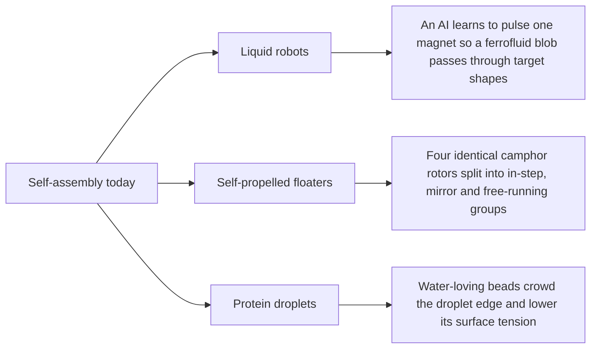

# Digest — 2026-11-20

*Curated America/New_York (ET). Verified via the arXiv API and new listings (cond-mat.soft, physics.bio-ph, physics.flu-dyn, cs.RO, nlin.AO, cs.MA, cond-mat.mtrl-sci, physics.chem-ph; searches on self-assembly, self-organization, swarms, active matter, colloids, origami, DNA nanostructures, peptide assembly, soft robots, microrobots, and programmable matter), arXiv abstract and HTML pages, and Crossref (published window 2026-11-19 to 2026-11-20).*  
*Focus: items since the 2026-11-19 digest. Items covered earlier are not repeated. All three highlights are arXiv preprints, read at abstract level (plus figure captions and selected sections).*

<Callout type="warning">
Frame these as **frontier progress**, not finished technology. Applications remain mostly simulation, tabletop hardware, or lab-scale experiments.
</Callout>

## At a glance

*Diagram: original illustration of this digest's key ideas (not from the papers).*

## Highlights

### 1. Ferrofluid Shape Control with Deep Reinforcement Learning
- **Authors:** Anthony Czubarow, Antonio Terpin, Raffaello D'Andrea
- **Date / venue:** arXiv preprint, submitted 2026-11-18 (cs.RO)
- **Link:** https://arxiv.org/abs/2611.25232
- **Tidbits:**
  - A ferrofluid is a liquid full of tiny magnetic nanoparticles, so a magnet can pull it into spikes and blobs. That makes it a candidate "body" for soft robots that squeeze through tight spaces, but its flowing, nonlinear motion is hard to control.
  - The team used a jar from a store-bought "dancing ferrofluid" speaker lamp (5 mL of ferrofluid under water, 85 mm wide) with one fixed electromagnet underneath and a camera above.
  - A deep reinforcement-learning method (DreamerV3) learned, directly from trial and error on the real hardware, how to set the magnet current so the moving fluid briefly passes through 20 target outlines: 4 polygons, asterisks with three to six rays, and 12 pentominoes. Many of these shapes cannot be held still with one magnet; the policy reaches them on the fly.
- **Why a beginner should care:** It shows that a machine can learn to "play" a messy physical material using only a camera and one control knob, with no full physics model written in advance.
- **Caveat:** A single tabletop rig shaping a flat silhouette in a jar; shapes are transient and this is far from a working ferrofluid robot. arXiv nonexclusive license, so the sketch below is our own drawing.

<PubImg
  src="/images/latest/2026-11-20-ferrofluid-rl-sketch.svg"
  alt="Sketch in three panels: a camera above a jar of water with a black ferrofluid blob sitting on an orange electromagnet; a loop of boxes reading camera image, learned policy, magnet current; a black three-armed blob inside a dashed three-ray asterisk outline"
  caption="Sketch drawn for this digest of the setup in the abstract and figure captions: a camera watches the ferrofluid, a learned policy picks the magnet current, and the moving fluid is steered through a target outline. Shapes and sizes are illustrative, not data."
  credit="Original illustration by Self-Assembly Lab; concept from Czubarow, Terpin and D'Andrea, arXiv:2611.25232"
  width={720}
  height={320}
/>

### 2. Three-mode chimera-like states in a minimal network of active camphor ribbons
- **Authors:** Ratan Sarkar, Sapna Yadav, Punit Parmananda, Charo I. del Genio, Stefano Boccaletti
- **Date / venue:** arXiv preprint, submitted 2026-11-19 (cond-mat.dis-nn, physics.flu-dyn)
- **Link:** https://arxiv.org/abs/2611.26039
- **Tidbits:**
  - A "chimera state" is when identical units, coupled in the same way, spontaneously split into groups that behave differently, some in step and some not.
  - The team pinned four identical camphor-coated elliptical rotors (3 cm by 1 cm) at the corners of a square floating on water. Camphor lowers the water's surface tension where it dissolves, so each rotor spins itself (the Marangoni effect), and the rotors feel each other only through the shared water surface.
  - After a few minutes the four rotors settle into three behaviours at once: rotors 1 and 4 move in step, rotors 3 and 4 move as mirror images (anti-synchronized), and rotor 2 runs on its own rhythm. This matches recent theory on three-domain chimeras.
- **Why a beginner should care:** It is a cheap, tabletop example of how identical, self-driven parts can organise into different groups with no leader and no wiring, only a shared medium.
- **Caveat:** One small four-rotor experiment; the chimera is "chimera-like" in such a tiny network, and the camphor-ethanol preparation is a lab step, not a classroom one. arXiv nonexclusive license, so the sketch below is our own drawing.

<PubImg
  src="/images/latest/2026-11-20-camphor-rotors-sketch.svg"
  alt="Top view of a blue water dish with a dashed square; yellow ellipses pinned at each corner labelled 1 to 4; text notes that rotors 1 and 4 are in step, rotors 3 and 4 are mirror images, and rotor 2 has its own rhythm"
  caption="Sketch drawn for this digest of the four-rotor setup and the three behaviours described in the abstract and figure captions. Positions and angles are illustrative, not data."
  credit="Original illustration by Self-Assembly Lab; concept from Sarkar et al., arXiv:2611.26039"
  width={720}
  height={320}
/>

### 3. Sequence-encoded amphiphilicity controls the interfacial tension of biomolecular condensates
- **Authors:** Nora-Elen Giesinger, Jens-Uwe Sommer, Arash Nikoubashman
- **Date / venue:** arXiv preprint, submitted 2026-11-19 (cond-mat.soft)
- **Link:** https://arxiv.org/abs/2611.25966
- **Tidbits:**
  - Cells contain protein droplets (condensates) that form without any membrane, a kind of self-assembly by phase separation. Strangely, these dense droplets have very low surface tension.
  - The authors simulate simple bead-chain "proteins" made of only two kinds of beads: oily (hydrophobic) and water-loving (polar). They compare chains at matched distances from the point where droplets stop forming.
  - Polar beads pile up at the droplet edge, acting like built-in soap. A polar fraction of one third cuts the surface tension roughly in half compared with a fully oily chain, and rearranging the order of beads (same recipe, different sequence) can lower it further without changing when droplets form.
- **Why a beginner should care:** It shows that the order of building blocks in a chain, not just the ingredient list, can tune how a self-assembled droplet behaves, a key idea for designing proteins and polymers.
- **Caveat:** Coarse-grained simulation with a two-letter model, not real proteins in cells. CC BY 4.0, figure below used with credit.

<PubImg
  src="/images/latest/2026-11-20-condensate-interface.png"
  alt="Figure panels: a sketch of a droplet with blue chains inside and orange polar beads crowding its edge; a simulation box with a dense slab and zoomed views of blue and orange beads; three small plots of polar fraction rising near the interface; a plot of surface tension against interfacial polar fraction for several sequences"
  caption="Figure 3 from the paper: (a) sketch of polar (orange) residues gathering on the outside of a condensate; (b) simulation snapshot of a dense slab; (c) local polar fraction rising near the interface; (d) surface tension falling as the polar fraction at the interface grows."
  credit="Giesinger, Sommer and Nikoubashman, arXiv:2611.25966, CC BY 4.0"
  width={699}
  height={320}
/>

### Stretch (adjacent)
- **Geometry-induced orientational trapping dictates escape of active rods in corrugated channels** (Baburao Simma, Rahul Bag, Hari K. Reddy, Radha Ramana, Vrinda Garg, Surya K. Ghosh; arXiv preprint, 2026-11-19, CC BY 4.0): https://arxiv.org/abs/2611.25563 — simulations show fast self-propelled rods can get stuck sliding along round cavity walls, so escape time first drops then rises with speed.
- **Topological trapping of active tracers in branched ring polymer matrices** (Rahul Bag, Baburao Simma, Vrinda Garg, Surya K. Ghosh; arXiv preprint, 2026-11-19, CC BY 4.0): https://arxiv.org/abs/2611.25528 — stiff branched-ring polymers form cages that trap self-propelled particles but barely affect passive ones.
- **Activity-driven motion and deformation of a circular membrane domain** (Gonzalo Ferrandez Quinto, Sho Kawakami, Petia M. Vlahovska; arXiv preprint, 2026-11-19, CC BY 4.0): https://arxiv.org/abs/2611.26578 — theory for how a molecular machine inside a lipid raft can push the whole raft along.
- **Nematic equilibria on a Möbius strip: topology and extrinsic curvature** (Massimo Frittelli, Sébastien Fumeron, Gaetano Napoli; arXiv preprint, 2026-11-19): https://arxiv.org/abs/2611.26552 — how a liquid crystal arranges itself on a twisted, one-sided strip depends on the number of half-twists and the strip's shape.
- **Soft biological and bio-inspired materials** (Livio Nicola Carenza, Giuseppe Negro, Adriano Tiribocchi; arXiv review, 2026-11-19): https://arxiv.org/abs/2611.25959 — review of active liquid crystal theory, topological defects, and active turbulence in living and synthetic systems.
- **Swimming formula in a linearly viscous fluid with anisotropic and odd viscosity tensors at low Reynolds number** (Yuto Hosaka, Kenta Ishimoto; arXiv preprint, 2026-11-19): https://arxiv.org/abs/2611.26049 — theory for microswimmers in "chiral" fluids; the scallop theorem still holds there.
- **Multiscale Modeling of Virus Capsid Self-Assembly Reveals How Small Molecule Antivirals Can Redirect Assembly Pathways and Products** (Layne B. Frechette, Smriti Pradhan, Farzaneh Mohajerani, Carolina Pérez-Segura, Jodi A. Hadden-Perilla, Adam Zlotnick, Michael F. Hagan; Journal of the American Chemical Society, 2026-11-19, CC BY 4.0): https://doi.org/10.1021/jacs.6c12725 — metadata verified via Crossref.
- **Pathway-dependent chiral toroid self-assembly and topological transformations based on large π-conjugated dipeptides** (Zhuoer Wang, Jiahui Lu, Aiyou Hao, Pengyao Xing; Nature Communications, 2026-11-20): https://doi.org/10.1038/s41467-026-79527-0 — metadata verified via Crossref.
- **Molecular Mechanism of Salt-Induced Fibrinogen Self-Assembly** (Antoine Eyram Kwame and colleagues; ACS Biomaterials Science & Engineering, 2026-11-19, CC BY 4.0): https://doi.org/10.1021/acsbiomaterials.6c01421 — metadata verified via Crossref.

---

## Safe classroom / discussion follow-ons

1. **Magnet and iron filings "shape game" (inspired by item 1):** Seal iron filings inside a clear zip bag or a capped plastic bottle of baby oil (keeps filings contained). Using one fridge magnet held underneath, take turns trying to make a target shape drawn on a card (a triangle, a three-armed star). Record how many tries it takes and which shapes are impossible to hold still. Discuss how a learning program could get better with practice the same way.
2. **Soap boats instead of camphor (inspired by item 2):** Cut small paper or foil "boats" with a notch at the back, float them in a tray of water, and touch a drop of dish soap into the notch. Watch the surface-tension (Marangoni) push. Then float two or three boats at once and discuss how they affect each other through the shared surface. Use fresh water each round, since soap spreads and stops the effect. (We avoid camphor, which is harmful if swallowed.)
3. **Bead-chain droplets (inspired by item 3):** Make paper-clip or bead chains with two colours: "oily" and "water-loving". Rule: oily beads want to touch other oily beads, water-loving beads want to face outward. Have groups pack several chains into a circle and see where the water-loving beads end up. Try chains with the same recipe but a different order and compare how many water-loving beads reach the edge.

## Key idea of the day

Self-organised order depends on how parts are coupled and arranged, not just what they are made of: one magnet plus a learning loop can steer a liquid into shapes, identical self-spinning floaters split into different groups through a shared water surface, and the order of beads in a chain tunes how soft a droplet's skin is. These are a tabletop rig, a small experiment, and a simulation, so treat them as a starting point, not finished technology.
