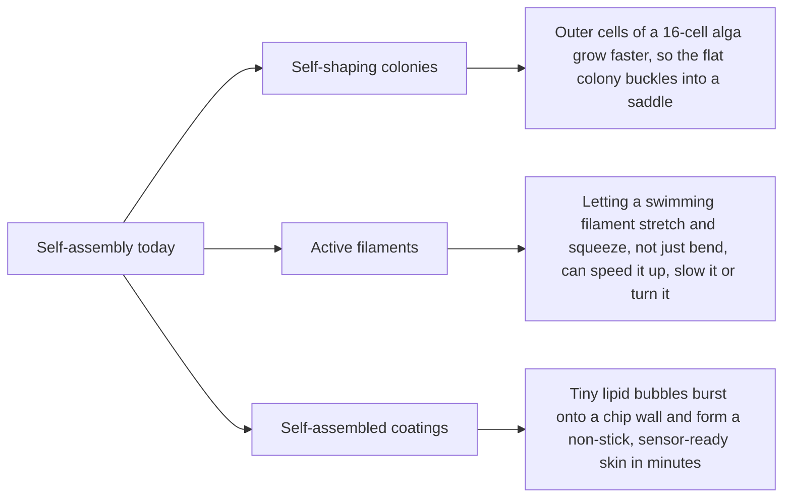

# Digest — 2026-11-23

*Curated America/New_York (ET). Verified via the arXiv new listings for Monday 2026-11-23 (cond-mat.soft, physics.bio-ph, physics.flu-dyn, cs.RO, nlin.AO, cs.MA, cond-mat.mtrl-sci, physics.chem-ph), the arXiv API (submitted 2026-11-19 to 2026-11-23; searches on self-assembly, self-organization, swarms, active matter, active nematics, colloids, DNA origami, soft robots, microrobots, and programmable matter), arXiv abstract and HTML/PDF pages, and Crossref (published window 2026-11-20 to 2026-11-23).*  
*Focus: items since the 2026-11-20 digest. Items covered earlier are not repeated. All three highlights are arXiv preprints, read at abstract level (plus figure captions and selected sections). A quiet weekend listing, so the picks lean toward living and soft systems.*

<Callout type="warning">
Frame these as **frontier progress**, not finished technology. Applications remain mostly simulation, tabletop hardware, or lab-scale experiments.
</Callout>

## At a glance

*Diagram: original illustration of this digest's key ideas (not from the papers).*

## Highlights

### 1. Saddle Buckling of a Multicellular Alga Driven by Differential Growth
- **Authors:** Zhao Wang, Sumit Kumar Birwa, Jane Y. Y. Chui, Kyriacos Leptos, Raymond E. Goldstein
- **Date / venue:** arXiv preprint, submitted 2026-11-20 (cond-mat.soft, nlin.AO, q-bio.QM)
- **Link:** https://arxiv.org/abs/2611.27563
- **Tidbits:**
  - *Gonium pectorale* is a green alga made of just 16 cells held together by a gel-like extracellular matrix. Young colonies hatch flat, then bend into a saddle (Pringle-chip) shape as they grow, with no cell division or rearrangement.
  - Cell-by-cell measurements and 3D reconstructions show the 12 outer cells grow faster than the 4 central ones. The outer ring gets "too long" for a flat disk, which creates hoop stress, and the cheapest way to relieve it is the saddle mode.
  - Once a colony passes a critical size, the saddle depth grows like the square root of how far past that size it is (fitted exponent 0.52 plus or minus 0.05), the textbook signature of a continuous buckling transition. A thin-plate (Foppl-von Karman) growth model matches the data and gives estimates of the matrix's mechanical properties.
- **Why a beginner should care:** It is a clean, living example of "shape from growth": no blueprint folds the colony, uneven growth plus mechanics does the job, the same principle engineers use in self-shaping gel and 4D-printed sheets.
- **Caveat:** One species, six edge-on colonies and dozens of face-on records; links to the evolution of multicellularity are discussion, not proof. CC BY 4.0, figure below used with credit.

<PubImg
  src="/images/latest/2026-11-23-gonium-saddle.png"
  alt="Three panels: microscope time-lapse of a small green algal colony held by a micropipette, flat at 0 and 10 hours and visibly bent at 20 and 29 hours; a plot of normalized shape amplitude against relative size that stays at zero then rises along a square-root curve; a plot of growth strain over size with a blue curve for 12 peripheral cells above a red curve for 4 central cells"
  caption="Figure 2 from the paper: (a) edge-on time-lapse of a growing Gonium colony held by a micropipette (scale bar 10 micrometres); (b) saddle amplitude stays near zero, then rises like a square root after a critical size; (c) the 12 outer cells (blue) grow more than the 4 central cells (red)."
  credit="Wang, Birwa, Chui, Leptos and Goldstein, arXiv:2611.27563, CC BY 4.0"
  width={720}
  height={204}
/>

### 2. Lacrymaria-like dynamics: compression and length change in active slender bodies
- **Authors:** Clément Moreau, Yukinori Nishigami, Johann Hérault, Kenta Ishimoto
- **Date / venue:** arXiv preprint, submitted 2026-11-20 (cond-mat.soft, physics.flu-dyn)
- **Link:** https://arxiv.org/abs/2611.27577
- **Tidbits:**
  - Most models of microscopic swimmers (sperm tails, cilia, tiny robot tails) treat the filament as a bendable rod that never changes length. Real ones, like the long "neck" of the single-celled predator *Lacrymaria olor*, also stretch and shrink dramatically.
  - The authors build a chain-of-links model where each link can both bend and change its length, with the surrounding water modelled by resistive force theory (drag that depends on local direction of motion).
  - Simply making the filament passively stretchy usually made swimming and crawling slower. But driving a deliberate wave of stretching alongside the bending wave could speed the swimmer up, slow it down, or make it turn, depending on the timing (phase), wavelength and frequency. A push applied at the tip (a "follower force") reproduces Lacrymaria-like whipping, exploring and escape-like motions.
- **Why a beginner should care:** It adds a second "knob" (length change) to how self-driven filaments move, a useful design idea for future soft microrobots and a way to understand odd living swimmers.
- **Caveat:** Two-dimensional simulations of a simplified model compared qualitatively with microscopy; no robot is built. arXiv nonexclusive license, so the sketch below is our own drawing.

<PubImg
  src="/images/latest/2026-11-23-active-filament-sketch.svg"
  alt="Three-panel schematic: a straight chain of blue links with round joints, and a red chain with alternating short and long links; three chains showing a bending wave alone and bending plus a length wave at two timings; a green oval cell body with a long curving neck ending in a dot"
  caption="Sketch drawn for this digest of the ideas in the abstract and figure captions: a filament built from links that can bend and change length, a length wave added to a bending wave, and a Lacrymaria-like neck that stretches out and whips. Shapes are illustrative, not data."
  credit="Original illustration by Self-Assembly Lab; concept from Moreau, Nishigami, Hérault and Ishimoto, arXiv:2611.27577"
  width={720}
  height={320}
/>

### 3. One-Step Self-Assembling Lipopolymer Coatings Enable Direct Longitudinal Biosensing in Native Biological Matrices
- **Authors:** Pascal Rüedi, Sarina Seiter, Stephan Handschin, Chiara Lombardo, Jaime Ortega Arroyo, Romain Quidant
- **Date / venue:** arXiv preprint, submitted 2026-11-20 (q-bio.QM, cond-mat.mtrl-sci, physics.chem-ph)
- **Link:** https://arxiv.org/abs/2611.27422
- **Tidbits:**
  - Sensors that work in real blood serum struggle because "everything sticks" to the channel walls. The usual fixes need several separate coating steps.
  - This team designs about 30 nm lipid bubbles (liposomes) from three ingredients: a plain membrane lipid (POPC), a lipid carrying a short PEG polymer "hair" that repels sticky stuff, and a lipid carrying a longer PEG with a chemical handle where antibodies are attached. Flowed into a microfluidic chip, the bubbles land, burst and self-assemble within minutes into a flat lipid layer with a polymer brush on top.
  - At 10 mol% short-PEG lipid the coating showed no detectable binding from full serum in their tests, worked on both glass and PDMS, and let them track vesicles released by lung cancer cell cultures over time using 50 microlitres of sample in 10 minutes, without purification.
- **Why a beginner should care:** The recipe is written into the ingredients: mix the right molecules in the right ratio and the surface builds itself, a practical example of self-assembly used as a manufacturing step.
- **Caveat:** A lab biosensing platform tested on cell-culture samples, not a clinical test. CC BY 4.0, figure below used with credit.

<PubImg
  src="/images/latest/2026-11-23-lipopolymer-coating.jpg"
  alt="Figure panels: a cutaway liposome with blue and yellow lipid layers and PEG strands; three lipid types labelled DSPE-PEG5000 azide, 18:0 PEG2000 PE and 16:0-18:1 PC; steps showing click chemistry and UV crosslinking attaching Y-shaped antibodies; a flat lipid bilayer with antibodies standing on top; electron microscope images of liposomes with 50 nm scale bar; a size distribution peaking near 50 nm; a protein gel"
  caption="Figure 1 from the paper: (a) PEGylated liposomes made of three lipid types are labelled with antibodies (click chemistry, then UV crosslinking) and self-assemble into a functional lipid coating inside a microfluidic channel; (b) electron microscope images of liposomes before and after antibody labelling; (c) size measurements; (d) gel confirming antibody attachment."
  credit="Rüedi, Seiter, Handschin, Lombardo, Ortega Arroyo and Quidant, arXiv:2611.27422, CC BY 4.0"
  width={720}
  height={490}
/>

### Stretch (adjacent)
- **Silver/alumina-capped Janus particles: a dispersible hyperbolic metamaterial** (Samhita Kattekola, Raymond R. Dagastine, Alexander Couzis, Ilona Kretzschmar; arXiv preprint, 2026-11-20): https://arxiv.org/abs/2611.27736 — four silver/alumina layer pairs evaporated onto one side of polystyrene beads turn each bead into a tiny, dispersible optical metamaterial.
- **Ultraslow vorticity modes in colloidal fluids** (Satyam Raheja, Noman Hanif Barbhuiya, Tsvi Tlusty, Chandan K. Mishra; arXiv preprint, 2026-11-20, CC BY 4.0): https://arxiv.org/abs/2611.27172 — high-speed confocal microscopy finds long-lived swirls around jiggling colloids that fade far more slowly than standard theory predicts.
- **Corrections to the Fick-Jacobs Description of Diffusion across Pickering Droplet Interfaces** (Rohit Khandoori, Wim Thielemans, Joost de Graaf; arXiv preprint, 2026-11-20, CC BY 4.0): https://arxiv.org/abs/2611.27818 — better formulas for how molecules diffuse through the gaps in particle-coated droplet skins.
- **Capillary partitioning of solutes on conformally coated colloidal monolayers: a universal geometric threshold** (Renaud A. L. Vallée, Carlos Drummond; arXiv preprint, 2026-11-20, CC BY-NC-ND 4.0): https://arxiv.org/abs/2611.27658 — once a coating is thicker than about 0.155 of the sphere radius, the pores between packed spheres seal and dye ends up on the caps instead of the valleys.
- **Where Delay Compensation Belongs in a Decentralized Mean-Field-Game Swarm with a Control-Barrier Safety Filter** (Jan Mikołajczyk and colleagues; arXiv preprint, 2026-11-20): https://arxiv.org/abs/2611.27540 — in drone-swarm simulations of up to 100 agents, stale neighbour data breaks the collision-safety layer first, and simple position predictors there restore safety.
- **A Metamaterial Agentic Swarm: Coordinated Search for Discrete Mechanical Design** (Achuth Chandrasekhar, Alexander Zhao, Amir Barati Farimani; arXiv preprint, 2026-11-19, CC BY 4.0): https://arxiv.org/abs/2611.26743 — forty cooperating software search agents pick unit cells for a mechanical cloak; an early, honest first step.
- **Recoverable Necking Enabled by Reverse Phase-Boundary Motion in Liquid Crystal Elastomers** (Weida Kang, Yufeng Zhang, Changyue Liu, Zhijian Wang, Xudong Liang; arXiv preprint, 2026-11-20): https://arxiv.org/abs/2611.27194 — a "necked" strip of liquid crystal rubber can un-neck almost completely when unloaded.
- **A nonlinear transient finite element analysis of coupled solvent diffusion and large deformation of magneto-elastic hydrogel balloon** (Nadeem Karim Shaikh, Ganesh Tamadapu; arXiv preprint, 2026-11-20): https://arxiv.org/abs/2611.27644 — simulations show a magnetic field can decide whether a swelling gel balloon stays stable or bursts.
- **Proximity-Triggered DNA Self-Assembly for Selective Regulation of Membrane Receptors on Living Cells** (Ajiao Sun, Xuran Dai, Jiaxin Jia, Xueqi Zhao, Yuchuan Liu, Daqian Song, Ying Sun; Nano Letters, 2026-11-20): https://doi.org/10.1021/acs.nanolett.6c04530 — metadata verified via Crossref.
- **Cryptochiral Circularly Polarized Luminescence Emerges From Cosolvent-Regulated Pathway Complexity in Amyloidogenic Peptide Self-Assembly** (Aparna Ramesh, Sourav Moyra, Darshana Deb, Rabindra Nath Manna, Goutam Ghosh; Angewandte Chemie International Edition, 2026-11-21): https://doi.org/10.1002/anie.anie-26-23616 — metadata verified via Crossref.
- **Geometry-driven polarization control in ferroelectric nematic liquid crystals** (Kazuma Nakajima, Hirokazu Kamifuji, Hirotsugu Kikuchi and colleagues; npj Soft Matter, 2026-11-23, CC BY-NC-ND 4.0): https://doi.org/10.1038/s44431-026-00050-9 — bending a flexible liquid crystal cell programs its polarization and boosts mechanical-to-electrical conversion.
- **Genetic control of active matter** (Alessio Lavino; Nature Chemical Engineering research highlight, 2026-11-23): https://doi.org/10.1038/s44286-026-00487-9 — metadata verified via Crossref.

---

## Safe classroom / discussion follow-ons

1. **Paper "growth" saddles (inspired by item 1):** Cut a paper disk and slit it from the edge to the centre. Tape an extra paper wedge into the slit so the outer edge is now longer than a flat circle allows: the disk cannot lie flat and pops into a saddle. Add two or three wedges for a wavier edge. Then try the opposite (remove a wedge, so the edge is shorter) and it forms a cone or dome. Discuss how faster growth at the edge does the same thing in the alga, and in curly lettuce and kale leaves.
2. **Bend-and-stretch swimmer (inspired by item 2):** Use a Slinky or a long spring toy on a table, or a string of pop-beads. Have one student wiggle one end side to side (bending wave) while another also squeezes and stretches it in time, then out of time. Watch whether the far end travels further or turns. Discuss why timing (phase) matters. Optional: watch a public microscopy video of *Lacrymaria olor* and describe its neck motion.
3. **Self-assembling "non-stick skin" (inspired by item 3):** Sprinkle ground pepper on water in a bowl, then touch the surface with a soapy toothpick: the soap molecules spread and organise at the surface on their own. Then compare how a drop of food colouring beads up on wax paper versus plain paper. Discuss how molecules with a water-loving head and an oily tail line up by themselves to coat surfaces, the same trick the lipid coating uses. (No lab lipids or biological samples needed.)

## Key idea of the day

Shape and function can be built in rather than imposed: uneven growth buckles a 16-cell alga into a saddle, adding a stretch wave to a bending wave changes how an active filament swims, and choosing the right lipid ratio lets a coating assemble itself on a sensor in minutes. These are a careful living-system measurement, a simulation, and a lab biosensor, so treat them as a starting point, not finished technology.
