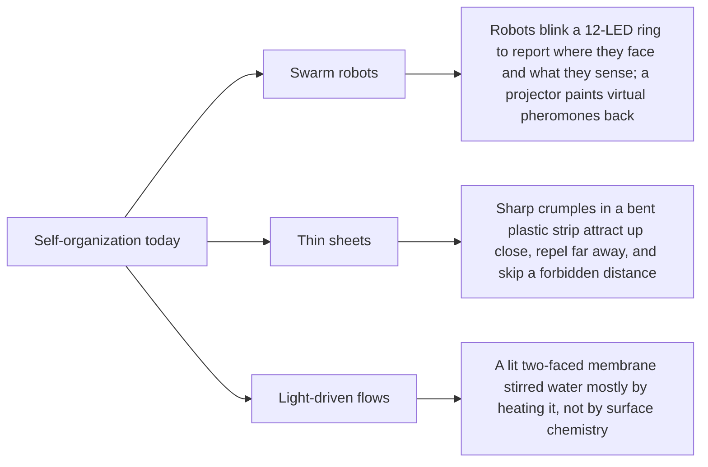

# Digest — 2026-11-24

*Curated America/New_York (ET). Verified via the arXiv new listings for Tuesday 2026-11-24 (cond-mat.soft, cond-mat.stat-mech, physics.bio-ph, physics.flu-dyn, physics.chem-ph, physics.app-ph, cs.RO, cs.MA, nlin.AO, cond-mat.mtrl-sci, q-bio.SC, q-bio.BM), arXiv abstract and HTML/PDF pages, Crossref (published window 2026-11-21 to 2026-11-24), and ScienceDaily.*  
*Focus: items since the 2026-11-23 digest, which covered the Monday listing; this page picks up the weekend and Monday submissions (2026-11-20 to 2026-11-23). Items covered earlier are not repeated. All three highlights are arXiv preprints, read at abstract level plus figure captions and selected sections.*

<Callout type="warning">
Frame these as **frontier progress**, not finished technology. Applications remain mostly simulation, tabletop hardware, or lab-scale experiments.
</Callout>

## At a glance

*Diagram: original illustration of this digest's key ideas (not from the papers).*

## Highlights

### 1. BO-COMM: Bidirectional Optical System for Simultaneous Localization and Communication in Swarm Robotics
- **Authors:** Cheng Hu, Haotian Wu, Qi Lin, Manrui Zheng, Shigang Yue, Tao Zou, Jigen Peng
- **Date / venue:** arXiv preprint, submitted 2026-11-21 (cs.RO)
- **Link:** https://arxiv.org/abs/2611.29044
- **Tidbits:**
  - Swarm experiments need two things at once: an overhead view of where every robot is and which way it faces, and a way to send information back. Radio links can jam when many robots report at once, and printed tags (like QR-style AprilTags) cannot change to report a robot's current state.
  - Each small Colias IV robot wears an add-on board with a ring of 12 LEDs. An overhead camera finds the ring centre, reads the lit/unlit pattern to get the heading (a fixed "10101" marker) and a short state code. After removing confusing patterns, 52 codes are usable, for example "I see red" or "I am in group B".
  - Going the other way, a projector paints coloured light on the arena floor that the robots' colour sensors read, and an infrared channel carries addressed commands. In a closed-loop demo, the computer "deposits" green or red virtual pheromone where robots report lingering and lets it fade: robots explore, follow green gradients and pause on the plateau, and avoid red, so they gather and later disperse. Image-processing time rose only modestly from 2 to 30 robots.
- **Why a beginner should care:** Stigmergy (leaving cues in the environment, like ant trails) is a core swarm self-organization idea; this is an affordable way to run it with real robots instead of chemicals.
- **Caveat:** The authors say plainly that these are functional demonstrations in one arena, not calibrated accuracy tests: no motion-capture ground truth, bit-error rate, or task-efficiency comparison. CC BY-NC-ND 4.0, so the sketch below is our own drawing.

<PubImg
  src="/images/latest/2026-11-24-swarm-optical-comm-sketch.svg"
  alt="Three-panel schematic: a circle with 12 small dots, some orange (lit) and some grey (unlit), and a red arrow showing heading; a camera and projector above a grey arena with four small robots; a square arena with a fuzzy green patch where four robots cluster and a fuzzy red patch that one robot moves away from"
  caption="Sketch drawn for this digest of the ideas in the paper: a 12-LED ring encodes heading and a state code, an overhead camera reads it, a projector and infrared send cues back, and projected green and red light act as virtual pheromones. Patterns and positions are illustrative, not data."
  credit="Original illustration by Self-Assembly Lab; concept from Hu, Wu, Lin, Zheng, Yue, Zou and Peng, arXiv:2611.29044"
  width={720}
  height={330}
/>

### 2. Elastic crumple pair potentials
- **Authors:** D. Gimeno, E. Hamm, J. A. Hanna
- **Date / venue:** arXiv preprint, submitted 2026-11-22 (cond-mat.soft)
- **Link:** https://arxiv.org/abs/2611.29654
- **Tidbits:**
  - When a thin sheet (graphene, a shirt sleeve, a soda can, an aircraft panel) is squeezed, the bending concentrates into small sharp points called crumples (also called d-cones or vertices). Most research studies one crumple at a time; this paper asks how two crumples push and pull on each other.
  - The team bends thin polyester shim stock (about 0.003 inch thick) into a quarter cylinder, clamps it, and slowly slides one edge sideways with an instrumented beam that measures force, while a camera tracks the crumples. They study two common pairs: an "O-valley" pair (like a dent in a soda can) and an "S-ridge" pair (like creases on a shirt sleeve).
  - The data show a non-monotonic pair potential: crumples attract when very close, repel at longer range, and in between there is a "forbidden" range they jump across instead of sitting in. A simple energy model reproduces this, and the O-valley data match it clearly; the S-ridge data are consistent but over too short a range to be conclusive.
- **Why a beginner should care:** It treats defects in a sheet like particles with forces between them, the same way colloid scientists describe self-assembling beads. That could help predict how crumpled and folded materials organize.
- **Caveat:** A careful tabletop experiment with a handful of sheets; small clamping differences changed results, and only two of five possible pair types were measured. arXiv nonexclusive license, so the sketch below is our own drawing.

<PubImg
  src="/images/latest/2026-11-24-crumple-pair-sketch.svg"
  alt="Two panels: a blue arch-shaped strip on a grey base with a red arrow showing one edge pushed sideways and two small red points marking crumples; a curve of energy versus distance that dips at short distance, rises steeply through a shaded forbidden band to a peak, then falls away at long distance, labelled attract, forbidden and repel"
  caption="Sketch drawn for this digest of the paper's main finding: two crumples in a bent strip feel short-range attraction, long-range repulsion, and an unstable middle range they jump across. The curve shape is illustrative, not the measured data."
  credit="Original illustration by Self-Assembly Lab; concept from Gimeno, Hamm and Hanna, arXiv:2611.29654"
  width={720}
  height={320}
/>

### 3. Distinguishing photothermal and photoelectrokinetic contributions to flow in light-activated microchannel architectures
- **Authors:** Sudharshan Anandan, Yuhang Fang, Lily Farmer, Maria Irineu, Shanmukhi Sripada, Tyler Hughes, Jared Nathan, Sathish Rajendran, Steven Wereley, Amy Marconnet, Thomas Beechem, Jeffrey L. Moran, David M. Warsinger
- **Date / venue:** arXiv preprint, submitted 2026-11-21 (physics.flu-dyn, cond-mat.soft)
- **Link:** https://arxiv.org/abs/2611.28481
- **Tidbits:**
  - Two-faced ("Janus") titanium dioxide and gold particles are a classic light-powered microswimmer: under UV light they self-propel, usually explained by light-driven surface chemistry that moves ions and drags water along. The same idea has been proposed for pump-free microfluidic chips.
  - This team shone UV light (369 nm LED) on a TiO2-gold Janus membrane in a millimetre-scale channel and mapped the flow at different depths with tracer particles and an infrared camera. They saw slow recirculating rolls (peak about 26 micrometres per second) with no measurable net flow through the membrane.
  - The gold absorbed about 87% of the light and warmed one side by a few degrees (about 27 C versus 23 C across 23.5 mm), and the flow profile matched a textbook heat-driven "Hadley" convection roll with one fitted parameter. Adding salt (100 mM NaCl), which should weaken surface-chemistry flows, left the profile unchanged. Simulations suggest convection fades below 1 micrometre per second in thin channels, where the chemical mechanism could win.
- **Why a beginner should care:** It is a model of good scientific control: before crediting a fancy mechanism for "self-powered" motion, check whether plain heating explains it. Size and geometry decide which effect wins.
- **Caveat:** One device geometry at millimetre scale; it does not rule out surface-chemistry flows in micro-sized channels or for free-swimming particles. arXiv nonexclusive license, so the sketch below is our own drawing.

<PubImg
  src="/images/latest/2026-11-24-light-flow-sketch.svg"
  alt="Side-view schematic of a long channel shaded pink on the left and blue on the right; dashed purple UV light lines hit a small gold-coloured membrane at the left; arrows in the top half point right and arrows in the bottom half point left, labelled as a slow rolling loop with no net pumping; labels warmer on the left and cooler on the right"
  caption="Sketch drawn for this digest: light warms the gold side of the membrane, setting up a slow heat-driven rolling loop (Hadley convection) in the channel. The salt test pointed to heat, not surface chemistry, as the main driver in this device. Arrow directions and sizes are illustrative, not measured data."
  credit="Original illustration by Self-Assembly Lab; concept from Anandan et al., arXiv:2611.28481"
  width={720}
  height={320}
/>

### Stretch (adjacent)
- **Strange new materials can crawl, walk, and dig like living creatures** (ScienceDaily, 2026-11-23, from a University of Amsterdam release): https://www.sciencedaily.com/releases/2026/11/261121221137.htm — chains of rods with small motors at the joints buckle and snap over and over, letting them crawl, walk and dig; a companion study finds that making some parts more active can make the whole lattice less active, explained by percolation. Papers: Al-Izzi, Du, Veenstra, Morris, Souslov, Carlson, Coulais and Binysh, *PNAS* (https://doi.org/10.1073/pnas.2531723123) and Binysh, Baardink, Veenstra, Coulais and Souslov, *Physical Review X* (https://doi.org/10.1103/flhb-kjyd).
- **Collective order from language models without communication, memory or shared context** (Yong Wang; arXiv preprint, 2026-11-23): https://arxiv.org/abs/2611.30521 — memoryless AI-model "particles" that only see neighbours and roll a die they weight themselves can reach an ordered lattice state and sort three-lane counterflow into one-way lanes.
- **Exact superdiffusion exponents and hull exploration of chiral random walkers on critical percolation clusters** (Joshua Uhlig, Ralf Metzler, Erik Kalz; arXiv preprint, 2026-11-22, CC BY 4.0): https://arxiv.org/abs/2611.29537 — a "chiral ant" that always turns one way hugs obstacle edges in a random maze and spreads faster than ordinary diffusion, with exponents fixed by geometry alone.
- **DMPT-Swarm: A Directional Mass-Preserving Transform for Decentralized Swarm Navigation in Obstacle Environments** (Jacob Lee, Samuel Sutphin, Haroon Malik, Chang Liu, Pingping Zhu; arXiv preprint, 2026-11-21): https://arxiv.org/abs/2611.28999 — each robot computes its own obstacle-aware target from a shared swarm-shape plan, with no robot-to-robot messages (simulation).
- **Geometry Reorganizes Nonequilibrium States that Gate Topological Switching in an Active Polymer** (Shiqi Zhou; arXiv preprint, 2026-11-22): https://arxiv.org/abs/2611.29649 — in simulations of a confined, partly self-driven polymer, hidden long-lived states decide which chains will tie themselves into knots, and a small change in pore size flips which states are most knot-prone.
- **Growing Knot Embeddings into Spherical Graphs** (Eren Gülmez, Joost de Graaf; arXiv preprint, 2026-11-23): https://arxiv.org/abs/2611.30245 — a growth-and-relaxation computation turns 3D knots into patterns on a sphere.
- **Statistical mechanics of noisy collisions in active matter: Dyson-Landau theory** (Horst-Holger Boltz, Max-Robin Schultz, Thomas Ihle; arXiv preprint, 2026-11-23): https://arxiv.org/abs/2611.30910 — theory showing when noise and collisions can be treated separately in models of aligning active particles, and when they cannot.
- **Dynamic Renewal for Hydrodynamic Coupling in Ciliary Mucus Transport** (Jeroen Bechtold, Joost de Graaf and colleagues; arXiv preprint, 2026-11-22, CC BY 4.0): https://arxiv.org/abs/2611.29378 — simulations find a mucus strand's own stirring of the liquid only slightly slows how a carpet of beating cilia turns it.
- **Handed Ultrafast Dynamics in Chiral Cyanine Nanotubes** (Indranil Ghosh, Keerthi Vaasan Mani, Caitlin C. Bellora, Gregory S. Engel; arXiv preprint, 2026-11-21): https://arxiv.org/abs/2611.28973 — dye molecules self-assemble into double-walled nanotubes with a chosen handedness, and light energy relaxes about 30% faster or slower depending on the twist of the pump light.
- **Introducing Controlled Backbone Porosity and Functionality into Aerogels through Mesoporous Nanoparticle Assembly** (Linoy Dery, Elena Tervoort, Martin Kröger, Markus Niederberger; ACS Nano, 2026-11-24, CC BY 4.0): https://doi.org/10.1021/acsnano.6c14834 — porous silica nanoparticles are assembled into an aerogel so the network and its tiny pores can be tuned separately.
- **Engineering Functional Peptide Biomaterials: Self-Assembly, Solid-State Formulation, and Antimicrobial Function** (Cesar Augusto Roque-Borda, Fernando Albericio and colleagues; Macromol, 2026-11-23, CC BY 4.0 review): https://doi.org/10.3390/macromol6040117 — metadata verified via Crossref.
- **Self-Templated Catalytic Assembly Overcomes Diffusion Limits in Dynamic DNA Circuits for Sensitive Biomarker Detection** (Shan Tang, Yizhen Sun, Jingni Zhou and colleagues; Advanced Functional Materials, 2026-11-23): https://doi.org/10.1002/adfm.79796 — metadata verified via Crossref.
- **Coordination-Driven Spiral Self-Assembly of Helical Mesoporous Polymer Nanospheres** (Zhengwen Tan, Zhenshi Wang, Jiyuan Feng and colleagues; Advanced Materials, 2026-11-24): https://doi.org/10.1002/adma.75859 — metadata verified via Crossref.
- **Tensegrity continuum robots enable task-adaptive morphologies for cooperative behaviours** (Mahmud Hasan Saikot and colleagues; Nature Machine Intelligence, published 2026-11-11, catch-up item not covered before): https://doi.org/10.1038/s42256-026-01335-4 — soft, cable-and-strut robots with claws dock into chains, loops and branches to carry and move things together.

---

## Safe classroom / discussion follow-ons

1. **Flashlight pheromones (inspired by item 1):** In a dim room, one student is the "projector" and shines a flashlight on the floor where classmate "robots" linger; the light slowly dims (evaporation) when they move on. Rules: walk forward when it is dark, step toward brighter light, stop in the brightest spot, back away from a red-filtered light. Watch the group gather and then spread out. Discuss how ants use trails the same way. Optional extension: colour in some of 12 dots on a paper ring (start with a fixed lit-unlit-lit-unlit-lit marker) and have a partner decode heading and "state" from it.
2. **Crumple pairs in a plastic sheet (inspired by item 2):** Bend a clear plastic report cover or an overhead transparency into an arch and tape its bottom edges to a table. Gently slide one taped edge sideways and watch sharp points pop up. Push two of them toward each other with a pencil: do they snap together, push apart, or jump? Compare with the dents in a squeezed (empty, rinsed) aluminium can and the creases on a pushed-up sleeve. No cutting of metal needed.
3. **Heat or chemistry? (inspired by item 3):** Fill a clear plastic box with room-temperature water, add a few drops of food colouring near one end, and hold a warm (not hot) water bottle or a hand-warmer against the outside at that end. Watch a slow rolling loop form. Then discuss a fair test: what would you change to check whether a "self-powered" effect is really just heating? (Use only warm tap water, no boiling water, flames, or UV lamps.)

## Key idea of the day

Self-organization lives in the interactions and in the environment around the parts: swarm robots coordinate through light they read off the floor, crumples in a sheet behave like particles with attraction, repulsion and a forbidden gap, and a light-powered membrane turned out to be stirring water mainly by heat. These are a hardware demo, a tabletop experiment, and a careful control study, so treat them as a starting point, not finished technology.
