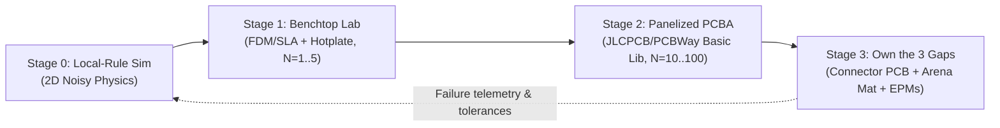

# DIY Supply Chain & V0.1 Self-Assembling Robot Blueprint

<Callout type="info">
  <strong>Honest frontier framing:</strong> There is still no off-the-shelf factory for programmable matter. Building your own supply chain today means outsourcing commodity electronics and shells to small-batch fabs while <strong>owning the three missing links in-house</strong>: hermaphroditic docking PCBs, contactless swarm charging, and local-rule validation.
</Callout>

<PubImg
  src="/images/v01-module-exploded.jpg"
  alt="Exploded industrial-design view of the V0.1 40mm self-assembling modular robot tile"
  caption="V0.1 40 mm × 40 mm × 20 mm module stack: chamfered top shell, ESP32-C3 ENIG mainboard, 1S LiPo pouch, dual N20 gearmotors, and four 90° hermaphroditic connector PCBs."
  credit="Concept render"
/>

## 1. The Micro-Supply Chain Loop

Skip "scale to millions" fantasies until you can build **10 reliable units** that dock, share power/data, and reconfigure on a tabletop. Treat your supply chain as a closed 4-stage loop:

### What You Outsource vs. What You Own

| Layer | Outsource To | Own In-House |
|---|---|---|
| **Compute & Sensing PCB** | [JLCPCB](https://jlcpcb.com/) / [PCBWay](https://www.pcbway.com/) SMT assembly (basic parts library) | [KiCad](https://www.kicad.org/) schematic, panelization, firmware |
| **Chassis / Shell** | [Craftcloud](https://craftcloud3d.com/) / [Protolabs](https://www.protolabs.com/) (MJF Nylon at N ≥ 20) | Home FDM/SLA prototyping & magnet-pocket tolerances |
| **Magnets & Actuators** | [K&J Magnetics](https://www.kjmagnetics.com/) (graded NdFeB), [Pololu](https://www.pololu.com/) (N20 motors) | Polarity fixtures & alignment jigs |
| **Docking Connector** | Fabbed as tiny 2-layer ENIG sub-PCBs | Hermaphroditic pad layout + V0.2 EPM coil winding |
| **Swarm Power** | Standard 1S LiPo + `BQ24075` / `TPS63020` ICs | Conductive charging arena mat or root-seed power bus |

---

## 2. V0.1 Hardware Specification (40 mm Magnetic Rover Tile)

The V0.1 module is a **40 mm × 40 mm × 20 mm** planar self-assembling tile—small enough to run a 20-unit swarm on a desk, large enough to use commodity parts without cleanroom [microfabrication](/supply-chain/microfab).

- **Brain & Telemetry:** `ESP32-C3-MINI-1` (RISC-V MCU; BLE/ESP-NOW for optional logging and target-shape broadcast, while local assembly rules run strictly over IR).
- **Locomotion:** 2× `N20` 6V micro metal gearmotors (300 RPM) driven by a dual H-bridge (`DRV8833`), providing differential steering and pushing torque for magnetic alignment.
- **Local Neighbor Sensing:** 4× perimeter IR emitter (`TSAL6100` / 0603 IR LED) + phototransistor pairs—one on each face—for short-range (~100 mm) bearing, hop-count gradient, and docked handshake.
- **Power:** 1S 3.7 V 300 mAh protected LiPo pouch cell + `BQ24075` power-path charger + `3.3 V` buck-boost regulator (`TPS63020`).
- **Docking & Interconnect:** 4× **hermaphroditic 90° castellated connector PCBs** soldered around the perimeter.

---

## 3. Hermaphroditic Connector PCB Spec (The #1 Bottleneck)

Custom mechanical latches wear out and jam at small scales. Turn the PCB fab into your precision connector manufacturer instead:

<PubImg
  src="/images/hermaphroditic-connector-closeup.jpg"
  alt="Macro view of two V0.1 modular robot tiles about to dock via hermaphroditic magnetic PCB faces"
  caption="Hermaphroditic faceplates: symmetric N/S neodymium cylinders, spring-loaded gold pogo pins meeting concentric ENIG pads, recessed IR window, and 45° chamfered guide walls."
  credit="Concept render"
/>

### Mechanical & Magnetic Geometry
- **Board dimensions:** `34 mm × 14 mm`, `1.6 mm` FR-4, **ENIG (Electroless Nickel Immersion Gold)** finish for low-resistance sliding contact.
- **Rotational Symmetry (Hermaphroditic):** Any face mates with any other face:
  - **Left pocket (`x = -11 mm`):** `3 mm × 3 mm` N52 neodymium cylinder, **North pole outward**.
  - **Right pocket (`x = +11 mm`):** `3 mm × 3 mm` N52 neodymium cylinder, **South pole outward**.
  - Head-on contact always aligns Left (`N`) with Right (`S`) for passive self-centering attraction.
- **Chamfered Guide Shroud:** 3D-printed `45°` lead-in chamfers (`1.5 mm` depth) absorb up to `±2.5 mm` lateral misalignment before magnetic snap.

### Electrical Pinout (3-Contact Symmetric Bus)

| Position | Contact Element | Signal | Protection |
|---|---|---|---|
| **Center (`x = 0 mm`)** | Spring pogo pin (`Mill-Max 0906` or `P50-B1`) + concentric ENIG ring | `VBUS` (+5 V power-share rail) | Ideal diode (`LM66100`) prevents back-feed/shorts |
| **Inner Pair (`x = ±4 mm`)** | Left pogo pin / Right flat ENIG landing pad (tied together) | `1-Wire / Half-Duplex UART` | `100 Ω` series resistor + ESD diode |
| **Outer Pair (`x = ±7.5 mm`)** | Left pogo pin / Right flat ENIG landing pad (tied together) | `GND` | Common ground reference |

<Callout type="default">
  <strong>V0.2 Upgrade Path — Electro-Permanent Magnets (EPMs):</strong> Permanent magnets make docking effortless but undocking hard. For active reconfiguration, replace the two permanent cylinders with compact EPM cores (N52 NdFeB + AlNiCo 5 rod + 40 turns of 32 AWG magnet wire pulsed for 200 µs via a <code>DRV8833</code>). Zero holding power, software-triggered release.
</Callout>

---

## 4. V0.1 Bill of Materials (N=10 vs. N=100)

| Subsystem | Part / Spec | Vendor | Unit Cost (N=10) | Unit Cost (N=100) |
|---|---|---|---:|---:|
| **Main PCB + SMT** | 4-layer 38×38 mm ENIG + `ESP32-C3` + `DRV8833` + `TPS63020` + passives | JLCPCB / PCBWay | $11.50 | $5.20 |
| **4× Connector PCBs** | Panelized 2-layer ENIG + 4× IR LED/photodiode + ESD | JLCPCB | $3.60 | $1.10 |
| **Pogo Pins** | 12× spring-loaded pogo pins (3 per face) | Digi-Key / LCSC | $3.00 | $1.20 |
| **Magnets** | 8× `D22-N52` (3×3 mm graded NdFeB cylinders) | K&J Magnetics | $2.40 | $1.40 |
| **Motors + Wheels** | 2× N20 6V 300RPM micro gearmotors + silicone tires | Pololu / AliExpress | $7.00 | $3.20 |
| **Battery** | 1S 3.7V 300mAh LiPo w/ PCM protection | Digi-Key / MakerFocus | $4.50 | $2.10 |
| **Chassis** | 2-part chamfered shell (FDM PLA at N=10 / MJF Nylon at N=100) | In-house / Craftcloud | $2.00 | $2.80 |
| **Total per Robot** | | | **~$34.00** | **~$17.00** |

Budget ~$120 one-time for the conductive charging arena mat (copper foil tape strips + 5 V / 10 A bench supply) and ~$40 for a 3D-printed magnet-polarity assembly jig (one reversed magnet breaks a module).

---

## 5. Interactive Local-Rule Simulator

Before ordering PCBs, stress-test local rules against realistic motor drift, IR packet drops, and dead modules. Click any robot in the arena below to inject or clear a live hardware fault, or fire the **EPM Undock Pulse** to trigger reconfiguration:

<SimFrame
  src="/sim/v01-swarm.html"
  title="V0.1 Local-Rule Self-Assembly Simulator (40 mm magnetic rover tiles)"
  height={680}
/>

<PubImg
  src="/images/swarm-tabletop-supply-chain.jpg"
  alt="Tabletop self-assembling robot swarm forming a T-bridge on a conductive charging mat next to a desktop micro-factory"
  caption="Target benchtop setup: 15+ modular tiles assembling on a copper-bus conductive mat alongside panelized PCBs, magnet wire, and a desktop 3D printer."
  credit="Concept render"
/>

---

## 6. First 30-Day Execution Checklist

- **Week 1:** Run the simulator above across all 6 morphologies with `15%` motor noise and `10%` dead modules until convergence exceeds `90%`.
- **Week 2:** 3D-print 4 passive magnetic test shells; dial in press-fit magnet-pocket tolerances and `45°` chamfer self-alignment.
- **Week 3:** Layout the KiCad mainboard + 90° hermaphroditic connector panel; order a 10-unit SMT batch using JLCPCB basic parts.
- **Week 4:** Assemble 10 units using a polarity jig, verify root-to-leaf `VBUS` continuity across a docked 10-unit T-bridge, and feed real failure modes back into the simulator.
