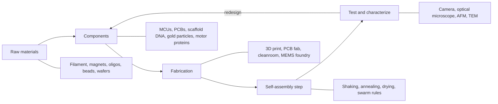

# Supply chain: sourcing what it takes to build self-assembly systems

Every digest on this site describes something someone built: a swarm of robots, a DNA origami tube, a film of nanoparticles. This section asks the next question: **where would you get the parts, tools, and services to build it yourself, now and as the field grows up?**

<Callout type="warning" emoji="⚗️">
**Honest framing.** There is no store where you can buy "programmable matter". Most of what the digests describe is lab-scale. What *does* exist is a patchwork: hobby electronics, research reagent catalogs, shared university facilities, and prototype foundries. You can source a lot today. You can't buy self-assembling products at industrial scale yet.
</Callout>

## The supply chain map

Every self-assembly system, from a magnet-tile kit to a DNA nanodevice, moves through the same five stages.

The loop back from **test** to **components** is the important part. Self-assembly is rarely right the first time, so cheap and fast iteration matters more than any single supplier.

## Maturity at a glance

| Domain | What you can source today | Maturity | Biggest gap |
|---|---|---|---|
| [Modular and swarm robots](/supply-chain/robots) | MCUs, motors, magnets, PCBs and flex PCBs, 3D printing | **Hobbyist** to **industrial** for parts. Self-assembling robot products: **not yet available** | Reliable, cheap, tiny connectors and power |
| [DNA nanotech](/supply-chain/dna) | Custom oligos, scaffold strands, free design tools | **University-lab** | Cost per structure and scale-up of production |
| [Colloids and nanoparticles](/supply-chain/colloids) | Gold, silica, and polystyrene particles, Janus microspheres | **University-lab** to **industrial** for plain particles | Patchy or programmable particles are mostly made in-house |
| [Active matter](/supply-chain/active-matter) | Tubulin and kinesin proteins, Janus particles | **University-lab** | No turnkey "active fluid" kit. Proteins are costly and fragile |
| [Microfab and patterned substrates](/supply-chain/microfab) | Shared cleanrooms, MEMS multi-project wafers, microfluidic chips | **University-lab** to **industrial** | Lead times of months, and design-rule expertise |
| [Characterization](/supply-chain/characterization) | Shared microscopy facilities, national user facilities | **University-lab** | Access needs a sponsor or a proposal |
| [Lab basics](/supply-chain/lab-basics) | Education suppliers, general lab catalogs | **Hobbyist** to **university-lab** | Many reagents ship only to institutions |

Maturity key: **hobbyist** means anyone can buy and use it at home with care. **University-lab** means you need an institution, a mentor, or a shared facility. **Industrial** means a mature commercial supply exists for the general category. **Not yet available** means only research prototypes exist.

## What would need to exist for scale-up

1. **Standard parts.** Electronics took off when resistors and chips came in standard sizes. Self-assembly needs standard connectors, standard DNA "handles", and standard particle chemistries that different labs can mix.
2. **Cheaper molecules.** Oligo pools and enzymatic or biological production of DNA strands are lowering cost, but DNA origami in bulk is still a research problem.
3. **Error-tolerant designs.** Real factories accept some defects. Self-assembly designs that tolerate missing or wrong parts are easier to manufacture.
4. **Measurement at speed.** Today, checking whether something assembled right often needs an electron microscope. Fast, cheap quality checks are a missing link.
5. **Clear rules.** Nanomaterials, engineered biology, and robots all carry safety and export rules. A mature supply chain needs those rules to be understood early. See [Safety and regulation](/supply-chain/safety).

## Where to go next

- **[Start sourcing today](/supply-chain/start-sourcing)**: a step-by-step path for a student, club, or tiny startup.
- **[Example starter BOMs](/supply-chain/starter-boms)**: three costed-by-category shopping lists to adapt.
- **[Manufacturing](/manufacturing)**: how people turn a prototype into a small batch.

<Callout type="info">
Vendors named in this section are examples we checked exist and sell the item category. They are not endorsements, and we don't list prices because they change. Always get a quote and check shipping rules for your country.
</Callout>
