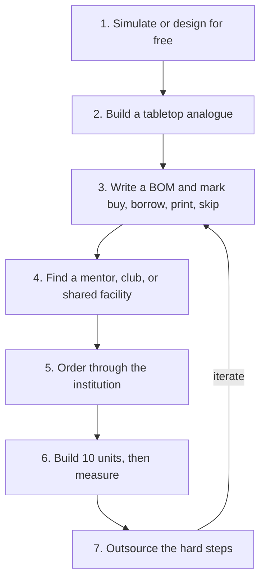

# Start sourcing today: a path for students and tiny startups

You don't need a factory to start. You need a **design you can test cheaply, a mentor or facility, and a bill of materials**. Here is a realistic path.

## Step by step

1. **Simulate or design first, for free.** Use [caDNAno](https://cadnano.org/) or [scadnano](https://scadnano.org/) for DNA, the [oxDNA web server](https://oxdna.org/) to check a design, [nanoHUB](https://nanohub.org/) for simulations, and [KiCad](https://www.kicad.org/) or [FreeCAD](https://www.freecad.org/) for hardware.
2. **Build a tabletop analogue.** Magnet tiles, bristlebots, floating capillary tiles, and pipe-cleaner bundles teach the same ideas as the lab versions. See [Experiments](/experiments).
3. **Write a bill of materials (BOM).** One row per part: quantity, vendor link, lead time, hazard note. Mark each row **buy / borrow / print / skip**. See the [starter BOMs](/supply-chain/starter-boms).
4. **Find access, not equipment.** A school teacher, university outreach office, makerspace, or community lab can open doors. US students and startups can look at [NNCI sites](https://www.nnci.net/), which serve outside users.
5. **Order through the institution.** Research reagents (oligos, proteins, nanoparticles) usually ship only to a lab address with a responsible person.
6. **Build ten, not a thousand.** Make ten reliable units and measure how often they assemble correctly before you scale.
7. **Outsource the hard steps.** PCB fabs, 3D printing services, MPW foundry runs, and shared microscopes let a tiny team act like a big one.

## Which domain should you start in?

| If you have... | Start with | Why |
|---|---|---|
| A 3D printer and a soldering iron | [Modular and swarm robots](/supply-chain/robots) | Every part is hobbyist-available |
| A laptop only | [DNA nanotech](/supply-chain/dna) design | Design tools are free |
| A school lab with a microscope | [Colloids](/supply-chain/colloids) and [active matter](/supply-chain/active-matter) analogues | Optical microscopy works above 1 µm |
| A university mentor | Any domain, plus [characterization access](/supply-chain/characterization) | Unlocks reagents and facilities |

## For a startup

- Your first customers will mostly be **other labs**: designs, reagents, kits, software, and services, not finished self-assembling products.
- Budget for **lead time** (weeks for oligos and PCBs, months for MPW runs) as carefully as for money.
- Expect suppliers and regulators to ask about **safety and end use**. Read [Safety and regulation](/supply-chain/safety) early.
