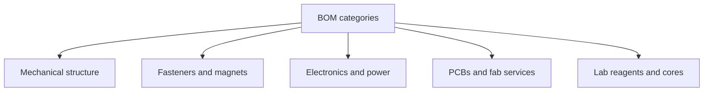

# Example starter BOMs

A **bill of materials (BOM)** lists every part, quantity, vendor, and lead time. Even a toy module deserves one. These examples are starting points to adapt. We don't list prices, because they change. Get current quotes.

| Category | Examples | Starter sources |
|---|---|---|
| Mechanical structure | 3D-print filament, acrylic, plywood | Makerspace, [Craftcloud](https://craftcloud3d.com/) |
| Fasteners | M2/M3 screws, heat-set inserts | [McMaster-Carr](https://www.mcmaster.com/), local hardware |
| Magnets | Neodymium discs or blocks of known grade | [K&J Magnetics](https://www.kjmagnetics.com/) |
| Electronics | MCU boards, motors, IR LEDs, sensors | [Mouser](https://www.mouser.com/), [Adafruit](https://www.adafruit.com/), [SparkFun](https://www.sparkfun.com/), [Pololu](https://www.pololu.com/) |
| PCBs | Custom rigid or flex boards | [JLCPCB](https://jlcpcb.com/), [PCBWay](https://www.pcbway.com/), [OSH Park](https://oshpark.com/) |
| Lab reagents (supervised) | Buffers, oligos | Through a school or university, see [DNA nanotech](/supply-chain/dna) |

## A. Magnetic tile kit (10 tiles)

- PLA filament (about 100 g)
- 40 neodymium disc magnets, press-fit size matched to your CAD
- CA glue or epoxy (use with ventilation)
- Optional acrylic base tray
- Notebook and phone camera for data

## B. Three ESP32 "swarmlets"

- 3 ESP32 development boards
- 3 vibration motors or continuous-rotation servos
- Protected battery packs and a proper charger
- Jumper wires, headers, IR or bump sensors
- 3D-printed chassis

The software (local rules, communication) is the hard part, not the parts.

## C. Design-only DNA origami

- [caDNAno](https://cadnano.org/) or [scadnano](https://scadnano.org/)
- [oxDNA web server](https://oxdna.org/) to simulate the design
- The Rothemund 2006 paper ([author PDF](https://www.dna.caltech.edu/Papers/DNAorigami-nature.pdf))

Cost: mostly time. Wet-lab work adds vendor and facility costs under supervision.

## What is hard to buy (plan around it)

| Hard item | Why | Starter workaround |
|---|---|---|
| Custom chips (ASICs) | Huge one-time cost | Use commodity microcontrollers |
| Exotic nanomaterials | Purity, handling, sometimes export rules | Start with macro demos and suspended particles |
| Research-only modular robots | Not retail products | Simulate, or build simple magnetic modules |
| Bulk DNA origami | Not a routine commodity | Design-only, plus literature study |
| Zero-defect connectors | Physics and wear | Design for error tolerance (a swarm lesson) |

## Open designs to start from

- Classroom capillary and floating-tile projects ([FloaTiles](https://github.com/karegeo/floatiles), [UCSD MRSEC activities](https://mrsec.ucsd.edu/experimental-self-assembly/))
- Modular robot papers that release CAD in their supplements
- Kilobot documentation via [Harvard SSR](https://ssr.seas.harvard.edu/kilobots)
- Claytronics and programmable-matter papers for mechanism ideas ([CMU hub](http://www.cs.cmu.edu/~claytronics/index.html)). This is a vision, not a store.

## Watch: what electronics manufacturing looks like

PCB factories are real. Programmable-matter factories aren't, yet.

<YouTube id="ljOoGyCso8s" title="Inside a Huge PCB Factory — Strange Parts" />

## Try this (BOM exercise)

1. Pick Exp 7 from [Experiments](/experiments) or a 5-module magnet chain.
2. Make a spreadsheet with part, quantity, vendor link, lead time, and hazard note.
3. Mark each line **buy / borrow / print / skip**.
4. Share the BOM with a mentor before ordering magnets or batteries.
